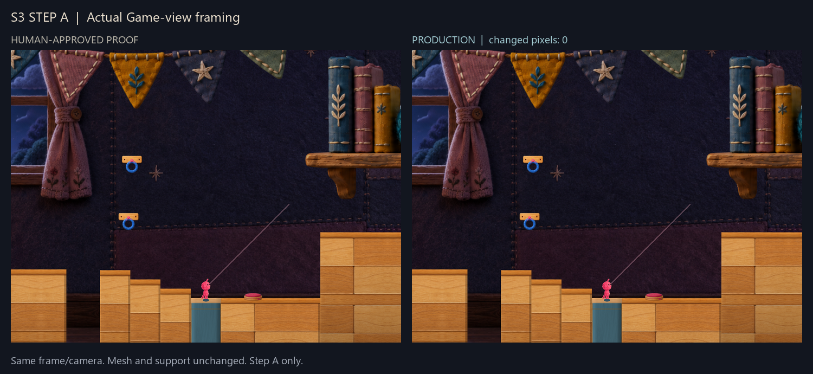
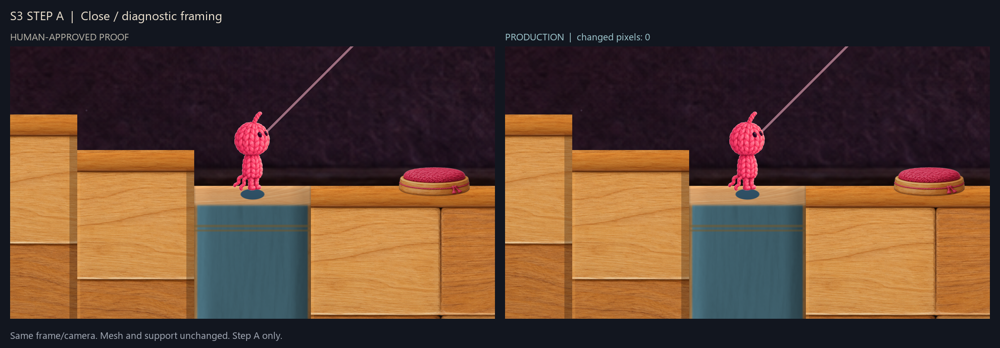

# Approved reference / Production identity

Run02 renders the archived approved pencil reference and Production synchronously,
without an intervening gameplay tick. Position, zoom, aspect and Player pose are
identical for each pair. The diagnostic observer handles visibility only for these
captures; Production has no comparison feature.

Five pairs are pixel-identical and PNG byte-identical:

- Actual Game-view: 1440 x 1080, real Camera framing/aspect.
- Close: 1920 x 1080, explicitly diagnostic framing.
- Surroundings: 1920 x 1080, explicitly diagnostic framing.
- Full object: 600 x 1800, explicitly diagnostic framing.
- Unobstructed wood end: 1920 x 1080, explicitly diagnostic framing.

The comparison sheets preserve aspect and contain no retouched/generated scene
content. World-camera captures omit overlay UI. They are not whole desktop or
Human-keyboard screenshots.

Codex inspected actual Game-view, near and full-object sheets before stage.
There is no observed visual mismatch, new decoration or material adjustment.
The simple blue side accepted by Human remains as approved.

Mesh/UV equality provides an additional check against concealing differences by
capturing an empty floor. The screenshots visibly contain the target pencil.
Equality to an old screenshot taken at another animation time is not claimed.
