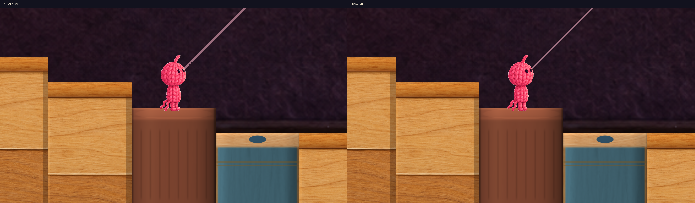

# S3 Return Step B Production integration

Human採用済みの「キャップ付き太軸フェルトペン」を、MainStageのS3 Return Step B **1床だけ**へ正式移植しました。採用判断は今回のHuman個別指示です。他床への展開は行いません。

Productionの追加は `MainS3MarkerVisual.cs`、`MainS3Marker.shader` と対応metaの4ファイルです。承認済みProofのメッシュ・色・模様・上面を維持し、比較切替を除いてMainStage限定の起動処理を追加しました。Sceneの保存や既存Sourceの変更はありません。

Unity 6000.3.21f1の隔離Editor Play最終Run04は**66項目PASS、FAIL 0、Gameplay Error 0**。対象21床の一意性と非対象20床の件数も検査しています。採用Proofと本番版の同時点・同画角比較5組はすべて**0ピクセル差**です。既存のUnityEditor.Search初期化例外1件は別扱いで記録しています。Editor Console全体がエラー0という判定ではありません。

- [実装と対象](01_Integration.md)
- [回帰と診断履歴](02_Regression.md)
- [画像確認](03_VisualReview.md)
- [保護と保存範囲](04_ProtectionAndGit.md)
- [Human採用記録と最終判断](05_FinalDecision.md)

比較画像の左が採用Proof、右が本番版です。画像はUnityの実Scene描画で、実カメラを変更せず描画専用カメラで保存しています。OnGUI HUDは写りません。通常画角は実測4:3を保持し、拡大・全高画像は診断専用画角です。

