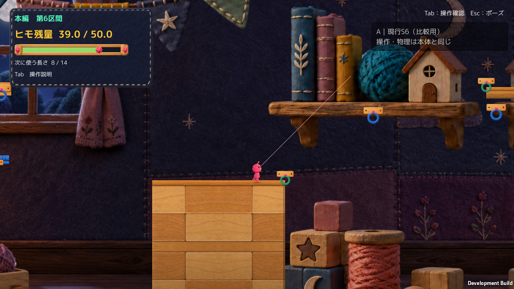
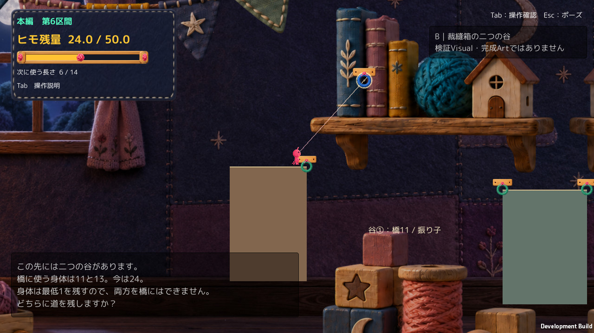
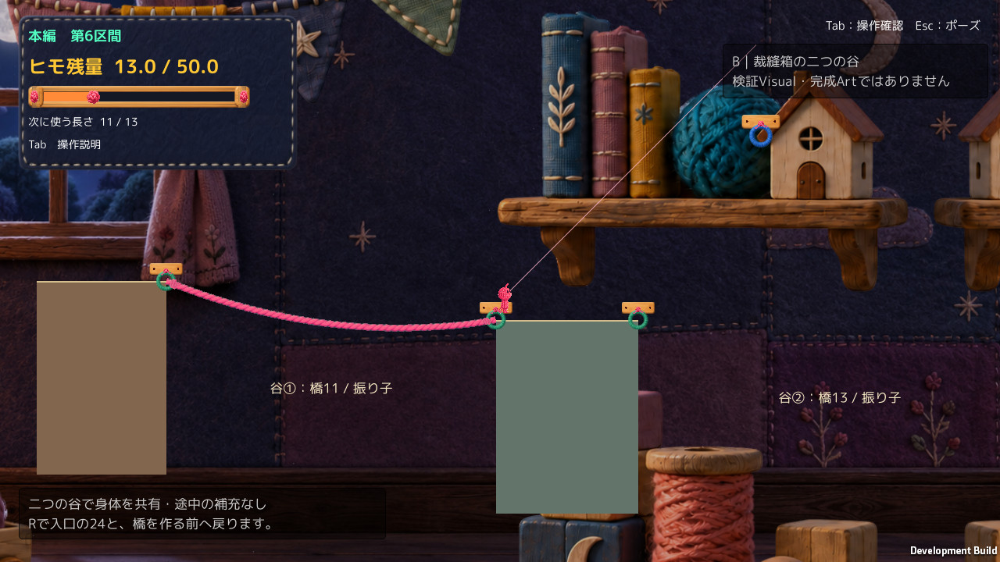
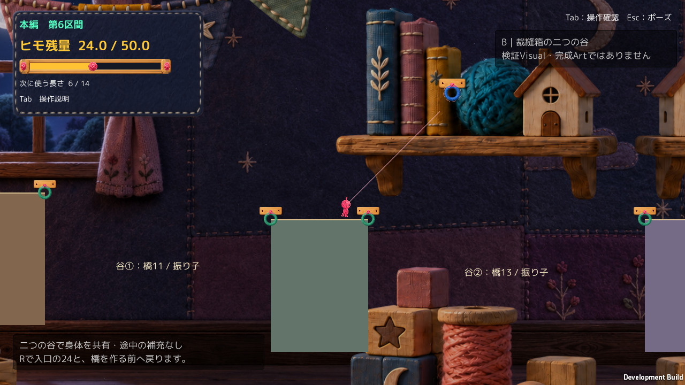
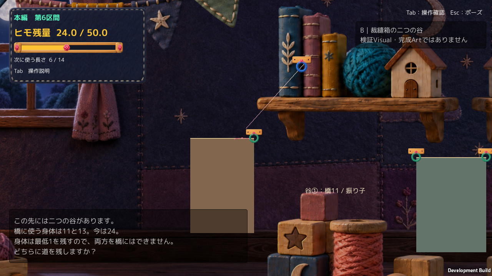
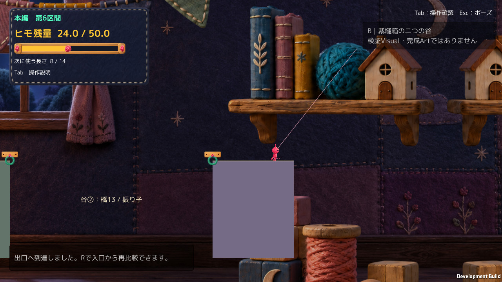

# ヒモヒト A2 r1：GitHubレビュー共有・本人実キー試遊

更新：2026-10-16T18:16:43.029927+09:00（Asia/Tokyo）。Review ID：`A2-20261016T181643_JST`。

結論：**Technicalは既存記録でPASS、Gameplay設計の採用推奨はHOLD、Visualは検証用、Human実キーは経験者1名の部分確認。正式採用・Production統合は未承認。**

## 1. 対象と今回行ったこと

- Proof：A2TwoValleysProof_20261016、revision r1。A＝現行S6比較fixture、B＝裁縫箱の二つの谷。
- 参照Production HEAD：`7a4f011b7ffc0343acd4727a75255495a3881fb3`。当時から存在するdirty差分を含む作業本体を参照し、clean HEADだけの再現性とは主張しない。
- exe SHA256：`A3D4FA240C51333301EFCC16714FF60722F00E803AFE1FB6750EC963CC0F1707`。
- Assembly-CSharp.dll SHA256：`64165E3DD098255540FC5BDFD2F32D407F1BF5B9E916BE569D71579640B4A8E3`。
- [Build identity](qa/BuildIdentity.json)：FrozenBuildの231件全てをサイズ・SHAで照合一致。Build・Unity起動・自動入力・配置変更は今回実行していない。
- 今回の変更はこのレビュー資料のみ。元資料・Build・Productionの既存差分は維持。

## 2. 評価を混ぜない

| 観点 | 判定 | 根拠・限界 |
|---|---|---|
| Technical | 既存試験PASS | Windows A 11/11、B 41/41、Compile/Build成功。今回再試験なし |
| Gameplay | HOLD | 3攻略はAPI入力で成立。資源判断が面白くなったかは別。本人は事前の両橋不可を理解していなかった |
| Visual | 検証用・最終Art未審査 | 元の高品質背景とGraybox床が同居。自然な生活用品地形の完成を主張しない |
| Human実キー | 1名・部分確認 | 両振り子で出口到達、復帰状態と橋①試行を記録。経験者で、初見理解・3攻略通しのPASSではない |

## 3. 3攻略・資源・復帰（自動入力/API）

| 攻略 | 技術結果 | 消費 | 残量 | 測定ルート時間 |
|---|---|---:|---:|---:|
| 橋①→振り子② | PASS | 11 | 13 | 5.38秒 |
| 振り子①→橋② | PASS | 13 | 11 | 5.14秒 |
| 両振り子 | PASS | 0 | 24 | 4.86秒 |
| 両橋（2本目拒否） | PASS | 11 | 13 | 3.02秒 |

時刻はゲーム内APIルート試験区間のみ。観察・思考・Human試行時間ではない。橋①11、橋②13、身体最低1の既存ルールなので24では両橋不可。途中補充なし、中床・出口CPなし。

[Windows A全結果](qa/Windows_A.json)／[Windows B全結果](qa/Windows_B.json)／[必要ログ抜粋](qa/ImportantLogExtract.txt)。BのRは常に入口24・選択長6・橋なし。AはCP7到達後、Rでは入口に戻らないので初めからの比較はA再起動。仕様差は不具合ではない。

## 4. 本人実キー結果

[本人発言・実行記録](human/HumanResults.md)／[構造化結果](human/HumanResults.json)。実施人数1名、B。操作者について「はい」。

> 下の文字を読んで何となくでやってた。両端不可というのは二本目生成しようとしたときに気が付いた。振り子の楽しさは正直なんどもプレイしているのであまり感じなかった

初回出口はゲーム時刻約64.82秒、残量24・橋0。以後入口復帰と橋①→中床の記録がある。両橋不可の事前理解は本人申告上未達。経験者の感想を一般化しない。自由試遊と補助説明後の別経路試験を混ぜない。後者は未実施。

## 5. 注意する三問題

1. **選択の偏り**：橋①は橋②より2安く、残す振り子②の局所成功サンプル時刻幅も広い。逆順の選択理由は未確認。人数を均等化する目標ではない。
2. **谷①着地余裕**：身体全体が収まる成功3点のサンプル時刻差は0.12秒。連続成功区間/人間成功率ではない。本人の厳しさ・納得感の評価は未確認。詳細は[解析抜粋](qa/AnalysisExtract.json)。
3. **考えた実感**：本人は「何となく」で操作。観察→選択→失敗からの変更が増えたという証拠はまだない。

## 6. 変更履歴・ソース・保護

[地形変更履歴](GeometryHistory.txt)：r0からr1への調整は1回/上限2回。中床幅3.5→4.4、2谷目を+0.6平行移動、橋最小11/13維持。Hook Collider初期化の診断訂正は地形再設計とは区別し、無効な試験を成功に数えていない。

[隔離Proofのソース差分](qa/SourceDiff.txt)／[当時のProduction保護](qa/ProductionProtection_Historical.json)。元Runtime119件、全C#128件、Input/Physics2D/Time不変。隔離環境にはPackage/ProjectSettingsのBuild用差分があるため、全設定byte同一とは言わない。

既存Editor Search起動例外は記録済み。Windows Gameplay Error 0とEditor Console全件0を混同しない。今回Productionのbranch/HEAD/index/既存dirtyファイル/通常の未追跡要約の同一性を確認して共有する。mainへのcommit/push/mergeはしない。

## 7. 画像とR証拠の欠落

以下は**表示用JPEGプレビュー**。元PNGをローカル保持、全画角・同寸法、再圧縮のみ。画像生成・描き足しなし。[元画像SHAと由来](qa/ImageProvenance.json)。自動QA画像と本人画像を明示した。

R復帰直後の画像は元資料に存在せず未収録。[R証拠の範囲](qa/RetryEvidence.md)。初期入口やR直前画像をR後画像として扱っていない。

### A：現行S6比較fixtureの入口。自動QA実Unity画面。

### B：入口初期状態。復帰後の画像ではない。自動QA実Unity画面。

### B：橋①通過後の中床。自動QA実Unity画面。

### B：振り子①の代表着地。自動QA実Unity画面。

### B：振り子②の代表着地。自動QA実Unity画面。

### B：橋②通過後。自動QA実Unity画面。

### B：両橋の2本目拒否。自動QA実Unity画面。

### B：R復帰テストの直前。復帰後の画像ではない。

### B：本人実キーセッションの出口到達。残量24・橋0本。

## 8. 次に最も効果が高い変更候補（1件だけ・未実装）

**最初のQ前に「二つの谷と、必要な橋24＋身体最低1」を一度に把握できる入口の情報提示を1点改善する。** 正解の橋位置は教えず、既存の入口案内の視認性・数値の読み取りを優先してHumanと再検討する。今回UI・配置は変更しない。谷①着地や橋コスト等の追加変更を同時に進めない。

## 9. Humanの次の操作

既存の通過はやり直さなくてよい。まず未回答の「橋を選ぶ理由・失敗の納得感・再プレイ意欲・背景棚の誤認」を口頭/このチャットで補足する。追加試遊を希望したときだけ既存A/Bランチャーを一方ずつ使う。[基本操作・観察手順](ManualProtocol.md)は正解ルートを含まない。

正式採用は未承認、推奨HOLD。今回のGitHub共有許可はProduction統合許可ではない。
