# 主人公の質感・振り子・着地の演出Proof — 候補1

更新：2026-10-17T00:00:45.151839+09:00（Asia/Tokyo）。**Human Visual Review待ち。正式採用・Production統合なし。**

今回の主題は地形の修正ではなく、接続後から移動再開までの主人公の表現。A2 r1の地形を同条件撮影に借用しただけで、A2 r1の不採用推奨は維持する。新ワールド制作や谷①の床幅変更はしていない。

## 最初に見る比較

左が現行、右が候補。元の通常画角をそのまま左右に配置したもの。

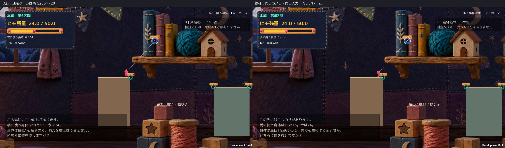

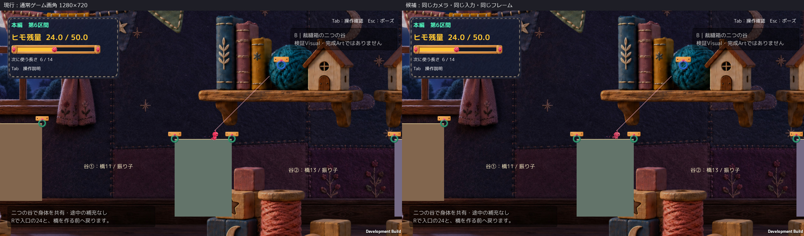

[左右比較の通常速度動画](Videos/SideBySide_30fps_silent.mp4)／[現行](Videos/Current_30fps_silent.mp4)／[候補](Videos/Candidate_30fps_silent.mp4)。動画は無音。実ゲーム音の録音ではなく、音質・音量の実聴は未確認。

同じBuild、地形、背景、Camera、1280×720、30fpsのオフライン撮影クロックを使用。自動入力と既存APIで約5.77秒の連続を撮影しており、Human実キー試遊ではない。30fpsの再生はゲーム内時間と同じ速さ。通常動作時のFPSや入力の手応えを測った試験ではない。

## 一続きの動き

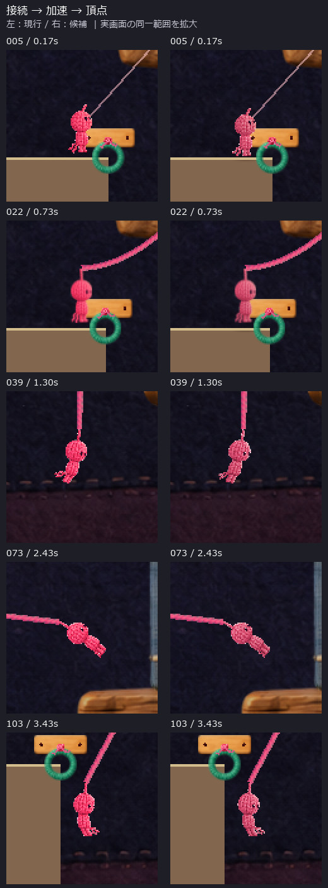

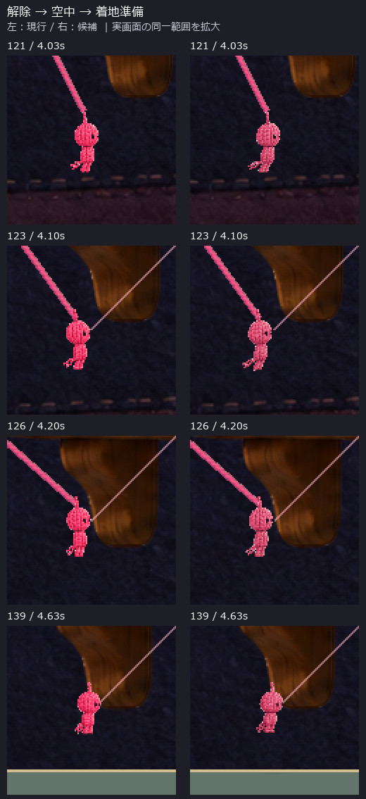

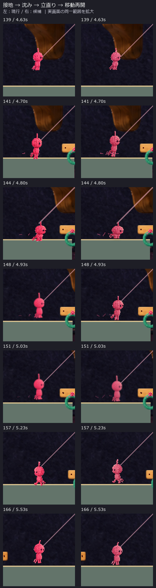

これらは通常画面の同じ範囲を拡大した比較シート。ラベルは画像外。元の全画面連続コマは[Frames](Frames/)にある。生成画像や動きの描き足しは使っていない。

## 毛糸の質感・足元

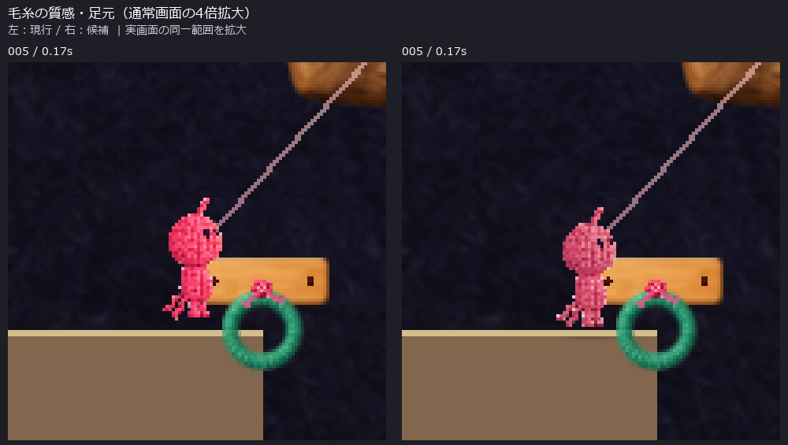

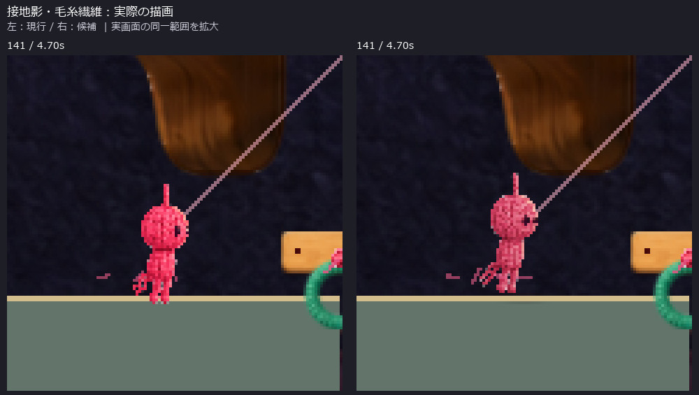

拡大は実ゲーム画素のnearest拡大で、新しい高解像度原画ではない。頭・身体の基本シルエットとピンクの識別色を保持し、毛糸絵の明暗を調整。影は床へ表示判定を追加した既存影で、別の影を重複追加していない。

## 採用基準5点：確認できる事実とHuman判断

| 観点 | 候補で変えたこと・証拠 | Human判断 |
|---|---|---|
| 背景と同じ世界の毛糸人形 | 元絵を保持し、ピンクの彩度・明暗を選択調整。通常画角/拡大を比較 | 未確認 |
| 振り子の力み・勢い・姿勢差 | 実速度に応じた6姿勢と遅れ。頂点付近を含む連続コマ | 未確認 |
| 解除から着地の連続性 | 既存解除演出を保持し、空中の備え→既存膝曲げ→回復へ接続 | 未確認 |
| 着地の柔らかさ | 衝撃に応じた回復時間、足先登録、影と繊維の実描画 | 手応え・気持ちよさは未確認 |
| 操作対象と足元の可読性 | ピンクを維持し、足先/床の表示上の位置を合わせた。左右反転・移動再開のコマあり | 未確認 |

演出数やQA件数を、この5点の品質PASSとは扱わない。[既存演出の監査](Audit.md)／[短い実装説明](Implementation.md)。

## 不変性と回帰確認

- 現行/候補173フレームでRoot位置・速度・Camera位置の最大差はすべて **0**。接地/接続状態・残量・選択長・橋数・固定時刻も一致。
- 地形/Hook/ColliderのLayout、Physics設定・Joint値のConfigも一致。Cameraのズーム・追従・揺れは変更なし。
- 描画ヒモ始点とRopeBodyVisual冠点の座標差は両版とも最大0。実際の接合部は解除前後の拡大コマで比較できる。
- 候補の接地中・未接続時の不透明足先マーカーとCollider上面の最大差は約 **1.2e-07 world units**。これは表示位置の計測であり、着地の気持ちよさや到達性改善の判定ではない。
- 影が画面内で描画されたフレーム：現行0、候補66。粒子Rendererの可視フレーム：現行18、候補18。実画像も上記に添付。
- 解除音・着地音は既存PlayOneShot発火を記録。着地音のマーカーと接地イベントは同一記録フレーム。音は追加・置換していない。実聴評価ではない。
- R復帰、入口24・選択長6・橋なし、復帰後の表示、静止状態のscaled-timeポーズ、左右歩行/反転、橋生成/編み表示を確認。
- 既存S9へ診断用に位置をセットして2橋生成・F統合・中央Hook消失・残量維持・統合表示を確認。これはA2からの通し攻略・Humanキー操作ではない。
- 最終Windows Build：成功、エラー0・警告0。PlayのGameplay Error 0。初期Editorの既存Search例外は別に記録し、Editor Console全件0とは主張しない。

[比較計測](QA/Comparison.json)／[現行実行記録](QA/Current_Result.json)／[候補実行記録](QA/Candidate_Result.json)／[統合回帰](QA/MergeRegression.json)／[必要ログ](QA/ImportantLogExtract.txt)／[Build識別](QA/BuildIdentity.json)。

### 復帰・ポーズ・橋・統合の実画面

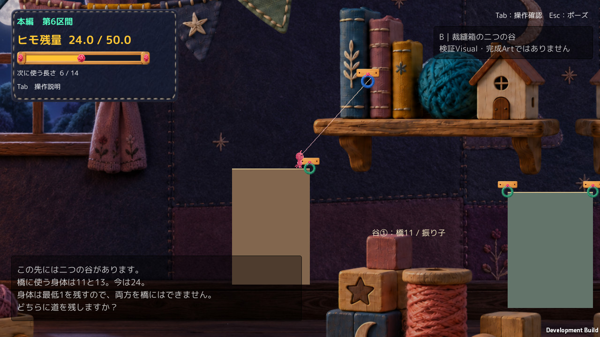

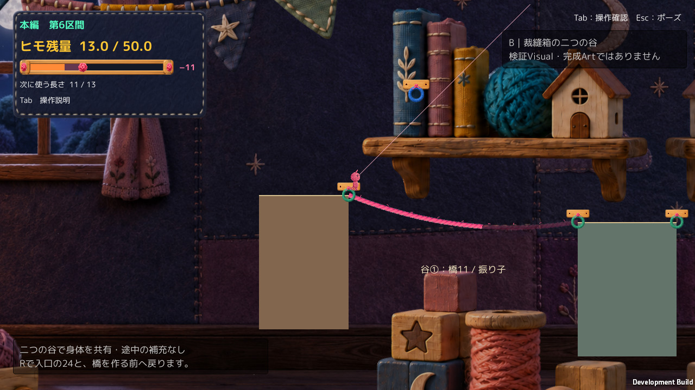

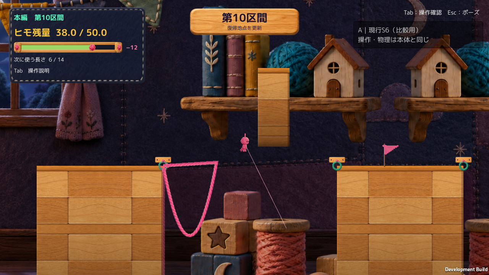

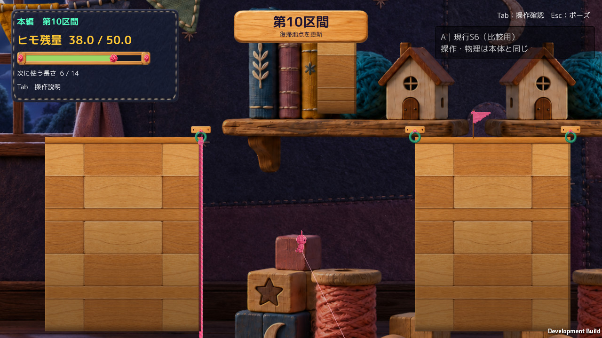

## 保護・共有範囲

Productionは読み取りのみ。凍結A2 r1、過去Evidence、元画像、BGM、既存dirty差分を保持。禁止された5 SourceはSHA一致、元Art/Scene/設定とCameraコードも隔離コピー内で変更なし。今回のSource変更は表示/音の診断マーカーに限定。[保護確認](QA/Protection.json)／[禁止5 Source](QA/LockedSources.json)／[差分](CodeDiff.md)。

GitHubへ共有するのはレビュー資料・通常画像・必要QA・隔離コード差分のみ。Build/Unity Project/Library/BGM/巨大な全ログは追加しない。画像の元PNGはローカル保持。[画像由来とSHA](QA/ImageManifest.json)。

短い比較動画も通常のGitファイルとして保存する。このrun内の `.gitattributes` だけで動画へのLFSフィルタを外し、Productionやリポジトリ全体の設定は変更しない。

## 未確認・次のHuman Review

- 候補の実キー操作・手応え・面白さは未確認。以前のA2の本人評価を候補へ流用しない。
- Escメニューを実キーで開閉する試験、振り子/着地途中のポーズ、全Tutorial・MainStage通しは未実施。
- 音の実聴、通常操作時の性能、細部が映像以上に自然かは未確認。
- このProofの着地成功はA2 r1への正式採用や、不採用理由の解消を意味しない。

Humanには同じr1の再試遊を要求しない。まず上の通常画角・動画・連続コマで、1案の方向性だけを判断してもらう。正式採用・Production統合・他区間展開はせず、ここで停止する。
