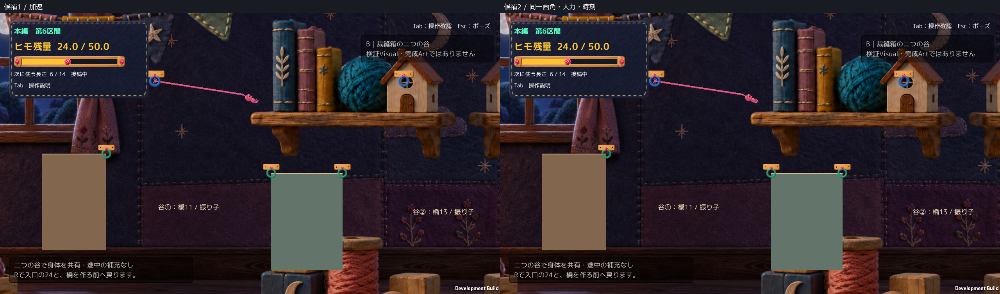
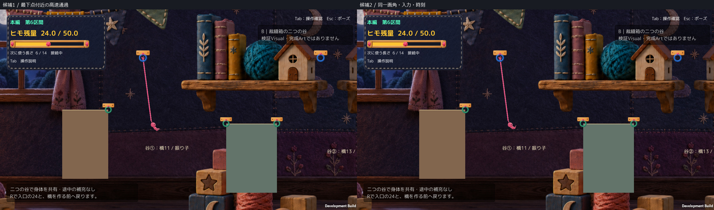
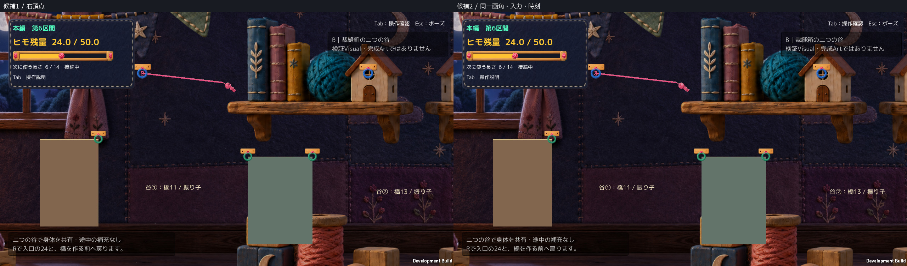
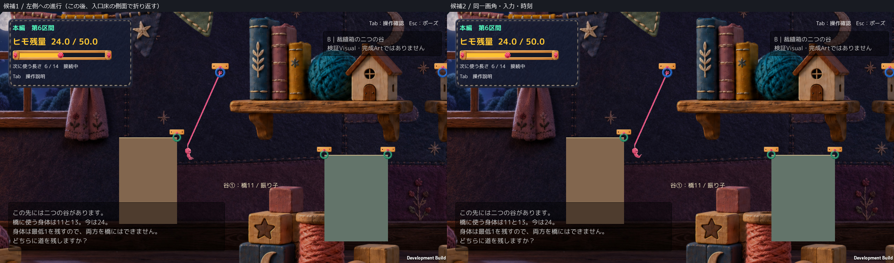
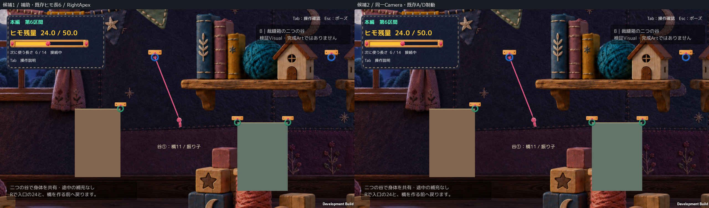
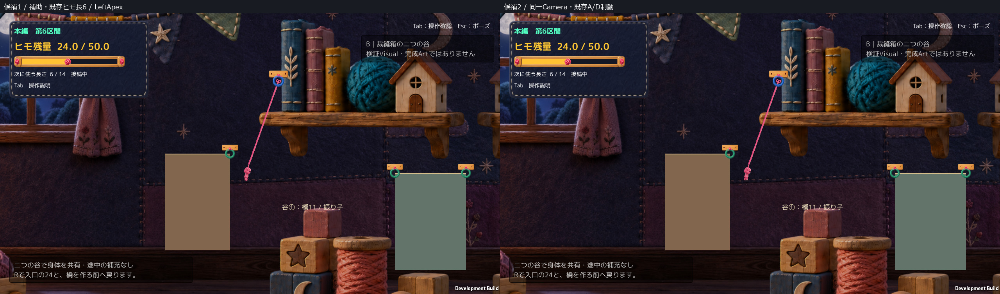
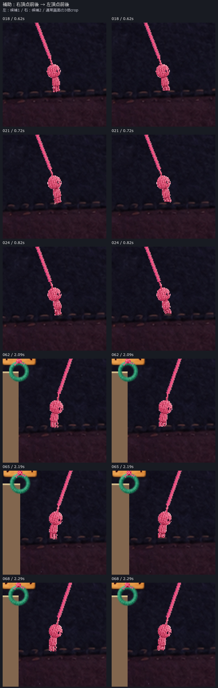
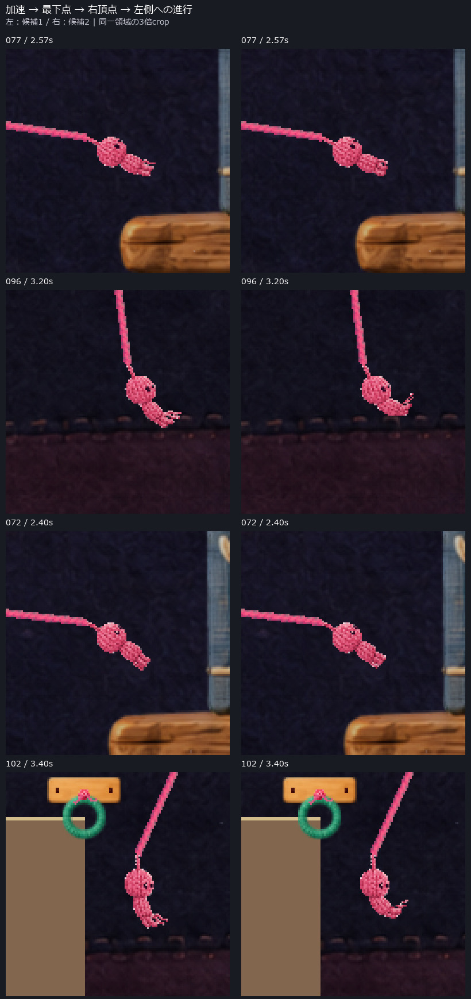
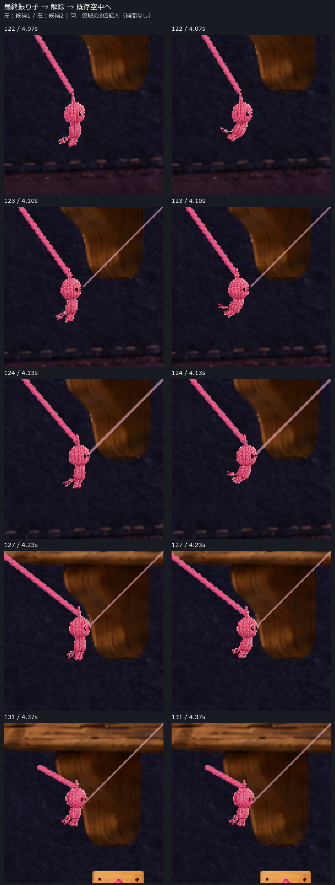
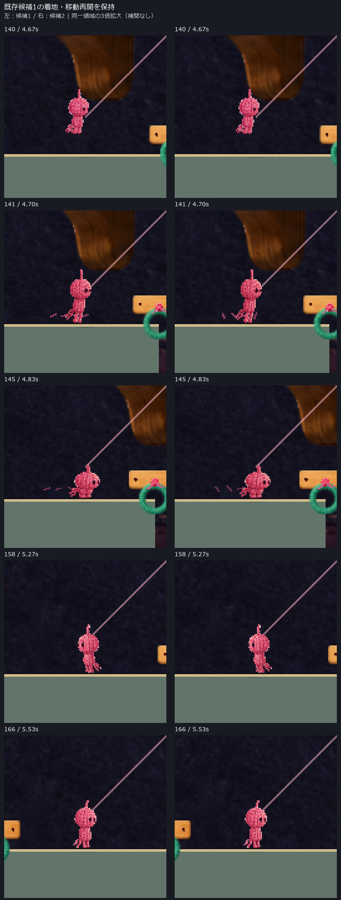

# 振り子演出候補2 — 候補1との隔離比較

更新：2026-10-17T01:13:44.729520+09:00（Asia/Tokyo）。**Human Visual Review待ち。正式採用・Production統合なし。**

候補1の基準commit：`b9d86c420e3a55c044e2527d7c787a4cdb6ae954`。[元の候補1報告](../20261017T000045_JST/Report.md)は変更していない。今回の変更は振り子中の描画姿勢だけ。候補1自体もHuman正式採用済みではない。A2 r1は地形・背景・Cameraを同条件比較へ借用しただけで、不採用推奨を維持する。

## 1. 最初は通常画角・連続動作で比較

[左右比較の通常速度動画](Videos/SideBySide_30fps_silent.mp4)／[候補1](Videos/Candidate1_30fps_silent.mp4)／[候補2](Videos/Candidate2_30fps_silent.mp4)。左＝候補1、右＝候補2。無音。音は変更しておらず、録音・実聴評価はしていない。

各1280×720、同じBuildの引数だけを変更、同じ地形・背景・Camera・物理・自動入力。173フレーム、30fpsのオフライン撮影時計で、通常速度はゲーム内時間と同じ。実キー操作でも通常実行時の性能測定でもない。入力APIによる動作をHumanの試遊と呼ばない。

注意：従来の撮影入力が「左頂点」と名付けていた折り返しは、入口床の側面に接触するため、純粋な空中頂点とは扱わない。上の左側画像も「頂点の成功証拠」ではない。地形は直していない。左右の頂点そのものは、下の補助撮影で別に確認する。

### 左右頂点の補助比較（既存ヒモ長6・A/D制動後）

[左右頂点の通常速度比較動画](Videos/FreeCycle_SideBySide_30fps_silent.mp4)。元の地上接続・既存Hook・ヒモ長6で、既存A/D入力を進行と逆に入れて小振幅まで制動し、その後入力0で振り子を観察した。両候補へ同じ自動制御を適用。Rootの移動セットアップやJoint／速度の直接書き換えなし。地形・Camera設定・物理ルールも変更していない。専用の自動撮影条件であり、入口からの攻略・面白さの証拠ではない。

角速度の符号反転から左右の折り返しを記録し、撮影全体で接地なしを確認。[補助QA](QA/FreeCycleComparison.json)。主動画の側面接触を隠して、きれいな振り子成功へ読み替えない。

通常画角の連続JPEGは[Frames](Frames/)。これらは実Unity画面を再圧縮した表示用プレビュー。比較配置・画像外ラベル・後述の拡大crop以外に描き足しや画像生成を行っていない。PNG原本はローカル保持。

## 2. 何を変えたか

| 場面 | 候補1 | 候補2で狙った差 |
|---|---|---|
| 加速 | 元の6姿勢＋小さな下肢の流れ | 既存入力と加速に反応して、腰から脚を前に曲げる |
| 最下点付近 | 伸びた身体がほぼそのまま通る | 高速・下向きのヒモ状態で首下と脚が後方へ流れる |
| 左右頂点 | 速度から中立絵へ戻る | 速度低下に合わせて膝を畳み、姿勢を収める |

新しいPNGや全アニメーションの作り直しはなし。既存6姿勢＋描画用の首下／腰／膝の回転を使う。入力、力、速度、Collider、Joint、物理Rootは書き換えない。頭側の冠点より上は追加変形しない。画面内での主人公サイズ・Cameraは拡大していない。

拡大図は通常画面の同じ範囲を3倍にした補助資料。細部が拡大で見えることだけを採用理由にはしない。

## 3. 保持したものと解除への接続

元の接続演出0.28秒の間は追加姿勢ゼロ。その後0.18秒で表示だけを加える。解除直後の1枚は直前の姿勢を引き継ぎ、**既存の解除0.24秒settleの中で追加曲げを解く**。解除後を別の新アニメーションへ置換したものではない。既存の空中・着地、色調、音・粒子・影のコード／素材は保持。

解除時の接続解除・返却・運動量保存は元の処理。新しい操作不能時間や強制停止はない。

## 4. 実測・確認範囲

- Unity 6000.3.21f1でCompile／Play smoke、Windows Build成功（エラー0、警告0）。[Build identity](QA/BuildIdentity.json)。
- 両候補173フレームの物理位置・速度・Camera位置の最大差はすべて0。接地、接続、残量、選択長、橋数、fixedTime、元のsprite選択・表示Transformも一致。[比較JSON](QA/Comparison.json)。左右頂点補助撮影も別途同条件比較。主動画はBuild r1、補助は診断ケースだけ追加したr3をそれぞれ両候補共通で使用。[表示Sourceが両Buildで不変のhash照合](QA/BetweenBuildsSourceComparison.json)／[補助Build identity](QA/SupplementaryBuildIdentity.json)。
- 描画ヒモ始点と既存の冠点座標の最大差は `0.0`。[画像と通常コマ](Frames/)でも接続の隙間を確認するために収録。追加shaderは冠点へ変位を与えない。
- 振り子途中のscaled-time APIポーズでsprite／回転／位置／メッシュ姿勢パラメータ／Root／速度が停止し、再開後は同じ接続で運動再開。[候補2停止](Figures/Candidate2_SwingPause_Held.jpg)／[再開](Figures/Candidate2_SwingPause_Resumed.jpg)。Esc実キー・メニュー操作の試験とは区別する。
- 左右の頂点、解除→空中→着地→移動、左右反転、R入口復元24・選択6・橋0、橋生成／編む表示を確認。[候補2QA](QA/Candidate2_Result.json)／[候補1QA](QA/Candidate1_Result.json)。
- 既存S9へ診断配置し、2橋生成・F統合・中央Hook消失・残量維持を確認。[統合回帰](QA/MergeRegression.json)。A2攻略・Human実操作の証拠ではない。
- [5指定Sourceのhash](QA/LockedSources.json)、[Production／候補1保持](QA/Protection.json)。Scene・Packages・既存Artの差分なし。

最初の追加ポーズ検査は接地中に停止し、残量を誤って `<24` としてFAILになった。検査のみ訂正して新しいBuild／撮影先へ保存し、旧記録は保持した。[検査訂正記録](QA/TestFixtureCorrection.json)。技術判定を件数でVisualの合格へ読み替えない。

空中診断位置からヒモ長4で接続しようとした補助初回も、既存の地上接続条件で拒否されて[FAIL記録](QA/RejectedSupplementSetup.json)。条件を回避・変更せず破棄せず記録保持し、通常地上接続6＋既存A/Dの制動に切り替えた。候補Visualの版を増やしたものではない。

## 5. 自己レビューとHumanへ残す判断

Technical：記録した範囲PASS。Gameplay：同条件の軌道・残量など不変、面白さは評価しない。Visual：3状態の比較資料を提出、正式採否は未承認。Human実キー：今回0名・未確認。

候補1より狙いを強めた点は、身体が一直線に揺れるだけでなく、脚の折り畳みと下半身の遅れを分けたこと。画像を確認した自己評価では高速時の曲がりが最も分かりやすく、加速・頂点は通常画角では依然控えめ。独立した腕の芝居も弱い。演出量が増えたことを、そのまま自然さ・良さと断定せず、採用推奨ではなく比較候補として提出する。

色調・着地などは元の素材・処理・選択・パラメータを保持したが、候補2の描画メッシュの細分化に伴う小さな補間差があるため、非振り子場面をpixel完全同一とは主張しない。[実画面差分の数値](QA/PixelDifference.json)。

Human Reviewではまず通常画角の動画で、(1)加速へ参加する意思、(2)最下点の勢い、(3)頂点の収まり、(4)解除での姿勢飛びの有無を見てほしい。候補1から明確に良くなったか／曲げが強すぎないかを判断する。A2 r1の同じ実キー再試遊は今回要求しない。

未確認：Human実キーの手応え・面白さ・Visual採否、音の実聴、Esc実キー、全Tutorial／MainStage、通常動作時のFPS。ponのゲーム性・UIレビューとは独立した作業で、結果を推測してUI・地形へ反映していない。[並行作業確認](QA/ConcurrencyGate.json)。

## 6. 変更理由を短く説明すると

- **速度から姿勢を選ぶ**：速いときは手足が遅れ、遅い頂点では脚が収まる。一定周期のダンスにしない。
- **見た目と物理を分離する**：描画用の節だけを回し、操作感・軌道は比較前後で同じにする。
- **元の演出へ受け渡す**：好評の接続を残し、解除後は既存の空中・着地へ戻す。着地や粒子を同時に別案へ変えない。

[変更理由・Source一覧](Implementation.md)／[表示用差分](CodeDiff.md)／[正確な差分JSON](CodeDiff.json)／[重要ログ抜粋](QA/ImportantLogExtract.txt)／[Human結果](HumanResults.json)。

レビュー資料だけを `review/a2-two-valleys` へ共有する。main、Production、既存Build、pon branchへは反映しない。候補1・旧r1評価・過去runは保持。ここでHuman Review待ち。
