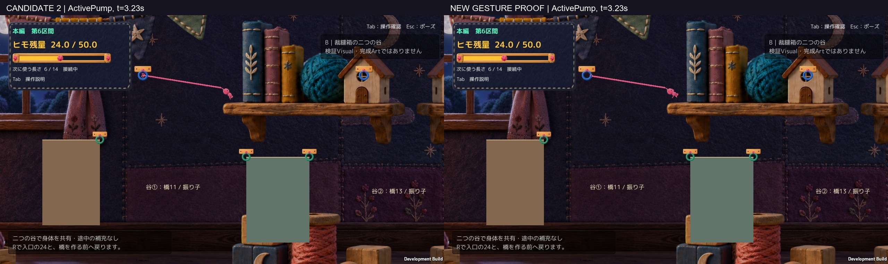
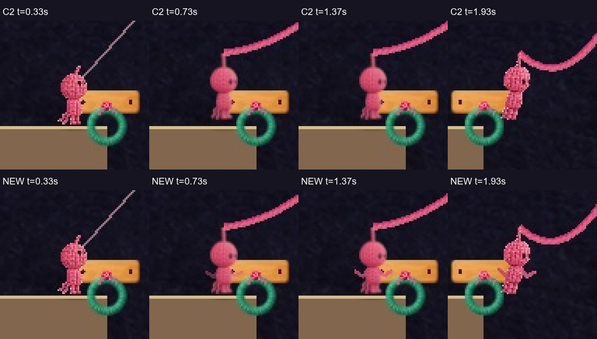
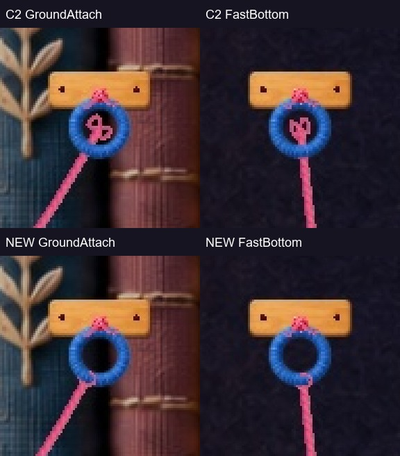
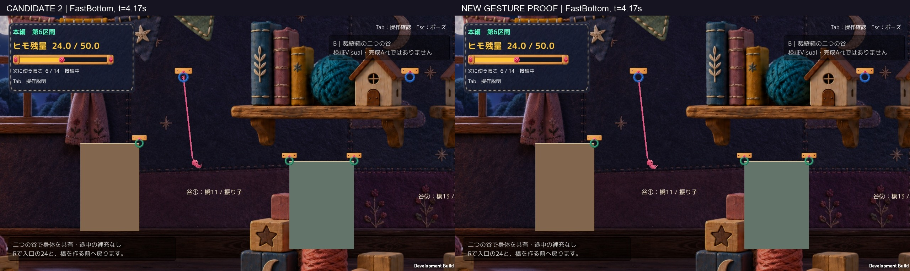
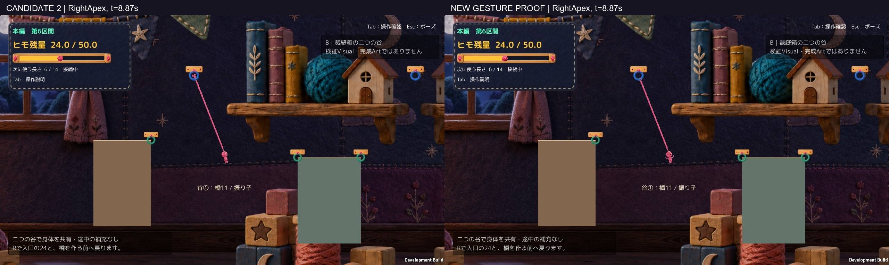
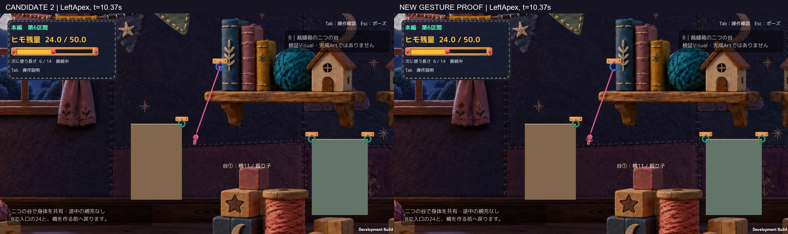

# 接続→身体を使う振り子 — 新しい隔離表示Proof 1案

候補2は未正式採用の比較基準として保持。**新候補も正式採用・Production統合ではなく、Human Review待ち。** A2 r1の不採用推奨は維持する。

## まず通常画角・通常速度で比較

- [候補2／新候補・連続比較動画 6.47秒](Videos/Main_SideBySide_30fps_silent.mp4)
- 単体で大きく見る：[候補2](Videos/Candidate2_Main_30fps_silent.mp4)／[新候補](Videos/NewCandidate_Main_30fps_silent.mp4)
- [入力なし→加速→逆入力→入力を離す補助比較 1.77秒](Videos/InputResponse_SideBySide_30fps_silent.mp4)
- [床と接触しない左右頂点の比較 3.13秒](Videos/FreeArc_SideBySide_30fps_silent.mp4)

**すべて自動入力／既存APIによる実Unity描画、無音、オフライン30fps。動画はゲーム内時間に等速であり、OS実キー録画・Human試遊・実行FPSの証拠ではない。** 両者は同じ地形・背景・Camera・1280×720・物理・入力条件。主人公やCameraを拡大していない。[通常画角のJPEG連続コマ](Frames/)はWorkから直接読める通常ファイル。

[新候補だけの通常画角](Figures/ActivePump_NewOnly.jpg)。左右比較で小さく感じる場合も、まず単体1280×720か単体動画で判断してほしい。後述の3倍cropだけで良くなったと結論しない。

## 1. 足が浮く原因と修正

Humanの112419の状態（残量24・長さ6・入口で最初の青Hookに接続し、ヒモが弛んでいる）を再現した。Root／Collider底／床／接地／描画足裏／張りを同時記録した結果、**主なずれは表示側**だった。

| 記録 | Root y | Collider底 | 床y | 描画足裏y | 接地 | 弛み |
|---|---:|---:|---:|---:|---|---:|
| 候補2・接続前 | 0.615 | 0.015 | 約0 | 0.015 | true | 未接続 |
| 候補2・接続後 | 0.615 | 0.015 | 約0 | 0.088751 | true | 0.770925 |
| 新候補・接続後 | 0.615 | 0.015 | 約0 | 0.015 | true | 0.770925 |

元の `PlayerMotionPresentation` は `grounded && !attached` の場合だけ足裏補正していた。新候補では、接地中なら接続していても**表示子の足裏をCollider底へ合わせる**。Root／Colliderを動かさず、離床後はこの補正を行わない。既存の橋のたわみ補正は除外を維持する。

約0.07375の表示ずれを解消。残る約0.015は物理側の接触間隔で、変更していない。足裏値は不透明画素の登録点で、空中のshader変形後の全輪郭を測った値ではない。[数値・全観測](QA/Comparison.json)／[通常画角](Figures/GroundAttach_Normal.jpg)。

この画像は実画面の3倍補助crop。最後は離床後で、床へ身体を貼り付けていないことを見る。

## 2. フック中央の8字→リングの縁への巻き付き

青／緑リング、役割色、固定具、Collider、物理anchorはそのまま。新候補だけ、接続したヒモの末端をリングの縁へ導き、縁の後ろ／前に分けた小さな巻き部分を描く。引かれる方向は実際のヒモの末端側から読む。中央の穴は塞がない。

結び生成後の記録では、描画末端と巻き部の接続点の距離は最大0。身体側もヒモ始点と登録された冠点の距離は最大0。これは登録点の照合であり、GPU上の毛羽立ち全画素が完全一致するという主張ではない。

解除では既存の戻るヒモへ追従して0.12秒でほどけ、着地／歩行再開時の結び残りは0。R後も0。[遷移記録](QA/Transitions.json)／[解除の通常画角](Figures/Release_Normal.jpg)。細い白線は比較基準にもある既存の照準ガイドで、残った結びではない。

## 3. 腰・膝だけでなく、肩・肘と胴を使う

既存の顔・頭・体格・ピンク系識別色・色調・接続音／演出・解除後・着地・影・粒子・音の素材と処理を維持。新しい服や小物、画像の量産は行っていない。毛糸素材を再利用した表示専用の肩→肘→手の2本のチェーンと、入力に対応する胴の傾きを追加した。

| 状態 | 新候補の表示 |
|---|---|
| 接続して接地 | 足裏を保ち、腕を小さく開いて構える |
| A/Dで加速 | 入力側の肩・腕を前へ、胴も参加。既存の腰・膝の動きへつなぐ |
| 逆入力で制動 | 入力と実速度が逆の間、腕を開き胴を逆へ受ける |
| 高速の最下点 | 胴と手先が進行の後ろへ流れる |
| 低速の頂点 | 腕を収める構えと、既存の脚の畳み |
| 入力なし | 加速芝居にせず、速度と位相による惰性・備え |
| 解除→空中→着地 | 既存0.24秒の解除settleへ腕の表示を渡し、従来の空中・着地へ戻す |

[身体の3倍crop補助](Figures/Body_Zoom3x_Supplement.jpg)／[着地](Figures/Landing_Normal.jpg)／[移動再開](Figures/ResumeWalk_Normal.jpg)。腕は表示パーツのみで、Rigidbody／Joint／Colliderを追加していない。一定周期の振付ではなく、既存入力・実速度・接続・接地・振り子の位相で選ぶ。

## 4. 実確認できた範囲

- Unity 6000.3.21f1 Compile／Windows Build成功。最終手動Build r3はエラー0・警告0。[Build SHA](QA/BuildIdentity.json)。standalone自動Playは確認、Unity Editorでの手動Playは未実施。
- 主比較：ポーズ前318フレームで、Root位置・速度・Camera・入力・残量・選択長・橋数・fixedTimeの最大差0。[比較](QA/Comparison.json)。解除の運動量維持、代表着地、R、橋生成13残し→Rで24／6／0を両者で確認。
- 補助入力比較：53フレームのRoot・速度・Camera・入力の最大差0。実際に速度と逆の入力となった6フレームを収録。操作感・快感の証明ではない。[補助比較](QA/SupplementComparison.json)。
- 自由な左右頂点区間73観測で接地0、Root xは118.951～123.028。入口床右端117.9からCollider半幅を含めても離れており、床の側面による折返しではない。主動画内の別の折返しを、左右空中頂点の証拠には使わない。
- APIポーズ6フレームでRoot・腕の角度／手の位置を保持。実Esc・メニュー操作は未確認。[停止・復帰・橋の画像](Figures/QA_API_pause_not_Esc.jpg)／[R後](Figures/QA_R_after_bridge.jpg)。
- 最終手動Build：既定新候補と候補2を別々に起動し、初期化後35秒以上、24／6／0で生存。撮影／自動入力／QA／新撮影クラスのインスタンスは0、時計は通常時間。[手動起動観測](QA/ManualStartup.json)。
- [主要5コード・Scene・Art・Shader・設定・Production Git・既存Buildの保持](QA/SourceProtection.json)。本比較r2と最終r3のコンパイル済みPDBから、異なるSourceは補助撮影ケースのファイル1件だけと確認した。[コンパイルSource照合](QA/BetweenBuildsCompiledSources.json)。演出は同じ1案。

## 5. 残る弱点・未確認

自己レビューでは、足元とリング中央の8字の改善は明確。通常画角でも腕と胴の形の差は出た。一方、**毛糸線を再利用した細い腕は胴より単純な質感で、自然な一体感はまだ弱い**。主人公が小さい画角なので、頂点の細かい芝居や小さな巻き部分の読みやすさもHuman判定が必要。演出が増えたことを、自然さや気持ちよさのPASSへ置き換えない。

Human／CodexのOSキー操作、手応え・面白さ、音の実聴、実Esc、全区間通し、F統合の新たな実行確認、全方向／全Hook／全残量でのVisualは未確認。撮影と待機確認だけをミュートし、通常ランチャーにはミュート指定を入れていない。skyは今回利用・復旧再試行していない。

Technicalは記録した範囲で成立、Gameplayの基本仕様は不変、Visualは比較提案、Human実キーは未確認。**採用判断はせず、Human Review待ちで停止する。**

## 手動版と記録

[起動方法](Launch.md)／[変更ファイル・仕組み](Implementation.md)／[正確な隔離差分](CodeDiff.json)／[撮影条件と訂正履歴](Methods.md)／[Human指摘の記録](HumanResults.json)。Build本体・Library・BGMはGitへ入れず、レビュー資料・画像・動画・差分だけを共有する。

[以前の候補2自動比較](../20261017T011344_JST/Report.md)／[以前の手動版](../20261017T110609_JST/Report.md)／[A2 r1の否定評価](../20261016T184703_JST/Report.md)はすべて保持している。
