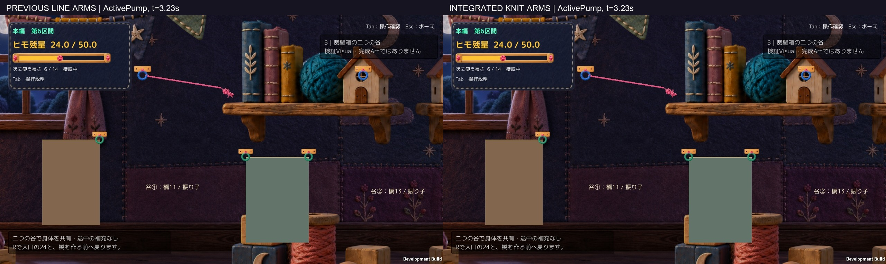
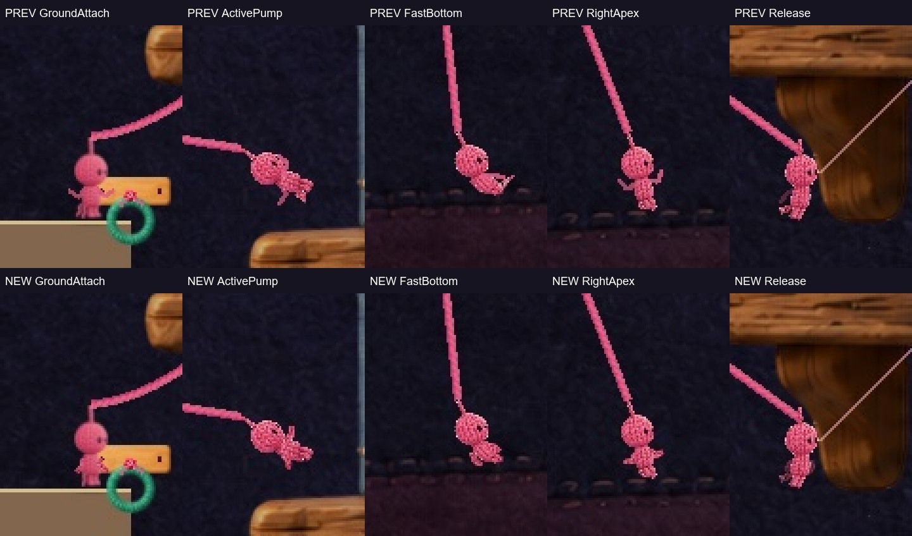

# 腕だけの改訂Proof — 胴と同じ編み目へつなぐ1案

**Human Review待ち。正式採用・Production統合なし。** 基準は `4e62641a8460b73d1d0c7c78ef0336f4f4d1e358` の接続／振り子Proof。Humanが良かったとしたフック巻き付きと接続接地時の足裏補正を保持し、「糸が手みたい」という腕表示だけを見直した。候補2・前回Proof・凍結A2は保持。A2 r1の不採用推奨も維持する。

## まず通常画角・通常速度で比較

- [前回の線状腕／今回の編み腕・連続比較6.47秒](Videos/Main_SideBySide_30fps_silent.mp4)
- 画面を小さくせず見る：[前回単体](Videos/PreviousArms_Main_30fps_silent.mp4)／[今回単体](Videos/IntegratedArms_Main_30fps_silent.mp4)
- [入力なし→加速→逆入力→入力を離す比較1.77秒](Videos/InputResponse_SideBySide_30fps_silent.mp4)
- [床に触れない左右頂点の比較3.13秒](Videos/FreeArc_SideBySide_30fps_silent.mp4)
- [Workから読める通常画角の連続JPEG](Frames/)

すべて**明示的な自動入力・既存APIによる実Unity描画**。オフライン30fpsでゲーム内時間に等速、無音。OSキー録画・Human試遊・実行FPSの証拠ではない。同じ最終Buildで前回表示／修正版を切り替え、地形・背景・Camera・1280×720・入力・物理条件を揃えた。主人公やCameraは拡大していない。

[修正版だけの通常画角](Figures/ActivePump_NewOnly.jpg)。以下の拡大補助だけで良くなったとは判断しない。

## 何を変えたか

前回は肩・肘・手の3点を細いLineRendererとヒモ用テクスチャでつないでいた。原画の腰付近から伸びる腕も含め、胴とは別の糸が生えた印象になっていた。

今回はLineRendererを作らず、**既存の毛糸人形の胴と同じ絵から編み目を参照する、連続した丸い腕メッシュ**に置き換えた。肩を胴の内側に入れ、奥の腕→胴→手前の腕の描画順、丸い肘・簡素な丸い手先、側面の陰影と薄い輪郭を使う。新しい服・手袋・小物・顔は作っていない。PNGも再生成・変更していない。

元の腕の外側の画素は、新しい腕が出る間だけ表示shaderで抑制する。元の原画は不変。解除時は既存0.24秒の表示遷移に沿って元の空中姿勢へ戻り、着地・歩行・R後には新しい腕を残さない。二組の腕を常時重ねてはいない。

腕は肩から上腕0.28×頭幅、前腕0.26×頭幅を固定。丸みを付けた接続面で曲げ、長さを伸縮させない。最大の骨長誤差は頭幅に対して約0.000000123（浮動小数点の丸め）。顔・頭・体格・サイズ・元の色調処理は保持している。

## 動作と自己レビュー

| 場面 | 今回の腕 | 画面による確認 |
|---|---|---|
| 床で接続 | 短く構え、肩は胴の中へつなぐ | [足元と全身](Figures/GroundAttach_Normal.jpg) |
| 加速 | 入力側へ腕を運び、逆側を引く。前回の胴・腰の動きはそのまま | [加速](Figures/ActivePump_Normal.jpg) |
| 高速通過 | 腕を進行の後ろへ受ける。細長い枝の突起を抑える | [高速通過](Figures/FastBottom_Normal.jpg) |
| 左右頂点 | 低速に応じて肘を畳む。一定周期の振付ではない | [右](Figures/RightApex_Normal.jpg)／[左](Figures/LeftApex_Normal.jpg) |
| 逆入力 | 実速度と入力が逆の間、腕を収めて受ける | [補助動画](Videos/InputResponse_SideBySide_30fps_silent.mp4) |
| 解除→着地→移動 | 既存の解除・空中・着地へ表示を渡す | [解除](Figures/Release_Normal.jpg)／[着地](Figures/Landing_Normal.jpg)／[移動再開](Figures/ResumeWalk_Normal.jpg) |

通常画角の自己レビューでは、前回の外へ突き出す細い線が減り、腕に胴と共通の量感が出た。一方、主人公が小さく、**奥側の腕が胴と重なる瞬間は入力芝居の差が読みにくい**。手前の肘も数ピクセルの差なので、Humanが自然と感じるかは未確認。今回は「大きく派手にする」ことで解決せず、現在の大きさを保持した。

提出前の内部修正では、初期化例外とR復帰中の腕残りを発見して解消した。[修正履歴](QA/SelfReviewCorrections.json)。最終Buildはr3の1案。失敗した内部r1/r2や元Proofはローカルに保持している。

## 実確認した範囲

- Unity 6000.3.21f1 Compile／Windows Build成功。最終r3はエラー0・警告0。比較・補助撮影・手動待機はすべて同じr3。[Build identity](QA/BuildIdentity.json)。
- 自動比較は両者413フレーム。ポーズ前318フレームのRoot・速度・Camera・入力・残量・選択長・橋数・Collider底・足裏・ヒモ両端の最大差0。[比較JSON](QA/Comparison.json)。
- 接続接地の描画足裏−Collider底は0。フック巻き付きコードはbyte不変で、ヒモ両端の登録点誤差も最大0。GPUの毛羽全画素の完全一致という主張ではない。[足元](Figures/GroundAttach_Normal.jpg)／[リング補助](Figures/Ring_Zoom3x_Supplement.jpg)。
- 自動の接続、解除時の運動量維持、代表着地、歩行再開、Rで24／6／0復元、橋生成で残量13→R復元が両者で成立。実キーで通したという意味ではない。
- 自由な左右頂点区間は接地0。APIポーズ中はRoot・腕角度・手先位置を保持。解除・着地・R後の新腕残りは0。[遷移](QA/Transitions.json)／[R後の実画面](Figures/QA_R_after_bridge.jpg)。実Esc・メニュー操作は未確認。
- 補助入力比較は53フレームでRoot・速度・Camera・入力差0。[補助比較](QA/SupplementComparison.json)。
- 最終手動版は修正版既定／前回表示を別々に起動して35秒以上生存。通常時間、入口24／6／0、自動入力・撮影・QA driver数0。[手動起動](QA/ManualStartup.json)。音・OSキーの反応の確認とは区別する。
- [Production状態・既存11ファイル・主要5コード・Scene・PNG・設定・元Proof536ファイル・凍結Buildの保持](QA/SourceProtection.json)。ゲーム本体のSourceはレビューbranchへ入れず、[隔離コード差分資料](CodeDiff.json)だけを共有。

## 操作許可と未確認

Humanからの対象ゲーム操作に関する継続許可を[作業メモ](OperationPermission.md)と[検証記録](QA/OperationAuthorization.json)へ保存した。許可の取り直しはしていない。

今回はcomputer-useの軽量な`list_apps`が、待機後の再試行・セッション再初期化後も `computer-use request timed out: list_apps`。原因は不明で、権限不足とは断定しない。**OS画面取得・キー反応・OSによる加速／制動／解除／着地は未確認**。自動Unity撮影を代替の実キー成功としていない。

新案のHuman実キー人数0。音の実聴、実Esc、全区間通し、F統合の新規実行、全Hook・全残量での見た目、入力の手応え・楽しさ・Visual採否は未確認。Technicalは記録した範囲で成立、Gameplay基本仕様は不変、Visualは今回1案の比較提案であり採用PASSとはしない。

## 手動版

[起動・終了方法](Launch.md)／[ファイルと変更理由](Implementation.md)／[撮影手法](Methods.md)／[Human評価の保持](HumanResults.json)。修正版ランチャーは `START_ArmsRevision.cmd`、比較用は `COMPARE_PreviousArms.cmd`。exeの直接ダブルクリックも修正版を手動起動する。

[前回Proofの報告](../20261017T120508_JST/Report.md)／[候補2の自動比較](../20261017T011344_JST/Report.md)／[A2 r1否定評価](../20261016T184703_JST/Report.md)は保持。Production統合・他区間への展開は行わず、Humanの正式判断を待って停止する。
