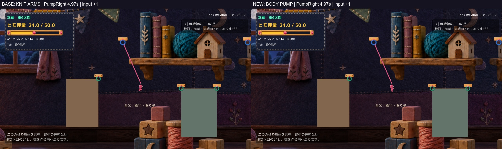

# 振り子中の身体加速表現 — 編み腕を起点とする1案

**隔離Proof完成・Human Review待ち。正式採用／Production統合なし。** 編み目の腕メッシュ修正版（レビューcommit `3383ca9c6607ba81243d8947b01379c8724d9d31`）を起点とし、糸状の腕へは戻していない。A2 r1の不採用推奨は維持する。

## 先に、通常画角・通常速度で見る

- [接続→加速→左右の振り→解除→着地→移動：同条件の比較動画](Videos/Main_BeforeAfter_30fps_silent.mp4)
- 横並びで縮小される場合：[基準版を通常画角で単独再生](Videos/Baseline_Normal_30fps_silent.mp4)／[今回を通常画角で単独再生](Videos/BodyPump_Normal_30fps_silent.mp4)
- [入力なし→加速入力→逆入力→惰性](Videos/Input_CoastDriveBrake_30fps_silent.mp4)
- [床に触れない左右頂点・APIポーズ／再開・R・橋後の復帰](Videos/CoastApex_Pause_Retry_30fps_silent.mp4)
- Workが直接読める[通常画角の連続JPEG](Frames/)／[代表画像](Figures/)

すべて**自動入力・既存APIを使った実Unity描画**。1280×720、同じ最終非Development Build内で基準の編み腕表示と新候補を起動し分けて撮影した。ゲーム内時間30fpsの通常速度・無音であり、OSキー操作録画、実機のフレーム性能、Human試遊ではない。Cameraと主人公のサイズは変更していない。画像は表示用JPEGプレビューで、描き足しや画像生成はしていない。

## 原因を3点に限定

1. `SwingPresentationState.Advance`の旧Driveは入力の絶対値に加え「前フレームからの速さの増加」を足していた。重力で速くなっただけでもDriveが上がり、入力の意思と受動的な運動を分けにくかった。
2. `ActiveSwingArms.Advance`は加速入力の分岐より先に低速／高速通過を判定する。その場面では入力中も惰性も同じ腕目標へ進み、押した違いが消えていた。
3. 首・腰・膝はSwingPresentationState、肩・肘と胴の傾きはActiveSwingArmsが別々に決めていた。腕素材は胴と統一されたが、全身で一つの加速動作を作る判断は統一されていなかった。通常画角ではこの小さな差がさらに読み取りにくい。

[原因箇所と変更差分](CodeDiff.json)に元の処理と今回の変更を収録した。Humanの「引っ張られている」という感想を、物理に不具合があるという事実へ置き換えてはいない。

## 今回の1案

`BodyPumpPresentation`で、読み取り専用の入力意図・接線速度・振りの位置・上昇／下降をまとめ、胴・腰・膝・肩・編み腕へ同じ動作意図を渡す。腕の素材、骨長、丸み、肩の取り付け、陰影は基準版のまま。

| 状態 | 身体の意味 | 通常画角の証拠 |
|---|---|---|
| 接続して接地 | 元の接続演出と足裏補正を保持。空中の変形を床上へ適用しない | [接続接地](Figures/GroundAttached_Normal.jpg) |
| 入力なし | 入力由来の踏ん張りをやめ、速さによる腕の遅れと控えめな全身姿勢へ | [惰性](Figures/Coast_Normal.jpg) |
| 加速入力・下り／最下点 | 胴から腰・足へ伸びる側と、前後の肩の構えを連動 | [右向き](Figures/PumpRight_Normal.jpg)／[左向き](Figures/PumpLeft_Normal.jpg) |
| 上昇 | 下りの伸びから腰を畳む。腕も胸側へ収める | [上昇](Figures/Ascent_Normal.jpg) |
| 頂点・切り返し | 速度低下で膝を集める。入力中と惰性の畳み量を分ける | [入力中の頂点](Figures/ActiveApex_Normal.jpg)／[右の自由頂点](Figures/RightApex_Normal.jpg)／[左](Figures/LeftApex_Normal.jpg) |
| 逆入力 | 進行方向へただ腕を出すのでなく、受ける姿勢へ切り替える | [補助入力比較](Figures/supplement_reverse_input_Normal.jpg) |
| 解除→着地・歩行 | 元の解除表示へ減衰して渡し、着地とR後に腕を残さない | [解除](Figures/Release_Normal.jpg)／[着地](Figures/Landing_Normal.jpg)／[歩行](Figures/Walk_Normal.jpg)／[R](Figures/Retry_Normal.jpg) |

説明用にまとめると、**「速度だけでなく押している意図から姿勢を選ぶ」「腰と肩を同じ動作でつなぐ」「見た目の関節だけを曲げ、物理Rootは触らない」**。一定周期の振付や追加キーは使っていない。「加速入力中」は入力の意思の表現であり、既存の速度・エネルギー制限を超えて必ず加速したという意味ではない。

## 技術確認と、品質判断を分ける

Technicalは今回確認した範囲でPASS。

- Unity 6000.3.21f1 Compile／非Development Windows Build成功、最終r2はエラー0・警告0。[Buildの同定](QA/BuildIdentity.json)。
- 主比較415フレームと補助71フレームで、Root・速度・Camera・入力・残量・選択長・橋数・Collider底・ヒモ長・両端点の修正前後の最大差0。[主比較](QA/Build_r2_Comparison.json)／[補助比較](QA/Supplement_Comparison.json)。それぞれ同じ入力列の基準版／新候補間の比較で、加速入力と惰性の異なる軌道同士を一致させたという意味ではない。
- 左入力・右入力、床に触れない左右頂点、加速・逆入力、解除時の運動量、代表着地・移動再開、橋生成とR復元を自動確認。入口24／選択長6／橋0へ復元。ポーズはAPIによる9フレームの停止で、腕・手先・身体姿勢を保持。実Escとメニュー操作は未確認。
- 接続接地の登録足裏−Collider底、頭の接続登録点、リングの表示接触点の誤差は0。編み腕の骨長誤差は浮動小数点の丸め範囲。着地／歩行／R後の表示腕残り0。[状態別の記録](QA/Transitions.json)。全画素の輪郭やすべての着地の完全一致は主張しない。
- 最終手動版は既定の新候補／別ランチャーの基準版それぞれ35秒待機。通常時間、自動入力・撮影・QA driver数0、入口24／6／0、エラー0。[手動起動](QA/ManualStartup.json)。操作反応の実測とは区別する。
- 主要5コード、入力／物理設定、Scene、Camera、PNG、巻き付き、足裏処理、色調shader、編み腕メッシュはbyte不変。ProductionのGit状態・未保存差分、元Proof538ファイル、既存Q／Tab／固定レビュー環境の選択ファイルを保持。[保護確認](QA/Protection.json)。

## 見た目の自己評価と残る弱点

通常画角では、基準版の「どの場面も丸めた脚＋小さな腕」から、**入力中の縦に伸びる身体／上昇時の畳み／入力を離した腕の収まり**を区別しやすくなった。主動画4.7〜5.1秒の高速通過、補助動画の入力切替と、その後の惰性を見てほしい。糸の外付け腕へ戻さず、同じ編み腕を保持した。

ただし改善幅を過大評価しない。**通常画角の肩・肘は数ピクセルで、胴と重なる奥の腕は依然読みにくい。** 今回は腰と脚のシルエット変化の方が読みやすく、これで「自身で振っている」と十分感じられるかはHuman判断が必要。入力切替から約0.1秒の追従を入れているため、頂点ですぐ逆入力したときの手応えも実操作では未確認。拡大して分かる腕の細部だけを成功根拠にはしない。

[肩・胴・腰の拡大補助（3倍crop）](Figures/BodyConnection_Zoom3x_Supplement.jpg)は補助資料。提出前のr1自己レビューで、関節の曲げが相殺されて身体が直立へ戻りやすい点を見つけ、同じ1案のr2で下りと上昇の曲げ配分を調整した。失敗／途中資料と元候補はローカルで保持し、最終の動画・QA・手動Buildはすべてr2で統一した。

Humanの面白さ・入力の手応え・Visual採否は**未確認／未承認**。自動QAの件数や姿勢角の差を品質PASSにはしていない。

## 未確認と次の操作

今回のOS操作環境確認は`list_apps`を1回だけ実施し、`computer-use request timed out: list_apps`。同じ許可の再要求・タイムアウト再試行なし。画面取得・OSキー反応・実Esc・Human実キー・音の実聴は未確認。全区間通しやF統合の新規実行も今回の検証範囲外。[操作許可と区別](OperationPermission.md)／[検証方法](Methods.md)。

Humanはまず通常画角の動画を比較し、必要に応じて[新しい手動ランチャー](Launch.md)で入力なし→A/D→逆入力→解除を確認できる。既存の固定ランチャーは上書きしていない。新候補1案を共有して停止し、正式採用・追加候補・Production統合へは進まない。

[元の編み腕報告](../20261017T125936_JST/Report.md)／[固定レビュー起動環境（今回は不変）](../20261017T134411_JST/Report.md)／[候補2](../20261017T011344_JST/Report.md)／[A2 r1のHuman否定評価](../20261016T184703_JST/Report.md)は保持。
