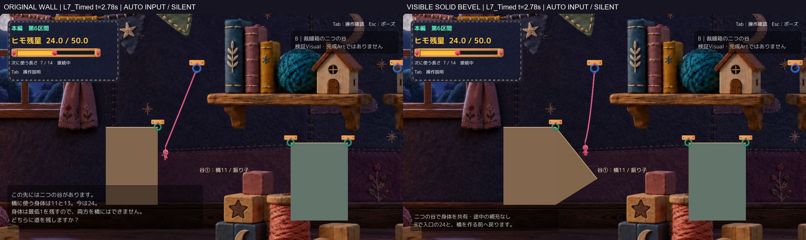
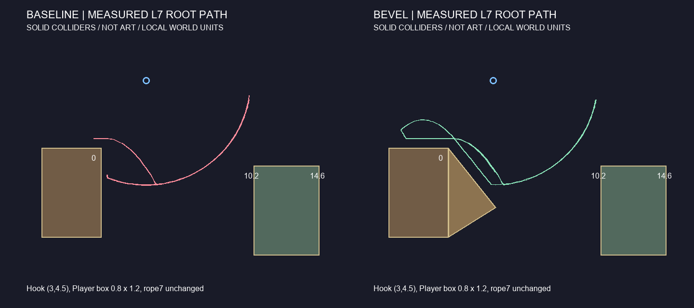

# A2谷①の壁衝突 — 原因調査と斜面1案

**判定：HOLD（部分改善・壁衝突の完全解消ではない）。** 原因を分離し、別の隔離環境に1案と手動Buildを作成した。Production統合・新たな正式採用はない。

HumanがBodyPumpを実操作した結果、「腕・胴・脚が重なり、手のような不自然な輪郭」と評価したことを記録した。**腕・姿勢は要修正、正式採用保留**。今回は腕・姿勢・巻き付き・足裏・色調を変更していない。比較基準は[BodyPump](../20261017T160603_JST/Report.md)で、古い糸状腕へ戻していない。[Human評価の区別](HumanResults.json)。

## まず通常画角の比較

- [長さ6・同じ時刻のA/D操作：5.04秒](Videos/L6_Timed_BeforeAfter_50fps_silent.mp4)
- [長さ7・同じ時刻のA/D操作：5.04秒](Videos/L7_Timed_BeforeAfter_50fps_silent.mp4)
- [長さ7・解除後に残る対岸衝突：3.04秒](Videos/L7_EarlyRelease_BeforeAfter_50fps_silent.mp4)
- 横並びが小さい場合：[長さ7・元配置を単独表示](Videos/L7_Original_Normal_50fps_silent.mp4)／[斜面案を単独表示](Videos/L7_Bevel_Normal_50fps_silent.mp4)
- [接触前後の連続JPEG](Frames/)／[手動で遊ぶ起動方法](Launch.md)

実Unity・1280×720・同じCamera設定・同じ最終非Development Buildで撮影。**自動入力／既存API、ゲーム内時間に等速の50fps、無音**。OSキーやHuman操作の録画ではなく、実機FPSの計測でもない。3組とも入力列の差0、接続時刻は同じ。解除動画は両方とも実測1.06秒で解除している。[撮影と入力の照合](QA/FilmComparisons.json)。

## 原因：接続中と解除後は別

Human提供の状態説明は、谷①・長さ7・最初の青Hookへ接続中、出発床上面より低い側面付近。静止画が衝突瞬間だったとは断定しない。WorkのファイルパスをWindowsで開いたり、画像再添付を求めたりせず、手元のBuildから同種の状態を再現した。

元配置の実測ローカル座標（全体Xオフセット117.9）：出発床はx=-4〜0、上面y=0、側面はy=0〜-6。青Hookは(3,4.5)。Playerの物理Boxは幅0.8×高さ1.2。張ったヒモの最下点におけるRootは長さ6でy=-1.5、7でy=-2.5となり、出発床上面より下を往復する。実際は弛みと床接触もあるため、単純な円だけで到達性を断定していない。

1. **接続中の復路：出発床の実在する側面へ当たる。** 長さ6・7とも、左向きに漕いで戻ると`A2 Proof Entry Box`へ横向き法線(1,0)の接触を記録した。腕やCameraが作る錯覚だけではなく、BoxColliderによる実接触である。
2. **早い解除後：対岸の側面へ当たる。** `A2 Proof Middle Box`の左側面、法線(-1,0)。足場上面に届く前に低い位置へ入る失敗で、接続中の出発壁衝突とは別。今回の入口斜面でも、この早い解除は改善していない。
3. **横速度が止まるのは接触応答に対応している。** 接触直前／直後、normalImpulse、接触点を記録した。最初の接触ではPlayerMover実行前後のRoot・速度は同じで、Unityの衝突callback後に横速度が止まっている。今回の表示処理が速度を消していたという根拠はない。物理係数や速度制御を変更する理由にはしていない。

固定時刻入力の代表値（速度はworld units/s。接触時刻は地形により違う）：

| 長さ | 元の出発側面への最初の接触 | 斜面への最初の復路接触 |
|---|---|---|
| 6 | t=2.70、速度(-14.28,5.42)→(0,3.28) | t=2.60、(-16.19,1.58)→(-6.04,7.55) |
| 7 | t=2.78、(-15.65,4.96)→(0,2.57) | t=2.64、(-17.45,-0.61)→(-4.45,5.56) |

斜面では完全停止を避けて上方へ動きが続くが、**長さ7のnormalImpulseは約14.36で、衝撃自体はまだ大きい**。単に「壁という分類の接触数が0」だから改善成功とはしていない。全斜面接触も公開した。

[接触点・直前／途中／直後の位置速度・入力・長さ](QA/FilmComparisons.json)／[元配置の接触とサンプル軌道](QA/Baseline_ContactsAndSampledTrace.json)／[斜面案](QA/Bevel_ContactsAndSampledTrace.json)。直前は該当physics tickのPlayerMover実行前、途中はその実行後、直後は衝突callback。選択長と解除後のActiveRopeLength=0を区別している。

頭上の背景棚は検証地形のColliderではない。今回の通常往復で頭上Colliderへの衝突は記録していない。[有効Solid Collider一覧](QA/Baseline_SolidColliders.json)。

## 1案だけ：出発床へ実体のある斜面を追加

`A2 Proof Entry Bevel`を1個追加。ローカル頂点は(0,0)、(3.2,-4)、(0,-6)。**同じ3頂点でGrayboxメッシュとPolygonCollider2Dを構成**し、上側斜面を薄い縁で示す。検証用であり完成Artではない。

- 元の出発床のBoxColliderはenabledのまま、元の位置・幅・上面・側面を維持する。壁を無効化／ignoreしていない。
- 中央床・出口床・すべてのHookは元の座標のまま。橋端点、消費11／13、残量24、最低残量1も不変。
- 見えない床、強制速度消去、自動着地、Player能力や入力規則の変更はない。
- 「Hookを高く移しジャンプ後に接続する」案はEditor調査で不成立。既存コードは最初の空中接続を許可していないためで、仕様を変えて通さなかった。[棄却理由](QA/RejectedRaisedHookFeasibility.json)。配布Buildは斜面1案のみ。

図の線は実測Root軌道、茶・緑はCollider形状。概念Artではない。歩行面とGrayboxメッシュは同じ境界だが、縁の描画には細い線幅がある。主人公の見た目と物理Boxは同じ全画素の形ではないため、[Collider重ね表示の補助](Figures/L7_Timed_ColliderOverlay_Supplement.jpg)も分けて示した。重ね表示は計測用加工で、通常比較画像・BuildにCollider線を追加してはいない。

## 長さ6／7・操作／解除の比較

各配置14条件。接触数は同じ面・接続状態で連続したcallbackを1episodeにまとめた値。斜面の接触を側面0の中に隠さず、別に記録している。

| 操作 | 元：出発側面episode（6／7） | 斜面：出発側面episode（6／7） | 補足 |
|---|---:|---:|---|
| 速度方向にA/Dで漕ぐ | 4／1 | 0／0 | 斜面接触は残る。入力の切替時刻は速度依存なので、この行は同一raw入力とは呼ばない |
| 時刻固定D→A→D | 2／2 | 1／0 | 動画は両者で同一入力列 |
| 初動後に惰性 | 1／1 | 0／0 | 斜面接触あり |
| 上昇中24°／30°で解除 | 対岸側面・失敗 | 同じ対岸側面・失敗 | 両長さで残る |
| 上昇中42°／54°で解除 | 対岸着地を記録 | 対岸着地を記録 | 離散サンプルであり連続成功窓・Human成功率ではない |

[全条件の結果](QA/Comparison.json)。同じ1回の成功だけで改善済みとはしていない。撮影の固定入力はDを1.7秒→Aを1.7秒→D。解除比較は別のD保持入力で1.06秒時点に解除。失敗後も動画を短く切って隠さず、通常の失敗表示を残した。

## 残る問題・HOLDの理由

1. **長さ6、時刻固定入力では、斜面を上がった後の元箱の上端(x≈0,y=0)へ側面接触が残る。** t=2.86で横速度約-6.43→ほぼ0。[残存接触の通常画角](Figures/L6_Timed_RemainingSideContact.jpg)。元箱と追加斜面が別Colliderである角・継ぎ目の接触が疑われる。外周を連続形状にまとめる案は考えられるが、今回は追加実装・別候補へ進めていない。
2. **早いE解除による対岸衝突はそのまま。** 入口だけの変更なので改善対象を取り違えない。解除タイミングの問題を物理変更や自動着地で隠さない。
3. **斜面が歩ける地形として追加された分、ルートと橋を使う価値が変わり得る。** フック・橋費用を保ち3攻略が通っても、攻略選択や自然さが良くなった証明ではない。生活用品としての最終Visualは未制作・未評価。

別途、元配置の長さ6・往復後Rで、直後は入口(-0.5,0.6)へ戻るが1.1秒後には元壁側(約0.415,-9.043)へ落ちた例を記録した。今回の矩形壁配置ではR13/14、斜面案では14/14。[Rの実測](QA/Comparison.json)。新案がRの基本処理を修正したという意味ではない。Source上では復帰と`PreventSolidSurfaceTunneling`の前回位置履歴の干渉を疑うが、1stepの因果確定は追加検証が必要。修正するならPlayerMoverのsweep履歴とMainStageRespawnOnFallの復帰通知が候補となるため、**今回許可外のCore変更として保留**した。

## 回帰・保護

- Unity 6000.3.21f1 Compile、Editor Play、非Development Windows Build成功。Buildは1回、エラー0・警告0。[同定SHA](QA/BuildIdentity.json)。
- 最終Windows版の既存回帰33項目PASS、Gameplay Error0。橋①→振り子②は残量13、振り子①→橋②は11、両振り子は24。両橋は2本目拒否、13−13=0＜最低残量1。[Windows回帰](QA/Windows_Bevel_Routes.json)／[Editor回帰](QA/Editor_Bevel_Routes.json)。
- Rで入口24／選択長6／橋0、Hookと地形の維持を確認した範囲は各JSON参照。元配置のR失敗もPASSへ混ぜていない。
- 最終手動版は両配置で35秒待機し、自動入力・撮影driver0、通常時間、入口24／6／0。新WallQAも起動フラグ無しでは作らず、WallResult未生成。[手動起動記録](QA/ManualStartup.json)。
- PlayerMover／RopeController／RopeResource／RopePlatformBuilder／MainStageRespawnOnFall、入力・物理設定、Scene、Camera、PNG、腕・姿勢・巻き付き・足裏・色調・音は保持。PlayerMotionPresentationはbootstrapだけを変更し、表示計算クラス部分は一致。元の床とHookのTransform・Collider設定も一致し、追加形状は斜面1個のみ。[差分](CodeDiff.json)／[保護](QA/Protection.json)。
- Camera設定は不変。古いBuildとのJSON比較ではUnityのプロセス固有instanceIDだけが違うため、それを数値設定の変更と混同していない。地形によりPlayer軌道・追従位置が違うのは期待どおりで、今回「軌道差0」とはしていない。
- 旧QAの24°解除はwall/fallという記録だったが、Colliderを識別していなかった。今回は出発復路と対岸低位置接触を分離した。[過去記録との照合](QA/HistoricalWallComparison.json)。すべての過去S6衝突が同原因だとは断定しない。
- Productionのdirty状態、元BodyPump540ファイル、凍結A2のexe／Assembly、Q／Tab／固定レビュー環境の対象ファイルとBGMを保持。ゲーム本体・BuildをGitへ保存しない。

## 未確認と次の判断

OS操作の継続許可は有効。今回も`list_apps`が1回タイムアウトし、再試行や同じ許可の再要求はしていない。[操作メモ](OperationPermission.md)。OSキー・実Esc、今回の斜面のHuman実キー、音の実聴、楽しさ・操作感・Visual採否は未確認。Editor起動時の既知のSearch例外もRuntime Errorとは分け、環境設定を修正していない。[ログ抜粋](QA/ImportantLogExtract.txt)。

**Technicalは上記の範囲で成立、壁改善の総合判断はHOLD、Human正式採用は未承認。** 動画で残存接触と地形変化を確認した後、必要なら新しい手動版を遊んで判断できる。腕の追加改修、追加候補、本番統合は行わず、この1案で停止する。
