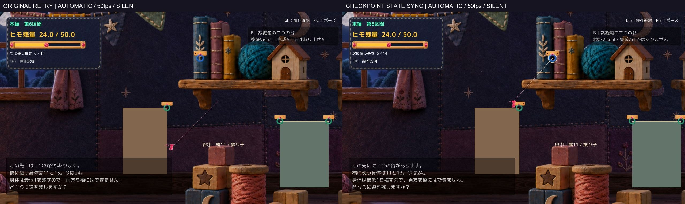

# A2 元配置：R復帰後に壁際へ戻される問題

**隔離修正1件。Technical：確認した範囲でPASS／Human実キー・手応え・正式採用：未確認。** Productionへの反映はしていない。斜面案はHOLD、腕・姿勢は要修正／採用保留、A2 r1の不採用推奨も維持する。

## 通常画角の短い比較

- [同じ操作からR：修正前後の通常速度比較](Videos/Retry_BeforeAfter_50fps_silent.mp4)
- [元処理を単独表示](Videos/Retry_Original_Normal_50fps_silent.mp4)／[同期修正を単独表示](Videos/Retry_Synchronized_Normal_50fps_silent.mp4)
- [R前後の連続JPEG](Frames/)／[手動Buildの起動方法](Launch.md)

実Unity 6000.3.21f1・1280×720、同じ元配置・Camera・腕・表示設定。**自動入力／内部APIによる撮影、ゲーム内時間に等速の50fps、無音**。実キー・Human録画・実機FPSの評価ではない。画像はJPEG表示用プレビューと枠外ラベルのみで、実画面への描き足し・画像生成はない。[撮影条件](QA/MediaValidation.json)。

## 1. 起点と再現

前回[壁調査](../20261017T191401_JST/Report.md)の`L6_ground_follow_release-1 / baseline_R_pass=false`を起点にした。長さ6で最初の青Hookへ接続し、速度方向へA/D入力を追従させ5秒間往復。その後入力を0にし、Rと共通の`RestartFromCheckpoint`を呼ぶ。元の記録と同じ壁際位置(118.314987,-0.594011)、速度0を再現した。

最初は**修正を入れず計測フックだけ**でEditor再現。[原因確定前の記録](QA/Editor_InstrumentedOriginal.json)。続いて、同じ自然な往復の後にA2InputDriverを無効化し、`A2Fixture.Retry`ラッパーを使わず、Updateから通常Rと同じ復帰メソッドを直接呼んでも落下した。[修正前のdriver分離試験](QA/Editor_NoDriverOriginal.json)。

これは診断driverの移動命令で押し戻されたものではない。通常Rのコードも同じ復帰メソッドを呼び、位置履歴を同期していない。**共通処理の不整合は確認したが、実際のOSキーRによる発症確認まではできていない。** 前回の画像が衝突瞬間だったという推測やHuman画像の再添付は使っていない。

## 2. 確定した位置変更の経路

座標はworld、A2のXオフセットは117.9。入口Rootは(117.4,0.6)、Player Boxは0.8×1.2。

| 時点 | Rigidbody位置 | PlayerMover前回位置 | 速度／入力 | 処理 |
|---|---|---|---|---|
| R直前 | (118.314987,-0.594011) | 同じ壁際位置 | (0,0)／0 | 青Hook接続中 |
| 元処理の復帰直後 | (117.4,0.6) | **壁際のまま** | (0,0)／0 | RootとTransformは入口、接続解除済み |
| 次のFixedUpdate | 入口 | 壁際 | (0,0)／0 | 1.504281の区間を通常の移動としてBoxCast |
| すり抜け防止の位置書込後 | 約(118.311,-0.589) | まだ旧履歴 | 入力0 | 出発床の側面の手前へ戻す |
| その後 | 最終的に(118.314987,-9.042987) | 落下履歴 | 無入力 | 支持床がないので重力で落下し失敗 |

`PreventSolidSurfaceTunneling`は距離2以下の移動を検査する。復帰距離1.504281はその対象となり、`A2 Proof Entry Box`を距離0.016416で検出、skin0.01を引いたsafeDistance0.006416まで旧位置側に戻していた。**復帰直後の正しい位置を変更したのは、このメソッドの`body.position = previousPhysicsPosition + direction * safeDistance`行。** 描画や腕、残量不足、R後の入力保持が原因ではない。

次のtickにも同種の補正が記録される。[原因の短い実測抜粋](QA/CauseEvidence.json)／[Windows元処理の全イベント](QA/Windows_Baseline_Matrix.json)で、R直前→復帰直後→mover.beforeFixed→sweep.beforePositionWrite→sweep.afterPositionWrite→mover.afterFixed→late.afterPhysicsを追える。BoxCastのfrom/to、検出Collider・距離・法線、実位置とTransform、速度、入力、接続状態も記録した。

## 3. 限定修正1件：復帰と移動履歴の同期

`PlayerMover.SynchronizeAfterCheckpointRestore()`を追加し、`MainStageRespawnOnFall.RestartFromCheckpoint()`の**入口位置と速度を復元した後**に呼ぶ。

- 前回物理位置を復帰位置へ合わせる。近距離のRも通常移動として走査しない。
- 古い上下速度・着地時間と足音タイマーを初期化し、復帰を着地衝撃として持ち越さない。
- 旧橋の接地参照と猶予を消し、復帰位置で接地を再取得する。
- 古い移動値・ジャンプ／coyoteバッファを消す。新しい入力は従来のUpdate／FixedUpdateで受け付ける。操作不能時間や入力ロックは追加しない。

**すり抜け防止メソッドの判定・距離・skin・補正式、通常の力・速度係数は不変。** Physics・Collider・Joint・Camera・ヒモ残量・橋ルールを変更していない。位置と速度を戻す処理自体も既存Rのもの。今回の追加は、その復帰が不連続な移動であることをPlayerMoverへ同期する処理だけ。[変更差分・診断コードの区別](CodeDiff.json)／[関数同一性・保護ハッシュ](QA/Protection.json)。

同じ新Buildで`-retrySync baseline`だけが旧経路、既定および`-retrySync fixed`が同期経路。比較スイッチ・計測・自動driverは隔離QA専用であり、本番コードではない。手動起動で自動入力・撮影・終了は開始しない。計測フックは観測中だけ記録し、位置・速度へ書き込まない。

地形は**斜面なしの元配置**。全床・HookのTransform／Collider、橋11／13、入口24・最低残量1を保持。新旧Layout JSONも一致し、斜面GameObjectは存在しない。

## 4. 検証結果

| 確認 | 元処理 | 同期後 |
|---|---|---|
| 元の長さ6・5秒往復後R | FAIL：入口から押し戻され落下 | PASS |
| 入力driver停止・Updateから共通R | FAIL：入口から押し戻され落下 | PASS |
| 出発壁付近からR | PASS | PASS |
| 空中からR | PASS | PASS |
| 入口から遠い出口床からR | PASS | PASS |
| R後に右入力を入れる対照 | PASS | PASS |
| 橋11生成後R | PASS | PASS |
| Rなし：長さ6振り子→解除→着地 | PASS | PASS |
| Rなし：長さ7振り子→解除→着地 | PASS | PASS |

元の失敗条件とdriver無効化条件は、修正前に落下、修正後は入口で静止接地した。修正後の直後は(117.4,0.6)、安定後y約0.615は通常の接触ソルバーによる分離で、人工的な接地位置への追従ではない。

復帰後に画面に残る細い線とHookの照準強調は、既存`RopeController.LateUpdate`が未接続時に出す`DrawAimGuide`であり、接続ヒモの残存とは区別する。記録ではattached=false／active hook空を確認している。照準表示は変更していない。

壁付近・空中・遠方は診断用に位置を設定してから検証した。**その準備時だけ位置と履歴を一致させ、診断テレポート自体の誤検出を混入させない。** R後にはQAから位置・速度を書いていない。位置設定を自然な攻略成功へ置き換えない。

HeldRightAfterRは意図的に右入力を入れる対照。動くのが正常であり、入口から動いたことを復帰FAILとしない。無入力では安定、入力ありでは従来どおり移動できる。これは内部入力で、OSキー確認ではない。

- Rなし：長さ6振り子→解除→着地：86サンプル、位置・速度・入力・残量・選択長・接続状態・Cameraの差0。
- Rなし：長さ7振り子→解除→着地：105サンプル、位置・速度・入力・残量・選択長・接続状態・Cameraの差0。
- 元のR失敗条件のR前：251サンプルも差0。R後だけ同期の有無で分岐する。

[新旧9条件の比較](QA/Comparison.json)／[Windows元処理のraw記録](QA/Windows_Baseline_Matrix.json)／[Windows同期後のraw記録](QA/Windows_Fixed_Matrix.json)。rawの`NoRetry_*`ケースはRを呼ばないため、未使用のbefore/immediateフィールドの0値は測定値ではない。比較JSONではその項目を除外している。

最終Windows版の既存回帰33項目PASS、Gameplay Error0。橋①→振り子②は残量13、振り子①→橋②は11、両振り子は24。両橋は2本目を最低残量1の条件で拒否。入口Rは24／6／橋0／Hook復元。[既存回帰](QA/Windows_Fixed_Routes.json)。

手動版の読み取り専用起動記録ではReadyから約15.1秒まで自動攻略・撮影driverなし、通常時間、24／6／0を保持。プロセス全体は42秒生存後に自身のPID／パスを照合して終了。35秒のReady観測は取得していない。[起動記録](QA/ManualStartup.json)。

Compile／Editor Play／非Development Windows Build成功、Buildエラー0・警告0。新Buildは1個、Profiler自動接続・script debugging・deep profilingなし。[Build同定](QA/BuildIdentity.json)。

## 5. 保持したもの・未確認

Productionのbranch／HEAD／origin/main／dirty status／stageと対象ハッシュを開始時と照合。MainStage、README、学習ログ、既存ログ差分を維持。元A2、BodyPump、腕修正版、Q／Tab、固定レビュー環境、前回斜面Proofの原本を上書きしていない。BGMも既知SHA一致。Production・mainへcommit／pushしていない。

操作ツールはcomputer-use手順で初期化したが、`list_apps`が1回タイムアウト。許可不足とは判断せず、再試行や同じ許可の再要求はしていない。OS実キーR、Esc、今回のHuman試遊・手応え・楽しさ・音は未確認。[継続許可と実測の区別](OperationPermission.md)。

Editor起動時の既知のSearch例外はRuntime Gameplay Errorと分けて記録し、環境設定を変更しない。最初のsandbox内Editor起動はログ未生成で終了し、通常環境での起動に切り替えた。またHidden起動の最初の動画は黒一色だったため映像証拠に採用せず原本をローカル保持し、通常ウィンドウ起動で再撮影した。ゲームのR成否ログと撮影の成否を混同しない。[必要なログ抜粋](QA/ImportantLogExtract.txt)。

今回確認したのはA2元配置の限定条件。全ゲームの全チェックポイント、メニューからの再開、他のテレポート処理まで修正済みとはしない。腕の輪郭と元地形の壁衝突は未解消で、このR修正の成功に混ぜない。

**次はこの手動版でR復帰の手応えをHumanが判断する段階。** 追加地形・腕改修・斜面の再採用・Production統合は行わず、限定修正1件で停止する。
