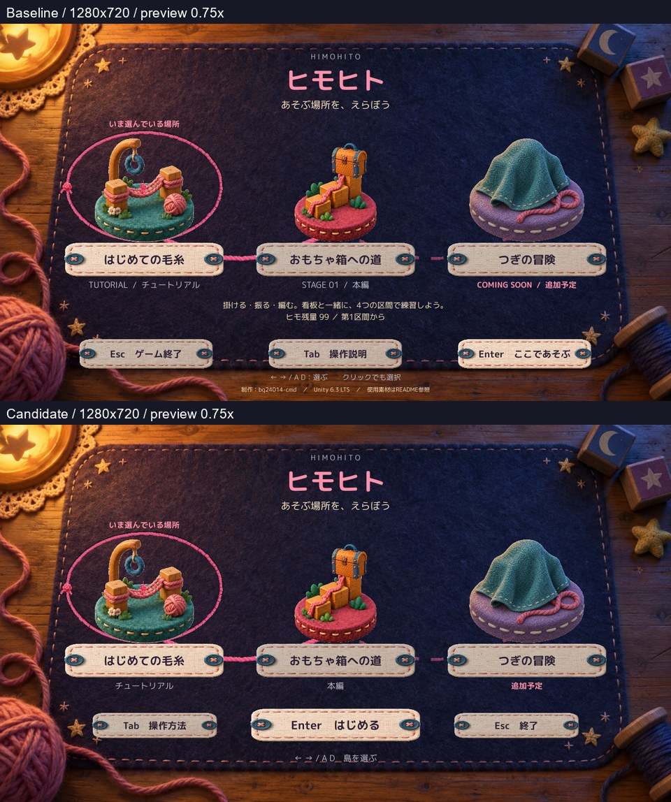

# C01 C02 C03 メニュー整理の隔離候補

2026年10月21日。Production基準は `3b6ac0dfe6a1035f8eed33d2efe720be51c481b3`。**StageSelectionView.csだけを変更した隔離候補1案**を作成した。開始を中央の主ボタンにし、紹介文・英語の重複・制作情報を整理した。島とゲーム名へ自然に目を戻しやすくなったと自己評価する。正式採用はHuman判断待ちで、Productionは未変更。

## 同一画角の比較

すべて実Unity Player画面。各解像度内でCamera・背景・島の位置・表示倍率は同じ。静止画では診断側から同じStageSelectionView.DrawAtTimeへ同じ時刻を渡し、選択演出の位相を揃えた。手動版は既存PrototypeHudから通常時刻で描画する。

上下の比較シートは0.75倍の表示用。元解像度の個別JPEGと、3島の比較は以下。

| 状態 | 1600×900 | 1280×720 |
|---|---|---|
| はじめての毛糸 | [比較](Images/1600_00_Island0_BeforeAfter.jpg) / [現行](Images/Baseline-1600_00_Island0.jpg) / [候補](Images/Candidate-1600_00_Island0.jpg) | [比較](Images/1280_00_Island0_BeforeAfter.jpg) / [現行](Images/Baseline-1280_00_Island0.jpg) / [候補](Images/Candidate-1280_00_Island0.jpg) |
| おもちゃ箱への道 | [比較](Images/1600_01_Island1_BeforeAfter.jpg) | [比較](Images/1280_01_Island1_BeforeAfter.jpg) |
| つぎの冒険 | [比較](Images/1600_02_Island2_BeforeAfter.jpg) | [比較](Images/1280_02_Island2_BeforeAfter.jpg) |
| 下部の原寸詳細 | [比較](Images/1600_Footer_Detail.jpg) | [比較](Images/1280_Footer_Detail.jpg) |

プレビューはJPEG化・必要な縮小と切り出しのみ。生成画像・描き足しは使っていない。通常選択時には下部の紹介文・残量説明・制作情報を出さず、削除した行へ別の装飾を追加していない。

## 文言と配置の変更

座標・サイズは1280×720基準。1600×900では全体を従来どおり1.25倍にする。字体は既存MPlusRounded1cのまま。

| 項目 | 現行 | 候補 |
|---|---|---|
| 開始 | 右、Enter ここであそぶ、255×56、18px | 中央、**Enter はじめる**、324×62、22px |
| ヘルプ | 中央、Tab 操作説明、255×56 | 左の補助ボタン、Tab 操作方法、238×48、18px |
| 終了 | 左、Esc ゲーム終了、255×56 | 右の補助ボタン、Esc 終了、238×48、18px |
| 選択キー | 長い矢印／A D／クリック説明、14px | **← → / A D 島を選ぶ**、16px |
| 補助表記 | TUTORIAL / チュートリアル、STAGE 01 / 本編、COMING SOON / 追加予定 | チュートリアル、本編、追加予定 |
| 通常の紹介文 | 掛ける・振る・編む、ヒモ残量99／50、第1区間から等 | メニューでは非表示 |
| 制作・Unity・README行 | 画面最下部 | メニューでは非表示。README等の元記録は保持 |

島の3名称、iconの254×197、名札の304×64、配置、縦横比、選択の毛糸枠は変更していない。主ボタンには既存の22pxスタイル、補助ボタンには従来の18pxを再利用。必要高さは主ボタン36.70/46px、補助31.12/32pxで収まり、縮小して押し込む処理は発動しない。

開始の上端を602→542、補助を550へ移し、選択案内を622へ配置。エラー／追加予定の説明だけを654の下段へ出す。将来のページ送りRectも操作群と重ならない位置へ移したが、今回の3島・1ページ以外は未確認。

StageCatalog.jsonは**変更していない**。表示側で既存subtitleの最後の`/`より右を表示し、利用不可は「追加予定」とする。長いdescriptionデータも削除せず、通常表示をやめただけ。実行時ResourcesのCatalogを読み出し、現行JSONと全データ一致を確認した。古いPlayer資産を更新後データとして扱っていない。

[採用検討用差分](Diff/ProposedStageSelectionView.patch)。ゲーム本体へは適用していない。

## 警告と開始条件

追加予定では主ボタンを無効にし、「この島は追加予定です。今はまだあそべません。」を表示する。既存StartSelectedStageによる拒否時のメッセージも保持。[追加予定と拒否後](Images/Candidate-1280_03_UpcomingRejected.jpg)

[読み込み先エラーの表示](Images/Candidate-1280_04_LoadError.jpg)は既存のエラー保持APIへ文言を渡した診断fixture。Scene参照を改変して読み込み失敗を起こした試験ではない。実際の読み込み先確認・失敗分岐はソース不変。今回、Tutorial／MainStageの正規Scene参照では開始を確認した。

## 演出と操作の動画

[現行・通常速度12.36秒](Video/Baseline-Menu-Realtime.mp4) / [候補・通常速度12.16秒](Video/Candidate-Menu-Realtime.mp4)

選択された練習島の人形、宝箱の開閉、毛糸枠、ヘルプ開閉、Tutorial開始時の布演出が見える。動画は通常の実時間で描画し、元の記録時刻間隔を使って25fpsへ変換した。音なし。説明ラベルはゲーム画像の外に付けた。**操作は既存APIによる自動実行であり、OSキーボード・クリック・Human試遊ではない。**現行／候補の実時間操作時刻にはフレーム単位の差があるため、厳密な同時刻比較は静止画を使う。

## 確認結果

最終実行は現行／候補×2解像度の各1回、いずれも実行エラー0。Compileは両版成功、既存CS0649警告4件ずつ。初期の診断方式の失敗は下記に分離している。

| 確認 | 結果と範囲 |
|---|---|
| 3島、文字・余白・重なり | 両解像度で自己確認。ボタン文字切れ、意図しない折返し、画面外はなし。追加予定・エラーも表示 |
| 島・画風・選択演出 | 描画等11メソッドが不変。上部～名札領域の差は720pで0、900pで最大1/255。人形の移動、選択切替時の宝箱開閉を動画と状態値で確認 |
| クリック領域 | GUI.Buttonと布の描画は同じRectを共用。ClothButtonメソッドは完全一致。幾何上の位置を確認したが、**物理クリック反応は未確認** |
| 左右・A/D・Enter・Tab・Esc | 入力処理ソースは不変。**OS実キー反応は未確認**。以下はAPI経路の確認 |
| 選択・ヘルプ | 3島選択、OpenMenuHelp／CloseHelp、ヘルプ中の選択・開始・終了禁止を確認 |
| 閉じると終了の分離 | CloseHelpと同じフレームのQuitFromTitleは抑止され、次フレーム以降にメニュー操作可能 |
| 開始と拒否 | Tutorial／MainStage開始、追加予定の開始拒否。開始残量99／50、Scene参照を保持 |
| メニューへ戻る | 既存イントロ終了APIの後、既存ポーズ＋戻る確認＋ReturnToTitle経路をAPIで実行。Intro全編やOS操作確認ではない |
| 終了 | QuitFromTitleが既存Application.Quitへ届くことを確認。QAでは終了要求を一度キャンセルして記録、手動版では介入しない |
| Tab説明画面 | 文面・配置・背景・処理は無変更。[実画面](Images/Candidate-1280_05_Help.jpg)を確認 |
| クリア旗・記録・音量 | 旗描画とStageProgressは不変。記録値・音量値は全記録点で保持。実行データは未クリアのため、旗の表示中の追加撮影はしていない |

既存の矢印／A D入力処理を自動APIで試したことにはしていない。入力の保持根拠はソース一致で、実反応は未確認。[Verification.json](QA/Verification.json)、[Candidate 900p](QA/Candidate-1600.json)、[Candidate 720p](QA/Candidate-1280.json)、[Baseline 900p](QA/Baseline-1600.json)、[Baseline 720p](QA/Baseline-1280.json)に分けて記録した。

Windows操作機能は1回の`list_apps`で `computer-use request timed out: list_apps`。再承認不足とは扱わず、同じ試行を重ねなかった。初回の疑似IMGUIクリックは不成立、次の撮影時計下のイントロ待機も上限に達したため、これらをPASSにしていない。[診断試行記録](QA/DiagnosticAttempts.json)。最終版は既存APIと実時間動画に切り替え、Introは終了API使用と明記した。Candidateのメニュー修正ソースはこの間変更せず、案を増やしていない。

## 実行方式と保護

**既存Unity6000.3.21f1非Development Player＋新規Compileしたmanaged overlay**。新規Unity Build／Editor Play成功ではない。既存PlayerのScene／Resourcesを再利用し、Catalog内容の一致と既存メニュー素材4種のロードを確認している。現在のdirty Sceneを再Buildした検証ではない。

手動版は通常のメニューから始まり、QA引数・自動入力・撮影・固定時計・自動終了はない。[起動方法](Launch.md) / [起動記録](QA/ManualSmoke.json)。比較元は別Runtime・別DLLで保持した。

Production HEADと既存5差分、stage空を維持。対象262ファイルのハッシュと過去Proofの対象ソース／DLLは不変。AGENTS.md、C06/C07・C08・C14・C17・C20・C22/C23を保持。READMEの制作名・環境・素材情報、既存未追跡物は変更していない。削除・reset・clean・stash、Project／Libraryの追加フルコピーは行っていない。

Humanの読みやすさ・理解度・採否、OS実キー／クリック、旗が立った状態の実表示、Intro全編、複数ページは未確認。技術確認だけで採用とは判断しない。C11・C18はHOLD、C05などの他課題に進まず、この1案でHuman Review待ちとする。
