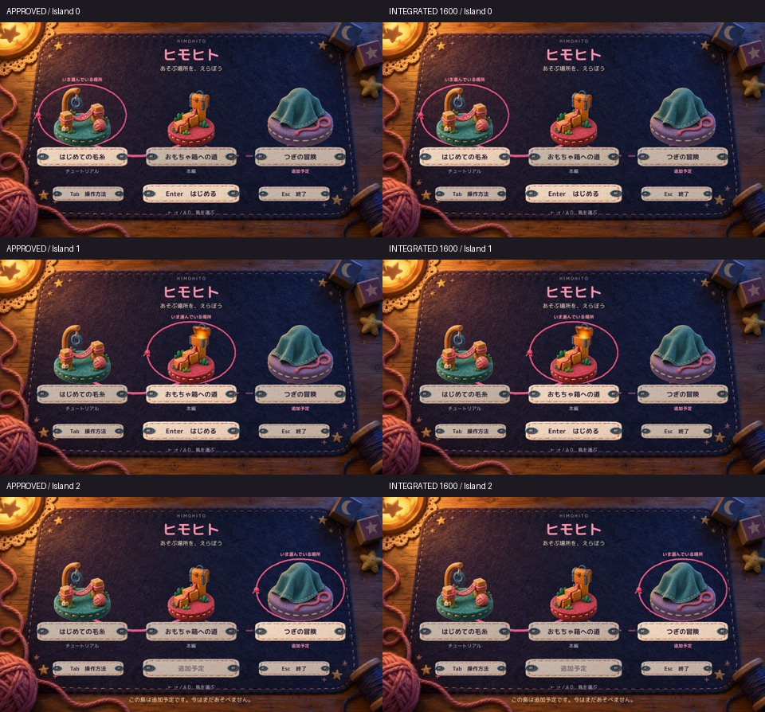

# C01 C02 C03 正式採用とProduction統合

Human承認候補をProductionへ統合した。mainへのpushは成功し、local HEAD／origin/main／remote mainがすべて`394b4a74e366678a9e0542d895b9a26f86993c19`で一致した。

- [Production commit](https://github.com/bq24014-cmd/himohito-prototype/commit/394b4a74e366678a9e0542d895b9a26f86993c19)
- [Production統合記録](https://github.com/bq24014-cmd/himohito-prototype/blob/394b4a74e366678a9e0542d895b9a26f86993c19/Docs/QA/C01C03MenuProduction_20261021/Integration.md)
- [採用候補と動画](../20261021T134500_JST/Report.md)／[保持した手動比較ランチャー](../20261021T134500_JST/Launch.md)
- [統合確認JSON](QA/IntegrationResult.json)／[1600×900](QA/Integrated-1600.json)／[1280×720](QA/Integrated-1280.json)／[ログ抜粋](QA/LogExcerpt.txt)

## 採用内容とソース一致

承認元は`3c37d9ba60ead7232be93206853e1578cea12d9f`。基準mainは`3b6ac0dfe6a1035f8eed33d2efe720be51c481b3`。StageSelectionView.csへ承認済みの表示差分だけを統合し、採用候補とのSHA-256完全一致を確認した。

```text
e64f145cc8402ae6af80d1ab284a793eb931682688078df5fe6c3127be80c76b
```

中央の「Enter はじめる」を主ボタンとし、Tab／Escを左右の補助ボタンへ整理した。補助表記は「チュートリアル／本編／追加予定」に統一。通常選択時の長い紹介文・残量説明・制作情報を画面から外し、余白を整えた。開始不可説明とエラー表示は保持した。

StageCatalog.json、ステージID、Scene参照、利用可否、クリア記録、音量設定は変更なし。島の素材・位置・縦横比、フォント、選択演出、毛糸枠、旗、開始時の布、Tab説明、ネイティブ入力処理は保持した。Production commitは実装1本と統合記録1本のみで、診断コード・自動入力・撮影処理は含まない。

## 実Player画面

左が採用候補、右が統合後。比較シートは実画面の縮小プレビューであり、画像生成や描き足しは行っていない。元PNGをローカルに保持している。




[統合後1600×900の通常画面](Images/Integrated-1600.jpg)／[エラー表示1280×720](Images/Error-1280.jpg)／[Tab説明1280×720](Images/Help-1280.jpg)

両解像度とも3島、追加予定拒否、エラー表示、Tab説明の各静止画は、採用候補と全ピクセル完全一致。文字切れ・重なり・不自然な空白は見られない。3ボタンの文字は既定サイズ18／22のまま枠内に収まり、表示とGUI.Buttonは同じRectを使用している。ただし、これは物理クリック成功の確認ではない。

## 回帰確認と実行方式

Unity 6000.3.21f1の参照アセンブリでProduction119ソースのみをコンパイルし、エラー0、既存CS0649警告4件。QA用には同じProductionソースへ外部fixtureを加え、既存の非Development Windows Playerにmanaged overlayで実行した。**新規Unity Build成功・Editor Play・OS実キー確認ではない。** 古いPlayerのserialized Scene／Resourcesを利用しており、dirtyなProduction Sceneの再Buildは行っていない。実行時catalog全データは現Productionと一致した。

1600×900／1280×720を各1回確認し、それぞれ23項目PASS、エラー0。

| 確認 | 結果と方法 |
|---|---|
| 3島選択、追加予定の開始拒否 | 既存SelectStage／StartSelectedStage APIでPASS |
| Tab説明開閉、背後の選択・開始・終了禁止 | 既存OpenMenuHelp／CloseHelp APIでPASS |
| 閉じるEscが終了へ流れないガード | CloseHelpとQuitFromTitleを同フレームに呼んで拒否を確認。実Esc押下ではない |
| Tutorial／MainStage開始、開始残量99／50 | ネイティブ開始・布遷移・Scene読込経路でPASS |
| メニュー復帰 | 紹介は既存RestoreState APIで終了後、ポーズ確認からReturnToTitle APIでPASS。全編試遊ではない |
| エラー表示 | 既存ReportStageStartErrorへエラー文を渡して表示。Scene参照やcatalogを変更してエラーを作っていない |
| 終了経路 | QuitFromTitleが終了要求へ到達。QAが一度だけ要求を取消し記録した |
| 記録と設定 | クリア記録と音量を維持。全状態スナップショット、ボタン配置、代表選択姿勢は採用候補と一致 |

開始布は実時間を使うため、同じ22フレーム後の撮影でも旧動画撮影あり／今回なしで経過秒・位相が異なる。1600×900の開始コマは同位相画像ではなく、ピクセル一致PASSにはしていない。布関連ソースは不変で、開始と遷移完了を確認した。復帰後等の小さな島アニメーション差もJSONに残している。新しい長い動画や同一QAの反復は行わず、[採用候補の短い比較動画](../20261021T134500_JST/Report.md)を保持する。

## 保護と未確認

保護対象262ファイル中、変更はStageSelectionView.csのみ。他261ファイルと過去Proofの主要13ファイルはハッシュ一致。MainStage Scene、README、学習ログ、既存QAのExeA／ExeBログの5件のdirty差分を維持し、今回のcommitに含めていない。metaは変更なし。フルProject／Library複製、削除、reset、clean、stashは行っていない。

Humanの正式採用は完了。統合後OS左右／A・D／Enter／Tab／Escと物理クリック、新規Build／Editor Play、旗が立った追加撮影、Intro全編、複数ページは未確認。以前のlist_appsタイムアウトを再試行せず、許可不足とも扱っていない。本人へ再添付や追加承認は要求しない。C11・C18はHOLDを継続し、他の改修へは進まない。
