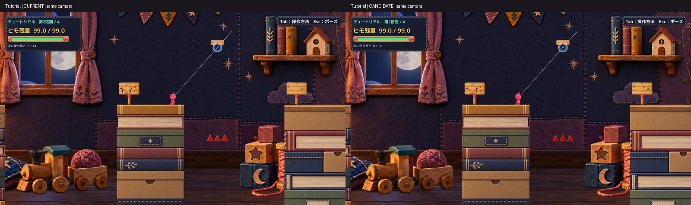
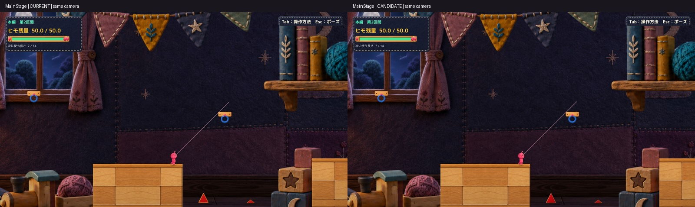
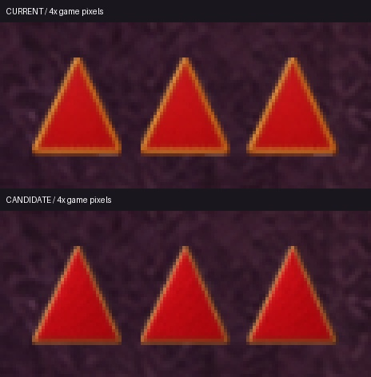
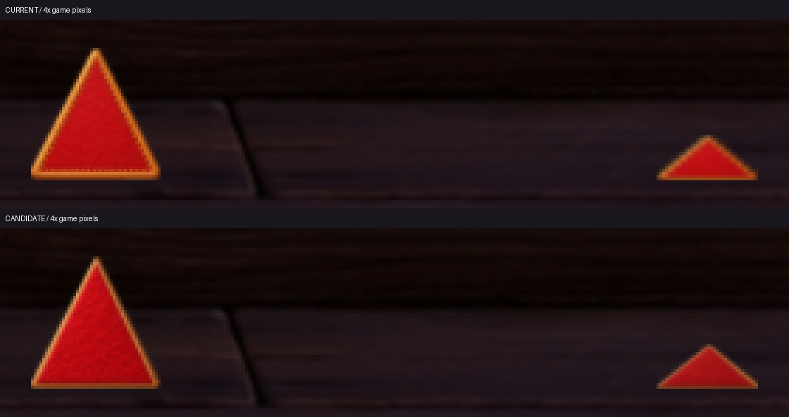

# C05 トゲの工作素材候補

既存の太く光る木枠と密な縫い目を、薄い木の縁・木目・赤い布の繊維へ置き換えた隔離候補1案。横長トゲには同じ画風の横長専用素材を使った。判定と物理は変更していない。Human Review待ちで、Production統合は行っていない。

[手動起動](Launch.md)／[比較JSON](QA/Comparison.json)／[表示の変更差分](Diff/ProposedToySpikeVisual.patch)／[新素材と生成記録](ArtGeneration.md)

## 現行で実際に使われた素材

基準Productionは`394b4a74e366678a9e0542d895b9a26f86993c19`。開始時main、stageは空。既存のMainStage Scene、README、学習ログ、ExeA／ExeBログの5件の差分を保持した。

現行ソースを使った実Playerで5本すべてのRendererを記録した。Spriteは`HimoHitoCraftSpike-v1 Processed`、Textureは`HimoHitoCraftSpike-v1 Transparent`。旧WoodenToySpikeや手続き三角形へのフォールバックではなかった。ルートSpriteRendererは無効、子Faceだけ有効、白のtint、Defaultレイヤーの描画順2。二重表示や白い背景板、意図しない前後関係による欠けは画面では見られなかった。

| Sceneと対象 | 位置 x y | ルート寸法 幅 高さ | Box Triggerの実寸 幅 高さ |
|---|---|---|---|
| Tutorial T2 Spike Left | 17.35, -2.65 | 0.55, 0.60 | 0.473, 0.540 |
| Tutorial T2 Spike Center | 18.00, -2.65 | 0.55, 0.60 | 0.473, 0.540 |
| Tutorial T2 Spike Right | 18.65, -2.65 | 0.55, 0.60 | 0.473, 0.540 |
| Main Section 2 Front Spike | 15.35, -7.90 | 0.90, 0.90 | 0.774, 0.810 |
| Main Section 2 Far Spike | 19.55, -8.20 | 0.70, 0.30 | 0.602, 0.270 |

全て回転0。ローカルBox sizeは`0.86, 0.9`、offsetは`0, -0.03`、Triggerを維持。見た目は三角形だが判定は既存の矩形であり、今回も三角形判定へ変更していない。

問題は主にデザインと拡縮にあった。小さい実画面では太く明るい縁が警告アイコンの外枠のように目立つ。さらに横長のFar Spikeは同じ素材を幅0.7／高さ0.3へ独立拡縮するため、縁・模様が縦方向へ圧縮される。コードの優先パスだけを見て素材未反映と判断していない。

## 通常画角と同倍率拡大

左右比較は左CURRENT／右CANDIDATE。各Sceneの両版で同じ位置、Camera、1600×900を使った。全体比較は両方を均一に半縮小した表示用プレビューである。

[現行の通常画面](Images/Tutorial_Current.jpg)／[候補の通常画面](Images/Tutorial_Candidate.jpg)

[現行の通常画面](Images/MainStage_Current.jpg)／[候補の通常画面](Images/MainStage_Candidate.jpg)

以下は同じ画面領域を4倍にしたもの。補助画像の上CURRENT／下CANDIDATE。元のゲーム画素をnearestで拡大しており、細部を生成・描き足していない。

新素材の原寸は[通常形](Assets/HimoHitoCraftSpike-v2.png)と[横長形](Assets/HimoHitoCraftSpikeWide-v2.png)。装飾の金色ステッチをなくし、木の縁を薄く、光沢を控えめにし、赤い布の繊維と右側の厚み・陰影を加減した。色だけの変更ではない。台座や新しい装飾は足していない。

自己評価では、枠の主張と横長の密な縫い目は減り、周囲の工作素材へ近づいた。一方、通常画角ではTutorialが約28×31px、Far Spikeが約36×16pxしかなく、布の細部は読めない。**三角形記号らしさは残る**。地形から離れた既存配置もそのままであり、設置理由や浮遊感を今回解消したとはしていない。赤色と上向きの危険形状は読み取れるが、世界観への適合と採否はHuman判断に残す。

## 新素材の実反映と先端の対応

新素材は別名のPNG2枚と、それぞれのmetaを隔離先に作成した。旧素材は不変。候補のToySpikeVisual.csだけに、新素材優先・縦横比による選択・ほぼ透明なノイズを除いた描画範囲の算出を追加した。既存Craft-v1以下のフォールバック、揺れ、判定処理は残した。

生成PNGにはalpha 1〜7のほぼ見えないノイズがあり、従来のalpha>0による外接範囲では先端と底辺が内側に縮んで見えた。新素材だけalpha>=8の外接範囲＋2px余白でSpriteを切り出し、従来どおり元のローカル寸法へ合わせた。元画像のalphaやRGBを書き換えず、既存素材の切り出しも変更していない。最終版の見た目の外接寸法は現行と同じで、最大浮動小数差は本編で`5.96e-8` world unit。

**素材更新はmanaged overlayだけではない。** 凍結PlayerのResourcesには新PNGが焼き込まれていないため、外部fixtureが`Runtime/ReviewAssets`の実PNGを読み、SHA-256を算出してLoadImageで復号した。既存の白抜き・alpha加重mipmap処理と候補のCreateTightSpriteを通し、描画用cacheへ供給した。Rendererの実Spriteがその生成オブジェクトと同一であることを5本すべて、再読込後も確認した。QAの`bakedResource`はfalseであり、新規Unity Build／Resources更新成功とは扱わない。反映コードは[外部fixture記録](Diff/ExternalReviewFixture.cs.txt)、実測SHAとサイズは各QA JSONのassetsにある。

## 接触動画と判定の保持

- [本編の通常サイズ接触動画](Video/MainStage-CandidateContact-FullSize.mp4)
- [本編の現行／候補比較動画](Video/MainStage-ContactComparison.mp4) 左CURRENT／右CANDIDATE
- [Tutorialの現行／候補比較動画](Video/Tutorial-ContactComparison.mp4) 左CURRENT／右CANDIDATE
- [本編の接触連続コマ](Images/MainStage_ContactFrames.jpg) 同一領域の2倍拡大

すべて自動診断による25fps・3.12〜3.16秒の動画。50Hzの固定撮影刻みを2コマごとに保存し、動作区間を通常のシミュレーション速度で再生する。音声は収録していない。ポーズ待ち区間の実時間は比較対象ではない。OS実キー録画・Human試遊ではない。

接続は入口床で既存TryAttach APIを使った。その後、接触比較用に同じ位置・速度へ診断配置し、実際のPhysics2D接触とRopeSpikeHazardを通した。本編の動画ではTriggerの上から落下し、HUDの接続中表示→接触解除を確認できる。単独で接触APIを呼んで演出だけを再生したものではない。Tutorialは近接配置からの接触記録で、通常ルート攻略の記録ではない。接触実測はTutorial中央／本編手前の代表2本で、残る3本への個別接触は未実測。外観とCollider契約は5本すべて確認した。

| 確認 | 結果 |
|---|---|
| Compile | Unity 6000.3.21f1参照でエラー0。既存CS0649警告4件 |
| 対象5本のルート・回転・寸法・Box・Trigger | 現行と完全一致。Scene再読込後も保持 |
| 接続中の接触 | 既存判定で解除、残量Tutorial99／本編50を維持。接触揺れと毛糸繊維の生成を確認 |
| 未接続の接触 | 接続状態はfalse、今回の接触揺れ・繊維を新たに発生させない既存挙動を保持 |
| ポーズと復帰 | 既存ポーズAPIで物理と接触揺れの停止・再開を確認。実Escではない |
| R | 既存RestartFromCheckpoint APIで入口、選択長8／7、残量99／50、橋0、未接続へ復帰 |
| 同一入力での比較 | 各Scene236物理フレーム。位置・速度・anchor・残量・選択長・Camera・接地・接続・入力の差は全て0 |
| 手動候補の通常起動 | 両SceneともQA引数なしで準備完了・待機・エラーなし。自動入力・撮影・時計固定・自動終了なし |

比較根拠は[Comparison.json](QA/Comparison.json)、[Tutorial現行](QA/Baseline-Tutorial.json)／[候補](QA/Candidate-Tutorial.json)、[本編現行](QA/Baseline-MainStage.json)／[候補](QA/Candidate-MainStage.json)。映像での揺れ・繊維は小さいため連続コマも参照する。接触時に残る細線は既存の未接続照準ガイドを含み、接続が続いている証拠とは扱わない。

## 実行方式と未確認

既存の非Development Unity Player＋最新Productionソースを基準とするmanaged overlay＋明示的な外部PNG読込。旧Playerのserialized Scene／Resourcesを使い、dirtyなProduction Sceneを再Buildしていない。metaは既存形式に合わせて用意したが、Unity Importerによる新素材の焼込み、新規Unity Build、Editor Playは未確認。

computer-useの初期化後、list_appsが`computer-use request timed out: list_apps`で失敗。反復せず、OS実キー・物理クリックは未確認とした。継続許可の不足とは扱っていない。Humanの見た目・手応え・正式採否、全区間通し、他の解像度、音の実聴も未確認。自動QAのPASSはVisual採用のPASSではない。

Production保護266ファイルのハッシュは全一致し、stageは空、既存5件のdirty差分はそのまま。C08・C14・C20・C22/C23・C06/C07・C17・C01〜C03のソースを保持し、過去Proofも変更していない。フルProject／Library複製・削除・reset・clean・stashは行っていない。共有commitはこのレビュー資料配下だけで、Production統合・mainへのcommit/push・C09等の改修は行わない。
