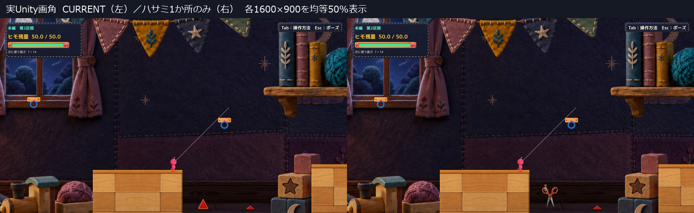
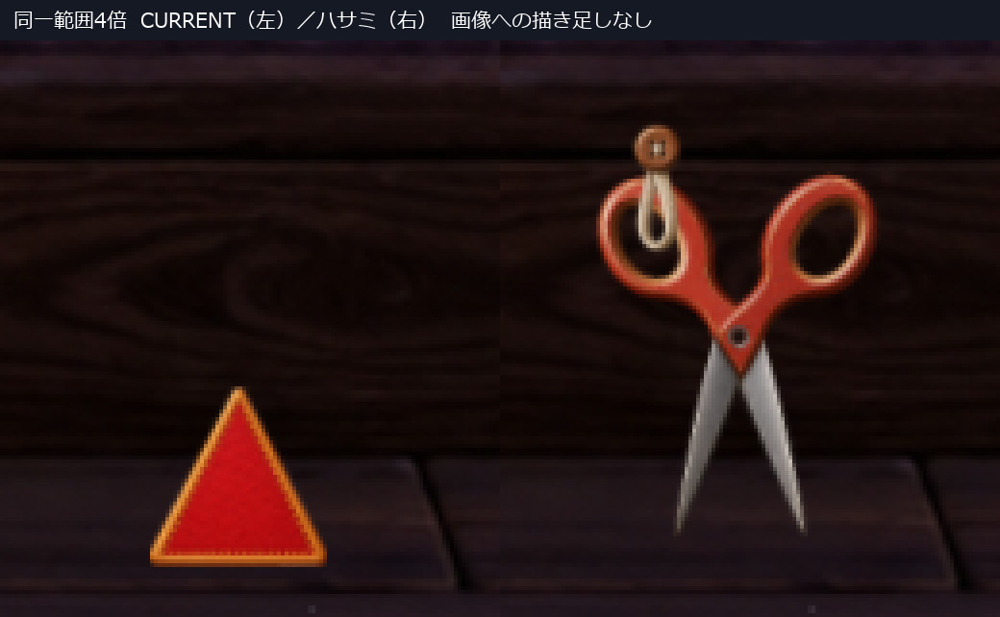
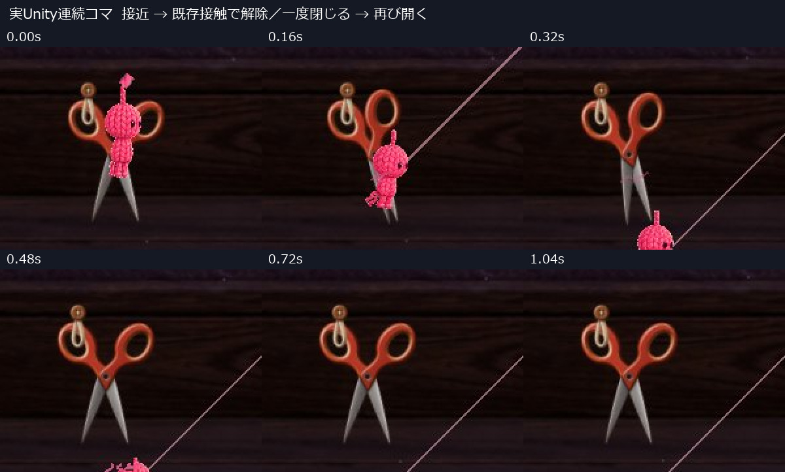
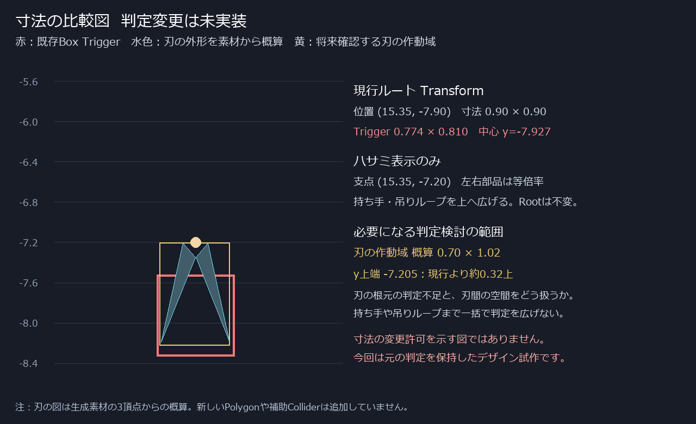

# C05 工作用ハサミのデザイン試作

本編第2区間の手前トゲ1か所を、赤い木製持ち手と金属刃の工作用ハサミへ置き換えた表示試作。背景の木部に留めたボタンと布ループへ片方の持ち手を通し、そこに掛けてある道具として見せる。通常画角での識別性を優先し、旧トゲの矩形に押し縮めていない。

**デザインレビュー待ち。Production未統合。** 旧素材調整候補 `80a0048680082e8d5bde14a2aaad196a51edb882` はHuman採用保留として保持した。以前の「赤い上向き三角形を維持する」条件は今回解除された。C11・C18の保留も継続する。

## 実ゲーム画角の比較

左右とも1600×900の実Unity Player撮影を均等に50%表示。左はProductionの現行三角トゲ、右は今回のハサミ。右奥の横長トゲとTutorialの3本は変更していない。原寸は[現行](Images/Current_Normal.jpg)／[ハサミ](Images/Scissors_Normal.jpg)。

拡大も実ゲーム画像の同一範囲・同倍率。新しいハサミはSpriteとしてUnity内に描画されている。ゲーム画像へ素材を後から貼り付けた合成見本ではない。比較画像は縮小・切り抜き・見出し付与のみで、描き足していない。

## 待機と接触反応

- [待機の原寸動画](Video/Scissors-Idle-FullSize.mp4) — 2秒、1600×900。片方の持ち手を固定し、もう片方が開いた状態で小さく動く。
- [接触反応の原寸動画](Video/Scissors-Contact-FullSize.mp4) — 1.32秒、1600×900。既存の接触・解除に続き、一度閉じて再び開く。
- [待機の現行／候補比較](Video/Idle-Comparison.mp4)／[接触の現行／候補比較](Video/Contact-Comparison.mp4) — 左CURRENT、右ハサミ。同条件の記録を各50%表示。

表示のヒンジは固定。待機は開角約31〜33度を保ち、片側だけ±1.2度動く。接触後は0.36秒で「閉じる→短く止まる→再び開く」。待機中に閉じる周期は設けず、消灯・退色・消失による安全状態の合図も加えていない。

接触反応は既存 `ToySpikeVisual.contactElapsed` の発火を読み取る。実際の `RopeSpikeHazard` が接続中のPlayerとの重なりを検出し、既存の解除処理を行った後の表示であり、動画のためにCutを直接呼んでいない。未接続接触では従来の切断反応が発火しないため、この表示も反応しない。接触規則の変更はしていない。

撮影は診断用の初期配置と自動進行。接地から既存APIでE相当の接続を行い、その後の接近開始位置・速度を診断設定して実際のTriggerへ落下させた。通常の入口からHumanが攻略した動画ではない。50Hzシミュレーションを2フレームごとに撮影し25fpsで収録した通常速度。途中のポーズ確認の実時間待ちは動画から省略。音声なし。解除後に見える細い線は既存の未接続時照準ガイド。

## 判定との整合は未完了

この図は実測座標と素材上の刃の代表点から作った**寸法説明図**で、新しいColliderを実装した画像ではない。

| 項目 | 今回の状態 |
|---|---|
| 対象 | MainStage / Main Section 2 Front Spike |
| Root位置・回転・寸法 | (15.35, -7.90), 0度, 0.90×0.90。変更なし |
| 既存Box Trigger | 幅0.774×高さ0.810。中心y=-7.927。変更なし |
| ハサミ表示支点 | (15.35, -7.20)。表示子だけを上へ広げた |
| 刃の作動域の概算 | 幅約0.70×高さ約1.02、y=-8.226〜-7.205 |
| 元判定との主要な差 | 刃の根元側の約0.32が既存判定の上へ出る |

持ち手と吊りループを含む表示全体は旧47px角より大きい。刃の根元に触れても既存判定へ入らない箇所があり、逆に開いた刃の間は元の矩形判定で接触する。**見た目と判定が一致した完成ギミックとしては扱えない。** この試作は物理・判定変更を混ぜず、その差を判断できる状態で止めている。

このデザインを進める場合の最小の次検討は、図の刃の作動域に限った判定整合。持ち手・ボタン・ループまで一括で判定を広げる案ではない。刃の間を常時危険とするかも含め、仕様と範囲の承認が必要になる。今回そこへは着手していない。

## 静止画と動きの自己評価

- **物としての識別性：改善。** 通常画角でも2つの持ち手の穴、支点、2枚の金属刃が読み取れ、三角形の標識から工作道具へ変わった。
- **設置の自然さ：改善候補。** 木部のボタンと布ループで片方の持ち手を支える。素材は木・赤い塗装・布・落ち着いた金属色。背景の家具や棚は動かしていない。
- **静止した危険性：Human確認が必要。** 開いた尖った刃は見えるが、吊られた文具を背景小物と誤認せず、「触れるとヒモが切れる」と理解できるかは未確認。
- **動きの読みやすさ：接触の区切りを確認。** 接触に一度だけ閉じて戻り、常時の開閉トラップにはしていない。待機の小さな動きは通常画角では控えめ。閉じた瞬間を安全と誤解しないかは未確認。

最も大きい残課題は、識別性を得るために広げた刃の表示と、維持した旧判定の不一致。技術チェックのPASSを、この整合やVisual採用のPASSには置き換えない。

## 確認結果と実行方式

[比較JSON](QA/Comparison.json)、[現行記録](QA/Current.json)、[ハサミ記録](QA/Scissors.json)、[主要ログ](QA/LogExcerpt.txt)。

同条件277物理フレームで、Root位置・速度・残量・選択長・Camera・接地・接続状態・既存接触タイマーの最大差は0。両トゲのRoot／Collider／Triggerは再読込後も同一。本編手前1か所だけに表示コンポーネントを追加した。既存の接触解除、ポーズ・復帰、Rによる入口状態への復帰、Scene再読込をAPIと自動進行で確認した。最終記録は現行8チェック・候補10チェック、エラー0。

初回のポーズチェックは落下失敗画面の後に実施しており、既存の「失敗画面ではポーズを閉じる」処理により不成立だった。プレイ中の接触直後へ確認時点を直して検証した。失敗画面の仕様は変更していない。最初の非表示起動で得た黒画像はVisual証拠に使わず保持し、提出画像は描画するゲームウィンドウから撮影した。

実行は既存の **Unity 6000.3.21f1 非Development Player＋managed overlay＋外部PNGの実読込**。Productionの全RuntimeソースをUnity参照DLLでコンパイルし、隔離した表示・撮影fixtureを追加した。Compileエラー0、既存警告4。新規Unity Build成功やEditor Play成功とは扱わない。

生成PNGを `Texture2D.LoadImage` で読み、SpriteRendererがそのテクスチャを使用していることを確認した。Spriteの矩形と支点で左右の部品を切り出し、画像のRGB／alphaは加工していない。素材SHAと実行DLLは[Manifest](QA/RuntimeManifest.json)。新素材のUnity importer／Resources焼込みは未確認。

手動経路は自動入力・自動撮影・撮影時計・自動終了なし。[起動手順](Launch.md)を参照。実キー操作・Human試遊・音の実聴・5本への展開・全区間の通し確認は今回未実施。

## 素材とソース

[生成素材とプロンプト](ArtGeneration.md)、[表示コード](Diff/CraftScissorsDesignVisual.cs.txt)、[隔離確認fixture](Diff/GroundingReview.cs.txt)。Productionのコード差分は0。今回のコードは独立した表示試作で、そのまま本番統合する差分ではない。

Production main `394b4a74e366678a9e0542d895b9a26f86993c19` と既存5件のtracked差分、stage空を維持。保護対象266ファイルと旧C05の素材・DLLに変更なし。[保護結果](QA/Protection.json)。旧候補、採用済みVisual、他のProofを保持し、追加Project／Library複製・削除・mainへのcommit/pushは行っていない。

このハサミ1案について、物としての自然さ、静止した危険性、開閉反応の分かりやすさをHumanが判断する段階で停止する。
