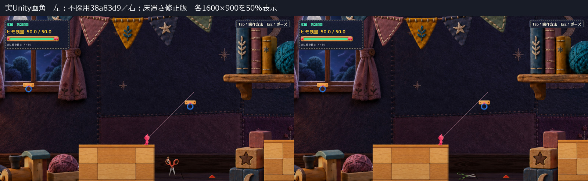
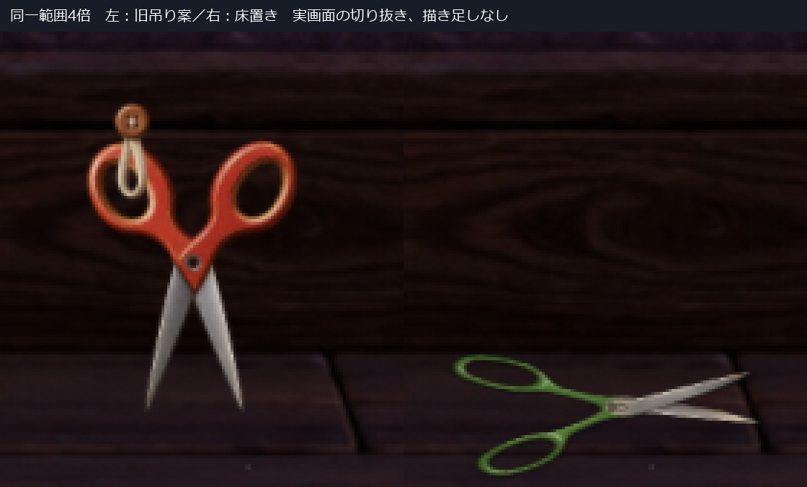
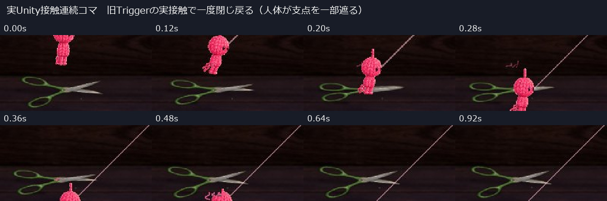
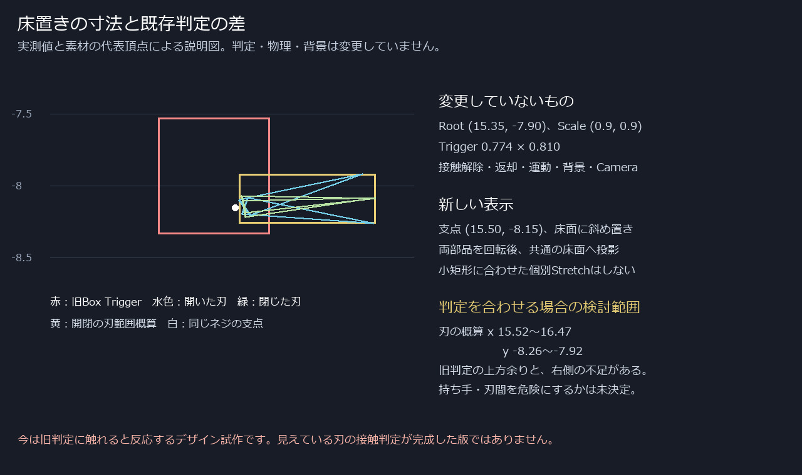

# C05 木の床に置いた緑ハサミのデザイン試作

本編第2区間の手前1か所に、開いた工作用ハサミを木の床面へ斜めに置く表示候補を作った。細身の緑の楕円ハンドル、長い柄、中央ネジ、先細りの金属刃を新素材で構成。ボタンと布ループは使わない。

**デザインレビュー待ち。Production未統合。** 旧 `38a83d9d1af88091d37c9503c34b4e4816ac8e07` は「吊り具とハサミの形に違和感」のHuman不採用を記録し、[旧報告](../20261021T160305_JST/Report.md)・素材・実行物を保持した。旧案を採用済みとして再利用していない。素材調整案 `80a0048` は採用保留のまま。

Humanから追加で「実物写真はイメージ用であり、写真そのものは関係ない」と回答があった。写真一致は要件にせず、文章で指定された構造を基準に制作した。

## 通常画角と置き方

左は不採用の吊り案、右は床置き案。両方とも実Unity Playerの1600×900を同じ50%で表示。Camera・背景・地形・Player位置は同じ。[新案の原寸](Images/Floor_Normal.jpg)／[Productionの三角トゲ](Images/Current_Normal.jpg)。

素材をスクリーンショットへ貼り付けた見本ではなく、UnityのSpriteとして実際に表示している。比較画像の加工は切り抜き・等倍率拡大縮小・見出しのみ。

細い柄を長く取り、持ち手と刃を左右それぞれ1部品とした。平面上のハサミを回転した後、共通の床面方向へ投影して奥行きを表現する。左右を別々に潰したり、旧0.9角のトゲへ寸法を合わせたりしていない。小さな接地影を添え、吊り具・台座・新しい床は追加していない。

ここで見える木の床は既存の背景絵。新たな歩行可能な床ではなく、落下失敗の規則もそのまま。背景を描き換えて平面を作った案ではない。

## 開閉の構造と動き

- [通常画角の待機動画](Video/Floor-Idle-FullSize.mp4) — 4秒。開いた状態のごく小さな動き。
- [通常画角の接触動画](Video/Floor-Contact-FullSize.mp4) — 1.32秒。一度閉じて戻る。
- [旧吊り案と新床置き案の待機比較](Video/Old-New-Idle-Comparison.mp4) — 2秒、同倍率。

左右の「持ち手→柄→刃」は分割変形させず、同じネジを中心に回す。基準の開角は両側±25度、閉じた角度は±6.4度。閉じると先端が重なり、持ち手同士は隙間を保つ。記録中、両部品とネジの支点距離は0だった。連続コマの閉じる瞬間には主人公が支点を一部隠すが、柄と刃の長さは変化せず、戻った姿勢にも継ぎ目の飛びは見られない。

待機は開いた角度から±0.8度だけ変化し、周期的な全閉はしない。接触で0.42秒の「閉じる→短く止まる→戻る」。色を消す・透明にする等の安全表示は加えない。閉じた瞬間を安全と受け取らないかはHuman未確認。

接触は既存 `RopeSpikeHazard` による接続解除の後、既存表示の接触タイマーを読む。未接続では従来の切断イベントが発火せず、この閉じ反応も起きない。新しい接触ルールは設けていない。

動画は診断APIで入口・接近位置・速度を設定し、接地から既存の接続APIを通した後、実Physics2DのTrigger接触を記録したもの。自動撮影であり、OSキー操作・Human試遊ではない。50Hzのシミュレーションを2フレームごとに保存し25fps化した通常速度。ポーズ試験の実時間待ちは省略、音声なし。解除後の細い線は既存の照準ガイド。

## 判定を合わせるために必要な範囲

実測座標と素材の代表頂点を使った説明図。物理・判定の変更は未実装。

| 項目 | 今回の状態 |
|---|---|
| 対象 | MainStage / Main Section 2 Front Spike の表示1か所 |
| 既存Root | (15.35, -7.90)、回転0、Scale 0.9×0.9。不変 |
| 既存Trigger | x=14.963〜15.737、y=-8.332〜-7.522。不変 |
| 表示ネジ位置 | (15.50, -8.15)。表示子のみ |
| 刃の開閉範囲概算 | x=15.52〜16.47、y=-8.26〜-7.92。待機の微小動作は別 |
| 差 | 旧判定が見た目より上に余り、刃の右側には判定が足りない |

**刃に沿った危険判定は完成していない。** 接触動画も旧判定へ触れた反応で、見えている刃と一致した命中確認ではない。今後整合させるなら刃の局所作動域が検討対象。持ち手・刃の間を危険とするか、床に置かれた物がどのプレイ奥行きへ届くかも判断が必要。今回はColliderの移動・拡張・追加、判定ルール変更を行わず止めている。

## 自己評価と残る弱点

| 観点 | 自己評価 |
|---|---|
| 物の識別 | 通常画角でも2つの細い穴、長い柄、交差する金属刃からハサミと読める。旧案の大きな持ち手と短い柄を変更した |
| 設置の理由 | 床へ置かれた日用品という説明がつく。ボタンや布ループによる後付けの吊り方を撤去した |
| 開閉 | 同じ支点で持ち手と刃が一体に動く。静止時もネジと先細りの刃が見える |
| 静止した危険性 | 尖った刃は見えるが、緑の持ち手と床上配置は背景の文具にも見える。危険物として十分かは未確認 |

最大の残課題は表示と旧Triggerの不一致。次に物理変更を承認する前に、この床置き形状自体が自然か、危険として読めるかをHumanが判断する段階。技術PASSをデザイン採用の証明にはしない。

## 確認結果と実行方式

[比較結果](QA/Comparison.json)／[新案記録](QA/FloorScissors.json)／[現行記録](QA/Current.json)／[主要ログ](QA/LogExcerpt.txt)。

同条件377物理フレームでRoot位置・速度・残量・選択長・接続状態・接地・Camera・既存接触タイマーの差0。2か所の既存HazardのRoot／Box／TriggerはScene再読込後も同一。新表示の追加は手前1か所だけ。既存の接触解除・返却、接触中のポーズ・再開、R、再読込をAPIで確認。最終エラー0。手動経路は起動READYと5秒待機中の継続動作を確認し、自動入力・撮影・終了は開始しなかった。

実行は **Unity 6000.3.21f1の既存非Development Player＋managed overlay＋外部PNGの実読込**。Production Runtimeソース119本は変更せずコンパイルし、隔離表示とfixtureを追加。Compileエラー0、既存警告4。新規Unity Build、Editor Play、素材のResources焼込み成功とは扱わない。新PNGを読み込んだSpriteRendererとSHAは[Manifest](QA/RuntimeManifest.json)で確認できる。

OS実キー・物理クリック・Human試遊・音の実聴は未確認。今回は操作ツールの再試行を行っておらず、新しいタイムアウトがあったとは記録しない。別解像度・5本への展開・全区間の確認も対象外。

## 差分と保護

[表示差分](Diff/FromRejectedDisplay.patch)／[表示ソース](Diff/CraftScissorsDesignVisual.cs.txt)／[診断fixture](Diff/GroundingReview.cs.txt)／[新素材と生成指示](ArtGeneration.md)／[手動起動](Launch.md)。今回の差分は隔離設計用で、Productionへ適用する採用用patchではない。

Production main `394b4a74e366678a9e0542d895b9a26f86993c19`、既存tracked差分5件、stage空を保持。266ファイルと旧C05の素材・DLL・ソースに差なし。[保護結果](QA/Protection.json)。新規Project／Libraryのフルコピー・削除はせず、不変のPlayer付属ファイルを共有し、今回のDLLと素材を別に置いた。

C11・C18の保留を継続。本番統合・mainへのcommit/push・5か所展開は行わず、この1案でHuman Review待ちとする。
