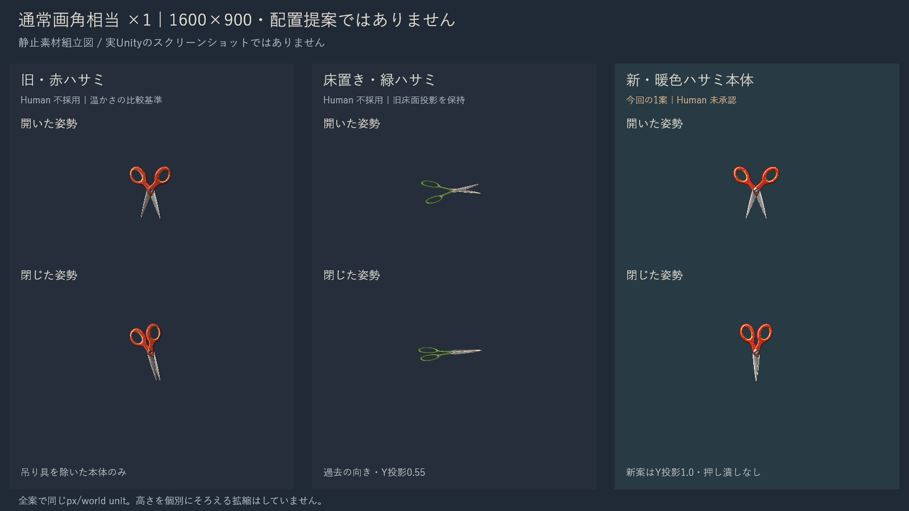
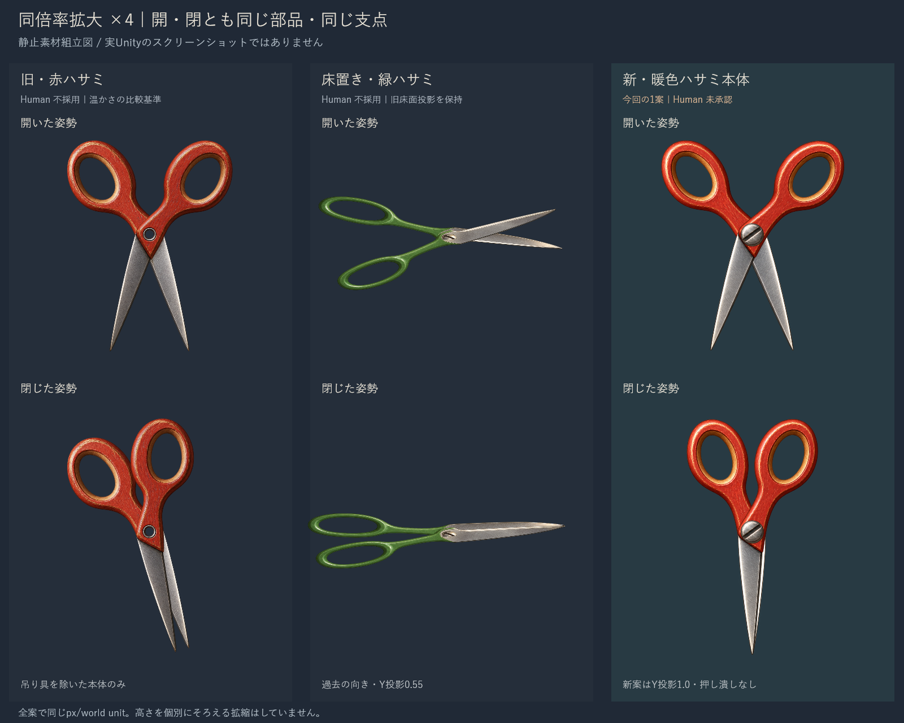
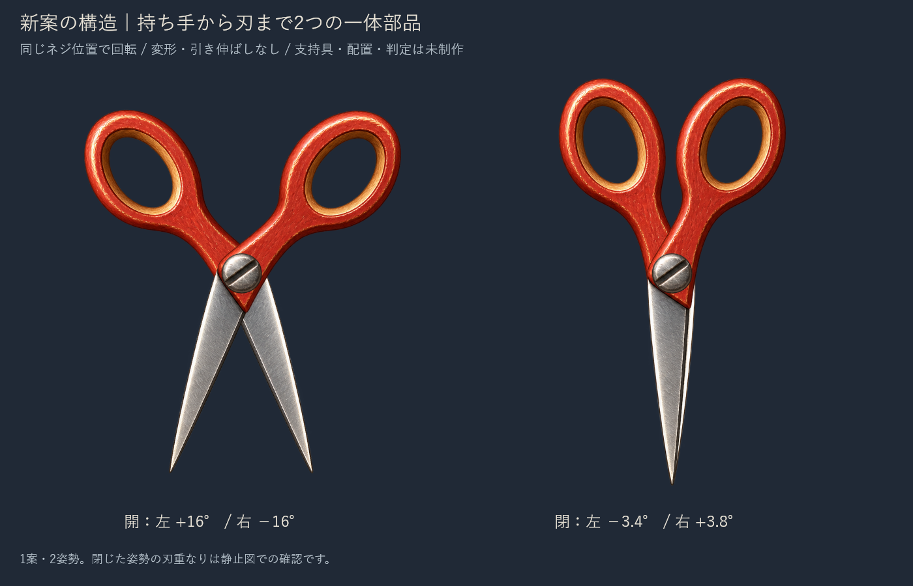

# C05 暖色ハサミ本体のデザイン比較

赤い持ち手の厚みと立体感を基準に、ハサミ本体1案を作成しました。**配置や支持具を含まない、開・閉2姿勢のデザイン確認用です。Human採否待ちで、Productionには反映していません。**

## 今回の比較

まず[通常画角相当の大きさ](Images/normal.png)、次に[同倍率の拡大比較](Images/large.png)で確認してください。

左：旧赤案。中央：床置き緑案。右：今回の暖色案。すべて画像生成素材を静止組立した図で、**新しい実Unity画面ではありません**。旧赤案の吊り具は本体比較からだけ除外しています。過去のProofや素材は変更していません。

## Human判断の記録

| 案 | Human判断 | 今回の扱い |
| --- | --- | --- |
| [旧赤ハサミ](../20261021T160305_JST/Report.md) 38a83d9 | 不採用。ボタン・布ループと本体形状に違和感 | 温かい色・厚み・立体感だけを参考。旧案全体を採用扱いにしない |
| [床置き緑ハサミ](../20261021T164023_JST/Report.md) 25ba244 | 不採用。「デザイン性は前回の方がよかった」 | 細身・緑色・床面投影を新案へ引き継がない |
| 今回の暖色ハサミ | 未承認 | 本体の形と画風だけをレビュー |

実物写真は使用していません。写真の再現やユーザーへの再添付は前提としていません。

## 本体の変更

- 赤い厚みのある楕円形の持ち手と、柔らかい面の陰影を維持。柄は持ち手から中央へ自然に細くつなげました。
- 左右それぞれが「持ち手・柄・刃」の一体部品。中央の同じ穴へ小さなネジ頭を重ねています。
- 同一の2部品を共通支点で回して、開いた姿勢と閉じた姿勢を作成。閉じ姿勢だけ別の絵に差し替えたり、部品を伸縮したりしていません。
- ボタン・布ループ・新しい支持具を加えていません。新案の縦方向投影は1.0で、床置き緑案の0.55圧縮は使っていません。

開：左+16度／右−16度。閉：左−3.4度／右+3.8度。角度は単体図の組立値で、実装するアニメーション仕様の承認を求めるものではありません。

## 比較倍率

既存の緑案の[実Unity記録](../20261021T164023_JST/QA/FloorScissors.json)にある51.724140167 px/world unitを使用。1600×900の通常比較は、この値をそのまま使った想定表示です。画像を100%表示すると想定ピクセルサイズになります。ブラウザやGitHubの自動縮小表示では小さく見えます。

旧赤と新案の素材密度は500 px/world unit。緑は既存の550基準を元画像寸法へ換算。全案共通のカメラ倍率で描き、個別に高さをそろえる拡縮はしていません。拡大比較は全案4倍、新案の構造補助図は6倍です。緑案だけ過去の方向−83度と床面投影0.55を保持しています。

これは同倍率の**単体比較**であり、新案を背景へ置いた画面や、接触判定との整合を確認した画像ではありません。

## 自己レビューと残る弱点

| 観点 | 今回の自己評価 |
| --- | --- |
| 通常倍率で物が読めるか | 赤い持ち手の2つの穴・交差した金属刃が残り、緑案より厚みと存在感を読み取りやすい |
| 持ち手から刃への連続性 | 開閉とも同じ部品でつながる。中央のネジを共有し、持ち手が刃から分離しない |
| 旧赤案からの改善 | 吊り具なし。閉じ姿勢で刃先がそろい、旧赤案にあった刃先の開き・傾きが小さい |
| 残る弱点 | 閉じると刃が細くなり、通常倍率では危険性が弱くなる可能性。持ち手のハイライトも背景との同時表示では強く見える可能性がある |
| Human判断 | 未確認。今回は形と画風の採否を待つ |

## 制作方式と確認範囲

新素材は組み込みimagegenで生成し、RGBA原本を保持しました。[生成指示](Assets/GenerationPrompt.txt)、[新素材](Assets/HimoHitoWarmScissorsParts-v3.png)、[meta](Assets/HimoHitoWarmScissorsParts-v3.png.meta)を同梱しています。画像生成スキルを使用し、手作業の色塗り・輪郭修正・アルファ削除はしていません。

静止図はオフラインのCanvasで元画像の部品を切り出し配置したものです。[表示テンプレート](Renderer/template.html)、[描画処理](Renderer/render.cjs)、[組立値](QA/AssemblyMetadata.json)を保存しています。新素材のmetaは用意済みですが、Unityへのインポート確認は行っていません。

ローカルHTMLのアプリ内ブラウザ表示はfileプロトコルのセキュリティ制限で拒否されました。別のブラウザやネットワーク経由で回避せず、ブラウザを使わない静止画像生成と画像閲覧で比較図を確認しました。

今回はUnity起動、managed overlay、新規Build、OS操作、動画、待機・接触アニメーション、物理QAを実施していません。単体デザイン確認という指定範囲に合わせたものです。配置・判定・安全に見える状態の有無は、形と画風の承認後に別途扱います。

## 保護と共有

Productionは `394b4a74e366678a9e0542d895b9a26f86993c19`。今回の変更はレビュー資料と独立素材だけです。Production/main、既存の5件のtracked差分、staged状態、既存のトゲコード・判定コードを保持。過去の素材2枚は元のSHAと一致しています。[確認範囲](QA/Protection.json)を参照してください。全未追跡ファイルの網羅監査は行っていません。

共有先は `codex/review-c05-spikes`、[固定入口](../../LATEST.json)。新規ゲーム実装差分はありません。5本への展開・Production統合は行わず、C11・C18のHOLDを継続します。

次に必要なのは、今回の本体が旧赤案の温かさを保ちつつ、自然なハサミの形になっているかのHuman Reviewです。
