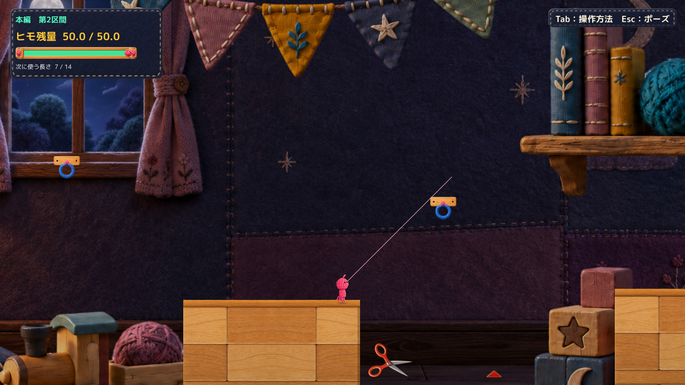
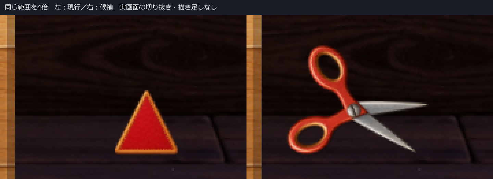
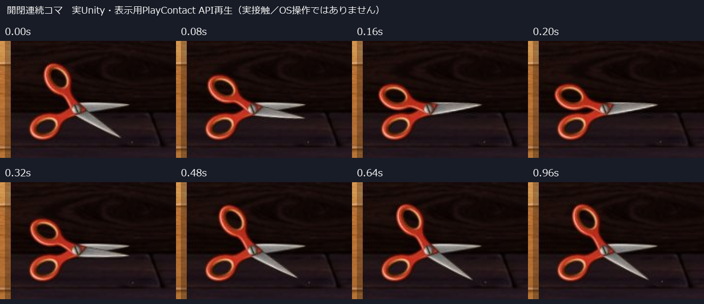
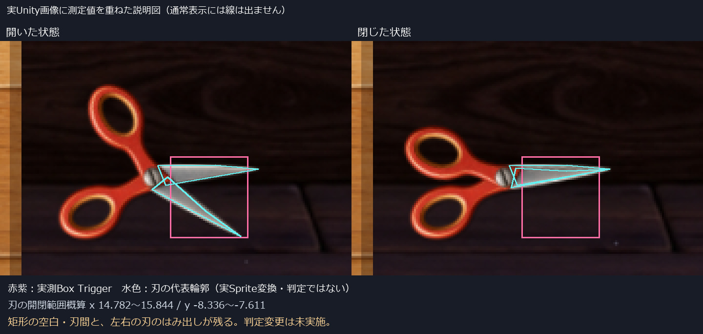

# C05 暖色ハサミの配置と開閉レビュー

Human承認済みの暖色ハサミ本体を、本編第2区間の手前トゲ1か所に配置しました。形・色・厚みを維持し、吊り具なしで木床付近へ斜めに置いています。**配置と動きの候補であり、刃と既存判定の不一致は残っています。Production統合や判定変更はしていません。**

## 実Unity画面と動画

[現行との同一画角比較](Images/Placement_Comparison.jpg)／[閉じた姿勢](Images/Warm_Closed.jpg)

- [通常速度の開閉動画 3秒](Video/Warm-OpenClose-FullSize.mp4)：0〜1秒は開いたままの微動、約1.0〜1.55秒で一度閉じて戻る。プレイヤーは岸に置き、表示用APIで反応を再生。実接触やOSキー操作ではありません。
- [既存Triggerへの接触動画 1.32秒](Video/Warm-NativeTrigger-FullSize.mp4)：診断用に接触前の位置と速度を設定した後、既存Physics2D接触で解除・返却・閉じ戻りを確認。プレイヤーが支点を一部遮ります。

動画は実Unityの1600×900画面を25fpsで記録した、ゲーム時間1倍の無音映像です。QAの固定撮影時計を使用しており、実キー操作の録画ではありません。新しい生成合成画面を実ゲームとして提出していません。

## 承認済み本体と今回の変更

承認元は[暖色本体レビュー 5c64b9e](../20261021T180204_JST/Report.md)。元PNGのSHA256 `b5558bcd4b40b7762201184ec0324758803aaaede56cc3102dbd169670c57c1d` を実行中にも照合しました。素材の描き直し、色調変更、縦横別倍率の圧縮はありません。

| 項目 | 今回の構成 |
| --- | --- |
| 対象 | Main Section 2 Front Spike 1個だけ |
| 表示位置 | ネジ中心 world (14.80, −7.73)、全体角度75度 |
| 大きさ | 承認図と同じ500px/world unit。表示Scaleはほぼ(1,1,1) |
| 置き方 | 左の木製足場の脇、既存の木床絵の上へ斜め置き。下の持ち手と刃先の位置を床面に合わせ、小さな接地影を使用 |
| 撤去したもの | ボタン・吊りループなし。新しい支持具や台座もなし |
| 待機 | 開いたまま、可動側だけ約±0.65度。閉じる周期を作らない |
| 接触反応 | 片側を固定し、もう片側を共通支点で約0.55秒かけて一度閉じて戻す |
| 本体構造 | 左右とも持ち手から刃まで同一Spriteの剛体部品。共通支点の距離0を記録 |
| 他のトゲ | 本編奥側は旧表示のまま。Tutorialへの配置処理なし |

床への関係は背景の床絵との視覚的な整合です。新しい物理床は追加していません。待機で安全になる時間は作らず、閉じている間も既存の接触判定を止めません。

固定側16度、可動側−16度→23.2度で開閉。閉じた相対角7.2度は承認済み本体と同じです。片側を床から持ち上げないため、閉じた本体全体の向きは単体図から回転していますが、形の変形ではありません。

## 刃と判定の重なり

赤紫の矩形は実測した既存Box Trigger、水色は実Sprite変換から求めた刃の代表輪郭です。説明用に画像へ重ねた線で、ゲーム内には表示しません。輪郭は素材上の代表頂点による概算で、正確なアルファ輪郭や新Colliderではありません。

| 範囲 | X | Y |
| --- | --- | --- |
| 既存Trigger | 14.963〜15.737 | −8.332〜−7.522 |
| 今回の刃の開閉範囲概算 | 14.782〜15.844 | −8.336〜−7.611 |

最初の配置では刃が右へ大きくはみ出したため、**表示全体のみ**を0.60左へ寄せました。最終候補でも左約0.181、右約0.107の範囲が矩形外に残り、矩形内の刃間・空白でも接触します。したがって「見える刃だけに正確に当たる版」ではありません。[測定値](QA/Geometry.json)

判定を整合させる場合は、この1個のTrigger形状に限定し、刃の掃引範囲に対する左右不足と空白領域を見直す必要があります。単純に矩形を拡大すると空白への接触を増やすため、その案は採っていません。動く刃だけを判定にするか、刃間を危険領域として保つかは別途判断が必要です。今回はいずれも未実装です。

## 確認結果

| 項目 | 結果と方式 |
| --- | --- |
| Compile | Unity6000.3.21f1の参照Assemblyで成功。エラー0、既存CS0649警告4件 |
| 実表示 | 既存の非Development Unity Playerで、承認PNGの実読込・Sprite反映を確認 |
| 対象限定 | 本編2個のうちFrontだけ新表示。Root・Collider・Trigger契約と再読込後の状態を現行と比較 |
| 同条件の状態比較 | 477物理フレームでRoot位置・速度・Camera・残量・選択長・接続・接地・旧接触状態の差0 |
| 接触 | 初回接続API→診断接近→既存Trigger接触。解除・返却は既存処理。反応は1回 |
| ポーズとR | APIポーズ中は物理と姿勢が停止。Rで既存の区間2状態へ復帰。Scene再読込後も対象表示を維持 |
| 手動起動 | QA引数なしで起動、READY後5秒稼働を確認。自動入力・撮影時計・自動終了なし |
| OS実キー | 未確認。`sky.list_apps` がタイムアウトし、同じ試行は反復しなかった |
| Humanの配置・動きの評価 | 未確認。本体デザインの承認とは分離 |

[状態比較](QA/Comparison.json)／[候補の記録](QA/WarmPlacement.json)／[ログ抜粋](QA/LogExcerpt.txt)／[手動起動確認](QA/ManualStartup.json)

最初の非表示ウィンドウ撮影は黒画面でした。これは画像確認の成功に数えず、通常表示で撮り直しています。採用した画像・動画は最終候補final2の記録です。長い全区間QAは実行していません。

## 実行方式と差分

**既存の非Development Unity Player＋隔離managed overlay＋外部PNGの明示的LoadImage**です。新規Unity BuildやEditor Playの成功とは扱いません。元PlayerのResourcesを差し替えたと推定せず、表示Spriteが読み込んだ外部PNGを使っていることを確認しています。

独立Playerは不変ファイルを既存環境からハードリンクし、変更するDLLと素材は独立配置。Project／Libraryのフルコピーはしていません。

- [表示コード](Diff/CraftScissorsDesignVisual.cs.txt)：新案の配置、共通支点、開閉、元表示の対象限定非表示。
- [直前の配置試作からの差分](Diff/FromFloorScissorsDisplay.patch)：旧緑素材・床面投影を承認済み暖色本体へ変更。
- [隔離撮影fixture](Diff/GroundingReview.cs.txt)：手動起動と診断撮影を分離。Productionへ入れるコードではない。
- [実行ファイル・素材の対応](QA/RuntimeManifest.json)：DLL・素材・ソースのSHA。

Productionの119本のRuntime Sourceを変更せず参照し、隔離側2本だけを追加しています。物理・消費ルール・Stage Scene・Cameraは未変更です。

## 自己評価と残る弱点

赤い持ち手の厚みと刃の金属面が通常画角でも残り、床置き緑案の平たい見え方は軽減しました。下の持ち手を据えたまま上側が閉じるため、吊られた物には見えにくくなっています。

ただし、画面下の配置なので視線が主人公へ集中した際の気づきやすさは未確認です。閉じると刃が細く見え、既存判定には空白が残るため、安全と誤認しないかはHuman Reviewが必要です。技術的に動いたことを、Visual・危険性・楽しさの合格には置き換えていません。

## 手動確認と保護

[起動手順](Launch.md)から候補と現行表示を別々に開けます。既存のレビュー環境・原本は上書きしていません。

Production `394b4a74e366678a9e0542d895b9a26f86993c19`、既存5件のtracked差分、空のstaged状態を維持。対象124ファイルと過去Proof・承認素材のハッシュが開始時と同一です。[保護記録](QA/Protection.json)

旧赤38a83d9・床置き緑25ba244は不採用のまま保存。今回の承認は暖色本体の形・色・厚みに限られます。配置・動き・判定の正式採用、Production統合、他のトゲへの展開は行わず、C11・C18をHOLDのまま、Human Reviewで停止します。
