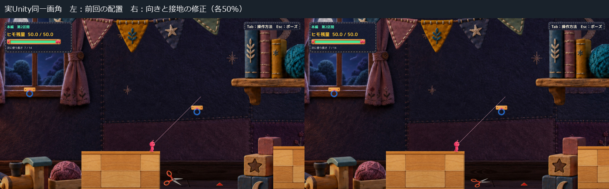
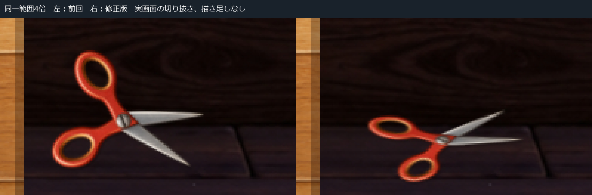

# C05 ハサミの向きと接地の比較

本体は承認済みのまま、**持ち手を手前、刃先を右奥へ向け、面を床へ寝かせる**1案に修正しました。前回の配置と同じUnity画角で比較できます。判定と開閉ロジックは変更していません。

## 同じ画角での比較

[前回の通常画角 1600×900](Images/Before_Normal.jpg)／[修正版の通常画角 1600×900](Images/After_Normal.jpg)

左が[前回の配置 32809c7](../20261021T193948_JST/Report.md)、右が今回です。比較シートは各画面を50%表示、接地比較は同一範囲を4倍に切り出しています。いずれも実Unityの画像で、ハサミや影を画像編集で描き足していません。

前回は正面を向く面と、床に接する持ち手・刃先が、立てて置かれたような関係になっていました。今回の案では、開いた本体を床板の奥行きに沿わせ、赤い持ち手が手前、刃が奥へ伸びる関係にしています。接地影も本体の向きに追従させました。吊り具・ボタン・新しい台座は追加していません。

## 変更したものと保持したもの

| 対象 | 内容 |
| --- | --- |
| 表示の置き姿勢 | ネジ中心を(14.80, −7.73)から(15.10, −7.98)へ。正面向きのZ75度から、Z110度の向きにX55度の傾きを重ねた剛体回転へ |
| 接地影 | 既存の影Spriteを保持し、回転後も画面内の小さな床側オフセットになるよう座標変換を変更 |
| 本体素材 | 承認PNGをそのまま読込。色・描線・厚みの絵・部品の切り分け・PPU500を保持 |
| 寸法 | 元の部品寸法を保持。縦横別の縮小なし。親の倍率を回転前に相殺し、world scaleは誤差約0.0000006以内で(1,1,1) |
| 動き | 共通支点、開閉角、待機微動、0.55秒の反応、接触での発火条件は前回と同じ。新しい動きは作っていない |
| Gameplay | 元のトゲRoot・Collider・Trigger、主人公、物理、Camera、残量処理は未変更 |

本体の画面上の縦幅は、面を寝かせた投影で短くなります。これは新素材への描き直しや、各部品を潰す倍率変更ではありません。ただし元が2D素材であるため、本物の立体モデルのように新しい側面が現れるわけではありません。

## 自己評価と確認してほしい点

持ち手が床の手前側に収まり、刃先が床板の奥へ向くため、前回より床に寝かせた物として読み取りやすくなったと評価します。一方、**通常画角では刃が前回より細く見える**ため、自然な置き方と危険物としての存在感を両立できているかはHuman判断に残します。

接地は既存背景の木床絵との視覚的な関係です。新しい物理床を足したわけではありません。刃と既存の矩形判定の不一致は解消しておらず、今回は判定調整へ進んでいません。

## 確認結果と実行方式

- 同一1600×900、同一Camera・背景・初期位置・撮影時刻で静止比較。前回表示の再撮影は前回提出PNGと全ピクセル一致。
- 新旧画像で差がある領域はハサミ周辺の矩形(859,800)〜(980,894)内だけ。
- 撮影前の41物理フレームで、Root位置・速度・Camera・残量・選択長・接続・接地・旧接触状態の差0。これは静止比較の範囲であり、全Gameplay回帰の再実行ではない。
- 両方とも本編のFront1個だけに表示を適用し、既存2個のhazardのRoot／Collider／Trigger値は一致。承認PNGのSHA256も一致。
- Unity6000.3.21f1参照AssemblyでCompile成功、エラー0。既存CS0649警告4件。実行時エラー0。
- 既存の非Development Player＋隔離managed overlay＋外部承認PNGの明示読込。**新規Unity Buildではない。** 診断APIで撮影位置を設定した静止画で、OSキー操作／Human試遊ではない。

[測定記録](QA/Checks.json)／[前回表示の記録](QA/Previous.json)／[修正版の記録](QA/Rest.json)／[ログ抜粋](QA/LogExcerpt.txt)

今回は向きと接地の確認に限定し、長い動画・接触試験・全区間QAは繰り返していません。新姿勢での開閉の自然さ、実キー操作、Humanの採否は未確認です。

## 差分と起動

[前回からの表示差分](Diff/FromPreviousPlacement.patch)／[表示ソース](Diff/CraftScissorsDesignVisual.cs.txt)／[起動手順](Launch.md)

新しい隔離先で候補と前回配置を切り替えて起動できます。手動起動には自動入力・自動撮影・撮影時計・自動終了の引数を渡しません。既存の手動ランチャーは保持しています。

Production `394b4a74e366678a9e0542d895b9a26f86993c19`、既存5件のtracked差分、空のstaged状態、対象124ファイルと前回Proofを維持しました。[保護記録](QA/Protection.json)

本体の承認は維持し、前回の配置は「向きが不自然」のHuman評価とともに保存しています。今回も配置レビュー候補まで。判定修正・Production統合・他のトゲへの展開はせず、C11・C18をHOLDのまま停止します。
