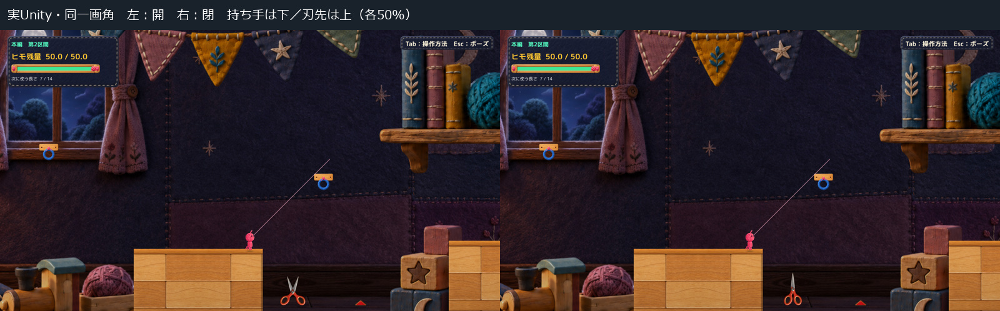
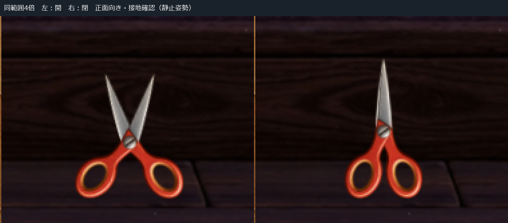

# C05 上向きハサミの静止比較

Human指定どおり、承認済み単体図を画面内で180度回し、**持ち手が下、刃先が上**になる正面向きへ変更しました。本編手前のトゲ1個だけの隔離表示です。開・閉とも同じ通常画角で確認できます。

## 開いた姿勢と閉じた姿勢

[開いた姿勢 1600×900](Images/Open_Normal.jpg)／[閉じた姿勢 1600×900](Images/Closed_Normal.jpg)

比較シートは各画面を50%表示、拡大は同一範囲の4倍切り抜きです。すべて実Unity画面の静止撮影で、画像へハサミや影を描き足していません。

## 指定との対応

- 本体全体をZ方向へ180度回転。床へ寝かせるX/Y方向の傾きは0です。
- 承認PNG・色・部品寸法・PPU500を保持。world scaleは(1,1,1)で、圧縮や引き伸ばしはありません。
- 開姿勢は単体図の左+16度／右−16度、閉姿勢は左−3.4度／右+3.8度を使用。同じ2部品と中央ネジの共通支点を保持しています。
- 下の持ち手の描画輪郭から高さを計算し、両姿勢とも同じ床ラインへ合わせました。吊り具・ボタン・台座は追加していません。

床ラインは背景の床絵に対応する表示上の基準Y=−8.34です。描画の輪郭は元画像の持ち手部分のalpha128以上から求め、物理床やColliderは追加していません。低い側の持ち手は基準と一致し、もう片側との差も通常画角で約0.16px以内です。

今回は**独立した開・閉の静止表示**です。接地をそろえた結果、中央ネジの表示高さは開と閉で約0.158 world unit異なります。動作中の支点移動を仕様化したものではなく、開閉アニメーションや接触反応の完成を意味しません。

## 確認結果

通常画角で、赤い持ち手が下にあり、その上へ開く金属刃を確認しました。正面の面積が戻り、寝かせた案にあった輪郭の圧縮はなくなっています。置き方と危険性の最終評価はHuman Reviewに残します。

- 1600×900、同じ背景・Camera・プレイヤー位置で撮影。
- 開・閉各41物理フレームの位置・速度・残量・Camera・選択長・接続・接地状態は差0。静止撮影の範囲であり、全Gameplay QAではありません。
- 共通支点の距離0、素材SHA一致。既存2個のhazardのRoot／Collider／Triggerは前回と一致し、奥のトゲは旧表示のまま。
- Compile成功、エラー0、既存CS0649警告4件。実行時エラー0。

[測定記録](QA/Checks.json)／[開姿勢の値](QA/OpenPose.json)／[閉姿勢の値](QA/ClosedPose.json)／[差分](Diff/FromRejectedRestPose.patch)

実行方式は**既存の非Development Unity Player＋隔離managed overlay＋承認PNGの実読込**です。新規Unity Buildではありません。診断APIによる初期配置・静止撮影で、OS実キー操作／Human試遊ではありません。長い動画・物理QA・接触試験は今回は行っていません。

## 保持と次の判断

[床へ寝かせた案 e560ab4](../20261021T202109_JST/Report.md)はHuman不採用として原本を保持。本体デザインの承認は維持しています。

既存判定と上向きの刃はまだ一致していません。判定・Production・他のトゲは未変更です。Production `394b4a74e366678a9e0542d895b9a26f86993c19`、既存5件のtracked差分、対象124ファイル、過去2Proofを保持しました。[保護記録](QA/Protection.json)

[静止表示の起動手順](Launch.md)。C11・C18はHOLDのまま、向きと接地のHuman Reviewで停止します。
