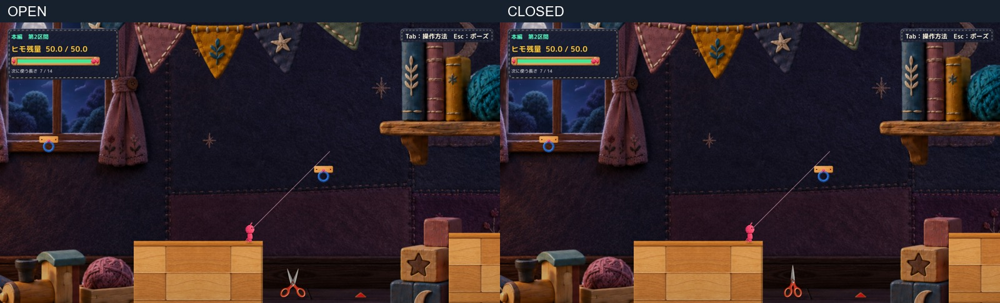
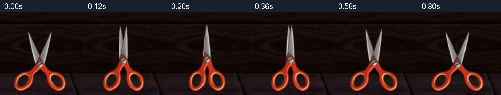
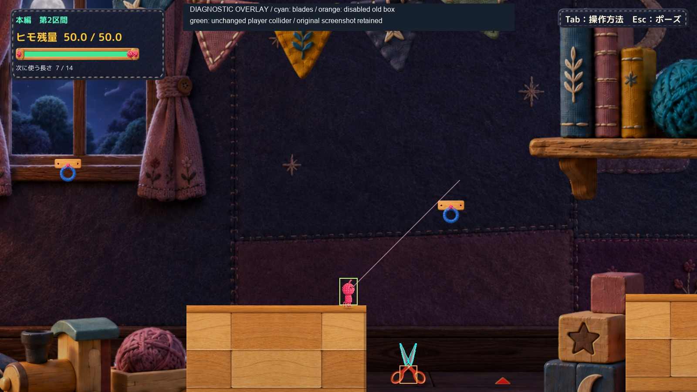

# C05 暖色ハサミの開閉と刃判定

本編第2区間の手前1個を、承認方針の「持ち手が下・刃先が上」のまま、連続開閉と刃に追従する判定を備えた隔離候補にしました。Productionには反映していません。

[通常画角の開閉動画](Video/01_Motion_API.mp4)／[実際の刃接触](Video/02_NativeContact.mp4)／[空白通過と通常落下](Video/03_EmptyPassage_ThenFall.mp4)／[手動起動](Launch.md)

## 見た目と動き

承認済みPNGの形・色・大きさを維持しています。左右とも持ち手から刃まで1つの部品として、同じネジ位置を中心に回転します。開状態から0.18秒で閉じ、0.08秒保持して、0.48秒で開状態へ戻ります。待機中は開いた範囲で微小に動き、閉じていても刃の判定は有効です。

持ち手の不透明な輪郭から最下点を求め、共通支点全体の高さを連続調整します。床へ寝かせる変形や大きさ変更はありません。201段階の測定で、低い側の接地誤差は最大0.000001 world unit未満、もう一方の持ち手との差は最大0.00303 unit（1600×900で約0.16px）。共通支点のずれは0でした。これは表示上の床合わせであり、歩ける補助床は追加していません。

[開いた全画面](Images/Open_Normal.jpg)／[閉じた全画面](Images/Closed_Normal.jpg)／[同倍率拡大](Images/Detail_OpenClosed.jpg)

## 判定の変更

対象は `Main Section 2 Front Spike` だけです。元の矩形Triggerをこの隔離実行中だけ無効にし、左右の金属刃に対応する2つの輪郭を持つPolygonCollider2Dへ置き換えました。刃の不透明部分と持ち手との境界から輪郭を取り出し、開閉の各物理更新で、描画部品と同じ変換を適用します。空白を覆う矩形や、持ち手には切断判定を付けていません。

水色が新しい刃判定、橙が無効化した旧矩形、緑が既存Player Colliderです。上図は実画面へ測定線を重ねた説明図です。[線のない実画面](Images/Open_Normal.jpg)も保持しています。[元画像上の輪郭](Images/BladeGeometrySource.png)では、水色が金属刃、黄色が接地計算用の持ち手輪郭です。

`RopeSpikeHazard.cs`、`RopeController.cs`、`ToySpikeVisual.cs`、`RopeLandingFluff.cs`は変更していません。既存の接続中判定、DetachAndRefund、接触繊維の発火をそのまま使います。新しい開閉処理は、既存の接触演出が始まったことを受け取るだけで、解除や返却を重ねて呼びません。動作中に別の新規接触が成立しても、現在の開閉を途中で開状態へ飛ばしません。

なお現行Productionでは接続・解除自体で残量を消費しません。実測でも接触前後の残量50は変わらず、余分な返却はありませんでした。既存の仕様を維持した結果です。

## 確認結果

| 確認 | 結果 |
| --- | --- |
| 開閉5段階で左右の刃先 | 10件とも実Triggerで解除、閉じ反応1回 |
| 開閉3段階で左右の刃中央 | 6件とも実Triggerで解除、閉じ反応1回 |
| 旧矩形内の空白と刃の外側 | 6件とも解除なし、反応0回 |
| 未接続で刃に接触 | 解除・追加返却・閉じ反応なし。既存ルールを保持 |
| 実際に閉じる途中、閉状態、戻る途中の接触 | 3場面で解除・反応1回。静止配置だけでなく動作中も確認 |
| 描画輪郭とColliderの座標 | 201段階で差0。輪郭は画像の不透明部分に基づく凸多角形近似 |
| ポーズ | 表示角度・支点・刃判定を保持、再開後に続行 |
| R | 入口へ復帰、残量50・選択長7・未接続。既存処理を使用 |
| 他の本編トゲ | Transform・Trigger・Hazardを変更していない |
| 手動起動 | 非Development Playerで35秒待機。自動攻略・撮影・終了なし |
| コンパイル | Unity 6000.3.21f1参照で成功。既存警告4件、追加エラーなし |

[主試験JSON](QA/Primary.json)は111チェック中111件PASS、23接触ケースを収録しています。ただし主試験末尾の空白動画には直前の失敗状態が残ったため、その動画は採用せず、[補足試験](QA/Supplement.json)で撮り直しました。

補足は32チェック中31件PASS、1件FAILをそのまま保存しています。「0.5秒間ずっと接続している」という診断の最後の条件が、0.48秒・Y=-9.2099で成立しませんでした。既存の落下ラインY=-9を越え、通常の落下失敗になったためです。直前まで刃の反応は0回で、この失敗時も閉じ反応は0回でした。落下自体を回避する地形・物理変更は行っていません。

[旧矩形内の空白](Images/03_EmptyOldRectangle_ColliderOverlay.jpg)では、Player Colliderと刃の離隔も確認しています。選択長7では診断位置がヒモ長を越えて刃へ引かれたため、空白だけを切り分ける試験には長さ9を使用しました。この条件差を、誤判定の改善へ混同していません。

[正確な解除処理のAPI確認](QA/Supplement.json)では、接触位置に配置して既存Cutを2回呼び、1回目で解除、2回目は無作用でした。速度(1.3,-2.6)と残量は呼出し前後で不変。この確認はOS操作でも自然な衝突測定でもなく、処理契約のAPI検証です。

## 動画の読み方

- [開閉 2.00秒](Video/01_Motion_API.mp4)：既存の接触演出APIで1回開始した表示確認。ゲーム上の接触とは数えません。
- [刃接触 1.20秒](Video/02_NativeContact.mp4)：岸で既存TryAttachを呼び、接触手前の位置・速度を診断設定した後は通常の物理更新。約0.16秒で刃に触れて解除、約0.36秒で閉状態、その後に通常落下します。
- [空白通過 0.52秒](Video/03_EmptyPassage_ThenFall.mp4)：長さ9。刃の左側を通り、閉じ反応なし。最後に既存の落下ラインへ到達します。
- [接触連続コマ](Images/ContactSequence.jpg)／[元倍率の代表コマ](Frames/)も通常のGitHubファイルです。

動画はUnityの実フレームを50fpsの撮影時計で取得し、2フレームごとに保存して25fpsで連結した、ゲーム時間1倍速の無音動画です。OS画面録画・Human操作の動画ではありません。ゲーム内カメラの挙動・解像度・Playerの寸法は変更していません。

## 実装と保護

[変更差分](Diff/FromUpright.patch)／[候補コード](Diff/CraftScissorsMotion.cs.txt)／[診断・手動入口](Diff/ScissorsReview.cs.txt)／[輪郭データ](Diff/BladeGeometry.json)

- 表示と対象判定は、新規の隔離コンポーネント1本にまとめました。
- 手動入口は本編第2区間へ置く初期設定だけです。QA指定がないと、自動入力・撮影時計・撮影・自動終了は実行されません。
- 実行方式は、既存の非Development Unity Player＋独立managed overlay＋承認PNGの実読込です。新規Unity Build、Editor Play、Resourcesへの焼き込み成功ではありません。
- Productionの119本の実行ソースと既存dirty 5ファイル、過去3Proofの指定原本を開始時ハッシュと照合し、不変を確認。[保護記録](QA/Protection.json)
- Production HEADは `394b4a74e366678a9e0542d895b9a26f86993c19`。mainへのcommit/push・本番統合・他のトゲへの展開なし。C11/C18はHOLD。

## 残る制限と判断待ち

通常画角でもハサミと上下の刃を識別でき、持ち手を床に置いたまま開閉していると自己評価します。一方、この場所は通常画面の下寄りで、閉じ動作は短いため、プレイ中の読み取りやすさはHuman確認が必要です。接触した主人公は救済せず、そのまま既存物理で落下します。

OS実キー、Humanの手応え・自然さ・採用判断、音の実聴、全区間、高速接触の全軌道は未確認です。20ms刻みの既存物理更新を使っており、あらゆる速度での連続衝突保証はしていません。手動操作許可は継続していますが、過去のOS操作ツールのタイムアウトを今回反復していません。

本体と上向き配置の採用方針は記録し、今回の「動作＋判定」は完成候補としてHuman Review待ちにします。旧候補や床寝かせ案を採用済みに読み替えません。
