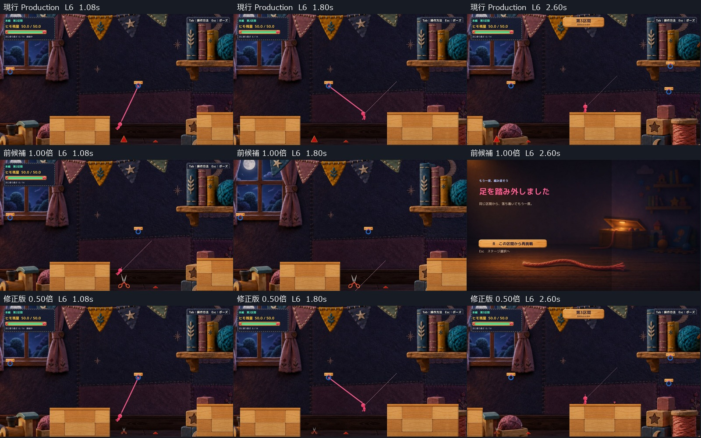
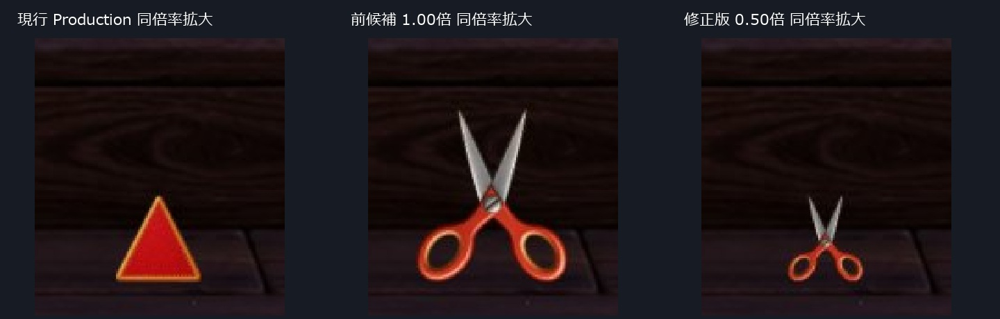

# C05 ハサミの長さ6通過を戻す隔離修正版

本編第2区間の手前1個だけを、承認済みの暖色・上向きのまま等比0.50倍にしました。現行版で通れる長さ6の軌道を修正版でも通過でき、長さ5の攻略も保持しています。Production統合はせず、Human Review待ちです。

Humanの「長さ6はハサミに当たる」「長さ5でも対岸へ届く」を受け、[前候補300027a](../20261021T211000_JST/Report.md)は採用保留として保持しました。以下は同じ初期状態・同じ操作列による自動入力/API比較であり、Humanの今回の再試遊ではありません。

## まず見る比較

- [長さ6の通常画角動画](Video/L6_Current_Previous_Candidate_Sequence.mp4)：通常速度。0〜4秒＝現行、4〜8秒＝前候補、8〜12秒＝修正版。
- [長さ6の連続コマ](Images/Route_L6_Sheet.jpg)／[接触箇所と判定の注釈](Images/L6_Contact_ColliderAnnotation.jpg)。注釈は実画面へ記録した判定輪郭を重ねたものです。
- 通常1600×900の入口：[現行](Images/Current_Entrance.jpg)／[前候補](Images/Previous_Entrance.jpg)／[修正版](Images/Candidate_Entrance.jpg)。[同倍率の拡大](Images/Scissors_EqualScale_Crop.jpg)。拡大率は対象物ごとに変えていません。
- [手動起動](Launch.md)／[結果JSON](QA/Summary.json)／[変更差分](Diff/FromPrevious.patch)。

## 原因と修正

前候補は開いた刃の上端が約y=-6.540まで伸び、旧トゲの判定上端y=-7.522より約0.98高くなっていました。床端で一度止まって接続し、踏み出してから漕ぐ経路では、1.06秒でPlayerの箱と手前側の刃が重なり、1.08秒で既存の接触処理がヒモを解除しました。Rootは約(14.792, -6.288)、直前の速度は約(2.249, -9.667)。身体の絵の中心ではなく、箱の右下付近が先に触れています。対岸やフックではなく、`Main Section 2 Front Spike`の刃判定への接触です。

今回の修正は表示の共通親へ等比スケールを1か所追加するだけです。左右の刃判定は従来どおり同じ部品の変換から求めるため、見た目と同時に縮小されます。

- 共通親の倍率：1.00 → 0.50。x位置15.35000038、持ち手の支持面y=-8.34、正面向き・上向き、共通支点は維持。
- 暖色本体のPNG、色、輪郭、厚みの比率、左右2部品、開閉時間は変更なし。個別に横や縦を潰していません。
- 旧矩形を再び有効にせず、左右の金属刃に沿う同じ判定を縮小。既存の解除・返却・接触反応の処理は変更なし。
- 対岸、Hook、Player、他のトゲ、物理、入力・消費ルールは変更なし。

実測軌道と開閉4姿勢を使った計算では、0.54倍の閉じた姿勢の余裕は約0.00078にすぎません。0.50倍では約0.0814となるため、ぎりぎりの接触回避ではなく余裕を残しました。実Unityの通常の待機動作で、長さ6の最小離隔は0.1265でした。[形状計算](QA/ScaleFeasibility.json)は連続する全軌道を保証する試験ではありません。

## 同じ操作による5／6／7の比較

3版・3長さとも、S2入口(12.7, -4.28)へ初期配置、残量50、速度0から開始しました。最初だけ診断で状態を作り、以後の通過ではRoot移動・速度の上書き・瞬間移動をしていません。

|時刻|共通の操作|
|---|---|
|0.00〜0.22秒|Dで床端へ歩く|
|0.22〜0.60秒|入力を離して停止|
|0.60秒|接地したまま最初の青フック(17.25, -0.85)へ接続|
|0.60〜0.72秒|Dで踏み出す|
|0.72〜1.20秒|移動入力なし|
|1.20秒以降|Dで漕ぐ／空中移動|
|1.80秒|接続中ならE相当の既存解除処理を呼ぶ|
|対岸へ着地後|Dを離して立てることを確認|

到達・失敗が決まるまでの入力列は3版で同一です。着地した版だけDを離す終了処理を行います。前候補の長さ6はそれ以前に落下して失敗画面へ移行するため、終了後まで全3版の入力値が同一という意味ではありません。

|長さ|現行 Production|前候補1.00倍|修正版0.50倍|
|---|---|---|---|
|5|[到達 2.44秒](Video/Current_L5.mp4)|[到達 2.44秒](Video/Previous_L5.mp4)|[到達 2.44秒](Video/Candidate_L5.mp4)|
|6|[到達 2.30秒](Video/Current_L6.mp4)|[1.08秒に刃接触、落下](Video/Previous_L6.mp4)|[到達 2.30秒](Video/Candidate_L6.mp4)|
|7|[1.16秒に手前トゲ接触、落下](Video/Current_L7.mp4)|[1.08秒に刃接触、落下](Video/Previous_L7.mp4)|[1.16秒に刃接触、落下](Video/Candidate_L7.mp4)|

これは試した操作列の結果です。長さ7がどの操作でも不可能とは断定しません。長さ5を不可能にする変更は入れていません。長さ5で解除を遅らせた予備試験では現行でも届かず、解除時期に依存することも確認しました。

助走を保ってDを押し続ける別条件では、[現行の長さ6](QA/Extra_Run_Current_L6.json)と[前候補の長さ6](QA/Extra_Run_Previous_L6.json)がともに通りました。Humanと同一の操作履歴までは確認できませんが、入口から始めた「現行は通る・前候補は切られる」経路を再現し、その同一入力で修正後の通過を確認しています。成功ルート1回だけを根拠に前候補の問題を否定していません。

## 確認できた範囲

- Compile成功。Unity 6000.3.21f1の既存非Development Playerで9回の通過を記録し、Runtime Error/Exceptionは0件。
- 現行と修正版は各長さ300フレームでRoot位置・速度・残量・Camera・入力が数値上完全一致。長さ7は接触後も同じ落下結果です。
- 101開閉姿勢で、刃判定の頂点と描画変換の差0、共通支点の差0、接地誤差最大0.000000954。左右持ち手の支持点差最大0.001513で、通常画角では1px未満。
- 長さ6で反応0回、長さ7の刃接触で閉じる反応1回。残量は全件50を保持。既存解除・返却処理を呼ぶ方式を維持。
- 修正版の手動ランチャーから起動し、35秒の待機後も応答し、自動攻略・自動終了が起動しないことを確認。対象Playerだけを通常終了。[起動記録](QA/ManualSmoke.json)
- Productionの124ファイル、既存tracked差分・staged状態、保護対象の過去Proofが開始時と一致。[保護確認](QA/ProtectionEnd.json)

実行は「既存Player＋隔離managed overlay＋承認PNGの実読込」です。新規Unity Build成功ではありません。動画は50Hzのゲーム時間を25fpsで出力した通常速度の自動撮影で、OSのキー操作録画ではありません。診断コードは手動起動で入力・撮影・自動終了を実行しません。ゲーム中の入力は既存のままです。

## 残る弱点とHuman判断

通常画角では、刃のV字と暖色の持ち手からハサミを識別できます。一方、高さは約93pxから約47pxへ小さくなり、前候補の存在感は減っています。図は拡大だけで良く見せず、通常画角も併記しています。

修正版のHuman実キーによる再試遊、見た目の採否、音の実聴は未確認です。全速度・全軌道・全閉じ具合での安全は保証していません。OSキー操作も今回は実施していません。長さ7の接触失敗は残します。

今回の推奨は「長さ5・6の攻略を保持した隔離候補としてHuman Reviewへ」です。正式採用やProduction統合は行っていません。C11・C18は保留を継続します。

## 差分と記録

- [本体の最小差分](Diff/FromPrevious.patch)：倍率の受け渡しと共通親への等比スケール。
- [候補表示コード](Diff/CraftScissorsMotion.cs.txt)／[隔離比較用driver](Diff/RouteReview.cs.txt)：レビュー用資料。Productionへ取り込んでいません。
- [結果一覧](QA/Summary.json)と同じフォルダの9件のJSONに全フレーム・接触イベント・地形情報を収録。
- [実行DLLとPNGのSHA256](QA/ArtifactHashes.json)。承認PNGは変更なし。

学習メモ：長さが同じでも助走と解除時期で軌道は変わります。判定だけを小さくせず、共通親の等比縮小を描画と刃判定へ同時に反映し、接地補正で持ち手の床面を保ちました。
