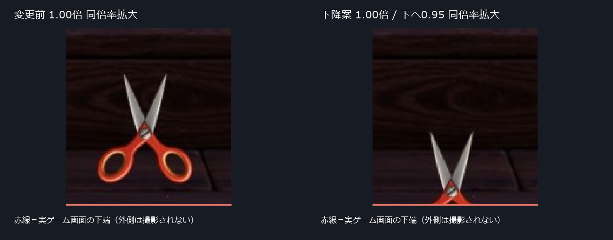
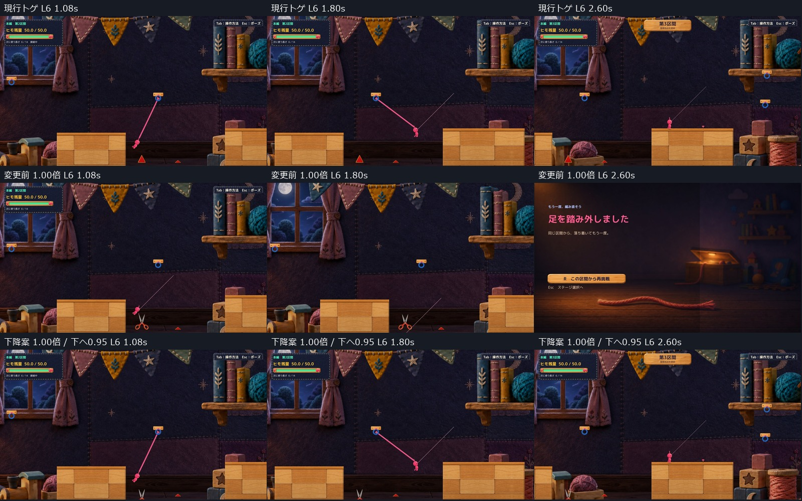
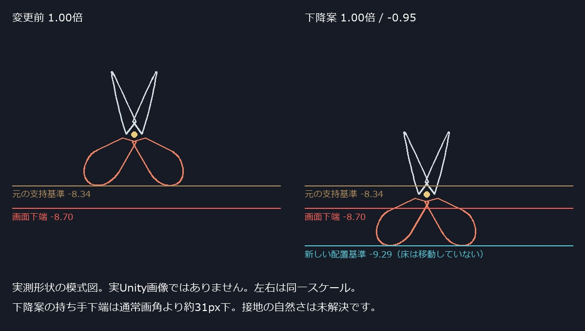

# C05 大きさを維持してハサミを下げる配置候補

本編第2区間の手前1個を、元の1.00倍へ戻し、0.95ワールド単位だけ下げました。同じ入口・同じ入力で長さ5と6は対岸へ到達し、比較経路の長さ7では刃への接触が残ります。開閉中の長さ6通過も確認しました。

ただし、通常画角では持ち手の大部分が画面外へ隠れます。通過条件は改善しましたが、床に自然に置かれている見え方は未解決です。配置の自己評価はHOLDとし、Productionには統合していません。

Human指定により、[0.50倍案](../20261021T220112_JST/Report.md)は不採用として保持。今回も暖色本体・上向きの方針承認と、完成候補全体の正式採用は区別します。

## 最初に見る比較

- [長さ6の通常速度動画](Video/L6_Before_After_Sequence.mp4)：0〜4秒が変更前1.00倍、4〜8秒が下降案1.00倍。各版は同じ入口・同じ入力で開始。
- [長さ5の通過](Video/Candidate_L5.mp4)／[長さ7の接触](Video/Candidate_L7.mp4)／[開閉途中と長さ6通過](Video/Candidate_L6_ClosingCycle.mp4)。
- 通常1600×900の入口：[変更前](Images/Previous_Entrance.jpg)／[下降案](Images/Candidate_Entrance.jpg)／[現行トゲ](Images/Current_Entrance.jpg)。
- [手動起動](Launch.md)／[実測一覧](QA/Summary.json)／[元1.00倍からの差分](Diff/FromFullSize.patch)。

画像は実Unity画面の同じ範囲を同倍率で拡大した表示用プレビューです。赤線は実ゲーム画面の下端。見えない持ち手を描き足していません。

## 位置だけを変えた箇所

対象は `Main Section 2 Front Spike` の隔離ハサミ1個です。

|項目|変更前1.00倍|下降案|
|---|---|---|
|本体倍率|1.00|1.00|
|持ち手の配置基準Y|-8.34|-9.29|
|X位置|15.35000038|同じ|
|正面と向き|奥行き傾斜なし、持ち手下・刃先上|同じ|
|素材・色・厚み|承認済み暖色PNG|同じPNG、SHA256一致|
|開閉|左右2部品、共通支点|同じ角度・時間・処理|

接地補正に使う高さを、旧定数からインスタンスの配置基準 `SupportY` へ切り替えました。毎回の開閉で、この新しい基準へ合わせるため、補正により元の高さへ戻りません。本体・ネジ・影は共通親に追従し、刃のPolygonColliderも同じ部品の座標から更新します。判定だけを下げた案ではありません。

同じ初期姿勢で、支点・支持点・刃頂点のX/Z差は0、Yの差は-0.95（最大誤差0.00000115）。101開閉姿勢で描画変換と判定頂点の差0、共通支点の差0を確認しました。左右持ち手の高さ差は最大0.00303で、元の本体形状に由来する範囲です。

元の床、Camera、Hook、対岸、Player、他のトゲは移動・拡縮していません。既存の解除・返却・接触反応処理も変更していません。`maxFloorError` は下げた配置基準への誤差であり、元の床への接地成功を意味しません。

## 下げ量の選定と開閉中の確認

記録済みの現行長さ6の軌道と、刃の101開閉姿勢から下降量を計算しました。閉じた姿勢が最も厳しく、幾何計算では約0.9344が必要でした。これは実接触判定の代わりではないため、Unityで境界を比較しています。

|下げ量|刃の状態|実Unityの結果|
|---|---|---|
|0.93|閉じたまま|1.24秒に手前刃へ接触、落下|
|0.94|閉じたまま|1.24秒に手前刃へ接触、落下|
|0.94|中間姿勢|2.30秒に対岸へ到達|
|0.95|閉じたまま|2.30秒に対岸へ到達、最小離隔0.00332|
|0.95|通常の待機開閉|2.30秒に対岸へ到達、最小離隔0.13625|
|0.95|通過中に閉じて開く|2.30秒に対岸へ到達、最小離隔0.04227|

したがって提出値は、今回の同一操作と開閉条件について、0.01刻みの実測で通過した最小の0.95です。全ての助走・解除時期に対する安全距離や、数学的な絶対最小とはしていません。閉じ切った場合の余裕は小さいままです。

「閉じたまま」「中間姿勢」は診断APIによる状態固定です。「閉じて開く」は1.10秒から既存と同じ0.18秒閉じ・0.08秒保持・0.48秒戻りの角度列を診断で重ねました。プレイヤー入力は通常待機の比較と同じです。手動版では、この強制位相・自動入力を実行しません。実接触に伴う開閉反応は長さ7の動画で確認できます。

根拠：[形状計算](QA/DropFeasibility.json)、[0.94閉じ刃の失敗](QA/Phase_Candidate_L6_closed_D0.94.json)、[0.95閉じ刃の通過](QA/Boundary_Candidate_L6_closed_D0.95.json)、[連続開閉の通過](QA/Phase_Candidate_L6_cycle_D0.95.json)。

## 長さ5と6と7の比較

入口(12.7, -4.28)、残量50、速度0から開始。Dで0.22秒歩く→停止→0.60秒に接地したまま青フックへE接続→0.72秒までD→1.20秒まで惰性→Dで漕ぐ→1.80秒に接続中ならE解除、という前回と同一の操作列です。対岸着地後だけ入力を離します。通過中のRoot移動、速度の強制設定、到達後への瞬間移動はありません。

|長さ|現行トゲ|変更前1.00倍|下降案1.00倍|
|---|---|---|---|
|5|2.44秒で到達|2.44秒で到達|2.44秒で到達|
|6|2.30秒で到達|1.08秒に刃接触、落下|2.30秒で到達|
|7|1.16秒に手前接触、落下|1.08秒に刃接触、落下|1.16秒に刃接触、落下|

下降案と現行トゲは、各長さ300フレームでRoot位置・速度・残量・Camera・入力が数値上完全一致しました。長さ7も接触後を含め同じ軌道です。変更前ハサミとは、長さ6・7の接触時刻から軌道が変わります。これは狙った接触位置の変更による結果であり、「全版の軌道が同じ」とはしていません。

長さ5の攻略を保持し、長さ7の接触・既存の解除・返却・反応1回を確認しました。残量は全件50。どの操作でも長さ7が通れないとは断定しません。Humanの実操作履歴が保存されていないため、Humanと完全に同一のキー履歴を再生したものでもありません。

現行トゲの比較3件は前回の同一入力・同一基準の記録を再利用し、変更前1.00倍と下降案の6件は今回撮り直しています。

## 通常画角の弱点

1.00倍なので本体の厚みや輪郭は縮小していません。しかし、下げた持ち手の基準は画面内Y約930.5pxです。900px高の通常画角より約30.5px下になり、持ち手の大部分が見えません。通常画角では刃とネジ付近が主に残り、ハサミとしての識別や床への接地関係は前配置より弱くなります。

この図は実測形状から作った模式図で、実ゲーム画像ではありません。床の絵もCameraも変更していないため、新しい基準高さに床を作ったことにはなりません。画面下に自然な支持面があるとも確認できません。

技術的な通過条件は今回の経路で成立しましたが、「大きさ・Camera・地形固定のまま、全身と接地を通常画角で明確に見せる」条件は満たしていません。この点から配置VisualはHOLD。追加の床・支持具やCamera変更を無断で加えず、位置だけを下げた1案として判断を待ちます。

## 実行方式と保護

- Unity 6000.3.21f1用アセンブリのCompile成功。既存非Development Player＋独立managed overlay＋承認PNG実読込。新規Unity Build成功ではありません。
- 初期状態設定と移動入力は診断API／フィールド入力。動画は50Hzのゲーム時間を25fpsで出力した通常速度の実Unity撮影です。OSキー録画・Human試遊とは区別します。今回の新規12実行でRuntime Error/Exceptionは0件。
- [手動ランチャー確認](QA/ManualSmoke.json)：20秒待機、応答あり、自動攻略・撮影・自動終了なし。自分で起動したPlayerを通常終了しました。OS実キーによる攻略は未確認です。
- [保護確認](QA/ProtectionEnd.json)：Productionの124ファイル、既存tracked差分・空のstaged、対象の過去Proofが開始時と一致。対象外の測定範囲のCollider配置も比較前後で一致。
- 追加のProject／Library複製はせず、不変の既存Playerファイルを共有し、編集するDLLと素材読込領域のみ独立。Production・mainへの実装commit/pushはしていません。

未確認はHumanによる今回の見た目・操作感・採用、OS実キー攻略、音の実聴、全入力条件での通過保証です。C11・C18は保留を継続します。

変更資料：[描画と配置](Diff/CraftScissorsMotion.cs.txt)、[隔離比較driver](Diff/RouteReview.cs.txt)、[SHA256](QA/ArtifactHashes.json)。レビュー資料だけを共有し、実装ファイルやBuild一式はProductionへ持ち込みません。

学習メモ：接地補正を使う物は、Transformを下げるだけでは次の補正で元へ戻ります。今回は基準高さを変更し、部品・影・刃判定を同じ変換から求めました。一方、通過の成立と、画面内で自然に見えることは別の評価です。
