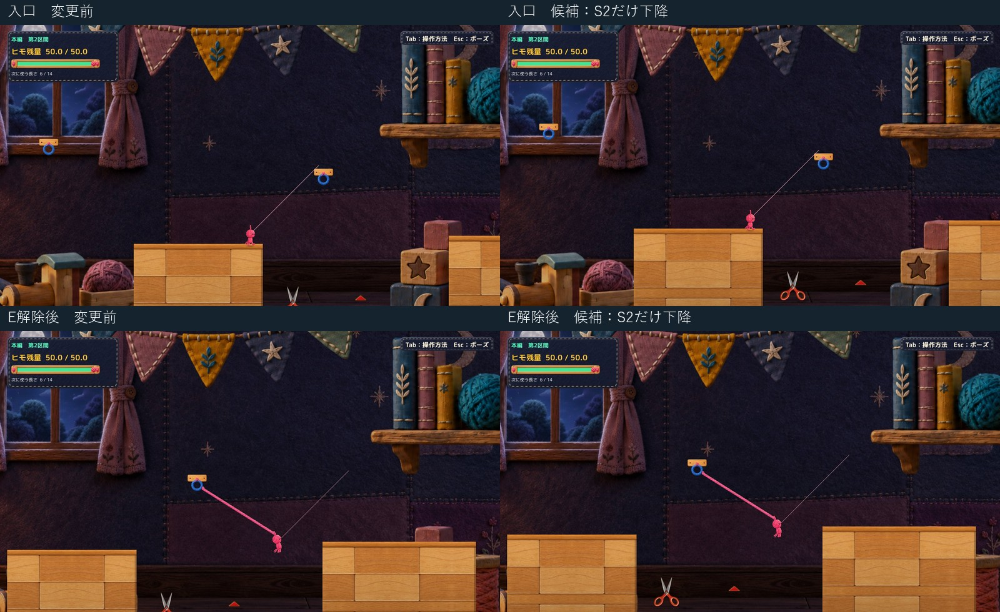

# C05 第2区間のカメラ高さ比較

1.00倍・下降0.95のハサミをそのまま使い、第2区間だけカメラ中心を0.95下げる隔離候補を作成しました。ズームと解像度は同じです。持ち手まで画面内に入り、主人公・接続先の青フック・対岸入口を同時に確認できます。長さ6の比較経路は変更前後とも2.30秒で対岸へ到達しました。

**技術確認はPASS、配置の自然さ・画角の心地よさ・正式採用はHuman Review待ちです。Productionには統合していません。** C11・C18はHOLDのままです。

[通常速度の同時比較](Video/Compare_L6.mp4)／[候補の全画面動画](Video/After_L6.mp4)／[変更前の全画面動画](Video/Before_L6.mp4)／[手動起動](Launch.md)／[実測要約](QA/Summary.json)

## 今回変えたもの

| 項目 | 変更前 | 候補 |
| --- | --- | --- |
| 第2区間のカメラ中心Y | 0 | −0.95 |
| 第2区間外の目標Y | 0 | 0を保持。第10区間の既存追従も保持 |
| 区間の出入り | 高さ固定 | 既存のSmoothDamp 0.28秒設定で遷移 |
| R復帰 | 復帰先で再設定 | 復帰先が第2区間なら−0.95、それ以外は元の高さ |
| ズーム／解像度 | OrthographicSize 8.7／1600×900 | 同じ |
| ハサミ | 1.00倍・下降0.95・支持基準Y −9.29 | 本体・支点・影・開閉・刃判定まで同一 |

範囲は既存の床Colliderから取得します。出発側 `Main Landing 1` の左端 **x=5.5** から、対岸 `Main Landing 2` の左端 **x=25** までです。チェックポイント番号は後戻りしても減らないため、番号ではなく現在位置で判定します。逆方向に範囲外へ出ても元の高さを目指します。床、フック、Colliderの位置・寸法は変更していません。

実装の変更は隔離版 `HorizontalCameraFollow.cs` の高さ決定だけです。横追従、ズーム、ポーズ・失敗時の停止条件は既存どおりです。[比較用差分](Diff/HorizontalCameraFollow.patch)には隔離比較スイッチを含むため、Productionへそのまま適用する差分ではありません。

背景の `HimoHitoCraftRoomBackground` はもともとカメラYへ追従します。その既存処理を利用し、背景PNG、Shader、パララックス係数は変更していません。描画完了時のFar/MidとカメラのY差は最大約0.000010 world unitsです。R APIを呼んだ直後、LateUpdate前だけ一時的な値差がありますが、次の描画時には追従しています。

## 実画面で確認できたこと

- 入口で持ち手の下端は画面Y約930.5px（画面外）から**881.4px（画面内）**になりました。ハサミの輪郭と下部の床板模様を一緒に見られます。
- 主人公、青フック、対岸の着地入口が第2区間通過中の画角内に収まります。主人公のViewport Yは約0.161〜0.368、フックは約0.506、対岸入口は約0.305でした。対岸全体を常時表示する変更ではありません。
- ハサミの大きさ・正面向き・開閉・支点・刃Polygonは変更前後で一致しています。カメラ下降で画面上の物が約49px上へ移るのであり、ハサミを再配置したものではありません。

[入口の変更前](Images/Before_Entrance.jpg)／[入口の候補](Images/After_Entrance.jpg)／[同じ範囲の足元拡大](Images/Compare_Entrance.jpg)／[通過中比較](Images/Compare_Lowest.jpg)／[解除後比較](Images/Compare_Release.jpg)／[対岸比較](Images/Compare_Arrival.jpg)

画像は実Unity Playerのスクリーンショットです。比較シートは縮小・切り抜き・見出し追加のみで、ゲーム画面への描き足しはしていません。全画面画像は1600×900です。

## 通過と切り替えの検証

| 確認 | 結果 | 方法と範囲 |
| --- | --- | --- |
| 長さ6の通過 | 変更前・候補とも2.30秒で対岸到達、ハサミ接触0 | 前回と同じ入口・選択長・入力。E接続0.60秒、解除1.80秒。固定ステップ自動入力／既存API |
| 描画以外の比較 | 300フレームで位置・速度・入力・残量・接地・接続・接触距離の差0 | Camera Xも差0。Camera Yだけ意図した差 |
| ハサミと判定の保持 | 姿勢、支点、刃頂点の差0。周辺Collider記録一致 | 前回のハサミ実装とPNGもSHA一致 |
| 左側から区間へ入る | 目標Yが0→−0.95、滑らかに下降 | 左端近くへの診断初期配置後、D相当入力で歩行 |
| 左へ戻って区間を出る | 目標Yが−0.95→0へ切り替わる | A相当入力。撮影終了時は上昇途中Y −0.844。完全収束までの左側試験は未実施 |
| 対岸へ進んで区間を出る | x=25で目標0へ、撮影終了時はほぼ0。CP3到達 | 長さ6の連続経路内で確認 |
| 第2区間へR復帰 | 即時Y −0.95。無入力2秒で入口に接地、失敗なし | 空中から既存RestartFromCheckpoint API。復帰後に物理履歴を補正する追加処理なし |
| 対岸側へR復帰 | 即時Y 0。無入力2秒で接地、失敗なし | CP3状態の診断設定＋既存R API |
| 手動ランチャー | 前後2本とも20秒待機・応答・通常終了を確認 | プロセス／ログ確認。自動攻略・撮影・終了なし |
| Compile／エラー | Unity 6.3参照でCompile成功、3診断実行のError/Exception 0 | 既存CS0649警告4件。新規Unity Buildではない |

[入口側の出入り](Images/left_entry_forward.jpg)／[戻る途中](Images/left_exit_backward.jpg)／[第2区間R復帰後](Images/S2_after_R_idle.jpg)／[対岸側R復帰後](Images/S3_after_R_idle.jpg)／[遷移の全数値](QA/Transitions.json)／[前の経路](QA/Before_Route.json)／[候補の経路](QA/After_Route.json)／[手動起動結果](QA/ManualSmoke.json)

動画は50Hzの比較シミュレーションを2フレームごとに実画面撮影し、25fps・通常速度の6秒動画にしています。撮影時の自動入力であり、OSキー操作やHuman試遊の録画ではありません。音声は収録・実聴していません。

## 残る弱点と未確認

持ち手から画面下端まで約19px、透明余白を含むSprite外接枠では約10pxしかありません。全体表示は改善していますが、画面下の余白は小さめです。今回は追加のズーム・位置調整は行っていません。

対岸へ出るとカメラが元の高さへ戻るため、後方のハサミは再び画面下へ隠れます。第2区間だけを下げる候補であり、通過後もハサミを追い続けるものではありません。床板は既存背景の絵で、ハサミの下に新しい物理床を足したわけではありません。床との見た目の自然さはHuman判断が必要です。

OS実キー、Humanの見やすさ・操作感、全入力・全解除タイミング、新規Unity Build／Editor Playは未確認です。今回の技術結果を面白さ・正式採用のPASSにはしません。前回の長さ5／7の結果は履歴として保持し、カメラだけを変更した今回は長さ6に絞りました。

## 保護と履歴

Production HEADは `394b4a74e366678a9e0542d895b9a26f86993c19`。124対象ファイルと既存のtracked差分5件・staged空状態、過去Proofの保護対象を照合し、変更なしでした。[保護結果](QA/Protection.json)

フルProject／Libraryの複製はせず、既存Playerの不変ファイルをハードリンク共有し、今回のDLLと実行資料だけを独立配置しました。共有元ファイルを編集していません。旧0.50倍案、1.00倍下降案、他のトゲ・既存差分は保持しています。

[前回の1.00倍下降案](../20261021T231056_JST/Report.md)／[Human不採用の0.50倍案](../20261021T220112_JST/Report.md)。本体と上向き配置の方針承認は維持し、今回の画角候補は新たなHuman Review待ちです。
