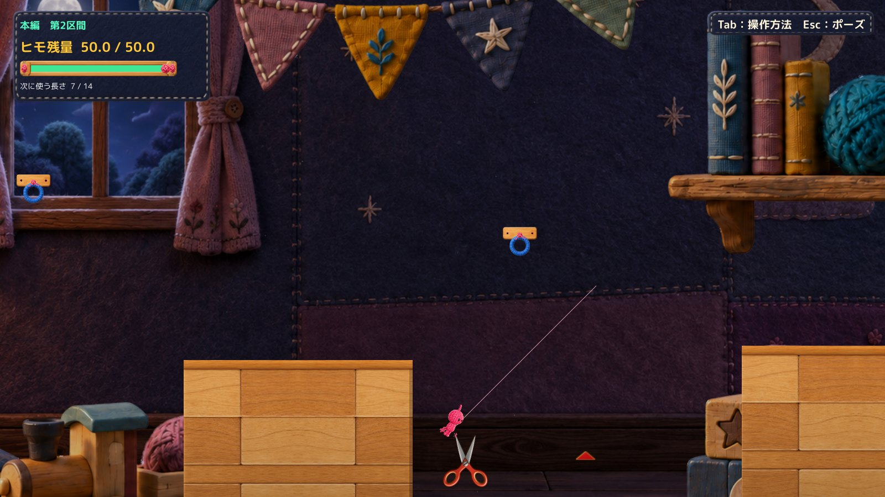
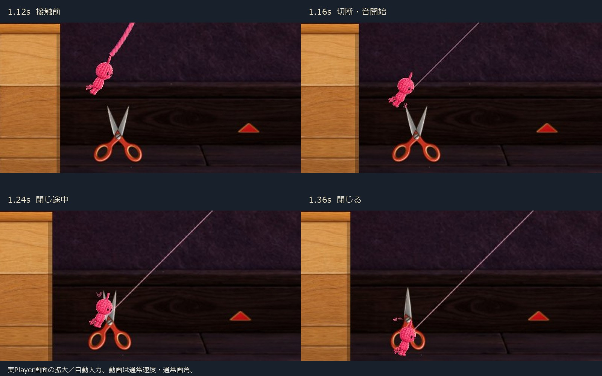

# C05 ハサミ切断音 — 隔離候補1案

本編手前のハサミ1個に、**切断が成立した瞬間だけ鳴る0.22秒の「シャキッ」**を追加しました。Human承認済みの本体・1.00倍／下降0.95の配置・第2区間カメラ下降0.95は保持しています。**Production未統合。音のHuman Review待ち**です。C11／C18はHOLDを継続します。

## まず試聴・比較

- [試聴用の原音 WAV（0.22秒）](Audio/HimoHitoScissorsSnip-v1.wav)
- [候補：実Player音声入り動画（通常速度・約6秒）](Video/After_PlayerMix.mp4)
- [比較元：切断音なし／既存BGM・効果音あり](Video/Before_PlayerMix.mp4)
- [手動起動と操作](Launch.md)

動画の **1.16秒：刃接触・切断・音開始**、**1.30秒：既存の落下失敗**、**1.34秒：閉じ完了**を比較できます。音声は実行中のUnity Playerがミックスしたものです。WAVを後から映像に合わせて鳴らした動画ではありません。原音試聴は素材そのままの音量、ゲーム内は既存効果音設定×0.42の音量です。

## 変更内容

| 対象 | 変更 |
| --- | --- |
| 隔離版 RopeSpikeHazard.cs | 既存の解除・返却と接触演出が成立した後に、表示／音用の成功通知を追加。判定・解除時刻・返却量は不変 |
| 新規 ScissorsCutAudio.cs | 対象名が Main Section 2 Front Spike の1個だけに追加。成功通知で1回再生。既存 HimoHitoAudioSettings.Effects に毎フレーム連動 |
| 新規 WAV＋meta | 48 kHz／mono／PCM16、0.22秒。短い刃の擦れから乾いた切れ音へ。リバーブなし |
| 起動・診断コード | 手動起動では音コンポーネントの初期化だけ。比較／録音は明示的な -routeQA 1 のときだけ |

**開閉アニメーションや ToySpikeVisual.PlayContact 自体には再生を結び付けていません。** 接続済みのヒモを実際に切ったイベントだけを使うため、待機微動・閉じる見本・未接続の接触・普通のE解除・落下ではこの新音は鳴りません。他のトゲには音コンポーネントを付けていません。

音の冒頭で擦れが始まり、約0.15秒に短い切れのアクセント、0.22秒で終了します。既存の閉じ時間0.18秒は変更していません。実測でも切断通知・再生要求・閉じ開始は同じフレーム104、閉じ完了はその0.18秒後でした。既存の落下失敗音と近接するケースも動画に残しています。

差分：[切断成功通知](Diff/RopeSpikeHazard.cs.patch)／[再生処理全文](Diff/ScissorsCutAudio.cs.txt)／[隔離起動差分](Diff/RouteReview.cs.patch)／[診断・音声収録コード](Diff/AudioReview.cs.txt)

## 必要な確認の結果

自動入力／APIによる結果です。OS実キー・Human試遊へ読み替えていません。

| 場面 | 実測 | 判定 |
| --- | --- | --- |
| 長さ7、刃に接触して切断 | 切断通知1回・新音Play1回・閉じ反応1回。離れた後の落下でも追加再生なし | PASS |
| 長さ6、空白を通過して通常E解除・着地 | 対岸到達。新音0回 | PASS |
| 待機／開閉だけ・接触演出だけ | 各1秒の診断中、新音0回 | PASS |
| 未接続で刃に重なる診断 | 切断なし・新音0回 | PASS |
| 効果音0%、BGM100% | 実切断1回・Play0回・音源volume0。BGMは継続 | PASS |
| 効果音0%、BGM0% | 切断周辺0.9〜1.8秒のPCM非ゼロサンプル0 | PASS |
| 効果音50% | 音源volume0.21。単独収録の切断区間RMS比0.4999997 | PASS |
| 同一入力、音なし／あり | 300フレームのRoot位置・速度・残量・Camera・接触結果・開閉・持ち手高さがすべて差0 | PASS |
| 旧承認画角の長さ6との比較 | 同じ300フレームのゲーム状態・Camera・開閉が差0 | PASS |
| 手動起動、音あり／音なし | 約20秒で初期化完了。その後10秒待機しても自動攻略／撮影／終了なし。通常ウィンドウ終了確認 | PASS（起動のみ） |
| 音の自然さ、聞き取りやすさ、手応え | 本人の実聴・実キー評価はまだ行っていない | 未確認 |

[集計とフレーム差分](QA/Analysis.json)／[候補の音イベント・全フレーム](QA/AfterVisible_AudioResult.json)／[候補のゲーム状態](QA/AfterVisible_Result.json)／[非接触・開閉だけの確認](QA/L6NoCut_AudioResult.json)／[手動起動確認](QA/ManualSmokeReady.json)

音量設定は既存Effectsをそのまま利用します。QAでは保存済みPlayerPrefsを書き換えず、同じ設定クラスのメモリー上の値のみ切り替え、終了前に戻しました。手動版では通常のEsc音量設定を使います。音源単独のPlayer出力ピークは約−14.70 dBFS、BGM・既存失敗音込みの候補動画は約−8.14 dBFSでクリップ0件でした。これを音量調整の技術的根拠としましたが、耳での最終バランス確認はHumanへ残します。

### ミュート測定の注意

全ミュート収録の先頭約1.3msには、設定変更前のミキサーバッファ残りがありました。切断音ではなく、以降から切断・閉じ・落下までPCMは0です。「ファイル全体が完全無音」とは報告していません。効果音のみミュートのケースではBGMが残ることが正常です。

## 実行・録音方式

- Unity **6000.3.21f1** の既存非Development Windows Playerに、今回コンパイルした独立managed assemblyと音源を配置しました。**新規Unity Build成功ではありません。**
- 音源は隔離RuntimeのReviewAssetsからPCM16を読み、AudioClipを生成しています。Playerで読み込まれたSHA-256は原音と一致：`19420a96fc903f9be4404f50e2e072bc9e103483f9b1f075b571439f7bf1f5a4`。
- 比較は入口の診断初期化、同じ固定ステップ入力、既存TryAttach／DetachAndRefundと通常の物理接触を使用。比較中に座標を調整して切断を成立させてはいません。
- 録音は[Unity AudioRenderer](https://docs.unity3d.com/6000.3/Documentation/ScriptReference/AudioRenderer.html)による**実Player内部の最終ミックス**。BGM・既存音・新音をまとめてPCM収録しています。OSスピーカーのループバック録音・マイク録音ではありません。
- 診断時計50 fps、画面25 fps、音声48 kHz stereo。AudioRenderer.Renderはサンプル0のフレームも含め毎フレーム呼びました。描画と実際に得たミックスをFFmpegでH.264/AACへ格納し、音の貼り足し・後付け同期・音量正規化はしていません。ミックスは約5.995秒、動画は通常速度です。
- AudioRendererは録音モード中にライブ出力を止めます。**手動版はこの録音モードへ入りません。**
- BGMの起動時の再生位相までは固定していません。音量50%の比率は他音源をミュートした診断収録で比較し、通常動画と区別しました。

## 音源の出典・利用条件

新しい切断音は今回のための**独自の数式・ノイズ合成**です。外部の録音・素材サイトのサンプル・音声生成サービスは使用していません。[生成スクリプト](Audio/make_sound.py)と[計測値](QA/SoundAsset.json)を同梱しました。外部サンプル由来のクレジット・再配布条件はありません。既存BGM／効果音の権利や条件が、この新音によって変更されるわけではありません。

動画中の既存音は変更していません。BGM「優しい踊り」／GANOは[配布元](https://dova-s.jp/bgm/detail/3126)・[利用条件](https://dova-s.jp/help/articles/license/)に従う既存ゲーム音源です。既存失敗音等は[効果音ラボ](https://soundeffect-lab.info/agreement/)、フック・歩行等の一部はKenney Impact Sounds（CC0）です。**BGMの生ファイルや単体の混合音声WAVはGitHubへ追加していません。** 公開音声ファイルは新規の切断原音のみ、既存音はゲーム映像内に含めています。

## 保持と未確認

Production HEADは `394b4a74e366678a9e0542d895b9a26f86993c19` のまま。124ファイル・既存dirty差分・過去Proofの保護対象ハッシュを再確認し、不変でした。[保護確認](QA/Protection.json)

CraftScissorsMotion.cs、HorizontalCameraFollow.cs、承認PNG、刃の幾何データは承認画角版と同一です。本体サイズ・配置・判定・Camera・攻略条件、他のトゲには変更なし。Project／Libraryのフルコピーや削除は行っていません。

初回の診断起動では接地待機を含まない入力計画を選んで接続に失敗したため、従来のstand計画に戻しました。その失敗記録は保持し、切断成功の証拠にしていません。非表示ウィンドウの黒い録画も提出映像に使わず、通常表示で撮り直しました。手動起動は15秒では読み込み中だったため、完了ログを待つ方式で確認し直しています。ゲームの挙動や音源をこのために変更していません。

**未確認：** OS実キー、実スピーカー／ヘッドフォンの出音、Humanの音色・音量・気持ちよさ、全音量・全接触角度の網羅、新規Unity Build／Editor Play。技術PASSを音のHuman採用へ読み替えません。

次は上の原音と音声入り動画を聴き、短さ・金属感・BGM／失敗音との馴染みを判断してください。候補はこの1案で停止し、Production統合は行いません。
