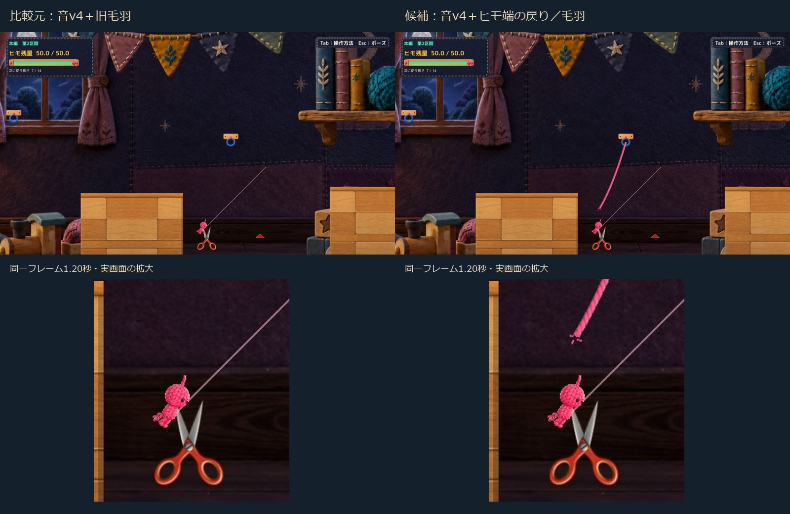
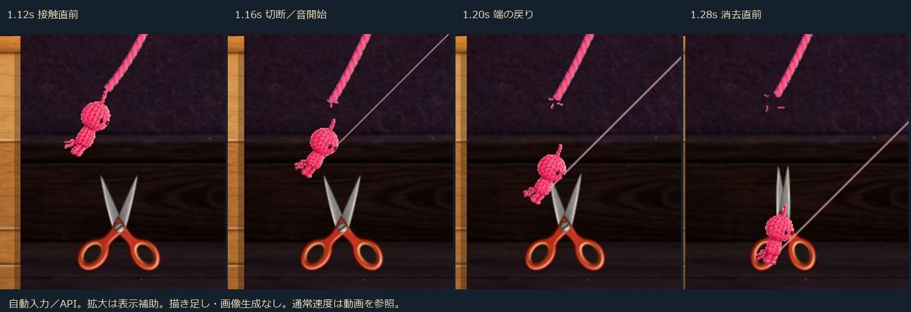

# C05：採用音v4＋切断VFX（隔離候補1案）

音v4を正確な原音のまま差し替え、切断直前の表示ヒモを使う短い戻り・ほつれを追加しました。本編手前ハサミ1個だけの候補です。**音v4はHuman承認済み、今回のVFXはHuman Review待ち。Production未統合です。** C11／C18はHOLDを継続します。

## 先に見る資料

- [通常速度の前後比較・音入り（約12秒）](Video/Comparison_NormalSpeed.mp4)：前半約6秒が音v4＋旧毛羽、後半が音v4＋新VFX。同じ1600×900・入力・地形・Camera。左右を縮小して並べた動画ではありません。
- [候補1600×900](Video/After1600_PlayerMix.mp4)／[候補1280×720](Video/After720_PlayerMix.mp4)／[比較元](Video/Before1600_PlayerMix.mp4)。各動画の1.16秒付近が切断成功。音の後付けなし。
- [承認音v4の原音](Audio/C05RopeScissors_v4.wav)／[手動起動](Launch.md)／[変更差分](Diff/RopeSpikeHazard.cs.patch)。

上段の比較シートは掲載用縮小、下段と連続コマは同範囲の拡大です。実画面の描き足し・画像生成はしていません。[1600×900原寸候補](Images/After1600_1.20s.jpg)と[1280×720原寸候補](Images/After720_1.20s.jpg)も通常ファイルで収録しました。

## 変更内容と理由

1. `ScissorsCutAudio`はZIPの`C05RopeScissors_v4.wav`を直接PCM読込。0.23秒、48kHz、mono、PCM16。SHA-256は`970d754ec4251d4ad2c4c57e22c97524db84ee63dcca50a1aefc4b1f4e2cde0e`。音を作り直さず、初期音量は従来の0.42×既存Effects設定を保持しました。
2. `RopeSpikeHazard`の既存切断前に、実際に描かれているLineRendererの点列・幅・色・材質・テクスチャ設定・描画順を保存。解除後は独立した描画コピーを使います。物理側の接触、DetachAndRefund、返却、速度、閉じ動作の発火時刻は変えません。
3. 新しい`ScissorsCutVfx`は同じ切断成功通知を1回受け、保存したヒモ端を0.10秒で0.14world戻し、短いほつれと4本の散る繊維を表示します。通常寿命は0.27秒。元ヒモの形を再推定したり、次の照準線を切断ヒモとして使ったりしません。
4. 対象1個の既存`SpikeContact`繊維4本だけを置換します。`ToySpikeVisual.PlayContact`は保持し、閉じ動作との同期を維持。他のトゲ、足音・ジャンプ・着地の毛羽は変更していません。

### 切断点に関する重要な制限

現行判定は「プレイヤーが刃に接触したら解除」です。今回の自然な長さ7経路では、**表示ヒモと刃の交点はありません**。接触点から保存済みヒモまで約1.394world離れています。

ZIPの指示どおり、存在しないヒモを刃まで延ばさず、最寄りの頭側端点でほつれを見せます。この経路の描画は「上側コピー1本＋端のほつれ2本＋散る繊維4本」であり、「刃の場所で2本に切れた」実測とは報告しません。実交点がある場合の2分割処理は実装していますが、今回の実接触サンプルではその分岐を通っていません。

通常画角でもヒモが瞬時に消える比較元との差は見えます。ただし、刃先そのものからヒモが切れる表現より因果の距離があり、特に720pでは毛羽が控えめです。また本経路は切断約0.14秒後に既存の落下失敗へ移るため、VFXは経過0.12秒で失敗処理に合わせて消去されます。これは残留防止を優先した結果で、演出の自然さはHuman判断が必要です。

## 実行方式

Unity 6000.3.21f1の**既存非Development Windows Player＋独立managed overlay**。今回のC#はUnityの参照アセンブリでCompileしました。新規Unity BuildやEditor Play成功とは扱いません。新WAVはPlayerが直接読み込み、SHA照合しています。ハサミPNGも既存の承認素材を直接読込。

比較は入口の診断初期化＋固定ステップのA/D入力＋既存TryAttach/Detach APIです。補助確認には診断位置設定、既存R復帰・ポーズ・Scene切替APIを使いました。**OS実キー・Human試遊ではありません。** 現セッションではネイティブ画面操作機能を使用できず、許可不足と扱ったり同じ承認を求めたりしていません。

録音は実Player内のUnity `AudioRenderer`最終ミックス。50Hzの撮影時計、25fpsの画像を通常速度の動画へ変換しています。OSループバックやスピーカー録音ではありません。原音だけを動画へ貼り付けていません。

## 確認結果

根拠：[集計](QA/Analysis.json)、[最終補助QA](QA/After720_VfxResult.json)、[音声記録](QA/After720_AudioResult.json)。

|項目|結果と範囲|
|---|---|
|Compile／Player|Compile成功、既存CS0649警告4件。今回のPlayer試験はError 0。Development=false|
|自然経路・長さ5／6|前後とも対岸到達。切断／音／VFXは各0回|
|自然経路・長さ7|前後とも刃接触1回。候補の音1回／VFX1回、旧SpikeContact毛羽0|
|同じ入力の前後|長さ5／6／7各300フレーム。Root位置・速度・残量・選択長・Camera・接地／接続／失敗状態・ハサミ開閉・接地高さに差0。旧音v1版の長さ7とも差0|
|ミュート|Effects=0でPlay 0、VFX 1。切断窓1.10〜1.70秒の最終PCMは完全0。冒頭には設定変更前の既存音バッファがあるため、収録全体が無音とはしていない|
|音量／ミックス|0.42×Effects。単独再生ピーク約0.149、通常ミックス最大約0.441、クリップ0。音色・他音との主観的なバランスは未確認|
|非切断|待機開閉、接触表示だけ、未接続で刃へ重なる、通常E解除は新音・VFXなし。Qは未接続の既存生成要求を確認（橋生成成功の再試験ではない）|
|ポーズ・R・再接続|ポーズ中8描画フレームでVFX時間／位置不変。Rで消去。再接続の生ヒモを古いコピーが消さない|
|失敗・メニュー・再読込|既存失敗、所有者無効、Tutorialへのメニュー復帰、MainStage再読込で残留なし|
|接触位置違い|補助APIで左右刃への接触を追加。全て最寄り端点。実交点での2分割の実プレイ確認は未実施|
|手動起動|候補・比較元を通常起動。入口準備後10秒間、自動入力／撮影／終了なし。通常のウィンドウ終了を確認。OSキー反応・Humanの手応えは未確認|

最初の1600版の補助ポーズ試験はFAILでした。診断で位置だけを戻したため直前の失敗状態が残り、既存メニュー側がポーズを解除したものです。証拠を残し、補助QAだけを「既存R復帰→接続表示を待つ→刃へ配置」へ修正。720版の再確認でtimeScale=0、VFX時間0→0を確認しました。ゲームのポーズ処理やVFX実装を変更して隠していません。1600撮影時r2と最終r3の差は診断セットアップ／Scene終了検証のみです。

## 保持・差分・出典

- Production `394b4a74e366678a9e0542d895b9a26f86993c19`。対象124ファイルのハッシュ、既存dirty5件、staged空、過去Proofの検査対象を保持。[保護確認](QA/ProtectionEnd.json)。mainへのcommit／pushなし。
- 承認本体PNG、`CraftScissorsMotion.cs`、`HorizontalCameraFollow.cs`、刃形状JSONは前候補とバイト一致。1.00倍・下降0.95、S2画角下降0.95、共通支点、判定、開閉、返却を保持。
- [新VFXソース](Diff/ScissorsCutVfx.cs.txt)、[切断箇所差分](Diff/RopeSpikeHazard.cs.patch)、[音v4差分](Diff/ScissorsCutAudio.cs.patch)。[QA用差分](Diff/RouteReview.cs.patch)と[QA専用コード](Diff/VfxReview.cs.txt)は製品採用用ではありません。
- 最終overlay DLL SHA-256：`36552ec9121493cd19b167787959e8ab0860aff8b9e411ce337f09dd4300042d`。Build／Library／DLL本体はGitへ追加しません。
- 音源はユーザー提供ZIPの手続き合成音。録音素材・外部音声入力なし。[生成記録](Audio/generation.json)／[承認記録](Audio/ADOPTION.json)／[生成スクリプト](Audio/synthesize_rope_snip.py)。原記録の「Unity未実施」は引継ぎ時点の記録として保持し、今回のPlayer確認とは区別しています。
- ZIPに第三者素材のライセンス指定はなく、この用途の採用・差替えがHumanから明示されています。既存BGM（GANO「優しい踊り」／DOVA-SYNDROME）と既存効果音の権利表記・設定は変更していません。音量／聴感はHumanが動画と手動版で判断してください。

## 判定

技術：確認した範囲でPASS。表示自己評価：短い断裂の区切りは比較元より伝わる一方、実際の刃接触と頭側のほつれの位置差が残るため、VFXの自然さはHuman Review待ち。ゲーム性・Human採用：未判定。Production統合・他トゲへの展開は行わず、この1案で停止します。
