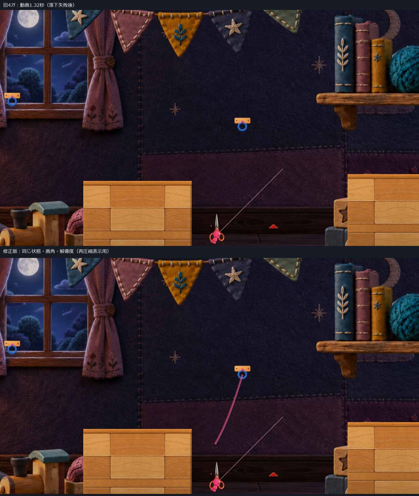
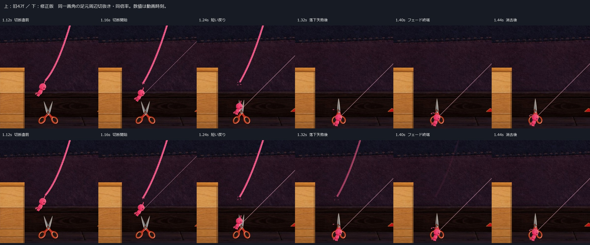

# C05 切断VFX：落下失敗後の連続性を直した隔離候補

2026-10-22 JST / 基準レビュー `47f66ebdeba099c0c779d93220ae5eaa4612bf0d`

**フェードの途中消失は修正できました。ただし、刃がヒモそのものを切る位置の一致は未解決です。** 現行のPlayer接触判定と長さ7の切断時刻を維持したまま、実在しない交点は描いていません。技術確認とVisualの採否を分け、VFX全体はHuman Review待ち・Production未統合とします。C11／C18はHOLDです。

まず [通常速度の音入り比較](Video/BeforeThenAfter_NormalSpeed.mp4) を見てください。前半0–6秒が旧47f、後半6–12秒が修正版です。旧動画は原本を再利用し、改変していません。[修正版1600×900](Video/After1600_PlayerMix.mp4)／[1280×720](Video/After720_PlayerMix.mp4)／[手動起動](Launch.md)。

## 1. 通常画角・連続コマ

[1280×720の同一画角比較](Images/FullFrame_After720.jpg)

連続コマは実Playerの同一範囲を同倍率で切り抜いた表示用画像です。原寸の全画面画像も[Images](Images)に収録しました。生成画像・描き足し・ヒモの延長はありません。動きは両者とも同じ入力とCameraです。画像の全ピクセル／身体アニメ位相の一致を保証する比較ではなく、後述の物理記録とVFX寿命を対照にしています。

## 2. 原因と、変えなかった限界

自然経路は入口から開始し、診断初期化後は既存物理で進みます。切断成功を直接発火させず、Playerと実際の刃PolygonColliderの接触を通しています。入口 `(12.7,-4.28)`、青Hook `(17.25,-0.85)`、選択長7。入力は従来と同じ固定ステップ列、接続はtick30、予定解除はtick90です。特殊な切断用配置ではありません。補助的なライフサイクル試験だけは診断配置を使い、自然通過と分けています。

切断通知直前に取得した値（world座標）：

| 項目 | 実測 |
|---|---|
| Player／刃の接触点 | `(15.00765, -7.47962)` |
| 表示ヒモの頭側端点 | `(15.15544, -6.09365)` |
| その時点の描画頭頂 | 上記端点と一致 |
| Player Collider下端／上端 | `-7.56218 / -6.36218` |
| 接触点→ヒモ端 | `1.393823 world` |
| 表示ヒモと刃の交点 | なし |
| 通知時の閉じ量 | `0.01789`（0=開、1=閉） |

原因は、**刃と接触したPlayer Colliderによって切断する条件**と、**頭から上へ続く表示ヒモの位置**が違うことです。描画頭頂とヒモ始点の遅れで1.394の隙間が生じたわけではありません。切断前の接続中28サンプルでも交点は0。切断直前の実ヒモ14点と刃の両ポリゴン、Collider範囲、速度を[自然接触の記録](QA/After1600/VfxResult.json)と[時系列](QA/After1600/Timeline.json)へ保存しています。

前後比較でも接触・切断通知・音・閉じ動作開始の時刻は維持しました。Playerが刃に触れる→ハサミが閉じ始める→実際に存在したヒモ端が戻る、までは読めます。しかし通常画角では、依然として「刃でヒモを挟み切る」より「頭から外れる」に近く見えます。ここを成功扱いにしません。接触点へ毛羽だけを移したり、存在しなかったヒモを加えたりしていません。

### 判定を変える場合に必要な範囲（今回は未実装）

候補となる最小範囲は `RopeSpikeHazard` の成功条件です。`Player overlap` に加え、**その時点の表示ヒモ線分と動いている刃の交差**を必要条件にし、交差が確定した場合のみ既存のDetach／返却／成功通知へ進む方式が考えられます。VFX側はその確定した交点を受け取る必要があります。フレーム間の高速通過については、過去・現在の刃とヒモの掃引も検討が必要です。今回はコード・判定を変えていません。

この変更なら、記録された長さ5／6の非接触経路に新しい切断は増えません。一方、**長さ7の現在の切断時点は交差なしなので切断しなくなります**。その後の軌道は切断の有無で変わり、今回の記録から将来の交差や対岸到達を推定してPASSにはできません。記録範囲のヒモ‐刃最短距離はL5=2.503、L6=1.505、L7切断前=1.402 worldで、単に交差条件へ変更して既存の「7は切断」を保てる根拠はありません。長さ7の結果維持と文字通りの刃・ヒモ交差を両立させるには、別途承認のもとで条件／配置／通過経路を再検証する必要があります。

## 3. 完成させた表示修正

- 切断コピーをPlayerの物理停止と切り離しました。落下失敗で `simulated=false`／RopeController無効になっても、その場の短い戻りとフェードを完了します。
- 既存の閉じ動作が次の物理ステップから動くため、戻りに0.02秒の短い立ち上がりを設けました。物理切断・音・刃の動きは遅らせていません。
- 戻り量0.14 worldと小さな毛羽は維持し、端の毛羽が実際の戻る端に追従するようにしました。フェードは0.08–0.27秒を滑らかにつなぎます。
- R完了後の**表示専用通知2行**を隔離版 `MainStageRespawnOnFall.cs` に追加しました。位置差だけの検出に頼らず、同じ座標へ戻るRでも即時消去します。復帰の物理／残量／Hook処理は変更していません。
- 再接続時はコピー自身だけを消去。新しい実ヒモのLineRendererを無効化しません。メニュー・Scene終了は破棄、ポーズは時間停止です。

| 動画時刻 / 切断からの経過 | 旧47f | 修正版 |
|---|---|---|
| 1.16s / 0.00s | 切断1・音1・閉じ反応1 | 同じ |
| 1.18s / +0.02s | 閉じ量0.052 | 同じ閉じ量、短い戻り開始 |
| 1.30s / +0.14s | 落下失敗でコピー消去 | 物理停止後も表示継続、alpha0.764 |
| 1.32s / +0.16s | コピーなし | alpha0.617 |
| 1.40s / +0.24s | コピーなし | alpha0.067 |
| 1.44s / +0.28s | コピーなし | フェード完了、コピーなし |

旧コピーの内部経過値は0.12秒で打ち切り、生成→破棄のTime.time差は0.14秒でした。修正版は設定寿命0.27秒を50Hz更新で終えるため、実際の生成→破棄は**0.28秒**です。最後の可視記録は+0.26秒・alpha0.008。動画の0秒は最初の記録フレームで、AudioResultの採録開始からの値は+0.02秒ずれます。異なる時計を混同せず、寿命は生成／破棄の同一時計差で計算しています。

## 4. 必要な確認結果

| 同じ入口・同じ入力 | 旧47f／修正版 | 切断・音・VFX | 返却後残量 |
|---|---|---|---|
| 長さ5 | 両方対岸到達 | 0 / 0 / 0 | 50 |
| 長さ6 | 両方対岸到達 | 0 / 0 / 0 | 50 |
| 長さ7 | 両方刃へ接触→切断→落下失敗 | 1 / 1 / 1 | 50 |

各300フレームでRoot位置・速度・残量・ヒモ長・Camera・接地・接続・失敗・閉じ量・持ち手の接地差は一致。1600×900／1280×720も同じ結果です。自然接触の切断コピー1、端の毛羽2、小さな散り4、旧接触毛羽0。見た目に判定を合わせる変更はありません。

実Player確認：Compile成功、Runtime Error 0、非Development。ポーズ中8描画フレームでVFX時間不変。同位置Rで即時消去、再接続した実ヒモ保持、メニュー復帰とScene再読込で残留0。自然落下失敗と、診断的な物理停止の両方でフェード完了を確認しました。接触なし・待機開閉・切断しない視覚反応・未接続での刃接触・通常E解除では切断音／VFXの増加なし。Qは未接続で要求しても発火しないことの確認であり、橋生成の全面回帰ではありません。

ミュート：切断1、音Play0、VFX1。切断を含む1.1–1.7秒の実ミックスPCMは0。録音開始直後の既存バッファまで含めたWAV全体の無音は主張しません。音v4 WAVのSHA-256は `970d754ec4251d4ad2c4c57e22c97524db84ee63dcca50a1aefc4b1f4e2cde0e`。元音を再加工していません。実ミックスの背景音の位相まで前後同一とはしていません。

[集計JSON](QA/Analysis.json)／[寿命・重複・復帰](QA/After1600/VfxResult.json)／[音・負例](QA/After1600/AudioResult.json)／[手動起動確認](QA/ManualSmoke.json)／[ログ抜粋](QA/Logs.txt)。

## 5. 実装範囲と実行方式

隔離候補は `C05CutVfxContinuityProof_20261022`。実装差分は [ScissorsCutVfx](Diff/ScissorsCutVfx.patch) と [R復帰の表示通知](Diff/MainStageRespawnOnFall.patch)。[診断差分一覧](Diff/SourceScope.json)に撮影・計測側を別記しました。比較専用 `-vfxLegacy 1` は旧寿命／戻り／フェードの再現用で、本番用ではありません。

暖色PNG・刃形状・開閉／Collider計算・RopeSpikeHazard・音v4／再生処理・Cameraは旧47fとバイト一致。1.00倍、下降0.95、S2 Camera下降0.95、zoom8.7、他のトゲ、地形、物理、長さ、返却は維持しました。

実行は **Unity 6000.3.21f1の既存非Development Player＋独立managed overlay**。Unity参照アセンブリによるCompileと、そのDLLを実Playerで確認しました。**新規Unity Build／Editor Playは実施していません。** 音は実PlayerのAudioRenderer最終ミックスで、動画への音源の後付けでもOSループバック録音でもありません。50Hz診断時計で撮影し、25fps・通常のゲーム速度で提示します。

手動起動は通常の実時間・既存入力で動き、自動入力／撮影／自動終了は開始しません。両モードとも起動完了後10秒以上待機し、対象ウィンドウの正常終了を確認しました。OS操作環境は一度試しましたが `computer-use request timed out: list_apps`。再試行・再承認要求はしていません。今回の経路とR／ポーズ等の結果は**自動入力／既存API**であり、OS実キー・Human試遊ではありません。

## 6. 自己評価・未確認・保護

残す価値がある変化：失敗による突然の消失がなくなり、短い端の戻りから静かに消える区切りができました。毛羽は実ヒモと同じ材質／色を使い、閃光・Camera揺れ・停止演出を増やしていません。

残る重要な弱点：**切断位置の1.394 world差**。刃がヒモを挟んだと自然に読める品質には達していません。さらに720pでは毛羽は小さく控えめです。画面の細い斜線は既存の照準ガイドで、切断コピーではありません。今回そこへ手を加えていません。

未確認：HumanのVFX採否／手応え、OS実キー、スピーカー出音と聴感、新規Build、全接触角度、実ヒモが刃と交差した場合の2分割経路。条件変更の採用・実装はしていません。推奨は **寿命修正のHuman確認／切断因果の品質はHOLD**。追加候補・Production統合へ進みません。

Production HEAD `394b4a74e366678a9e0542d895b9a26f86993c19`、対象124ファイルと既存dirty5件、過去Proofの確認対象を保持。[保護記録](QA/ProtectionEnd.json)。削除・reset・clean・stash・Project/Library複製なし。レビュー資料だけを `codex/review-c05-spikes` に共有します。
