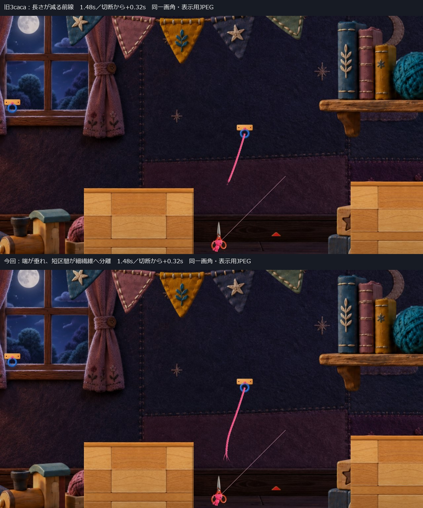

# C05：張りを失って崩れ、端が繊維に分かれる候補

基準：`3caca298cdeca8577a9afc2f6bd2c07021c38ee7`

対象：Main Section 2 Front Spike のハサミ1個

状態：**隔離候補1案を共有。完成映像はHuman Review待ち、Production未統合。**

## 先に見る比較

- [720p・音入り通常速度比較](Video/Before3cacaThenAfterSoft_1280x720_NormalSpeed.mp4)
- [900p・音入り通常速度比較](Video/Before3cacaThenAfterSoft_1600x900_NormalSpeed.mp4)
- [720p・今回だけ](Video/After_1280x720_PlayerMix.mp4)／[900p・今回だけ](Video/After_1600x900_PlayerMix.mp4)
- [手動起動](Launch.md)

比較動画は **0–6秒＝旧3caca、6–12秒＝今回**。同じ入口・入力・画角、25fps、通常速度です。切断は各単体動画1.16秒、比較動画の今回側7.16秒。切断前から完全消去後まで省略していません。画像は実Playerの記録です。生成画像・描き足しはありません。

録音は実Player内部の **Unity AudioRenderer最終ミックス**。音の後付けでもOSスピーカーの録音でもありません。採用音v4のWAVは無加工・SHA一致、動画化時のみミックスをAACへ符号化しています。録画は50Hzの診断用固定時間進行を25fpsへ記録したもので、OS実キー・Human試遊ではありません。手動起動では通常の実時間を使います。

## 変更した見せ方

旧案は太い糸の表示長を切り口から削っていました。今回は保存した経路の長さをほぼ残し、自由端側から向きを変えて張りを抜きます。フック側の端は固定です。

1. 小さな戻りの後、切り口側が下がって曲がる。
2. 端の短い範囲が、少しずれた時刻に3本の細い繊維へ分かれる。根元は太い糸につながる。
3. 形を残したまま端側から薄くなり、残った部分も遅れて消える。先端が全経路を走る長さ削除はしない。

散る細片は補助の2本だけです。大きな閃光・別色・画面揺れ・スロー・物理停止は追加していません。自然接触で保存された片側1本だけを使い、刃までの架空の糸や反対側の破片を作っていません。

### 通常画角での比較

上が旧3caca、下が今回。+0.32秒の全画角を同倍率で並べた表示用JPEGです。画面内にはラベルを描き足していません。

| 段階 | 切断後 | 720p・旧 | 720p・今回 |
|---|---:|---|---|
| 切断前 | −0.04秒 | [全画面](Images/Before3caca_1280x720_00028_PreCut.jpg) | [全画面](Images/AfterSoft_1280x720_00028_PreCut.jpg) |
| 切断直後 | 0.00秒 | [全画面](Images/Before3caca_1280x720_00029_Cut.jpg) | [全画面](Images/AfterSoft_1280x720_00029_Cut.jpg) |
| 端が緩む | 0.20秒 | [全画面](Images/Before3caca_1280x720_00034_Slack.jpg) | [全画面](Images/AfterSoft_1280x720_00034_Slack.jpg) |
| 繊維に分かれる | 0.32秒 | [全画面](Images/Before3caca_1280x720_00037_Split.jpg) | [全画面](Images/AfterSoft_1280x720_00037_Split.jpg) |
| 薄れ始めた状態 | 0.52秒 | [全画面](Images/Before3caca_1280x720_00042_Fade.jpg) | [全画面](Images/AfterSoft_1280x720_00042_Fade.jpg) |
| 完全消去後 | 0.68秒 | [全画面](Images/Before3caca_1280x720_00046_Gone.jpg) | [全画面](Images/AfterSoft_1280x720_00046_Gone.jpg) |

補助：[720p同倍率切抜き](Images/SequenceSameScale_1280x720.jpg)／[900p同倍率切抜き](Images/SequenceSameScale_1600x900.jpg)／[900p全画角比較](Images/FullFrameComparison_1600x900_Split.jpg)。全画面コマは原寸JPEGのコピー、比較シートだけ再圧縮プレビューです。ローカル原画像を保持しています。

## 計測した形の変化

値は今回の実Rendererの座標・幅・透明度とCamera投影から取得しました。設定時間や制御値を成功の実測値に置き換えていません。[Analysis.json](QA/Analysis.json)／[720p全フレーム](QA/After720/VfxResult.json)。

| 項目 | 今回の実測 |
|---|---|
| 切断時の保存経路 | 14点、片側1本、弧長5.660994 world |
| 保存形状との初期最大誤差 | 0 |
| 0〜0.32秒の生の描画経路長／保存長 | 0.992178〜1.0000004 |
| +0.32秒の自由端 | 下方向0.204388 world、総移動0.852957 world |
| 自由端の接線角 | 初期59.399°→+0.24秒105.634° |
| フック端の最大位置ずれ | 0 |
| 太い糸と分岐繊維の根元の最大隙間 | 0 |
| 720p・+0.32秒の繊維の投影長 | 約33.82〜36.76px |
| 同時点・繊維中間の幅 | 約1.64px |
| 同時点・繊維中間〜3/4部分の最小中心間隔 | 3.05／4.56／6.35px |
| 同測定位置の最小幅／透明度 | 1.54〜1.64px／0.69〜1.00 |
| 全部位の透明度が0になった時刻 | 切断後約0.64秒 |
| コピーの実際の片付け | 切断後約0.66秒 |

生の経路長には透明な頂点も含みます。「見える糸が最後まで全長不透明」という意味ではありません。末端の数学的な点は幅0なので、その点同士の間隔を可読性の根拠にはしていません。表は幅と透明度の残る途中位置を測定した値です。

3本とも中間透明度>0.5・幅>1px・測定最小中心間隔>2pxを満たす記録は、+0.20〜0.48秒、サンプル時刻幅約0.28秒でした。これは数値条件であり、人の認識時間や成功率ではありません。完全消去直前の最大透明度は約0.62秒のサンプルまで0.01超、0.64秒で0となり、次の更新で破棄しています。短い棒を不透明なまま破棄する終わり方ではありません。

### 見た目の自己評価と弱点

通常720pの全画面コマでも、消去前の端の曲がりと3繊維への接続が旧案より読み取れます。巻き取りを主とする形は抑えられました。独立したコード・画像確認でも同じ傾向を確認しています。[独立確認](QA/IndependentReview.json)

ただし、細い末端は背景の布へ溶けやすく、太い糸ほど目立ちません。切断元の糸が比較的縦に近いため、垂れる量自体は控えめです。**通常速度動画でのHumanの読み取りやすさ・柔らかさ・最終採否は未確認**。数値PASSや静止コマの自己評価を、その採否へ置き換えません。

## 技術確認

| 項目 | 結果・方式 |
|---|---|
| Compile | PASS：Unity6.3アセンブリ対象、エラー0・既存CS0649警告4 |
| 実行 | 既存Unity6000.3.21f1非Development Player＋独立managed overlay。新規Unity Buildではない |
| 長さ5／6 | 同じ入口・自動入力／APIで両方対岸到達。切断・音・VFX各0 |
| 長さ7 | 自然な経路接触で切断1・音1・VFX1。旧毛羽0 |
| 同一入力の比較 | 各300フレーム、位置・速度・残量・Camera・ヒモ長・ハサミ開閉・持ち手接地差0。状態不一致0 |
| 返却 | 各経路終端残量50。旧版と一致 |
| ミュート | 効果音0・BGM0で再生要求0、切断前〜完全消去後の最終ミックス最大振幅0 |
| 重複／非切断 | 待機開閉、見た目だけの接触、未接続の刃接触で追加音・VFXなし。通常解除APIもなし |
| 自然落下失敗 | 切断約0.14秒後に物理停止しても、表示は約0.66秒まで完走 |
| ポーズ／再開 | 進行0.24秒で経過時間・形状・幅・透明度を停止。再開後も処理継続 |
| R | 同位置の診断CPから既存R復帰APIで即時消去 |
| 再接続 | 診断入口配置・接地更新・既存TryAttachを同フレームで実行。旧コピーだけ消去し、本物を保持 |
| メニュー／Scene | 既存メニュー復帰APIとScene再読込で残留なし |
| 通常手動起動 | 新旧両方で起動準備完了後10秒待機。自動入力・撮影・終了なし、通常終了できた |
| Player errors／録音失敗 | 各ケース0 |

根拠：[集計](QA/Analysis.json)／[L5](QA/AfterL5/Result.json)／[L6](QA/AfterL6/Result.json)／[L7](QA/After1600/Result.json)／[復帰・停止試験](QA/After1600/VfxResult.json)／[音・非接触](QA/After1600/AudioResult.json)／[ミュート](QA/Muted/AudioResult.json)／[手動起動確認](QA/ManualSmoke.json)／[ログ抜粋](QA/Logs.txt)。

L7の自然接触1回と、復帰分岐のための診断接触4回は分けています。検証全体5回を「1接触で5回鳴った」とは扱いません。後半の診断は配置API・物理停止・復帰APIを明記し、通常操作の成功として扱いません。OS実キーとHuman試遊は今回未実施です。

## 変えていないものと未解決の切断位置

**刃の接触点と表示ヒモ端は1.393823 world離れたままです。表示ヒモと刃の交点も記録範囲では0です。** 現行判定はPlayerと刃の接触による切断です。今回の演出改善は「刃が実際のヒモを切った」位置の整合を解決しません。端を刃へ移したり、存在しなかった糸を足したりしていません。

採用音v4、暖色本体、上向き・1.00倍・全体下降0.95、S2Camera下降0.95／ズーム8.7、刃形状、地形、物理、入力、ヒモ長、残量・返却、他のトゲを保持。[ソース・素材ハッシュ](QA/Analysis.json)

- 表示コピー：[`ProgressiveUnravelDrawing.cs`](Diff/ProgressiveUnravelDrawing.patch)
- 新旧切替・表示寿命・実測値取得：[`ScissorsCutVfx.cs`](Diff/ScissorsCutVfx.patch)
- 計測／ポーズ検証のみ：[`VfxReview.cs`](Diff/VfxReview.patch)
- 基準アルゴリズム保持：[`PreviousProgressiveUnravelDrawing.cs`](Diff/PreviousProgressiveUnravelDrawing.cs.txt)（旧クラス名だけ変更）
- [全Source範囲](Diff/SourceScope.json)

Production HEADは `394b4a74e366678a9e0542d895b9a26f86993c19`。保護対象124ファイル・既存tracked差分5件・stage空・過去Proofの記録対象ハッシュを確認し、変更0です。[保護確認](QA/ProtectionEnd.json)。Project／Libraryのフルコピー・削除・Production統合は行っていません。

## 未確認と停止点

- 完成映像のHuman評価・実操作感・実聴。
- OS実キー／OS画面取得。既存timeoutを許可不足と判断せず、同じ試行は反復していません。
- 新規Unity Build・Unity Editor Play（今回実施していません）。
- 全接触角度、実際にヒモと刃が交差して2片になる経路。

本体・配置・画角・音v4・演出方向の承認と、今回映像の採用は別です。修正版1案で停止し、Human Reviewを待ちます。C11／C18はHOLDを継続します。
