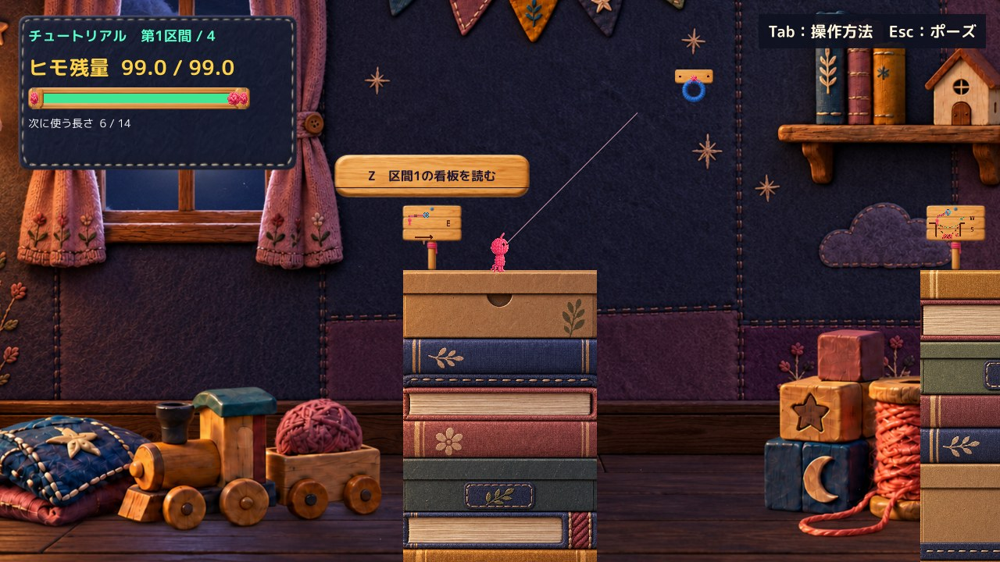

# C06 C07 操作案内を右上へ統一する隔離候補

Tutorial／MainStageの左HUDから「Tab 操作説明」だけを削除し、右上を「Tab：操作方法　Esc：ポーズ」に統一しました。通常画角で右上が読みやすくなったと自己評価します。画風への適合と本人の読みやすさはHuman判断待ちです。Production統合はしていません。

基準はProduction `d88160da59fd5902222ef68a76a8b74882fafe98`。中断前の調査を引き継ぎ、追加の課題には着手していません。

## 比較画像

全画面は実Unity Playerの同一画角・同一解像度です。JPEGは表示用プレビューで、元PNGはローカルに保持しています。描き足しや画像生成はしていません。

| Sceneと解像度 | 修正前 | 候補 | UIの同範囲比較 |
|---|---|---|---|
| Tutorial 1600×900 | [BEFORE](Images/Tutorial-1600-Before.jpg) | [AFTER](Images/Tutorial-1600-After.jpg) | [右上・左HUD](Images/Tutorial-1600-HintCompare.jpg) |
| Tutorial 1280×720 | [BEFORE](Images/Tutorial-1280-Before.jpg) | [AFTER](Images/Tutorial-1280-After.jpg) | [右上・左HUD](Images/Tutorial-1280-HintCompare.jpg) |
| MainStage 1600×900 | [BEFORE](Images/MainStage-1600-Before.jpg) | [AFTER](Images/MainStage-1600-After.jpg) | [右上・左HUD](Images/MainStage-1600-HintCompare.jpg) |
| MainStage 1280×720 | [BEFORE](Images/MainStage-1280-Before.jpg) | [AFTER](Images/MainStage-1280-After.jpg) | [右上・左HUD](Images/MainStage-1280-HintCompare.jpg) |

明暗差は[補助試験 Tutorial](Images/Tutorial-1280-ControlledContrast.jpg)／[MainStage](Images/MainStage-1280-ControlledContrast.jpg)も比較しました。右上の背後に診断用の明色／暗色を表示した実Player撮影であり、自然なステージ背景の別地点ではありません。手動版にはこの試験色は表示されません。実ステージ比較は上表の入口画角に限定しています。

## 変更した表示

| 対象 | 変更 | 保持した内容 |
|---|---|---|
| PrototypeHud | 左HUD最終行のTabラベルを1行削除 | 区間、残量、バー、選択長、接続状態、既存パネル寸法 |
| MainStageHud | 同上 | 同上、その他の案内 |
| StageOverlayControls | 右上を20pxの既存丸ゴシック太字、淡いアイボリー、濃紺90％背景、横12px／縦8px余白へ | Tab／Escの入力処理、ヘルプとポーズの内容・配置・背景 |

右上の安全領域から18px離し、文字の実測寸法に余白を加えます。対象2解像度では縮小や改行を使わず一行です。新しい装飾素材・看板・操作説明は追加していません。

[PrototypeHud差分](Diff/ProposedPrototypeHud.patch)／[MainStageHud差分](Diff/ProposedMainStageHud.patch)／[StageOverlayControls差分](Diff/ProposedStageOverlayControls.patch)

## 確認結果

実行方式はUnity **6000.3.21f1の既存非Development Player＋再コンパイルしたmanaged overlay**です。Unity 6.3のRoslyn・参照アセンブリで修正前後をコンパイルし、実Playerで撮影しました。新規Unity Buildの成功ではありません。既存のCS0649警告4件ずつ、新規コンパイルエラー0件です。

| 項目 | 結果と範囲 |
|---|---|
| Tutorial／MainStage、1600×900／1280×720 | 修正前後8回のPlayer実行完了、実行エラー0件。通常プレイ案内は右上だけ |
| 文字・余白 | 通常画角で文字切れ、重なり、画面外はみ出しなし。20px太字を両解像度で保持 |
| 明暗 | 通常画面と診断用の明暗背景で比較。明色では旧案よりコントラストが明確 |
| ヘルプ開く→閉じる | API経路で停止0→復帰1と右上再表示を確認 |
| ポーズ→ヘルプ→閉じる→再開 | API経路でポーズ維持0→再開1と案内復帰を確認 |
| Tab説明画面の保持 | 文面・背景・描画メソッドは不変。[Tutorial](Images/Tutorial-1280-Help-Unchanged.jpg)／[MainStage](Images/MainStage-1280-Help-Unchanged.jpg)で紙と閉じるボタンを確認 |
| ポーズ画面の保持 | 描画・入力処理は不変。[Tutorial](Images/Tutorial-1280-Pause-Unchanged.jpg)／[MainStage](Images/MainStage-1280-Pause-Unchanged.jpg)で確認 |
| 描画以外 | 比較した全時点でRoot位置・速度・残量・選択長・Camera・TimeScale・開閉状態は修正前後一致。移動入力を伴う全区間QAは対象外 |
| 手動起動 | 候補のTutorial／MainStageをQA引数なしで起動。準備後6秒以上待機し、自動入力・撮影・終了が始まらず生存。[記録](QA/ManualSmoke.json) |
| OS実キー | **未確認**。computer-useのlist_appsが1回タイムアウトし、再試行・キー送信はしていない |
| Human理解・採否 | **未確認**。API確認は本人の実キー操作や採用判断ではない |

Tab説明画面の画像差は最大1/255、1〜3画素の微差でした。半透明ポーズ画面では、削除した左HUDのTab行が背後に見えなくなる差があります。その行以外は最大1/255の描画差です。「全画像が完全一致」とは扱っていません。[測定と保持メソッド](QA/Verification.json)に範囲を記録しています。

## 保護と残る制限

ProductionのHEAD・既存のtracked差分5件・stage空を維持し、Source／meta／Scene等247ファイルのSHA256一致と、再利用元PlayerのDLL不変を確認しました。[保護記録](QA/Protection.json)

C08・C14・C20・C22/C23のソースはそのまま参照してコンパイルしています。既存のQ・Tab・腕Proof、固定レビュー環境、Productionのファイルは書き換えていません。Project／Libraryの追加フルコピー、削除、Productionへのstage／commit／pushはしていません。共有ブランチに追加するのはこのレビュー資料だけです。

残る判断点は、濃紺の小パネルが本人にとって画風へ十分馴染むかです。読みやすさを優先しており、新規装飾は足していません。実際のキー操作感、他区間を移動した全背景での視認性、Human理解は未確認です。

[手動ランチャーと確認経路](Launch.md)から候補を確認してください。追加改修や本番統合はせず、Human Reviewを待ちます。
