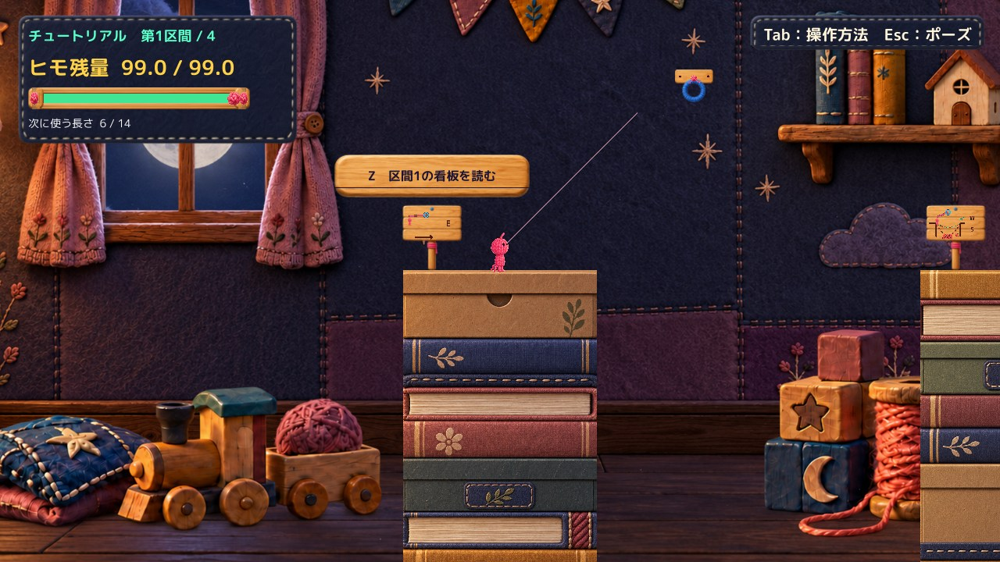

# C06 C07 布タグと左HUDの余白修正版

右上を左HUDと共通素材の布タグに変更し、左HUDの高さを206pxから172pxへ詰めました。20pxの文字と既存のHUD内容は縮小していません。前候補より画面の布・刺繍へ馴染み、左下の余白も自然になったと自己評価します。今回の修正版はHuman Review待ちで、Production未統合です。

## Human評価と比較基準

前候補 `cd879b94db6ba7c7bc1141729e5367696bfd6063` はHuman不採用です。理由は「右上の案内が世界観に合わず浮く」「左側のTab行削除後に不自然な下余白が残る」。[前資料](../20261020T215531_JST/Report.md)・ソース・Player・ランチャーを保持しています。

今回の比較はその不採用候補と布タグ修正版です。Production基準HEADは引き続き `d88160da59fd5902222ef68a76a8b74882fafe98` です。

## 同一画角での比較

すべて実Unity Player画面です。JPEGは表示用プレビューで、元PNGはローカルに保持。HUD拡大は同じ範囲の2倍表示で、ゲーム画像への描き足し・画像生成はしていません。

| Sceneと解像度 | 不採用候補 | 布タグ修正版 | 左右HUDの同範囲拡大 |
|---|---|---|---|
| Tutorial 1600×900 | [前](Images/Tutorial-1600-Rejected.jpg) | [修正](Images/Tutorial-1600-ClothTag.jpg) | [左右比較](Images/Tutorial-1600-HudZoom.jpg) |
| Tutorial 1280×720 | [前](Images/Tutorial-1280-Rejected.jpg) | [修正](Images/Tutorial-1280-ClothTag.jpg) | [左右比較](Images/Tutorial-1280-HudZoom.jpg) |
| MainStage 1600×900 | [前](Images/MainStage-1600-Rejected.jpg) | [修正](Images/MainStage-1600-ClothTag.jpg) | [左右比較](Images/MainStage-1600-HudZoom.jpg) |
| MainStage 1280×720 | [前](Images/MainStage-1280-Rejected.jpg) | [修正](Images/MainStage-1280-ClothTag.jpg) | [左右比較](Images/MainStage-1280-HudZoom.jpg) |

接続状態も確認：[Tutorial全画面](Images/Tutorial-1280-Attached.jpg)／[MainStage全画面](Images/MainStage-1280-Attached.jpg)。各解像度の接続中HUD拡大はImages内の `ConnectedHud` ファイルです。選択長14の「接続中」まで同じ固定枠に収まり、未接続へ戻っても枠高は172pxです。

## 表示の変更

右上は既存の `Art/HimoHitoCraftHudPanel-v1` を使います。左HUDと同じ加工済みSpriteと9分割描画で、12pxの角を保持。横長タグの中央は素材の一部を縦に切り出し、側面の縫い目全体を短い高さへ押し潰すことを避けています。新規画像や追加装飾はありません。

文面は「Tab：操作方法　Esc：ポーズ」のまま、20pxの既存丸ゴシック太字と淡い文字色を保持。左右18px・上下12pxの内余白、安全領域から18pxの外余白で、タグは約303×52pxです。前候補の無地の濃紺矩形は撤去しました。

左HUDは共通定数 `CompactHudHeight` を206→172pxへ変更し、背景パネルとGUILayoutの描画領域を同時に短縮しました。文字・バー・残量・選択長・接続状態のサイズや上からの配置は変更していません。角は従来どおり12px、枠高は内容に応じて伸縮しません。最初の自己レビューで164pxは下端が詰まると判断し、下余白8pxを足した172pxだけを提出しています。

前候補からの変更は **StageOverlayControls.csとHimoHitoUiParts.csの2本**です。PrototypeHud.cs／MainStageHud.csは前候補とバイト一致で、Tab行を削除した状態を維持しています。

- [前候補との差分 StageOverlayControls](Diff/FromRejected/StageOverlayControls.patch)
- [前候補との差分 HimoHitoUiParts](Diff/FromRejected/HimoHitoUiParts.patch)
- Production基準からの全候補差分：[PrototypeHud](Diff/FromProduction/PrototypeHud.patch)／[MainStageHud](Diff/FromProduction/MainStageHud.patch)／[StageOverlayControls](Diff/FromProduction/StageOverlayControls.patch)／[HimoHitoUiParts](Diff/FromProduction/HimoHitoUiParts.patch)

## 確認結果

| 項目 | 結果と範囲 |
|---|---|
| コンパイルと実行 | Unity 6.3アセンブリ・Roslynでコンパイル成功。既存CS0649警告4件、新規エラー0。最終候補4条件と同条件の不採用候補4条件で実行エラー0 |
| Tutorial／MainStage、1600×900／1280×720 | 同一画角で比較。通常画角で右上が読め、左の最終行・バーが枠内に収まることを自己確認 |
| 未接続／接続中／解除後 | 既存の接続APIを通して確認。固定枠172px、接続文字切れ・意図しない改行・枠伸縮なし |
| 布の角・縫い目 | 共通素材で統一。拡大で角の丸みと縫い目を確認。細いタグ側面は中央切り出しで過密な圧縮を避けた |
| Tab説明画面 | 文面・背景・配置・開閉処理不変。[Tutorial](Images/Tutorial-1280-Help.jpg)／[MainStage](Images/MainStage-1280-Help.jpg)を確認 |
| ヘルプ／ポーズ復帰 | APIで開閉・停止・再開、ポーズ→ヘルプ→ポーズ→再開、接続中のヘルプ復帰を確認。右上案内が復帰 |
| 描画以外 | 同条件・全記録時点でRoot位置・速度・残量・選択長・Camera・接続状態・TimeScaleが前候補と一致 |
| 明暗の補助試験 | [Tutorial](Images/Tutorial-1280-ControlledContrast.jpg)／[MainStage](Images/MainStage-1280-ControlledContrast.jpg)。診断用の明暗色を背後に表示した試験であり、自然な別区間の背景ではない |
| 手動起動 | QA引数なしでTutorial／MainStageを起動し、自動処理なしで待機を確認。[起動記録](QA/ManualSmoke.json) |
| OS実キー | 今回は未実施。直前のlist_appsタイムアウトを踏まえ反復せず、APIで確認。APIを実キー成功とは扱わない |
| Human採否 | 未確認。世界観への馴染みと余白の最終判断を待つ |

実行方式は **既存Unity 6000.3.21f1非Development Player＋managed overlay** です。新規Unity Build成功ではありません。自動入力・撮影・終了はQA引数を指定した場合だけで、手動版には起動しません。

Tab説明・入力・ポーズを含む9メソッドはソース一致。Tab画面の画像差は1/255以内です。半透明ポーズ画面には変更した左HUDが透けるため、その領域以外を比較し、差は1/255以内でした。[実測JSON](QA/Verification.json)

## 保護と残る弱点

[保護記録](QA/Protection.json)のとおり、Productionは基準HEAD、既存tracked差分5件、stage空を維持。247ファイルのハッシュと、旧候補の元DLL・ソースも一致しています。C08・C14・C20・C22/C23、看板、操作説明、ゲーム挙動、Q／Tab／腕の旧Proofには変更を加えていません。Project／Libraryの追加フルコピーや削除もしていません。

短い布タグでは、長い左HUDと側面の縫い目の本数が異なります。拡大では角と縫い目を保てたと自己評価しますが、布の継ぎ目や密度が本人に自然と感じられるかはHuman判断待ちです。全区間の背景を移動した確認、今回のOS実キー、Human理解度は未確認です。

[手動起動方法](Launch.md)から一方ずつ確認できます。修正版はこの1案で停止し、本番統合や他の課題へは進みません。
