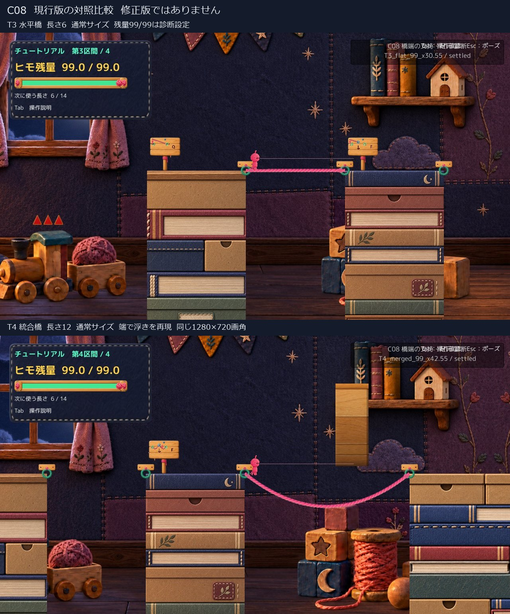
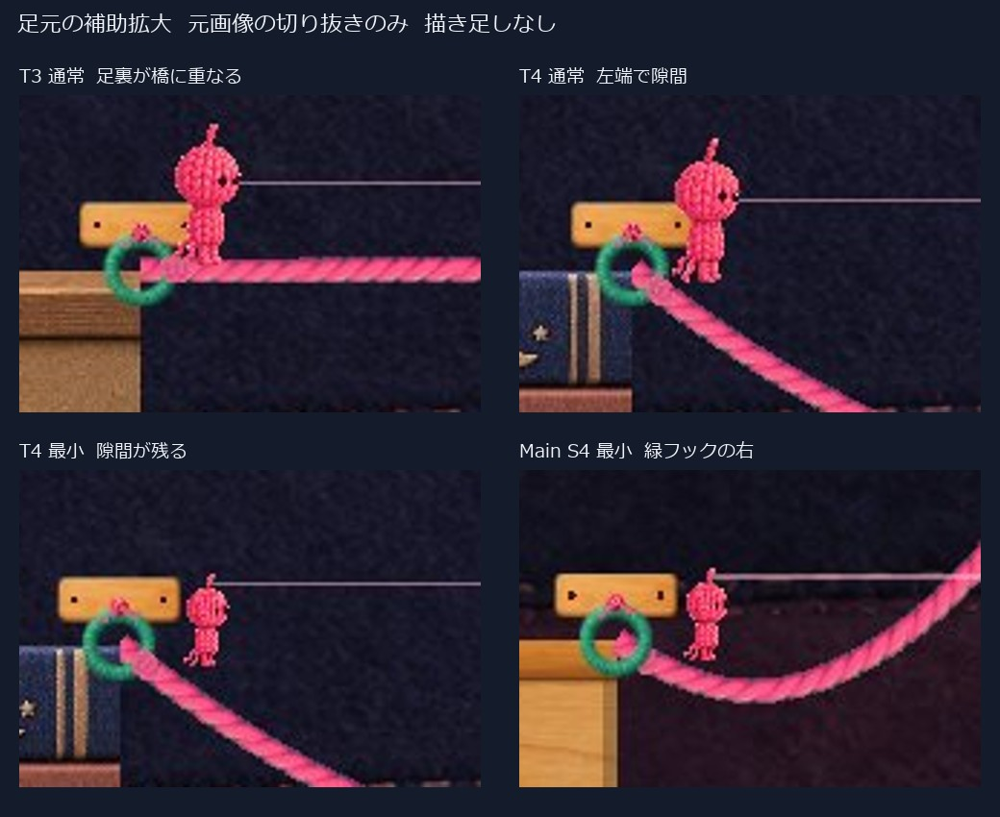
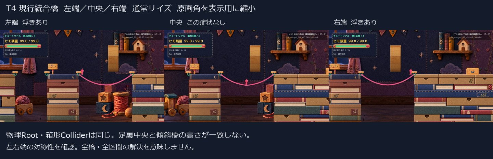
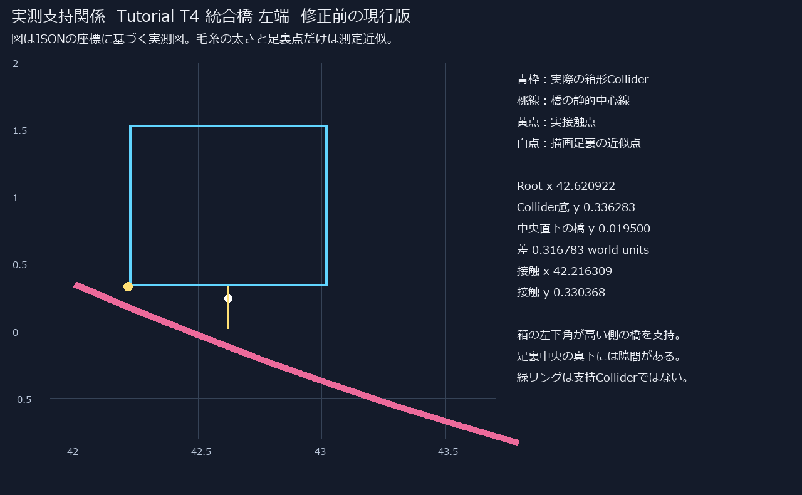
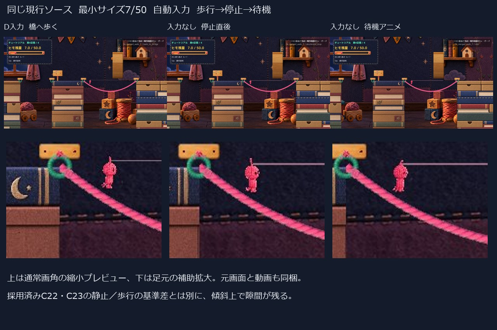

# C08 生成橋端で足裏が離れる原因と修正範囲

判定は **HOLD**。C22・C23を統合した現行ソースでも、傾斜した生成橋で浮きを再現しました。箱形Colliderの下角が橋に接触していても、描画上の足裏中央はその真下の橋から離れています。緑リング自体に乗り上げた現象ではありません。

今回は原因を実測し、ゲーム側の修正は加えていません。物理的な支持形状に関わるため、表示だけを一律に下げる対応はしていません。修正前後のAFTER画像・修正版Build・解決PASSはありません。

基準は Production `2a0a2b5f5d5478f5ee2c6be5553121683757ebf7`、Unity `6000.3.21f1`。採用済みC22・C23を保持しています。

## 再現した場所

元のHuman指摘を、保存済みC22資料と試遊資料から正確なScene・橋長・座標へ結び付ける記録は見つかりませんでした。以下は今回実測した再現箇所であり、本人が最初に見た橋そのものと断定しません。

| Sceneと区間 | 橋の端点と長さ | 立ち位置の実測 | 残量とサイズ | 結果 |
|---|---|---|---|---|
| Tutorial T3 | 緑 `(30,0.35)` → 緑 `(36,0.35)`、長さ6 | x30.55 / 33 / 35.45 | 診断99/99 通常、7/99 最小 | 左端・中央・右端でこの浮きは再現せず |
| Tutorial T4 統合相当 | 緑 `(42,0.35)` → 緑 `(52,0.35)`、長さ12 | 通常 左x42.621・中央46.873・右51.369 | 診断99/99 通常、7/99 最小 | 左右端で再現。中央は同じ浮きなし |
| MainStage S4 | 緑 `(64.6,-2.15)` → 緑 `(68.3,-0.65)`、長さ5 | 左側 通常x65.239、最小65.359 | 診断99/99 通常、7/99 最小 | 緑フックの右側で再現 |
| Tutorial T4 歩行 | 上記の長さ12 | x43.227 → 43.348 → 43.349 → 42.290 | 50/50 通常、7/50 最小 | 歩行・減速・待機・戻り歩行で隙間が残る |

99はサイズ段階を固定する診断用容量です。通常の消費バランスの証拠には使いません。最後の歩行記録は容量50で撮影しました。サイズ係数は通常1.0、最小0.65で、身体の縮小とColliderの大きさを混同していません。詳細値は [測定JSON](QA/PointsSyntheticCapacity99.json)、[S4測定](QA/MainS4SyntheticCapacity99.json)、[容量50の歩行記録](QA/WalkCapacity50.json) にあります。

## 通常画角と足元

上は水平なT3、下はT4の傾斜橋です。両方とも現行ソースの実Unity画面で、修正前後比較ではありません。元の1280×720画像は [T3](Images/T3_full_left.jpg)、[T4左端](Images/T4_full_left.jpg) です。

元画像の切り抜き拡大のみです。左上のT3では足と橋が重なりますが、T4は通常・最小とも離れます。本編S4でも同系統の隙間を確認しました。

## 支持点から分かる原因

T4左端の通常サイズでは、Rootは `(42.620922,0.936283)`、箱の幅0.8・高さ1.2、Collider底yは `0.336283`。橋との実接触は `(42.216309,0.330368)` で、箱の左下角側です。接触先は `Generated Rope Platform 1`、接触法線は `(0.614783,0.788697)`、接触分離は約 `-0.005` でした。

一方、箱の中央xの真下で測った橋Collider上面はy `0.019500`。箱の底中央との差は **0.316783 world units** あります。物理接触は成立していても、箱の角より内側に描かれた足裏には空間が残ります。足裏ピクセルと表示リボン上面の近似差は約0.227、通常画角で約9pxです。この近似値は接触分離そのものではありません。

実装との対応は次のとおりです。

- [PlayerMover](https://github.com/bq24014-cmd/himohito-prototype/blob/2a0a2b5f5d5478f5ee2c6be5553121683757ebf7/Assets/Scripts/PlayerMover.cs#L97) は角を丸めないBoxColliderを使います。実際の斜面接触を選び、[HookPointを接地候補から除外](https://github.com/bq24014-cmd/himohito-prototype/blob/2a0a2b5f5d5478f5ee2c6be5553121683757ebf7/Assets/Scripts/PlayerMover.cs#L437)しています。今回の接触記録にもリングは含まれません。
- [RopePlatformBuilder](https://github.com/bq24014-cmd/himohito-prototype/blob/2a0a2b5f5d5478f5ee2c6be5553121683757ebf7/Assets/Scripts/RopePlatformBuilder.cs#L484) は端点間距離に対する余長からたわみを作ります。T4長さ12は距離10に対して余長2があり、端側に強い傾斜ができます。線とEdgeColliderの基準曲線は共通です。
- [RopeBodyVisual](https://github.com/bq24014-cmd/himohito-prototype/blob/2a0a2b5f5d5478f5ee2c6be5553121683757ebf7/Assets/Scripts/RopeBodyVisual.cs#L319) は既存の橋のしなり量へ表示を追従させますが、箱の支持角と足裏中央の横方向の違いを補正しません。

したがって、確認したC08相当の浮きは、C22・C23で直した「縮小時に静止と歩行の足元基準が違う」問題とは別です。C22を戻しても解決になりません。橋のしなりは小さな差を加えますが、上記0.317の物理支持差の主因ではありません。

## 歩行と生成直後の違い

[通常速度動画 3.48秒 無音](Video/CurrentC08_AutomaticWalk_1x.mp4) は最小サイズ7/50の **自動入力** です。ゲーム内の入力フィールドへ診断driverが値を渡しており、OSキー操作でもHuman試遊でもありません。Unity撮影50fpsの隔フレームを25fpsで符号化し、速度変更はしていません。

| 動画時刻 | 状態 |
|---|---|
| 0.00〜0.44秒 | D相当で岸から橋へ歩く |
| 0.46〜0.58秒 | 入力を離し減速・停止 |
| 0.60〜2.90秒 | 静止から既存待機アニメへ |
| 2.92〜3.46秒 | A相当で岸方向へ再歩行。完全に岸へ戻る前まで |

通常50/50と最小7/50で、各イベントのRoot位置・速度は一致しました。待機時xは43.34858、足元近似差は約0.18で、歩行中にも約0.19あります。停止時だけの切替ミスではありません。

既存の `TryAttach` と `TryBuildCurrentPlatform` を使うT4左橋の生成も確認しました。費用6で93または7へ減少し、落ち着いた後の足元近似差は約0.05でした。歩いて曲線上へ進んだ場合の大きな差とは異なります。生成直後の表示展開中と、定常状態を同一に扱っていません。[生成後画像](Images/T4_nativeQ_small_settled.jpg)、[生成とジャンプの記録](QA/NativeQJumpRSyntheticCapacity99.json) を参照してください。

## 修正案は一つに限定して保留

次の最小候補は、**橋の端に限って接線を緩め、描画とColliderを同じ曲線で作る案**です。端点位置・幅・消費長・残量ルールを維持し、中央のたわみと歩行時のしなりを残すことを条件にします。全橋を平らにする案ではありません。

ただし、これは見た目だけの足元補正ではなく、橋の実際の支持形状を変えます。端の傾斜を中央へ押し付けて別の浮きや着地難度を増す可能性もあります。今回の資料では未実装・効果未確認です。基本Colliderの形を変える、Rootを下げる、当たり判定を広げる、空中の身体を橋へ吸着させる対応はしていません。物理に関わる範囲を勝手に拡大せず、まずこの原因と変更範囲をHumanへ返します。

## 確認結果と残る範囲

| 項目 | 確認方法 | 結果 |
|---|---|---|
| 現行C22・C23を含むC#のCompile | Unity 6000.3.21f1同梱RoslynとStandalone参照 | 成功。既存の未代入フィールド警告4件 |
| 実Unity Playerの再現実行 | 非Developmentの隔離managed overlay | 採用した4記録はError/Exception/Assert 0 |
| 左端・中央・右端 | T3、T4の静止診断配置 | 上記の再現／非再現を確認 |
| 左右向き、減速、待機、再歩行 | 容量50の自動入力 | 表示切替を確認。浮きは残る |
| 岸から橋への歩行 | 同上 | 接触を維持して渡り始める |
| 橋から岸へ戻る | 戻り歩行まで | 完全に岸へ戻り切る遷移は未確認 |
| 実生成、ジャンプ、着地 | 既存メソッドAPIとジャンプbuffer | 生成・空中離脱・再接地を確認。C08は残る |
| R復帰 | 既存RestartFromCheckpoint API | 残量99または13、選択長6、橋0、未接続、入口に接地 |
| 修正後の中間サイズ・同一入力回帰 | 修正未実装 | 未実施。現行119ソースはProductionと全件同一 |
| OS実キー、Humanの手応え・採否 | 操作ツールのアプリ一覧取得が1回タイムアウト | 未確認。許可不足とは扱わず反復していない |
| 全橋・全区間 | 対象外 | 解決済みとは扱わない |

静止用API配置、生成API、ジャンプbuffer、自動入力の区別は [診断fixture](Diff/DiagnosticFixture.cs.txt) と各JSONに残しています。これらを通常操作の成功へ置き換えていません。音は未確認です。

## Productionと既存成果物の保護

[保護結果](QA/ProtectionFinal.json) の対象130ファイルと、比較元の144個の再利用Playerファイルは一致しました。隔離側119本のRuntimeソースもProductionと同一です。C22・C23の `RopeBodyVisual.cs` SHA256は `1CCA878FD7B4538AC35E3062A613D77C87FF5849FEEF4F55243A5EA0CF88A635` のままです。

MainStage Scene、README、学習ログ、既存QAログ2件のdirty状態は不変、Productionのstageは空です。旧ProofのAssemblyとソースも不変。Production/mainへのcommit・push、削除、フルProjectやLibraryの複製はしていません。

共有するのはこのC08専用レビュー資料・実画面・動画・測定・診断コード参照だけです。C22のレビュー入口や他Proofは上書きしていません。実行環境の構成と制限は [Environment.md](Environment.md) に記載しています。
