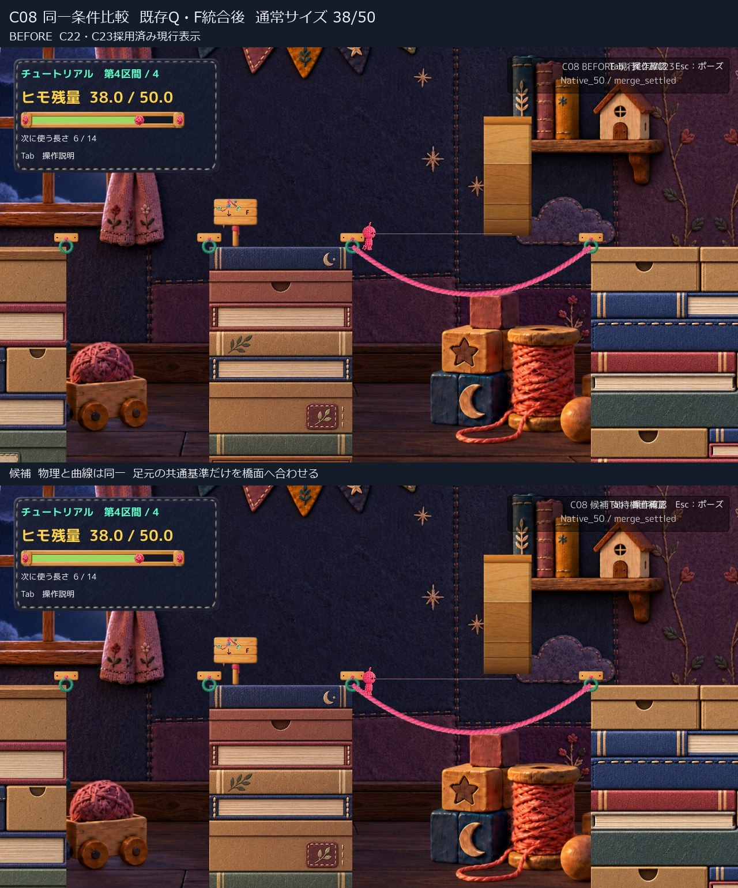
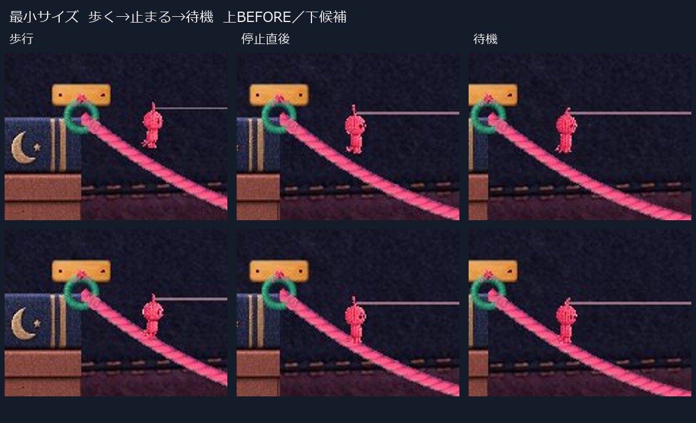
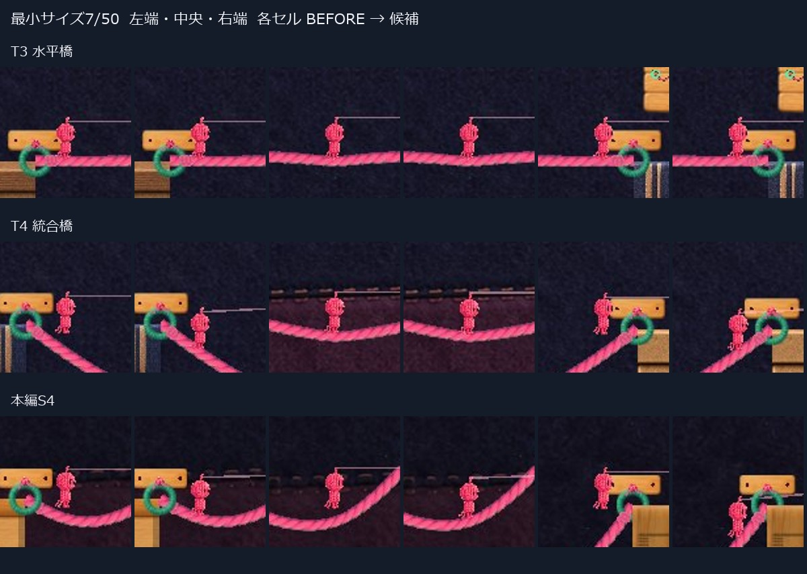
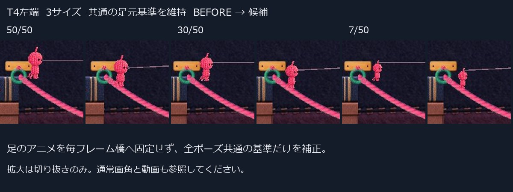
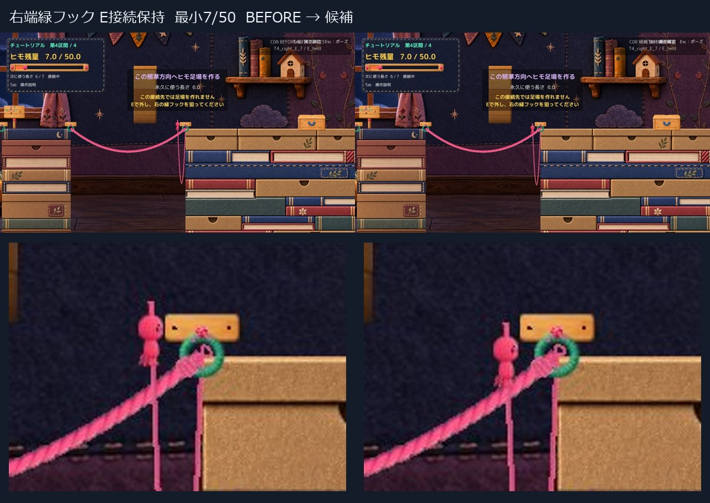

# C08 支持橋面に合わせる描画候補

橋の形・Collider・Player物理を変えず、足元の共通基準を橋面へ合わせる隔離候補を1案作成しました。T4と本編S4の橋端の浮きは通常画角でも小さくなりました。測定したA/BのRoot位置・速度・残量・Camera・橋の状態差はゼロです。

ただし、物理支持は箱の角のままです。急傾斜で絵と物理箱の距離が大きくなるため、正式採用は保留し、Human Reviewへ提出します。橋端の接線変更は実装していません。ProductionとC22・C23は保持しています。

## 比較画像と動画

[通常速度A/B動画 3.96秒 無音](Video/WalkStopIdleReturn_AB_1x.mp4)。左がC22・C23採用済み現行表示、右が候補です。1280×720画角2枚を並べた2560×720動画です。Unityの50fps撮影を隔フレーム25fpsで符号化し、速度変更はしていません。**自動入力であり、OSキー操作・Human試遊ではありません。**





動画は最小7/50で、岸→橋、停止、待機、再歩行、岸へ完全に戻って止まるまでです。通常50/50・中間30/50も同じ入力で確認しました。[元の通常画角 BEFORE](Images/Before_T4_Walk_Small.jpg)、[候補](Images/Candidate_T4_Walk_Small.jpg)、[岸へ戻った画像](Images/Candidate_BankReturned.jpg)も参照できます。

## 補正方法と差分

採用済みC22・C23の足元基準は変更せず、次の表示差を加えます。

```text
高さ差 = 足元中央xでの橋曲線の高さ − 支持点xでの橋曲線の高さ
最終表示 = 既存ポーズ ＋ 上の高さ差 ＋ 既存の橋のしなり
```

水平橋の高さ差はゼロです。Section名・橋名・残量サイズごとの固定値は使いません。アニメ画像の最下点を毎フレーム橋へ固定せず、足上げ・足運びを残します。

既存PlayerMoverの接地・支持橋を読み、実接触と現在のCollider距離を確認します。接触一覧の座標は移動中に1物理更新分遅れるため、計算には現在の `Collider2D.Distance` の橋側点を使います。E→Qの既存固定保持では接触一覧が空になる場合があり、その状態に限り、固定保持条件と実際の幾何的接触を照合します。接地判定は変更しません。

橋を離れると橋面の追跡を止め、保存した描画差だけを0.14秒で解消します。空中位置を橋へ合わせる処理ではありません。振り子へ移る時は既存の頭頂遷移へ引き継ぎ、二重加算しません。岸とR復帰では補正0、ポーズ中は表示を保持します。

隔離側の変更は2本です。

- `RopeBodyVisual.cs`：局所形状に基づく表示差、頭頂への引継ぎ、表示状態の初期化。
- `RopeController.cs`：`DrawAimGuide` の描画だけ。表示始点を身体へ合わせ、空の方向は既存照準方向を維持。対象Hookがある時はそのHookへガイドを通します。

照準判定・接続先・距離・Jointは従来どおり物理Root基準です。描画ガイドを判定へ使っていません。[変更差分](Diff/IsolatedRendering.patch)は隔離比較用切替を含み、Production採用用ではありません。[診断fixture](Diff/DiagnosticFixture.cs.txt)も比較資料だけです。

## 形状とサイズ





T3水平橋は長さ6、T4統合相当橋は12、本編S4は5。各橋の左端・中央・右端、左右向き、通常50/50・中間30/50・最小7/50の静止54条件を比較しました。診断配置から自然に落下して落ち着いた実位置は [Measurements.json](QA/Measurements.json) に記録しています。

T4左端の最小では足裏と橋上面の近似差が約+0.23から約-0.07 world unitsへ変化しました。マイナスは毛糸リボン内への重なりで、水平橋にも元から約-0.07あります。ゼロへ強制せず既存接地基準へ近づけています。静止比較では胴体の埋まりは見つかりませんでしたが、足先の小さな重なり・離れは残ります。

静止マトリクスは計算確定時の記録を再利用しています。後の変更は接触一覧がない固定保持、空中への引継ぎ、空の方向のガイドで、静止の曲線計算は同一です。変更箇所は提出用の移動・接続・空中記録で確認しました。[実行版の対応](QA/Execution.json)を分けています。

## 実Q生成とF統合

APIで復元した橋に加え、既存の接続・Q生成・F統合メソッドを通しています。準備位置は診断APIによるもので、OSキーの成功とは区別します。

| 入口残量 | Q 1本目後 | Q 2本目後 | F後 | R復帰 |
|---|---|---|---|---|
| 50 | 44 | 38 | 長さ12・橋1・残量38 | 入口50・長さ6・橋0・未接続 |
| 42 | 36 | 30 | 長さ12・橋1・残量30 | 入口42・長さ6・橋0・未接続 |
| 19 | 13 | 7 | 長さ12・橋1・残量7 | 入口19・長さ6・橋0・未接続 |

[実Q/F後 BEFORE](Images/Before_NativeQF_Small.jpg)、[候補](Images/Candidate_NativeQF_Small.jpg)、[R復帰](Images/Candidate_R.jpg)。



接続可能な右端緑Hookでは3サイズともE保持・解除を確認。保持中も足元補正が残り、描画ヒモ始点とRopeOriginの差は0です。本編S4ではFar Hookへ長さ12で接続し、実空中へ移り、解除しました。補助試行で接続不可の左端Hookを狙ったFalseは成功に数えず、右端と本編の成功記録を分けています。

## 確認結果

| 項目 | 結果と範囲 |
|---|---|
| Compile | Unity 6000.3.21f1同梱RoslynとPlayer参照で成功。Error 0、既存CS0649警告4件 |
| 物理比較 | 7組のA/BでRoot・速度・残量・Camera・Collider寸法・橋半径・リボン形状の最大差0 |
| 橋形状 | 最終記録の端点・長さ・EdgeCollider全点列は同一。生成・統合コードも無変更 |
| 歩行・向き・待機 | 静止54条件、歩行連続198サンプルを確認 |
| 岸往復 | 岸へ戻り切りx約39.90で停止、補正0 |
| ジャンプ・着地 | T4 x約43.35と中央付近で実空中・着地。既存ジャンプbufferをAPI設定 |
| 接続・解除 | 右緑Hook保持3サイズ、本編Far Hookの空中と解除をAPI確認 |
| ポーズ | 既存ポーズ状態APIで停止・姿勢保持・再開。Esc実キーは未確認 |
| R | 上表の復元。描画補正0 |
| 手動起動 | 両ランチャーで初期化完了後5秒待機。自動driver・撮影・終了なしの経路。OSキー反応は未確認 |

[A/B比較値](QA/Comparison.json)、[連続軌道](QA/Trajectory.json)、[橋全点列](QA/BridgeGeometry.json)、[手動起動](QA/ManualSmoke.json)から追えます。岸際の既存ジャンプ不成立例もあり、今回で全ての踏切問題が解決したとは扱いません。

空中の [BEFORE](Images/Before_Air.jpg) と [候補](Images/Candidate_Air.jpg)、候補の [着地](Images/Candidate_Landing.jpg)も通常画角で保存しています。

技術評価は測定条件での限定PASS、Visual自己評価は「浮き改善、限界あり」です。Humanの手応え・自然さ・正式採用は未確認。操作ツールは一覧取得で1回タイムアウトし、反復していません。音も未確認です。

## 残る最重要の限界

**支持は箱の角のままです。** 本編S4の急傾斜では表示差が最大約0.535 world units、通常画角で約22pxになります。物理箱と絵の相対位置まで一致させた修正ではなく、この差が衝突・踏切の直感を損なわないかHuman判断が必要です。

個別の足を斜面へ置くIKはなく、反対側の足の小さな重なり・離れは残ります。足上げを固定して隠していません。遷移の補正量は最大1フレーム約0.115 world units変化しました。Rootの瞬間移動はありませんが、すべての見た目の切替が自然とは断定しません。

元のHuman指摘の正確な橋、他の橋長・全区間・20/50段階は未確認です。全区間解決や正式採用へ読み替えず、候補1案の比較で停止します。

## 保護と起動

[保護記録](QA/Protection.json)：Productionの130ファイルとdirty状態、比較元のPlayer144ファイルは不変。C22・C23を維持し、隔離側の他117本はProductionと一致しています。mainは `2a0a2b5f5d5478f5ee2c6be5553121683757ebf7` のままです。

Project／Libraryの追加フルコピー、削除、Production統合、mainへのcommit/pushはありません。共有はC08レビュー資料だけです。[手動起動と実行方式](Launch.md)を参照してください。
