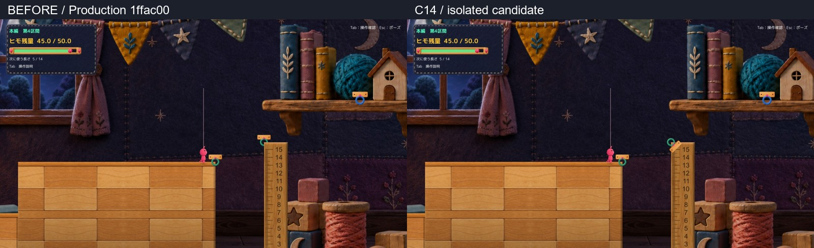
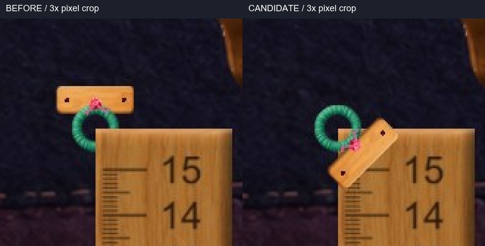

# C14 定規の緑フックの描画修正

S4の定規上端左で、緑リングの右下が定規面に隠れる現象を再現した。リングを定規より手前へ描き、既存の木製固定板を定規の角に掛ける隔離候補を1案作成した。接続点や地形を動かさず、同一入力の状態記録は修正前後で完全一致した。**正式採用・Production統合は未実施。**

この比較シートは左右それぞれ800×450の表示用縮小。元の実Unity画面は [現行1600×900](Images/Before_01_Detached.jpg)／[候補1600×900](Images/Candidate_01_Detached.jpg)。画像は撮影画面の縮小・切り抜きのみで、生成や描き足しをしていない。

## 対象と原因

対象Sceneは `MainStage`、区間はS4、GameObjectは **Main Section 4 Green Bridge End Hook**。HookPoint／橋端点は `(68.3, -0.65)`、緑リングの直径は0.62。定規は **Main Section 4 Intermediate Column**、位置 `(69.2, -5.65, 0)`、寸法 `1.8×10`。定規の左上角とリング中心が重なっている。

実画面ではリングの右下が定規の矩形で切れていた。実行時の同じSorting Layer内で、定規MeshRendererは描画順7、リングは6だった。RopeAnchorRingVisualは6を、MainS4RulerVisualは元の順序＋7を設定するため、定規が後からリングを覆う。定規面のZは約-0.22〜0.05だが、今回の主要因は異なるsortingOrderによる遮蔽である。この位置関係・実行値・切れた輪郭を照合して判断した。

固定板は現行ではリングより上の水平板として張り出す。これは画像で確認できる配置上の特徴であり、Humanが指摘した食い込みそのものとは分けている。候補では、定規に固定される理由を読み取りやすくするため、同じ板・ピン・結びを角に沿わせた。

## 変更は対象の表示だけ

実装差分は [MainS4RulerVisual.csの提案patch](Diff/ProposedMainS4RulerVisual.patch) 1本。MainStageVisuals、RopeAnchorRingVisual、HookWoodMountVisualの共通処理は変更していない。

- MainS4RulerVisualから、S4の対象名に一致する緑リングだけを定規面＋5、すなわち描画順12へ設定する。既存固定板もその相対描画順で定規の前へ出す。
- 対象の装飾子だけを-135度回し、板・影・ピンを装飾ローカル上方へ0.15寄せる。ピンが定規の角の内側に置かれる。リング本体のTransform、HookPoint、照準先、接続点、橋端点は変更しない。
- 新しい画像・材質・Shader・Colliderは追加しない。採用済みの定規素材・寸法・位置と、青／緑の役割色を保持する。

リングの中心は同じで、接続完了時の描画ヒモ終端と物理anchorの差は0。既存の射出アニメ中はヒモ先端が移動するため、一時的な差を接続位置の不一致とは扱わない。射出中の最大差も現行と候補で同一だった。

## 状態別比較と動画

| 状態 | 通常画角の修正前後 | 周辺拡大 |
| --- | --- | --- |
| 未接続 | [比較](Figures/01_Detached_FullComparison.jpg) | [拡大](Figures/01_Detached_HookCrop.jpg) |
| 照準中 | [比較](Figures/02_Aim_FullComparison.jpg) | [拡大](Figures/02_Aim_HookCrop.jpg) |
| 接続中 | [比較](Figures/03_Attached_FullComparison.jpg) | [拡大](Figures/03_Attached_HookCrop.jpg) |
| Q生成後 | [比較](Figures/04_Generated_FullComparison.jpg) | [拡大](Figures/04_Generated_HookCrop.jpg) |
| 上岸到達 | [比較](Figures/05_Upper_FullComparison.jpg) | [拡大](Figures/05_Upper_HookCrop.jpg) |
| R復帰 | [比較](Figures/07_R_FullComparison.jpg) | [拡大](Figures/07_R_HookCrop.jpg) |
| Scene再読込 | [比較](Figures/scene_reloaded_FullComparison.jpg) | [拡大](Figures/scene_reloaded_HookCrop.jpg) |

通常速度の動画は [現行](Video/Baseline_E_Q_Walk_1x.mp4)／[候補](Video/Candidate_E_Q_Walk_1x.mp4)／[左右比較](Video/Before_Candidate_Comparison_1x.mp4)。約5.48秒、音声なし。現行・候補の個別動画は1600×900、左右比較は各960×540のプレビュー。Unity時刻から各フレームの表示時間を求め、スロー化せず25fpsへ符号化した。

目安は0〜0.5秒が照準、約0.5秒でE接続、約1.1秒でQ生成、約2.2秒以降が橋歩行。動画の代表フレームを通常画角と拡大で自己確認した。候補では緑の輪郭と、板からリング下右へつながる結びが読める。接続中に中央へ見える既存のピンク結びは変更していない。

## 検証結果

実行方式は **Unity 6000.3.21f1の既存非Development Playerへのmanaged overlay**。Production Runtime 119本を隔離コピーし、変更は上記1本だけ。診断fixtureは隔離内にのみ追加した。Project／Libraryのフルコピー、新規BuildPipelineによるUnity Build、Editor Playは行っていない。Unity用Roslynコンパイルはエラー0、既存CS0649警告4件。

| 確認 | 結果と方式 |
| --- | --- |
| EとQ | 既存APIで対象緑フックへのE接続成功。Qは長さ5、残量45→40。 |
| 橋の通行 | 既存moveInputへの自動入力で上岸 `(69.40,-0.03)` 到達、接地。逆方向に出発岸へ戻り接地。 |
| C08 | 橋支持中の足元補正としなりが記録され、修正前後で値も一致。C08のソースは無変更。 |
| R | 既存復帰APIで入口、残量45、選択長5、橋0、未接続、接地に復元。 |
| Scene再読込 | SceneManagerでMainStageを再読込。対象の描画順とHook・定規の物理契約を再確認。 |
| 同一入力比較 | 134フレームと代表静止状態のRoot、速度、残量、Camera、接続、足元補正等が完全一致。 |
| 対象外 | 記録した全Hook・定規の位置、Collider、anchorが一致。描画一覧で変わったリングは対象1個だけ。隠し装飾の変更はこのリング配下に限定。 |
| Production保持 | 244ファイルのハッシュ一致、既存dirty状態維持、stage空。C08・C20・C22/C23と過去Proofを保持。 |
| ログ | 現行・候補とも完了、Error／Exception 0件。 |

[QA要約](QA/Summary.json)、[フレーム記録](QA/FrameComparison.json)、[描画順と物理契約](QA/TargetRenderOrder.json)、[手動起動確認](QA/ManualLauncherSmoke.json)を参照。

## 未確認と残る制限

Windows操作機能は `sky.list_apps` でタイムアウトしたため、OS実キーは未確認。撮影・E/Q/Rは自動入力／APIであり、Human実操作・採用判断ではない。音、全区間通し、新規Unity Build、Editor Playも未確認。

自己評価では食い込んだ輪郭は解消した。ただし固定板が定規上端の一部目盛りを覆うため、この固定の仕方を自然と感じるかはHuman判断へ残す。既存の中央ピンク結びの形や他フックは今回の対象外として保持した。候補の正式採用・Production統合は行わず、C14のHuman Reviewで停止する。
