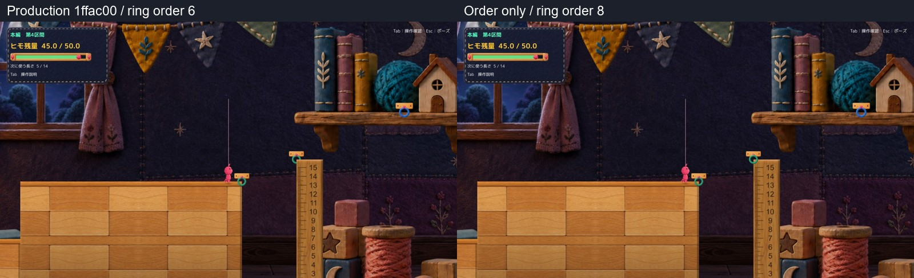
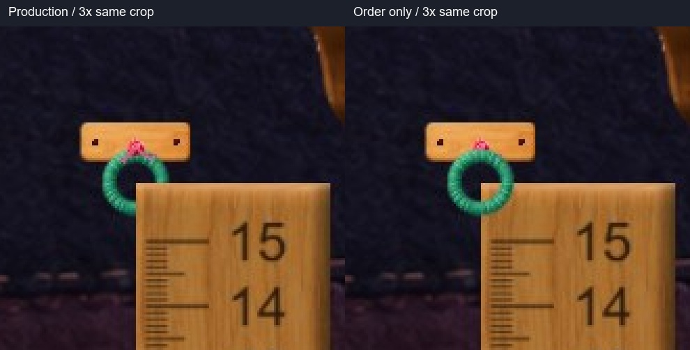
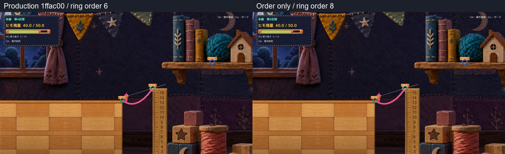
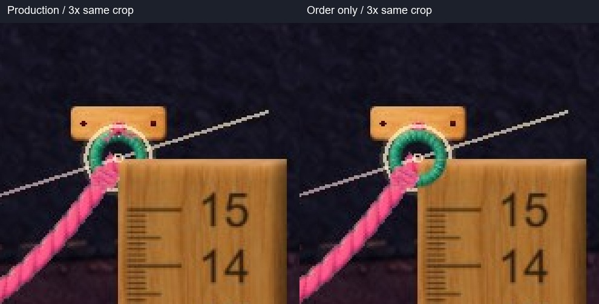

# C14 対象リングの描画順だけの比較

旧6190090候補は[Human不採用](HumanReviewResult.md)。今回はProduction 1ffac00の水平固定板をそのまま使い、S4の定規左上にある緑リングの描画順だけを6→8にする隔離候補を1案作成した。**新候補も未採用・Production未統合。**

## 未接続の比較

左右比較の通常画角は各800×450の表示用プレビュー。元の1600×900画面は [Production](Images/Production_01_Detached.jpg)／[新候補](Images/OrderOnly_01_Detached.jpg)。拡大は同じ範囲を切り抜いた3倍表示で、生成・描き足しはない。

## 橋生成後の比較

元画面は [Production](Images/Production_03_Generated.jpg)／[新候補](Images/OrderOnly_03_Generated.jpg)。[E接続完了時の画面](Images/OrderOnly_02_Attached.jpg)も保持した。

## 変更範囲

対象はMainStage S4の **Main Section 4 Green Bridge End Hook**、anchor `(68.3,-0.65)`。定規面の描画順7の前へリングだけを出す。リングの中心と直径0.62、定規の素材・Transform・Collider、実接続点、橋端点は保持する。

差分は [MainS4RulerVisual.cs](Diff/ProposedMainS4RulerVisual.patch) 1本。既存の共通Configureは固定具の描画順もリングに合わせて作り直すため、その副作用を対象固定具だけで相殺し、板・影・ピン・結びの描画順も元どおりに保つ。角度、位置、寸法へは一切代入していない。

実行時に固定具を含むRenderer 208件を照合し、差があったのは対象リングのsortingOrder 6→8のみ。固定板・影・ピン・結び・左右の糸端の7部品は、位置、角度、スケール、描画順、Sprite名、可視状態がProductionと完全一致した。旧候補の-135度回転と+0.15移動は含まない。

## 最小確認の結果

| 確認 | 結果 |
| --- | --- |
| E接続 | 既存APIで対象フックへ接続成功。接続完了時、表示ヒモ終端・物理anchor・リング中心が一致、差0。 |
| Q生成 | 既存APIで長さ5の橋生成成功。残量45→40。橋端点を保持。 |
| 新旧状態 | 未接続・接続完了・橋生成後でRoot、速度、残量、Camera、Hook／定規のCollider・anchorが一致。 |
| 実行 | 現行・候補ともError／Exception 0。Unity用コンパイルはエラー0、既存CS0649警告4件。 |
| 保護 | Production 244ファイルと既存dirty状態を保持。不採用候補の元Source・DLL・QA・ランチャーもハッシュ一致。 |

[値と固定具の比較記録](QA/Comparison.json)、[手動ランチャー確認](QA/ManualSmoke.json)を参照。

既存C14環境のPlayer・素材・コンパイラを再利用したmanaged overlayであり、新規Unity Buildは行っていない。長い比較動画、橋歩行やRの反復、全区間QAも今回の範囲に含めていない。E/QはAPIであり、OS実キー・Human試遊ではない。

## 自己評価を分ける

| 観点 | 評価 |
| --- | --- |
| リングが見えるか | 未接続・Q後とも、定規に隠れていた右下の輪郭が見える。緑の役割色も保持。今回の狙いは満たしたと自己評価する。 |
| 自然に取り付いて見えるか | 不採用だった斜め板による目盛り隠しはない。Productionの水平板の取り付け方を保持した一方、板の上方への張り出し自体は元のまま。自然な固定が完成したとまでは断定せず、Human判断へ残す。 |

音・OS実キー・Humanの採用判断・Editor Playは未確認。追加の固定具デザインや素材制作、Production統合は行わず、この1案でHuman Reviewを待つ。
