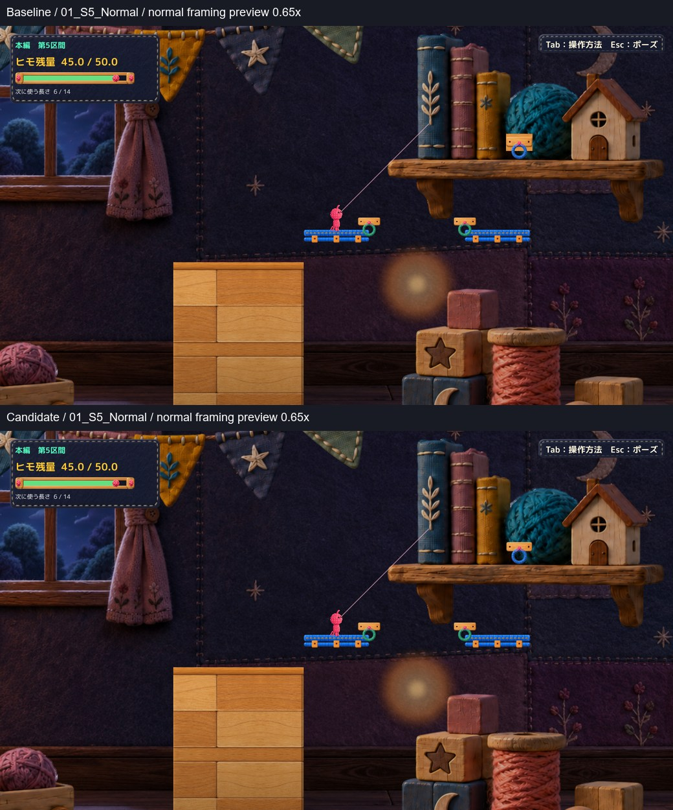
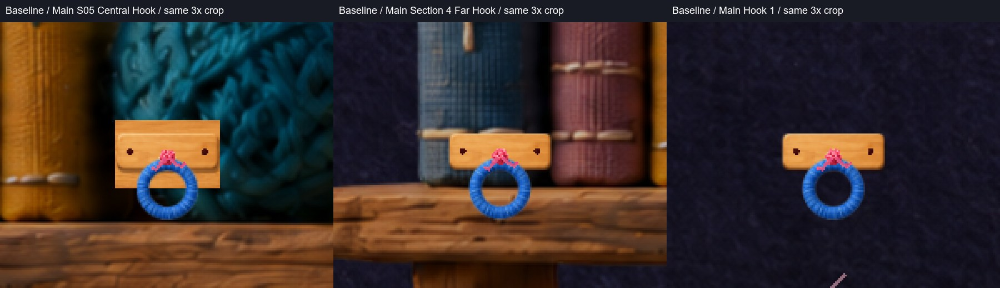
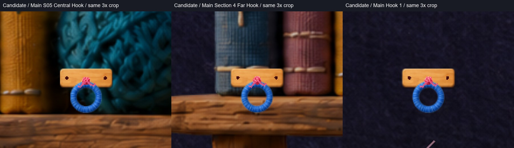

# C17｜S5中央青フックの表示統一・隔離候補1

2026-10-20 JST。基準Production：`0130f68488fcbde83c2f83dc72acd7adeaba4dee`。

結論：違いを再現した。青リング自体は既に共通だったが、S5だけ背後に床用木片が重なり、固定板が二重・厚手に見えていた。**その木片1つの描画だけを抑える候補**を用意した。輪郭・穴・青色・直径が他区間と揃ったと自己評価する。自然さと採否の最終判断はHuman待ち。Productionは未変更。

## 先に見る比較

同じ通常Camera設定、1600×900。各画面の表示倍率は51.72414 pixel/world unit、orthographicSize 8.7。対照のS4・S1は同じ倍率で別地点から撮影したものであり、背景の位置は異なる。

上が現行、下が候補。これは0.65倍の表示用プレビュー。個別の1600×900画像：[現行](Images/Baseline_01_S5_Normal.jpg) / [候補](Images/Candidate_01_S5_Normal.jpg)。

対照の通常画角：[S4](Images/Baseline_02_S4_Normal.jpg) / [S1](Images/Baseline_03_S1_Normal.jpg)。対照2画面の元PNGは現行と候補でバイト単位でも一致した（[画像照合](QA/ImageEvidence.json)）。

3枚とも同じ200×160 pixel範囲を3倍にした補助画像。ゲーム内Camera・キャラクター寸法の拡大ではない。画像への描き足しや生成補完はしていない。JPEG化した元PNGはローカルに保持。

## 原因：実測とコードの対応

| 比較項目 | S5中央 | S4 Far Hook | S1 Main Hook 1 |
|---|---|---|---|
| 実際のSprite | HimoHitoCraftHookBlue-v1 Processed | 同左 | 同左 |
| Sprite instance ID（同一起動内） | -154 | -154 | -154 |
| texture instance ID | -152 | -152 | -152 |
| リングworld bounds | 0.72×0.72 | 同左 | 同左 |
| sorting order / tint | 6 / 白 | 同左 | 同左 |
| 親scale | 1.6×0.45×1 | 同左 | 同左 |
| 共通固定具 | 同じ7描画部品 | 同左 | 同左 |
| 追加の床用木片 | **あり** | なし | なし |

実測では元のPrototypeSquareは無効、青リングの二重表示はない。`HimoHitoHookRingVisual`が親scaleを相殺して直径0.72にしているため、親が横長というだけでは今回の差を説明できない。実際の部品・重なりは[Baseline.json](QA/Baseline.json)の`hooks`、`views.overlaps`、`lightMountParts`に記録。

余分な木片は `Main S05 Flashlight Source/Craft Wood Body`。MeshRenderer、order 1、world中心 `(102, 3.35, 0)`、bounds `1.2×0.8`。共通固定板と重なり、リング穴の上半分にも木が見える。照明スポット本体ではない。

コード上の経路は次のとおり。`MainStageSectionFiveSetup.EnsureLightMount`が無効BoxCollider付きの木色オブジェクトを作り、`MainStageFloorCollisionSetup`が無効Colliderを除外せずSolidSwingSurfaceを付与する。`MainStageVisuals`の地形判定から`CraftWoodPlatformVisual`が床用木片を生成する。ここに共通リング・固定具が重なる。**今回、床の分類・Collider・共通フック処理を変更して解決することはしない。**

## 候補の変更

[ProposedMainStageVisuals.patch](Diff/ProposedMainStageVisuals.patch) のみが採用検討用差分。ローカル隔離版の`MainStageVisuals.cs`に限定した変更で、Productionには適用していない。

`Apply`の最後に、正確なS5照明元の`Craft Wood Body`だけへ`Renderer.forceRenderingOff = true`を設定する。GameObject・コンポーネントを削除せず、照明元や床全体を無効化しない。新素材・新固定具は作らない。共通青リング、木板、ピン、結びの寸法・角度・描画順を変更しない。

候補の初回とScene再読込後で、現行との描画部品差はこの1フラグだけ。他の青フック群は全スナップショットで一致。既存素材が現在の階層に生成されることを前提とする局所案で、将来の階層名変更まで保証する汎用処理ではない。

## 確認結果と実行方式

**Unity 6000.3.21f1の既存非Development Player＋再Compileしたmanaged overlay**。新規Unity BuildやUnity EditorでのPlay成功ではない。Production現行119本のRuntime Sourceを使い、候補ではMainStageVisualsだけを差し替えた。撮影・開始地点設定は隔離診断fixture。手動モードとは起動分岐を分けた。

Scene／Resourcesの格納データは既存Playerのものを再利用した。現在のdirtyなProduction Sceneを再Buildした検証ではない。フック／S5の配置・表示は現行Runtime Sourceの初期化処理による実測であり、この実行方式の範囲を超えた保証はしない。

| 確認 | 結果・範囲 |
|---|---|
| Compile / Player起動 | 両版PASS。既存4件のCS0649警告、実行時Error/Exception 0 |
| 通常画角・同倍率 | S5/S4/S1で共通Sprite・サイズ・順序を確認 |
| 未接続 / 接続 / スイング / 解除 | native APIと自動A/D入力で確認。青anchor `(102,2.95)` を保持 |
| Q生成・通行 | 既存生成処理で6消費、残量45→39。右側レールへ歩行 |
| 光の遮蔽・減光 | 未遮蔽alpha 0.62→橋生成後0.08→R後0.62。遮蔽判定も両版一致 |
| R | native復帰後、接地、位置 `(93.6,-0.035)`、速度0、残量45・選択6・橋0・未接続 |
| Scene再読込 | 修正が再適用され、共通リングと固定具を維持 |
| 同一入力比較 | 471物理サンプルの位置・速度・入力・anchor・ヒモ長・残量・Camera・光の状態が完全一致 |
| S5契約値 | 9対象のTransform・Collider状態・anchor等が初回／再読込で両版一致 |
| 手動モード起動 | 両版とも準備完了ログ・生存・エラーなしを確認。起動から終了まで約24～25秒（準備後4秒を含む） |
| OSキー / Human試遊 | **未実施・未確認**。APIや自動入力を実キー成功扱いしない |

完全な照合結果：[Comparison.json](QA/Comparison.json)。[Baseline](QA/Baseline.json) / [Candidate](QA/Candidate.json)、[手動起動確認](QA/ManualSmoke.json)、[Compile抜粋](QA/Compile.txt)、[ログ抜粋](QA/CandidateLogExcerpt.txt)。診断経路は[FixtureSource.txt](QA/FixtureSource.txt)で確認可能。

### 接続とスイングの短い実画面動画

[通常速度・現行／候補比較（6.24秒、音なし）](Video/C17_Comparison_NormalSpeed.mp4)。左右とも通常Cameraの画面を0.5倍で並べた表示用動画。25fps。固定撮影時計50fpsで2フレームごとに採取し、25fpsで再生した。**自動入力／API撮影であり、OS入力録画・Human試遊ではない。**

- 前半：緑フックへ既存API接続→Q生成→橋を自動D歩行。
- 後半：右側レールからS5青フックへ接続→Dスイング→解除→R。

通常画角の要点：[橋生成・減光](Images/04_S5_Q_Blocked_BeforeAfter.jpg) / [青フック接続](Images/05_S5_E_Blue_BeforeAfter.jpg) / [候補スイング](Images/Candidate_06_S5_Swing.jpg) / [再読込後](Images/09_S5_Reload_BeforeAfter.jpg)。身体側の端点・接続ヒモは既存の表示のまま。光の「判定・減光が同じ」と、プレイヤーにとって自然・分かりやすいという評価は別。

## 自己評価・残る制限

- 輪郭・穴・青色・サイズ：共通素材と実寸が一致し、二重木片がなくなった。表示統一の候補として成立すると判断する。
- 自然さ：共通固定板だけになり、S4/S1との取り付け表現が揃ったと自己評価。ただし背景の本・毛糸玉との位置関係は既存どおり。家具への取り付けを再設計する案ではない。
- OSキー反応、Humanの見た目評価・操作感、音、全区間通しは未確認。今回はOS操作ツールを試行しておらず、過去のタイムアウトを今回の実測失敗として扱っていない。
- 初回の手動起動確認は8秒で初期化途中だった。エラーではないとログで切り分け、45秒上限の待機に変更した確認では両版とも準備完了。ゲームの実装修正ではない。
- C18はHOLDのまま。照準補助、地形・光の位置／判定、橋遮蔽ロジック、Gameplayには変更なし。

## 保護と次の操作

Productionはmainの`0130f68488fcbde83c2f83dc72acd7adeaba4dee`、既存5件の未commit差分・stageなしを開始時に確認。[Protection.json](QA/Protection.json)で終了時の同一性を確認する。C06/C07・C08・C14・C20・C22/C23、Scene、README、学習ログ、既存QA等の対象ハッシュを保持。Productionへの編集、add/commit/push、reset/clean/stash、削除、Project/Libraryフル複製は行っていない。Git共有はこのDocs配下のレビュー資料だけ。

[手動起動](Launch.md)で候補と現行を一方ずつ確認し、余分な木片を消す局所案の採否をHumanに判断してもらう。**候補は1案、正式採用・Production統合はせず、Human Reviewで停止する。**
