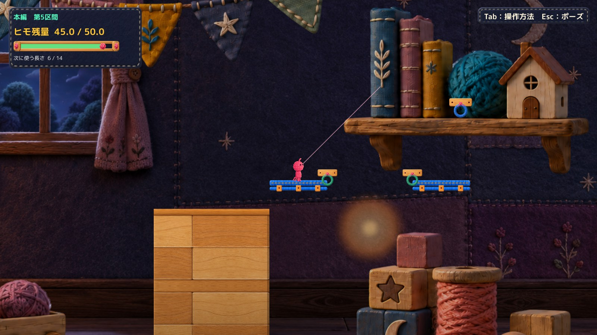

# C17 正式採用とProduction統合

2026年10月21日、Humanから「良い感じ」と評価された[候補ce25a9c](https://github.com/bq24014-cmd/himohito-prototype/blob/ce25a9cf336305e0654317ee09074a6ec02e3962/Docs/Reviews/C17S5Hook/runs/20261020T234000_JST/Report.md)を正式採用・統合した。Productionのlocal HEAD、origin/main、GitHub側mainは **`3b6ac0dfe6a1035f8eed33d2efe720be51c481b3`** で一致。commit messageは `Integrate approved C17 S5 hook visual correction`。

## 統合範囲

Production変更は[MainStageVisuals.cs](https://github.com/bq24014-cmd/himohito-prototype/blob/3b6ac0dfe6a1035f8eed33d2efe720be51c481b3/Assets/Scripts/MainStageVisuals.cs)の14行追加と、[統合記録](https://github.com/bq24014-cmd/himohito-prototype/blob/3b6ac0dfe6a1035f8eed33d2efe720be51c481b3/Docs/QA/C17S5HookProduction_20261021/Integration.md)の2ファイルだけ。承認済みSourceとバイト一致し、対象は `Main S05 Flashlight Source/Craft Wood Body` のRenderer描画抑制1つだけ。

共通リング・固定具、GameObject、Transform、Collider、接続点、床の分類、照明・遮蔽処理は保持。診断コード、自動入力、比較切替、設定変更は統合していない。

## 回帰結果

Production119ソースのみのCompile成功。統合ソース＋Production外の既存QAfixtureを使い、一巡だけPlayer確認した。既存CS0649警告4件ずつ、新規エラー0、実行エラー0。

| 確認 | 結果 |
|---|---|
| S5通常表示、E接続、スイング、解除、R、再読込 | 採用候補と全画面ピクセル一致 |
| 他区間の青フック | 全フック部品の記録が一致。S4全画面、S1のフック周辺もピクセル一致 |
| Q生成と光 | 既存APIで生成・通行。消費6、残量45→39。光alpha0.62→遮蔽0.08→R後0.62 |
| Rと再読込 | 残量45・選択6・橋0・未接続、入口接地に復帰。再読込後も対象木片だけ描画抑制 |
| 物理・資源・Camera | 採用候補と471サンプルが完全一致 |
| 保護 | 対象外252ファイル、既存5差分、過去Proofの対象ソース／DLLハッシュを保持。stage残りなし |

[実測JSON](QA/IntegrationVerification.json) / [Player生記録](QA/IntegratedQA.json) / [Compile抜粋](QA/Compile.txt) / [Playerログ抜粋](QA/PlayerLogExcerpt.txt) / [remote確認](QA/RemoteVerification.json)

JPEGは表示用プレビュー、元PNGはローカルに保持。全9枚のフック／固定板周辺はピクセル一致。全画面では9枚中7枚が一致し、残るS1は「第1区間」表示の有無、Q後は橋付近30ピクセルに最大10/255の差があった。Q後の微小差の詳細原因は未確定であり、全画面完全一致とは報告しない。両版の部品設定・物理・遮蔽状態は一致した。

## 実行方式と未確認

**既存Unity6000.3.21f1非Development Player＋統合ソースをCompileしたmanaged overlay**。新規Unity Build、Unity Editor Play成功ではない。格納Scene／Resourcesは既存Playerを再利用し、現在のdirty Sceneを再Buildした確認ではない。

接続・生成・R等は診断API、A/Dは自動入力。統合後のOS実キー、音、全区間通し、現在のdirty SceneのEditor Play、新規Windows Buildは未確認。Humanが正式採用した見た目と、統合後のこれらの未実施項目を混同しない。既存配布Buildは未更新。

採用元の[隔離版手動ランチャー](../20261020T234000_JST/Launch.md)をそのまま保持している。C06/C07・C08・C14・C20・C22/C23と既存差分は保持。C18はHOLDのまま。他の改修には着手せず、C17の統合完了で停止する。
