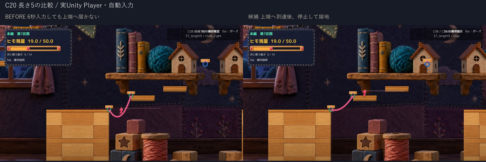
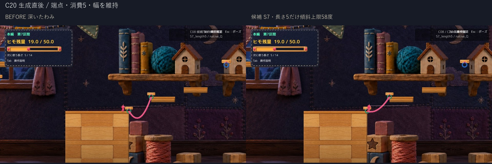
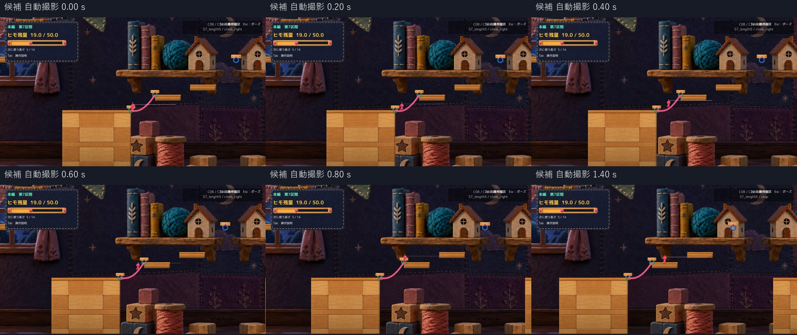

# C20 第7区間の長さ5の橋 登坂修正候補

長さ5の登坂不能を再現し、S7の対象橋だけ傾斜を抑える隔離候補1案を完成した。候補は通常の移動入力で上端へ到達し、停止・岸への戻り・再登坂・ジャンプ着地・R復帰を確認した。Technicalは確認範囲でPASS、Visualは比較資料による自己確認、Human実キーと正式採用は未確認。Productionへは未統合。

## 基準と原因

C08統合後のProduction `e9eabc93eef26fb04d0ccb86eaef0cf7b85d04bd` を基準にした。C08とC22・C23を保ったまま、実際のE接続→`TryBuildCurrentPlatform`によるQ生成を使った。対象はMainStage第7区間、緑フック `(155.1,-2.15)` と `(157.9,-0.35)` の間。入口24、幅0.22、最低残量1。

現行の曲線は直線から `余長×4t(1−t)` だけ下がる。直線距離約3.329に対して長さ5は余長約1.671となり、上端側の実測最大角は71.39度（長さ4は57.63度）。実接触法線yが0.449、0.428の区間を記録した。`PlayerMover.TryGetRopeWalkingContactTangent`は0.45未満を歩行用接触から除外し、接地記憶でIsGroundedがtrueでも接線歩行ではなく空中制御へ移る。重力で戻されるため上りが繰り返し失速する。単に接地falseになった、摩擦だけが原因、C08の表示の浮き、と扱わない。

同じD方向入力の現行長さ5は5.98秒でx最大157.077、上端へ届かず後退した。長さ4は約1.18秒で上岸へ到達した。APIによる準備/入力でありHuman試遊ではない。

## 候補1の差分

変更は隔離版 `RopePlatformBuilder.BuildSaggingCurve` のみ。[差分](Diff/LocalBridgeShape.patch)。S7の上記端点ペアと長さ5に完全限定し、式 `(|dy|+4×たわみ)/|dx|` から終端傾斜58度を上限にたわみを求める。40点化後の実測最大角は57.60度。端点・点数・幅・消費5・最低残量・Player Collider・操作・接地閾値・全ステージ共通の物理は変えない。見える橋面とEdgeColliderに同じ曲線を使う。不可視床や生成拒否で隠していない。

最初の60度上限でも到達したが、上端へ移るときに一時離床したため、既存長さ4に近い58度へ絞った。提出する最終候補は58度の1案のみ。60度の途中記録はローカルに保持。副作用として、対象橋では長さ5でも追加余長による深いたわみがほぼ増えなくなる。消費は5のままで、長さ4より得な資源ルートにはしていない。この局所ルールの採否はHuman判断。

## 通常画角と連続動画

- [修正前 長さ5 通常速度](Video/Before_Length5_1x.mp4)
- [最終候補 長さ5 通常速度](Video/Candidate_Length5_1x.mp4)

1280×720の実Unity Player、固定50fpsの自動入力試験から25fpsで撮影した通常速度映像。診断配置は試験開始時だけで、Q生成後から登坂中に位置・速度を直接設定していない。Q自身の既存の足元配置は従来どおり。修正前は登坂入力6秒、候補は登坂→上端到達→停止の1.6秒を無切替で掲載。ポーズ後の自動連続コマは画面表示と時系列の一致を保証できなかったため動画に採用せず、戻り・停止再開・ジャンプ着地・Rは個別静止画像と実測JSONで示す。全手順の連続動画とは扱わない。所定上岸へ着いたら入力を止める同じ条件式のdriverなので、到達以後の入力時刻は版によって異なる。全編を完全同一入力と偽らない。Camera設定は同じだが、実位置を追従するため長さ5の実Camera座標は変わる。映像に音声は含まず、音は未確認。

## 確認結果

| 確認 | 結果と実行方式 |
| --- | --- |
| Compile / 実Player | Unity付属Roslynで成功、既存警告4。非Development Playerのmanaged overlay。新規Unity Build/Editor Playではない |
| 長さ4 | 形状不変。同じ登坂60フレームのRoot・速度・Camera差0、上端接地・逆走・停止再開・ジャンプ着地・Rを確認 |
| 長さ5 | 上端到達x159.261、到達後停止して接地、左岸へ戻る、途中停止後の再登坂を確認 |
| 消費とR | 24→長さ4で20/長さ5で19。Rで入口24・選択長4/5・橋0・未接続へ復元。最低残量1を変更しない |
| Q/F | 対象橋はnative E/Q。対照T4でQ×2、F統合1本、追加消費なし、Rで入口復元を確認。補助E_supported=falseは接続不可の左フックで、E成功件数へ含めない |
| ポーズ | APIで2回の停止フレームの位置/補正/TimeScale一致、再開後の移動を確認。Esc実キーではない |
| C08としなり | RopeBodyVisual/RopeControllerはProductionと同一。橋支持中の足元補正、しなりの実表示を通常画角で自己確認。しなり量最大0.086world。個別の足上げは固定しない |
| 保護 | 隔離Runtime Source119のうちProductionとの差はRopePlatformBuilderのみ。C08以外のProduction既存差分、Scene、過去Proofを保持 |

[実測要約](QA/Summary.json) / [現行記録](QA/Before.json) / [最終候補記録](QA/Candidate.json) / [Q/F対照](QA/NativeQF.json) / [起動方法](Launch.md)。足元Gapは画像上の近似値で、橋外のsentinel 999付近は誤差評価から除外する。

## 残る弱点と未確認

OSのウィンドウ取得はタイムアウトし、OSキー反応・Human実キー・操作感・面白さ・正式採用は未確認。対象橋以外や長さ6以上の急坂を解決する修正ではない。C08の固定物理箱と小さい表示の寸法差は維持される。長さ5の形状が長さ4に近くなるVisual/資源の納得感をHumanに確認してほしい。

診断fixtureのMainStageポーズ取得先を最初にPlayer本体と誤りNullReferenceExceptionが出た途中試験はPASSから除外し、Scene全体から既存Overlayを取得するfixtureだけを直して最終試験を完了した。ゲーム本体の例外ではなく、失敗資料も削除していない。OS環境の許可設定変更はしていない。

推奨は「隔離候補としてHuman試遊へ」。追加の物理/地形/腕改修や正式統合は行わず停止する。
