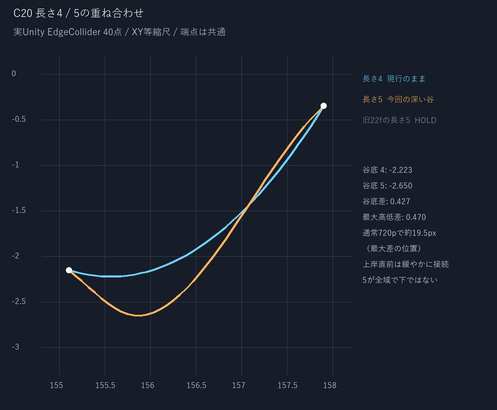
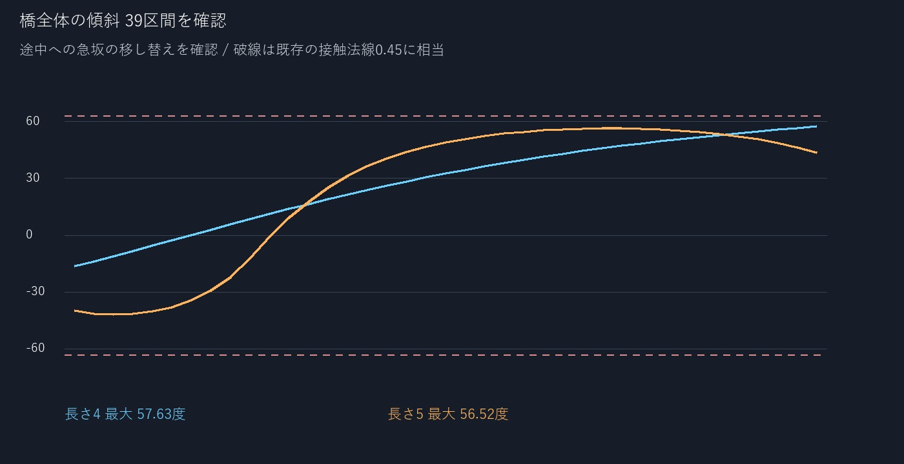
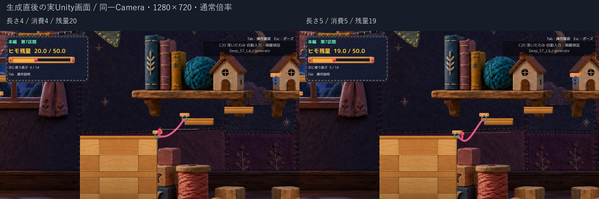
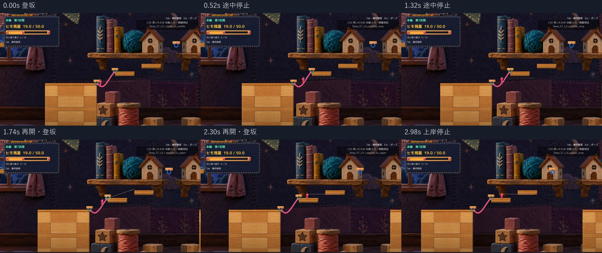

# C20 深いたわみと登坂を両立する隔離候補

長さ5の谷底を長さ4より約0.427 world unit深くし、両方で途中停止・再開・上岸への移行を実Unityで確認した。対象橋の曲線形状だけを変更した隔離候補1案。Production・C08・C22/C23は変更していない。技術確認は対象範囲PASS、通常画角での違いは自己確認、Human採否・実キーの手応えは未確認。

旧候補 `22f35cef998ee43c59aca604fe9d421e6db92c12` は「長さ4/5がほぼ同じ形になり、消費だけが増える」ためHuman採用保留。過去runとBuildは保持し、本案の採用へ読み替えない。

## 成立性と変更内容

端点 `(155.1,-2.15)` / `(157.9,-0.35)`、幅0.22、消費4/5、最低残量1を維持。長さ4の40点は旧候補・Productionの生成結果と完全一致する。長さ5は谷底を下岸寄りに置き、谷底から上岸までの横幅を長く使う。谷底で接線がつながる2本の3次曲線にし、端だけを緩くして途中を急坂にする方法を避けた。

まず連続曲線の10,001点で成立性を計算し、その後、Unityが実際に生成したEdgeCollider全40点・全39区間を確認した。[事前計算](QA/ShapeFeasibility.json)と[実測](QA/Summary.json)を区別している。描画とColliderには同じ基礎曲線を渡す。従来の足元のしなりだけは描画側の反応として残す。

| 実Unity計測 | 長さ4 | 今回の長さ5 |
| --- | ---: | ---: |
| 谷底のY | -2.223 | -2.650 |
| 橋全体の最大傾斜 | 57.63度 | 56.52度 |
| 曲線の幾何学的な長さ | 3.589 | 4.065 |
| 入口24から生成後 | 20 | 19 |

最大高低差は約0.470 world unit、通常1280×720画角で約19.5px。長さ5は谷が深い一方、上岸直前は緩くつなぐため、全X位置で長さ4より下になるわけではない。ヒモ長は既存のゲーム向け近似・消費値であり、厳密な懸垂線長一致へ仕様変更したものではない。

## 同じ通常画角での生成直後

[長さ4原寸](Images/L4_generated_same_camera.jpg) / [長さ5原寸](Images/L5_generated_same_camera.jpg)。両画像は同一Camera位置 `(154.300,0,-10)`、同一orthographicSize 8.7、1280×720。静止比較の撮影時だけ、通常カメラから採取した共通座標へ診断fixtureで固定した。動画と手動版は既存追従Cameraをそのまま使い、Camera Source/設定を変更していない。Q後の主人公位置は既存生成処理が曲線接線から決めた結果で、同じ位置に見せかけていない。

自己レビューでは、長さ5の下岸寄りの谷が通常画角で深く読める。Humanの視認性評価は未確認。

## 登坂から途中停止 再開 上岸への連続動画

- [長さ5 通常速度 約3.00秒](Video/L5_ClimbStopResume_1x.mp4)
- [長さ4 通常速度 約2.82秒](Video/L4_ClimbStopResume_1x.mp4)

ネイティブE→Q生成後、移動入力の値をA/Dと同じPlayerMoverへ渡して登る自動入力/API試験。登坂中のRoot/速度設定、テレポート、不可視床、接地閾値変更、速度補助は使わない。Q自身の既存配置とR自身の復帰は従来のまま。動画はEOFの状態と画面を同期採取し、[Unity実測時刻](QA/VideoTiming.json)で通常速度にしている。静止採取で欠けた区間は直前画像を保持し、途中の操作カット・加速再生はない。音声は含めず、音は未確認。

## 検証結果

- 長さ4/5とも生成直後からDで登坂→途中停止→D再開→上岸で安定接地。停止後の速度はほぼ0。
- 上岸からAで下岸まで戻り、岸から再び全橋へDで進入。谷底付近と上り途中でそれぞれ停止・再開し、再び上岸へ到達した。片方の成功だけで橋全体の確認と扱っていない。
- ジャンプで実際に離床し、上岸へ着地。Rで入口24・橋0・未接続・選択長4/5へ戻る。接地判定/物理Sourceは不変。
- C08の足元補正・足運び・表示しなりは同じSource。RopeBodyVisual/RopeController、PlayerMover、RopeResource、復帰処理など118本はProductionと同一。変更は隔離版RopePlatformBuilderだけ。[Productionとの差分](Diff/FromProduction.patch) / [旧22fとの差分](Diff/FromHeld22f35ce.patch)。
- Unity付属コンパイラでCompile成功、既存CS0649警告4。実Playerで例外/エラー0。既存非Development Playerへのmanaged overlayであり、新規Unity Build・Editor Play成功とは区別する。
- [実測全記録](QA/UnityMeasurements.json) / [要約](QA/Summary.json) / [手動起動](Launch.md)。OS実キー・Human試遊は今回実施していない。自動入力を本人の操作成功へ置き換えない。

## 残る制限と判断

対象はS7のこの端点ペア・長さ5だけ。長さ6以上や他区間へ一般化しない。追加消費1に対する谷の深さ・見た目・選択の納得感はHuman判断が必要。小さい表示と固定物理箱の寸法差、個々の足を完全に斜面へ置くIKがない点はC08の既存制限として残す。今回それらを直していない。

推奨は「条件を両立した隔離候補としてHuman Reviewへ」。本番統合・mainへのcommit/push・追加案制作は行わず停止する。
