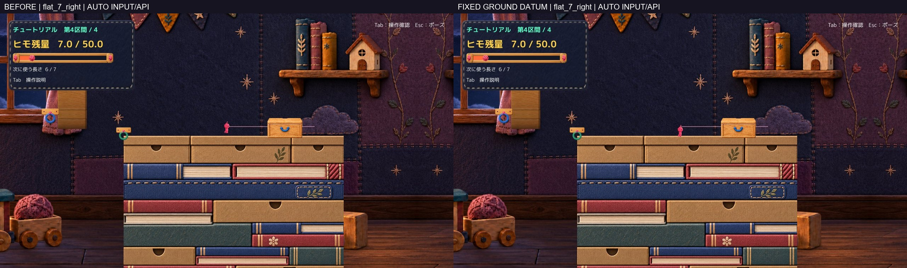
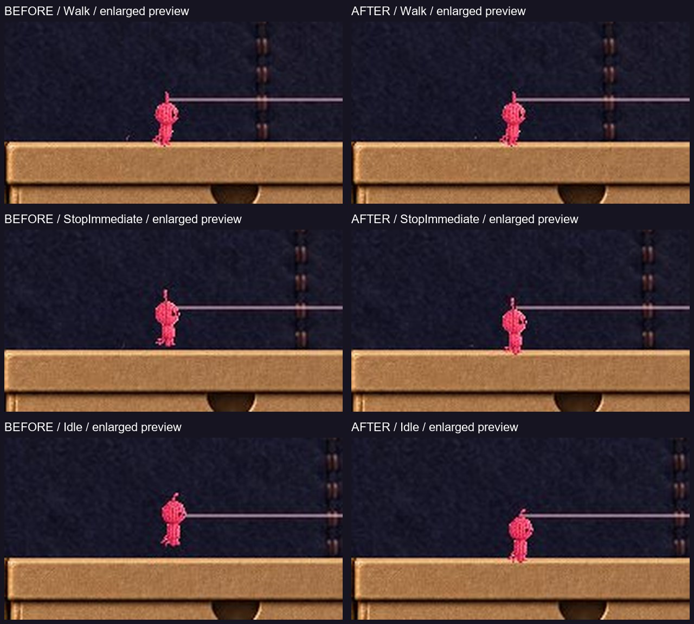
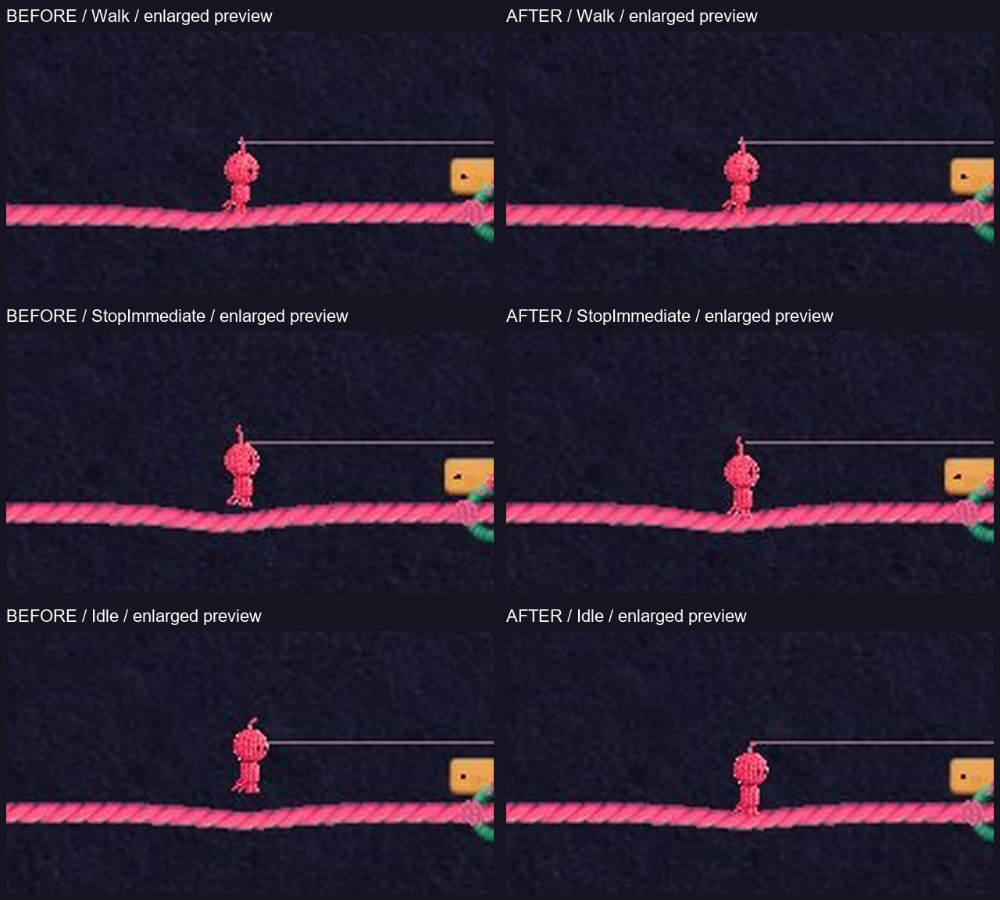

# C22 C23 主人公の足元修正 Proof

小さい身体が停止すると浮く原因は、歩行と静止で足元の登録高さが異なることでした。隔離版では接地中の足元基準を既存の歩行にそろえ、身体縮小・足運び・橋のしなりを保持しました。Technical確認は完了、画像の自己評価は改善あり、Humanの実操作・正式採用は未確認です。Production統合はしていません。

## 最初に見る比較

いずれも実Unity画面、同じ入力・Camera・残量7/50です。左が比較元、右が修正版。動画は190コマを50fpsで再生するゲーム時間の通常速度で、自動入力／APIによる撮影です。音声は含みません。

画像79枚と動画2本は、LFSポインタではなく通常Git blobとして共有します。レビュー資料配下だけの属性で指定し、実体のハッシュを検査しています。

- [平地の短い比較動画](Videos/flat_7_right_BeforeAfter_50fps_silent.mp4)
- [生成橋の短い比較動画](Videos/bridge_7_right_BeforeAfter_50fps_silent.mp4)
- [通常画角の歩行](Figures/flat_7_right_Walk.jpg) → [停止直後](Figures/flat_7_right_StopImmediate.jpg) → [待機](Figures/flat_7_right_Idle.jpg) → [照準](Figures/flat_7_right_Aim.jpg)
- [生成橋の通常画角](Figures/bridge_7_right_Idle.jpg)、[連続コマ一覧](Frames/)、[動画の仕様](QA/Media.json)

補助画像は上の実画面を切り出して拡大した表示用プレビューです。描き足し・画像生成はしていません。

## 原因と限定修正

基準はProduction main `7a4f011b7ffc0343acd4727a75255495a3881fb3` と現在のローカル資料です。RopeBodyVisual以外の既存ゲームコードと、Scene・採用済みArtをそのまま隔離コピーしました。A2・汽車・腕・BodyPump・Q案内・Tabの候補は取り込んでいません。

`UpdateWalkAnimation` は足ピボットを `-1.15 × 0.5` に置きます。一方、`TryShowIdle`／`TryShowAimPose` などはさらに `currentBaseScale` を掛け、`TryShowGroundTransition` も停止に向けてその高い位置へ補間していました。中心ピボットの立ち姿も縮小中心を動かさないため、足が上がります。これは仮説だけではなく、修正前の実Unity計測で確認しました。

接地しているときだけ共通の `GroundFootHeight` を使い、足ピボットの基準を歩行と同じ高さにしました。中心ピボットの立ち姿は縮小後の足位置で登録します。静止・照準・減速・編みポーズと、頭／胴を分ける既存ポーズでも同じ基準を使うため首の接続を崩しません。

全身を一律に下げる処理ではありません。歩行・着地の既存基準は変更せず、縮小率1では補正差も0です。空中・振り子に床吸着を行わず、Root・Collider・Jointは動かしません。各絵の足運び、始動／制動の傾き、弾性、橋上の表示オフセットは残しています。

[提案する表示修正差分](Diff/ProposedRopeBodyVisual.patch)と、[比較切替を含む隔離版の実差分](Diff/IsolatedRopeBodyVisual.patch)を分けました。比較切替の `DiagnosticUseOriginalGrounding` はProof専用で、Production採用対象ではありません。

## 同じ残量とポーズの実測

容量50を診断初期値にし、既存の4段階を検証しました。値はUnity world単位です。平地・生成橋・左右の各条件で同じ結果です。

| 残量 | 身体倍率 | 比較元の静止基準が歩行より高い量 | 修正による静止基準の差分 |
| --- | --- | --- | --- |
| 50/50 | 1.0000 | 0 | 0 |
| 31/50 | 0.8810 | 約0.08211 | 約−0.08211 |
| 18/50 | 0.7655 | 約0.161805 | 約−0.161805 |
| 7/50 | 0.6500 | 約0.24150 | 約−0.24150 |

最小サイズの平地は、歩行→停止→待機→照準→再歩行で、修正前がY=0.275〜0.5165、修正後の登録基準はY=0.275です。足の絵に残る微小な上下差は固定していません。床Colliderに合わせて新しい歩行高さを設けたのではなく、これまで好評だった歩行側の描画基準を維持しています。

生成橋は既存の足圧で最大約0.142下へしなっていました。この表示オフセットを保持しており、橋上の全フレームを一定の高さに固定していません。橋の測定値には描画補間・しなりが含まれるため、ワールド座標での完全固定を合格条件にしていません。

[4段階の比較画像](Figures/Tier7_Idle.jpg)、[段階50](Figures/Tier50_Idle.jpg)、[段階31](Figures/Tier31_Idle.jpg)、[段階18](Figures/Tier18_Idle.jpg)、[計測と新旧比較](QA/Assessment.json)。

## 確認結果

| 項目 | 確認結果と方法 |
| --- | --- |
| Compile / Editor Play | 成功。新旧の短い再現試験でRuntime Error 0 |
| Windows Build | Succeeded、Error 0、Warning 0、非Development。Profiler／デバッグ接続なし |
| 4段階 × 平地／生成橋 × 左右 | 16条件で歩行・減速・停止・実際の待機表示・照準・再歩行を確認 |
| 描画以外の比較 | 125の対応区間で、位置・速度・入力値・残量・選択長・Camera位置／サイズ・接地／接続／橋支持・Collider底の差は0 |
| ジャンプ／着地 | 既存のジャンプ入力バッファを診断設定し、空中上昇・着地を確認 |
| E接続／解除 | 既存TryAttach／DetachAndRefundを使用。解除瞬間の速度保持と返却を確認 |
| ヒモの頭頂接続 | 記録した接続フレームで描画始点とRopeOriginの誤差0 |
| 首／顔 | 分割ポーズ17サンプルで首の接続点誤差0。素材・顔処理は不変。[実画面](Figures/Actions_Neck.jpg) |
| Q生成／消費 | 既存処理で2回生成。各6、18→12→6。[Q後の画面](Figures/Actions_AfterQ.jpg) |
| F統合 | 元の照準／統合処理で2橋→1橋、残量不変 |
| R復帰 | 保存した7/50・選択長6・T3橋1本・未接続・入口位置へ復元、接地維持 |
| ポーズ／再開 | 既存メニュー処理のAPI呼び出しでRoot／姿勢保持と再開を確認。Esc実キーではない |
| 手動モード | 新旧とも通常起動し約25秒観察。自動入力・撮影・終了なしで存続。実キー成功とはしていない |

Windowsの各45確認は[比較元](QA/ChecksBefore.json)／[修正版](QA/ChecksAfter.json)、操作と状態は[イベント記録](QA/Events.json)にあります。自動入力はPlayerMoverの入力値・ジャンプバッファへ診断注入し、接続・生成・統合・復帰は既存APIを呼んでいます。Human操作に置き換えていません。

初回の計測器はCPU読取不可画像へのGetPixels32で失敗し、その後のbatchmode撮影待ちも中断しました。素材やImporterではなく診断器だけを直し、撮影はWindows版へ分離しています。失敗記録はローカルに保持し、成功確認へ数えていません。Editor SearchDatabase起動例外は別の環境観察です。[制約と失敗記録](QA/Limitations.json)

## 変更範囲と保護

候補の表示変更は `Assets/Scripts/RopeBodyVisual.cs` のみです。診断・撮影・初期状態設定は新規 `GroundingReview.cs`、Editor確認／Buildは `GroundingProofEditor.cs` に分離しました。[隔離支援コードの差分](Diff/ProofSupport.patch)

Packagesへの画像出力用組込み2モジュールと、製品名の区別は隔離版の撮影・梱包用です。Camera、InputManager、Physics、Scene、PlayerMover、RopeController、RopeResource、RopePlatformBuilder、MainStageRespawnOnFallは変更していません。関連.metaも確認済みです。

ProductionのSource／Art／Scene／Packages／ProjectSettingsについて、開始時の483ファイルのハッシュ一致を確認しました。未保存MainStage・README・学習ログ・既存QAログ、および記録した既存Proofも保持しています。[保護確認](QA/Protection.json)

ゲーム本体・Build・Library・BGMはGitHubへ追加していません。今回共有するのはこのレビュー資料配下だけです。

## 手動で比較する方法

ローカルの `PlayerGroundingProof_20261019` フォルダで、一方ずつ起動します。

- 修正版：`START_C22C23_Fixed.cmd`
- 比較元：`COMPARE_C22C23_Original.cmd`
- Build：`Build/PlayerGroundingReview.exe`
- 終了：ウィンドウの×またはAlt+F4。Escは従来どおりポーズ。

開始は既存T3右岸、残量7/50・選択長6・生成橋1本の比較用状態です。新しい通常開始仕様ではありません。A/Dで左の橋へ歩く→止まる→待つ→再歩行、矢印で照準を変えると確認できます。既存キーを変更していません。手動起動時に自動QA・撮影・終了は開始しません。[起動仕様](Launch.md)

Build識別用Assembly-CSharp.dll SHA256：
`4F74D997A3D6DE70246EF42A66B1B0132189011846FD1A173BEB1054F6594C0E`

## 残る確認と判断

C22・C23について、静止時の登録高さの差は解消したと自己評価します。小さい身体でも待機・歩行を読み取れ、既存の橋の柔らかさを消していません。Humanによる最終的な接地感・視認性・採否は判断待ちです。

OS操作ツールはlist_appsが1回タイムアウトし、同じ試行を反復していません。実キー・Human試遊・実音声は未確認です。C08の緑フック付近だけの現象は専用再現を行っておらず、今回直ったとは判定しません。残る場合は別件として扱います。

Production統合・mainへのcommit/pushは未実施。C22・C23のこの1案を提出して停止します。
