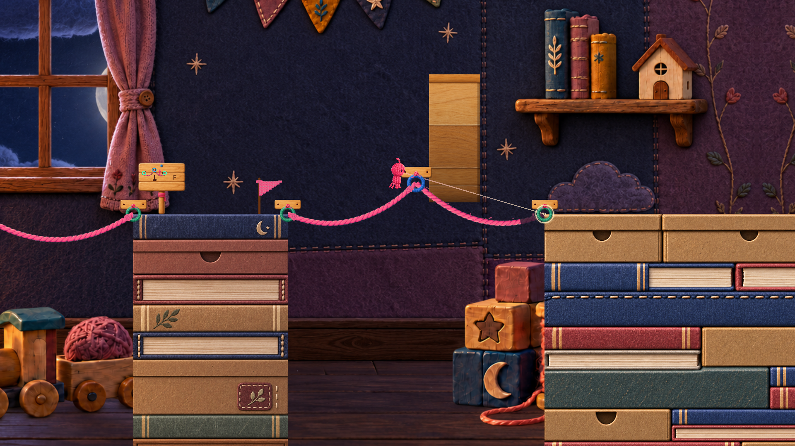
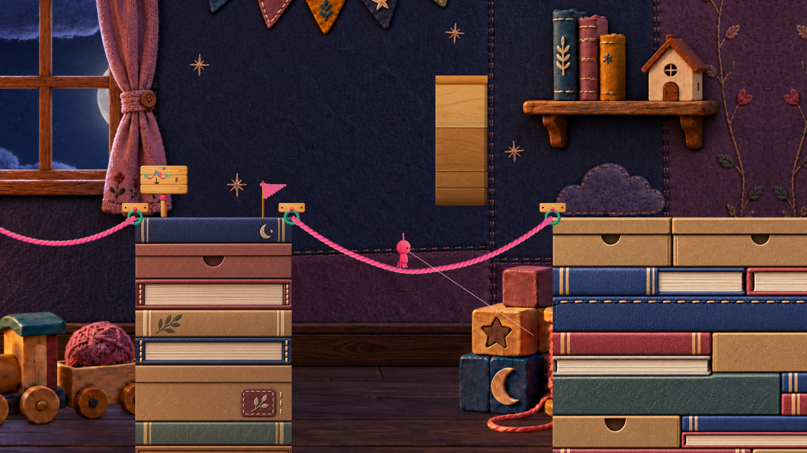

# 追補｜T4の因果説明とS10の学習重複

対象は**10/6 FriendPlay固定Buildの入力ソース/保存Sceneと、それ以前の既存画像**。現行Productionや演出候補2の評価ではない。今回の通常入力Aは0、実通過・実聴・人間の感情の記録はない。以下はBの静的事実、そこからの設計上の所見、Cの要確認を分ける。

既存8周と重複する「Fで下がる」「最後の橋が単純」という結論自体は新発見に数えない。追加したのは、**説明の経路と内部時刻、図と実形状の対応、箱のクリア条件、前の学習との同型性**である。

## 1. T4：理由の説明は、すでに存在する

固定原文の概要は「2本の足場を中央で外し、梁の下を通れる1本の橋へまとめます。」。さらにアニメ字幕には、問題→行動→結果がある。

| 図の内部経過時間 | 固定原文 | 根拠 |
|---|---|---|
| 9.0以上11.6未満 | 2本の橋では通り道が高い | `TutorialGuideAnimation.cs:86–91` |
| 11.6以上12.6未満 | 梁があって進めない | 同91行 |
| 12.6以上13.8未満 | 中央の青いHookへ戻って狙う | 同92行 |
| 13.8以上15.6未満 | F　中央を外すと1本に下がる | 同87、92行 |
| 15.6以上21未満 | D　低くなった橋で梁の下へ | 同93行、周期は18行 |

表は`Sample`の条件を読み解いた時刻で、動画を計測した秒数ではない。全体周期は21。全画面の看板を開くと`illustrationTime=0`へ戻り、開いている間だけunscaledDeltaを加算する。1回の加算に0.1の上限もあるため、**内部時間9秒＝実際に9秒待ったと断定しない**。根拠は`TutorialSectionGuide.cs:496–528, 663–668`。

**肯定材料B**：見た目の変化だけでなく「高いから梁に当たる」「中央を外すと下がる」という理由を既に文章化している。「理由の説明がない」「Fしか書いていない」という評価は撤回する。

**残るC**：短時間で看板を閉じる人は、理由の字幕の段階へ届かない可能性がある。一方、最初から出る概要にも「梁下へ1本にまとめる」と書くので、字幕を待たなければ何も分からないと断定できない。本人がどの情報で理解したかの試遊が必要。

**限定した最小案**：説明を追加する前に、既存の因果文を概要の位置へ移す比較。修正文は「2本の橋では梁に当たります。中央のフックを外すと、橋が下がります。」。長さ6やFの条件は補助として残す。字幕と同文を増やすことを目的にしない。

## 2. 通常の小さい看板と、Zで開く看板は伝える情報が違う

`TutorialSignInscription.cs:83–93`のT4小看板は2本→1本の曲線、青い中央リング、下向き矢印、Fを描く。この枝には梁の図がない。`135–171`では橋の変形と中央リングのフェードを描くが、`frame.Caption`の文章を小看板へ描く処理ではない。

対して全画面の看板は、梁と「梁」のラベルを描き、`DrawDemoCaption`へ字幕を渡す。根拠は`TutorialSectionGuide.cs:767–794`。

- **肯定B**：小看板でも中央が消えて橋が下がる動きは示す。全文を読ませず操作結果を予告する経路がある。
- **反例/C**：小看板だけでは梁を避ける理由まで示す図にはならない。実際の梁の地形を見るか、Zの説明を見る必要がある可能性がある。ただし小看板と実際の梁は同じ通常画角に写る既存コマがあり、「梁が見えない」とは言えない。
- **注意**：中央リングの不在は変形後の正しい表現になり得る。静止1枚から欠落バグにはしない。全画面のアニメは開き直しで0へ、小看板のアニメはゲームのscaled timeで進むため、同じ瞬間を並べたとは限らない。

## 3. Sceneと曲線の式も、梁下へ形を変える意味を支える

保存Tutorial Sceneでは、中央フックが(47,1.55)、梁が(48.5,3.3)、大きさ(2,5)。root Transform・単位BoxCollider・offset0を読み取った。Runtimeの`TutorialSectionFourSetup`にも同じ値がある。実行時の初期化から呼ばれる経路は`PrototypeRunController.Awake:78–81`。

`RopePlatformBuilder.cs:484–495`の式を、Unityを起動せず紙上で評価した結果：

| 位置 | 2本のまま（6+6） | 統合後（12） | 読めること |
|---|---:|---:|---|
| 中央x=47 | 中央支点 y=1.55 | 曲線 y=-1.65 | 中央支点が無くなると約3.2下がる式になる |
| 梁中心x=48.5 | 右側曲線 y≈0.469 | 曲線 y=-1.47 | 梁下端y=0.8に対して、同じ位置の道が約1.94下がる |

これは連続式上の曲線位置であり、衝突・足元支持・キャラクター全体の通過をテストした結果ではない。計算に使った点、式、境界は[静的計算JSON](evidence/t4-s10-static-geometry.json)へ保存した。

既存10/3の2コマでは、同じ梁と両岸に対して、2本時の中央青リングがあり、統合後は青リングが消えて谷の道が下がっている。

| 2本の状態 | 統合後 |
|---|---|
|  |  |

2枚ともProduction統合検証に残る**既存の診断キャプチャ**で、今回の通常キー操作の証拠ではない。コマ間の所要時間も測っていない。形の見比べにのみ用いる。

**更新した判断**：T4はKEEP/REWORK候補を維持。ただし「因果説明を新設する」優先度は下げ、「既存の因果文の表示順・発見性」の小さい比較へ限定する。理由を把握できたかはC。

## 4. S10はT3と同型で、S9より単純な橋へ戻る

| 項目 | Tutorial T3 | Main S9 | Main S10 |
|---|---|---|---|
| 接続の骨格 | 同じ高さの2端点 | 中央支点がある3端点 | 同じ高さの2端点 |
| 新しい操作の役割 | Qで身体を橋に残す | Qを2回、Fで形を変える | Qで橋を1本作る |
| 固定ソースの端点/距離 | (30,.35)→(36,.35)、距離6 | 左180→中央185.5→右191 | (199,-2.15)→(208,-2.15)、距離9 |
| 推奨値の性質 | 設定6、看板推奨7 | 6+6 | 設定10 |

根拠：`TutorialSectionThreeSetup.cs:11–27`、`MainStageSectionNineSetup.cs:19–38`、`MainStageSectionTenSetup.cs:12–29`。設定値は`RecommendedRopeLength`であり、Qの条件は推奨値との完全一致ではない（`RopePlatformAnchor.cs:5–27`）。

**肯定B**：S10では新しいキー/新しい橋の接続構造を追加していない。T3で学び、S4/S5/S7/S9でも使うQを、同じ高さの単純な2点橋へ戻す構成。終盤の新しい学習課題としては重複があると考える根拠になる。

**反例B/C**：長さの選択による消費・たわみは残る。距離9に対して、式の中央yは長さ9なら-2.15、10なら-3.15、14なら-7.15となる。したがって「どの長さでも同じ」「10を押すだけの完全固定解」は誤り。ただし、この差が実際に意味ある選択になるか、各長さで通常入力の接続・歩行が成立するかは未確認。

入口下限11は、前の選択で0から無条件に同じ残量へ戻す処理ではない。残量が下限未満の場合のみ補充する。節約して多く残したルートの差は維持される。この点も「節約の意味が完全に消える」への反例。下限の存在と逆算必須性の弱まりは既存8周の所見であり、新発見の件数には加えない。

## 5. 橋から右岸へ乗った瞬間の即クリアではない

保存SceneとRuntime設定でS10右端はx=208、箱のmarkerはx=219。間に11単位ある。`MainStageGoalZone.OnCollisionStay2D:50–62`は、最終床への衝突だけでなく`GoalChestPresentation.ReadyToClear`を要求する。

固定ソースの条件は、床の上に載ること、markerがある場合は箱へ近づくこと、開く進行が完了すること、箱までの水平距離1.05以内であること。箱の開き始めは2.6以内、開く設定時間は0.45。さらにClear表示の遅延定数は1.35。根拠：`GoalChestPresentation.cs:9–11,56–94`、`MainStageGoalZone.cs:13,50–88`。

**これらはコードの定数/条件であり、プレイで測った待ち時間ではない。** フレームや操作状態を含む実時間は未確認。marker不在の旧grayboxでは別の完了経路があるが、保存S10 Sceneにmarkerの存在を確認した。

- **KEEPの理由/C**：S9の形状変更の後に、単純な橋と箱への接近で緊張をほどく締めになる可能性。最後の身体消費と箱の反応を残す価値はある。
- **MERGEの理由/C**：既に学んだQを独立した新課題として繰り返す必要が弱い可能性。学習の新規性を足すために敵/装飾を増やす案にはしない。
- **限定した推奨**：S10の独立した課題性はMERGE/短縮の比較候補。箱への接近・開く反応・最後に身体を残す意味は、削除損失として明示する。無条件REMOVEの推奨へは上げない。

## 6. 親レビューの文案訂正

本文へ以下を反映した。すべて資料の案でありゲームUIの採用/変更ではない。

- Space：「ジャンプ（未接続・足場の上）」、別補足「接続中はEで外す」。Space自身が解除するという読みにしない。
- W/S：「次に使う長さを選ぶ（未接続時）」。U05も同じ条件表現にした。
- Q不可：「橋を作ったあとに、ヒモを{最低残量}残す必要があります」。serialized設定を含む最低残量を表示時に使う案にし、常に1とは断言しない。10/6保存Tutorial SceneのPlayer上にはminimumRopeReserve=1を確認したが、文案は動的値のまま。
- T3：「体のヒモを7使い、橋として残します。99 → 92」。身体→道の因果を図だけへ委ねない。
- U13の「最初から」：通常Scene再入場/初期化と整合する条件付き案。`StageStartTransition:98–121`はSingleでMainを読み込み、`MainStageRespawnOnFall.Awake:65–76`は第1区間/最大残量で初期化。保存Main Sceneの両プレビューflagは0。`StageProgress`はクリア印だけを保存する。実Build再入場の実測はCとして残す。
- 「判断の薄さがある」「進行不能を増やす」「形を変える強い体験」は、可能性/恐れ/体験候補へ修正した。対象版の表記は10/6固定Buildへ統一した。

## 追跡用の根拠

- [固定ソースの実本文抜粋](evidence/t4-s10-source-excerpts.md)：16ファイル。BuildInputsとのハッシュ照合は全件一致。初回29件との重複があり、合計45件とは数えない。
- [保存Sceneの抽出](evidence/t4-s10-scene-facts.json)：元SceneのfileID、GameObject/Transform/Collider行、値、SceneハッシュとBuildInputs一致を保持。Sceneを読み取っただけでUnityは起動していない。
- [静的な式の評価](evidence/t4-s10-static-geometry.json)：実通過や内部API操作ではない。
- [追加2画像の出所とハッシュ](evidence/t4-s10-image-index.json)：既存診断キャプチャの同一コピー。

朝の最初の1件は、既定の「Q案内の予測比較の採否判断」を変更しない。追加テーマ・実装・pushは親の次指示へ引き継ぐ。新しい時刻タスクは作成していない。
