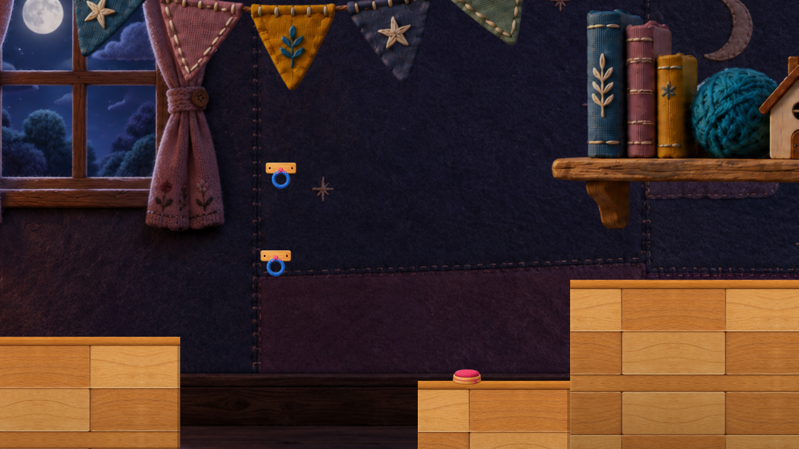
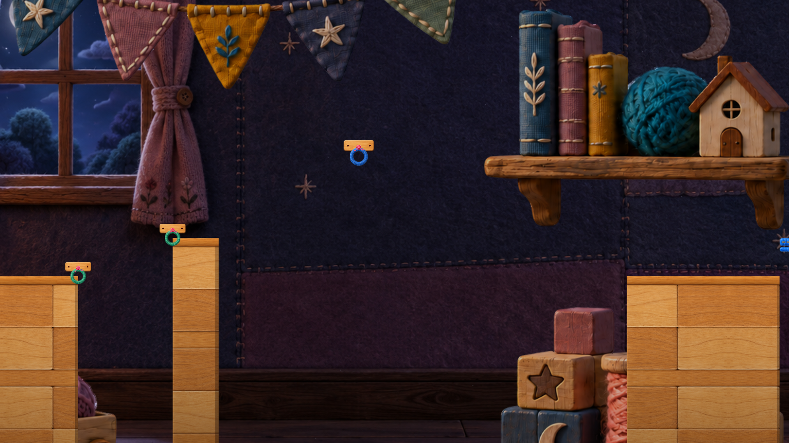
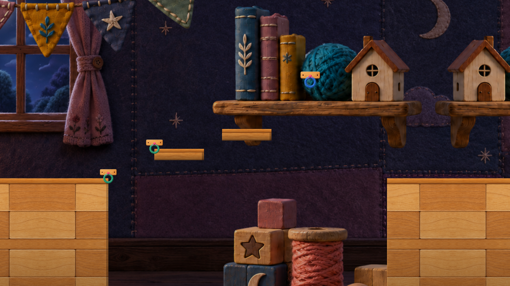

# 失敗後の再実行と区間反復｜S3・S4・S7

**A=0、実時間・面倒さ・難易度は未測定。** 10/6固定Buildの保存配置とコード、旧Intro画像から、参考経路を再採用した場合の反復を整理した。snapshot/補充の仕組みは既存07、入力受付は08を参照し、再解析を繰り返していない。数値はUnity座標であり、歩行距離・秒数・最少キー数ではない。

## 新しく強められた根拠

- S3下床・S4中継柱・S7中段/上段にチェックポイントはない。保存SceneのComponent配置で確認した。
- S3下床の上面は−6.05で、Mainの落下閾値−9より高い。下床に着地する設計自体は、落下失敗を要求していない。Fの帰路と、通常プレイ中のR帰還という選択を分ける。
- S4はCP4のx53.6から橋の始端x64.6までX差11、S7はCP7のx147.9から始端x155.1までX差7.2。**必須歩行距離ではない。** 接続可能距離やQでの配置によって実際の移動は変わる。
- S7には中段→上段の横隙間1.1・上面差1.2があり、S4の中継柱から振る構成との差分がある。ただし「全員が必ずこのジャンプをする」とは示していない。

[配置・元画像・ハッシュ](evidence/retry-layout-facts.json)／[追加コード抜粋](evidence/retry-source-delta.md)／[ケースと反例](evidence/retry-learning-cases.json)。固定入力15件（CPのGUIDを含む）はBuildInputsと一致。旧画像の配置に関係する9入力も固定コピーと一致した。以前の照合件数とは重複がある。

## 画像の版と用途

3枚は10/3の自然Introを記録した旧画像の同一バイトコピー。プレイヤーはS1に待機した記録で、当該区間の通過/失敗/復帰を写したものではない。S3の帰路はこの状態では非表示、S4/S7の生成橋も無い。これを欠落と批判しない。Intro画角を通常プレイの見え方へ読み替えず、背景/Art全体の同一性も主張しない。

別途確認した10/6 Step B Productionの診断画像は、この固定コピーに無い統合入力を使うため対象Buildの見た目の証拠から除外した。HumanのStep B採用を覆す評価ではない。大砲/ネズミ/最新演出Proofも今回の本編根拠に含めない。

## S3｜「死なずに選び直す帰路」とR帰還を分ける

**観察根拠（B）**：下フックと上フックがあり、下床の上面−6.05、右の高床上面−2.15。帰路A～Dは上面−6.05/−5.50/−4.95/−4.40の4段。Fスイッチは既存で、Revealは段のGameObjectを有効化してから見た目の演出を始める。演出完了まで待つ入力条件は、この処理にはない。

**参考経路で再び行うこと**：下へ着地→近くのFで帰路を開く→段を使って左側へ戻る→別のフック/長さ/位置を選んで再挑戦。開始床へ戻る位置条件で階段は再び非表示になる。通常プレイでRを使って復帰地点へ戻る経路もあるため、4段の帰路を毎回全員が使うとは言わない。

**弱さの仮説（C）**：下を選んだ理由が結果から読み取れず、同じ下経路と帰路を繰り返すだけなら、選択の学習より再移動が前面に出る可能性がある。今回はその停滞を観測していない。

**最小の改善候補**：まず通常試遊で「下を選ぶ→F帰路」「下を選ぶ→R帰還」を分け、次の試行で選ぶフックが変わるか確認する。見た目を足す前に、既存F案内を見付けたかを記録する。配置変更の採用を先に決めない。

**推奨**：KEEP/REWORK。現段階で帰路4段や下経路を無条件REMOVEとはしない。試遊で新しい判断が生まれない場合に限り、帰路のMERGE/短縮を比較候補にする。

**削ると失うもの/前後への影響**：死なずに世界内の帰路から選び直す連続性（ジャンプの要否は未実測）、Fで帰り道を開く操作、上下のフックを読み直す機会を失う。Rだけを出口にすると、世界内の回復手段を減らす。段数削減は高さ/隙間も変えるため、必ず簡単になるとは限らない。S2の着地床との接続、S4へ向かう高床は保持が必要。

## S4｜後半の失敗で、橋を作る前半へ戻る

**観察根拠（B）**：CP4は前の高床のx53.6。高床の右端は64.6。橋は64.6,−2.15から68.3,−0.65へ、中継柱の左端が68.3。さらに遠い青フック75.6,2.55と着地側がある。中継柱にはCPがなく、次は着地側のCP5。

**参考経路で再び行うこと**：CP5未受理のまま後半で失敗し、同じ橋→振り子案を再採用するなら、接続可能な位置まで移動/必要なら長さを選ぶ→E/Qで橋を作る→遠いフックへ接続できる位置へ移る→振り子の移動/解除、を再実行する。橋が保存される中間到達点はこの配置にない。実押下回数、必須歩行距離、代替経路の不存在を証明したものではない。

**弱さの仮説（C）**：失敗原因が遠いフックでの加速/解除にあるのに、すでに説明できる橋の準備と接近を毎回繰り返すなら、直したい失敗へ戻るまでの反復が学習を薄める可能性がある。橋の位置が次の接続を作る理解を毎回確認できる、という残す理由もある。

**最小の改善候補**：同じ開始床の範囲[49.6,64.6]内で、Rの復帰位置を右寄りにする紙上比較。例としてx61.5はその床内だが、採用値ではない。地形・橋・費用を変える案より範囲は小さい。変更していない。

**推奨**：橋→振り子はKEEP、復帰位置はREWORK候補。S4全体のREMOVEを裏付ける新証拠はない。

**短縮で失うもの/影響**：復帰直後にフック配置を見渡す余白、歩いて接続距離へ入る学習が減る可能性。CP受理直後にRで接近を省く使い方も生まれる。カメラの復帰画角と、両端/青フックの見え方を比較する必要がある。同じ床での位置変更でも、効果を確認せず安全な修正と決めない。

## S7｜S4と同じ接続に加え、高さをつなぐ配置がある

**観察根拠（B）**：CP7はS6合流床のx147.9、橋始端155.1、橋終端157.9。中段床は[157.9,160.9]・上面−0.35、上段は[162,165]・上面0.85。その先に青フック167.35,3.7。中段/上段にCPはなく、着地側でCP9へ進む。

**参考経路で再び行うこと**：橋→中段→上段への移動→振り子という案を再採用する場合、CP9前の後半失敗では橋の再生成からの前半も再実行する。参考手順の5を必須長とはせず、他の選択長や別経路の通行性は未探索とする。Source注釈の跳躍時間を実測秒数として再利用しない。

**前後との学習の重なり**：S4の橋で次の接続位置を作ることを再利用する。S5は遮光、S6は橋消費と無消費振り子の選択、S7は中段から上段への位置/高さの接続という差がある。見た目の「Qの後に振る」が同じだけで、4区間が同一体験とはしない。上段を考える判断が試遊で現れなければ、S7の重複感を疑う根拠になる。

**最小の改善候補**：最初から中間CPを増やす前に、同じS6合流床[147.1,155.1]内のR復帰位置を比較する。例x153は床内だが未採用。中段CPは橋の再生成を省ける一方、現在は区間番号を進めるCPであるため、章番号/保存境界/橋に使った残量の固定を含む設計変更になる。

**推奨**：KEEP/REWORK。上段への接続を残す価値がある。上段での判断が確認できない場合に、S4とのMERGE候補を再検討する。現時点でREMOVEを強める操作証拠はない。

**短縮で失うもの/影響**：S6合流後に残量と次の地形を観察する余白、橋から高さを得る複合課題。中間CPを採ると、失敗で橋の消費を巻き戻す境界も変わる。既存のS6選択差/CP9下限への影響を別に確認する必要がある。

## 実試遊で比較する最小範囲と、今夜言えないこと

| 比較 | 記録すること | 根拠にならないもの |
|---|---|---|
| S3下への選択後 | F/Rのどちらを使ったか、次に狙うフック/長さ/位置が変わったか | 階段が4段あることだけから「長くて面倒だった」とする評価 |
| S4後半での失敗後 | 同じ失敗へ戻るまでに再度必要だった行動と、各行動で新しい判断をしたか | X差11を歩行距離や所要秒へ換算すること |
| S7後半での失敗後 | 橋/上段/振り子のどこが失敗原因か、既に分かった前半をどれだけ繰り返したか | 参考手順のキー列を全員の必須操作数へすること |
| 復帰位置の比較を採る場合 | 初回と復帰の画角、フックの予測、資源と橋の状態、転落/詰まりの有無 | 床内の座標というだけで完成した改善とすること |

今回は実入力も新撮影もない。新確証は配置・CPの所在・帰路有効化順・画像版の境界であり、反復の回数/時間/気持ちよさではない。上位5案や朝の1件を入れ替える実プレイ証拠は増えていない。中間CP追加や区間削除へ進まず、既存のQ予測比較と未実施の入力確認を親/Humanの判断に残す。
