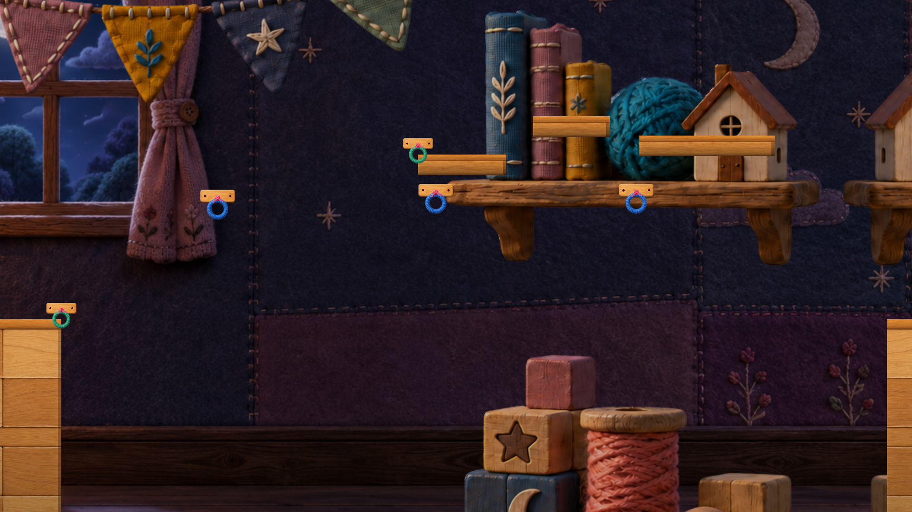
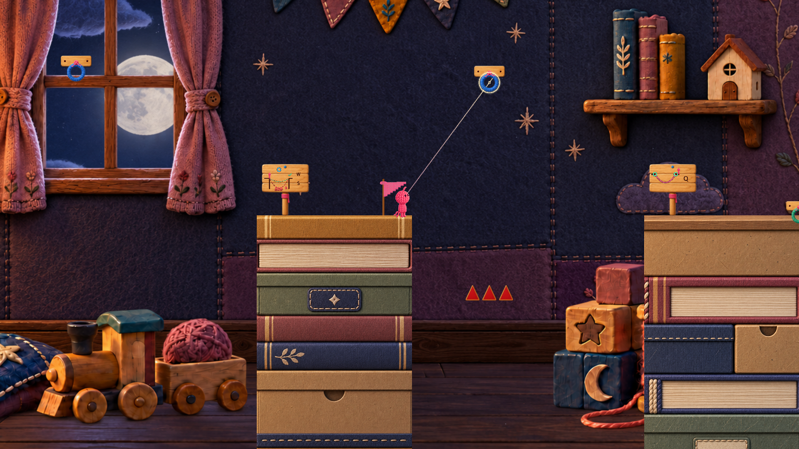

# 見せ場候補3件｜予測できることと、結果から読めること

**A=0。実入力・再接続・新撮影なし。親レビュー条件を反映、保存準備中（remote照合前）。** 対象は10/6 FriendPlay固定Build。面白かった順位ではなく、作品を説明する候補の暫定順を **T4 → S6 → T2** とする。新しい敵/装飾/仕様を足す案はない。

| 候補 | 残す価値の中心 | 既存画像で見える結果 | 今夜まだ言えないこと |
|---|---|---|---|
| T4 統合 | 支点を外して、自分が作った道の形と用途を変える | 中央が消え、両岸を残した1本の低い道になる | 通常入力で梁下を通れる実感、F前に理由を予測できるか |
| S6 ルート選択 | 身体を橋に残す費用と、無消費の連続接続を比べる | Introに上の床/緑端点と下の青フック3個が写る | 選択時に費用と負荷を読めるか、上が実際に安全か |
| T2 長さ調整 | 変えた数値を、危険との位置関係に結び付ける | 同一画面の上フック・下のトゲ・両岸・看板 | 6と8の実軌道差、失敗理由を読み取れるか |

## 1. T4｜最初に見せ場として確かめたい

**予測の手掛かりB**：旧2コマでは、橋の山を支える中央青リングと梁、左岸の小看板が同時に写る。小看板は中央除去→低下を示すが、梁の理由は実地形かZ説明に依存する。Zの既存概要/字幕には梁下へ下げる因果がある。追加説明が無いと決め付けない。

**結果の手掛かりB**：中央リングが消え、端点を維持して曲線が低くなる。これが単なるエフェクトではなく、通り道を変える核を最も短く示せる候補。既存06の式も低下を支える。ただし統合後コマは梁を抜け終えた成功画像ではない。

**成立を疑う反例C**：説明のFを順に押せても、「なぜ下げるか」を予測していない可能性。F成功だけで身体/支点/道の理解を認定しない。

**最小比較（未実施）**：2橋完成からF→梁下への通常操作を途切れず観察。F直前に「橋と通れる場所はどう変わる？」、直後に「何が変わった？ 次はどう進めそう？」を記録。実際に通過できた後に、その理由を聞く。地形/看板/Z/既知の記憶のどれを根拠にしたかも残す。因果を説明して移動へ使えるならKEEPを強める。キー列だけなら既存因果文の位置をREWORK比較する。

[2本の旧診断コマ](https://github.com/bq24014-cmd/himohito-prototype/blob/9ffbc91829319bccd325d864f77a3a9b37ade1a9/Docs/Reviews/PonPlaytest/runs/20261017_004500JST/evidence/images/E09_t4_two_bridges_legacy.png)／[統合後の旧診断コマ](https://github.com/bq24014-cmd/himohito-prototype/blob/9ffbc91829319bccd325d864f77a3a9b37ade1a9/Docs/Reviews/PonPlaytest/runs/20261017_004500JST/evidence/images/E10_t4_merged_legacy.png)。10/3隔離診断の同一バイト既存画像で、今夜の実プレイではない。

## 2. S6｜選んだ理由が資源差までつながるか

**予測の手掛かりB**：E15には高い緑端点/段状床と、その下の青フック3個が写る。一方、入口と合流は画面の左右端付近で、HUDも無いIntro画角。これだけでは通常の決定位置で両案と費用を見渡せる証拠にならない。色と配置から14消費/無消費まで分かるとも言わない。通常Main HUDに残量/選択長はあるが、長いルート説明の定義は通常描画から呼ばれない（既存09）。

**結果の手掛かりB/C**：Q後は残量と消費表示、E接続は費用なしという実装。参考条件の合流差25/39は既存07の条件付き追跡であり、画像に出た成績ではない。照準の縁/haloは接続可否を示す処理だが、1.5の空中再接続条件をその見た目だけで学べるかは未確認。速さ/安全さをコード注釈から採点しない。

**成立を疑う反例C**：見慣れた緑や近そうな上を選び、Q後に初めて費用を知るなら、二択があっても事前の資源判断にはなっていない。

**最小比較（未実施）**：まず事前質問ありの初回試行で、選択前に「何を使い、どこが難しそうか」を聞き、結果後の説明と比べる。両ルートを比べる場合は通常操作で同じ入口状態を再現できたときだけ、入口/合流の残量、接続失敗、読んだ情報を記録する。再現不能な条件を内部値変更で揃えない。費用を予測して選び、結果を説明できるなら見せ場としてKEEP。できなければQ予測表示の比較が先。

## 3. T2｜数値を変えた意味が軌道で返るか

**予測の手掛かりB**：E14は青フック・3本のトゲ・両岸・W/S看板を同時に写す。小看板には安全/危険の2軌道があり、Z図/字幕も6～7を提示する。説明がない課題ではない。HUDの「次に使う長さ」は既存で、接続中は長さ変更できず、外して選び直すコードになっている。

**結果の手掛かりB/C**：トゲは接続中のプレイヤー側Colliderとの重なりで接続を外す。接触位置での見た目の反応/毛くずを呼ぶが、発火コードは見やすさの証拠ではない。その場で失敗画面へ直行する処理でもない。実際に接触/手動解除/その後の落下を区別できるかが結果読解の要点。6と8の比較軌道画像は今回見つけていない。

**成立を疑う反例C**：6～7という答えをなぞって通過し、短くすると何が変わるかを説明できない可能性。通過だけで選択の面白さは成立しない。

**最小比較（未実施）**：事前質問ありの初回試行の前後で、長さと危険の予測を聞く。その後に通常復帰で可能なら8と6を比較し、開始位置/照準/加速/解除をできるだけ揃え、差も記録する。同一入力の決定論テストとは呼ばず、必ず死亡させる必要もない。軌道の変化を予測修正へ使えるなら短い見せ場に残す。答えの再生だけなら学習区間として残し、代表映像の優先度は上げない。

質問した試行を、無誘導の自然選択や人間の初見試遊とは呼ばない。

## 版の境界と今回の判定

E14/T4は10/3の隔離自動診断のworld-camera画像で、Overlay HUDを含まない。E15は10/3自然Intro観測でプレイヤーはS1待機。今夜の実操作、全経路通過、音、経過時間、初見人間の感情の証拠ではない。選んだScene/ロジック19入力は両旧記録と10/6固定入力で一致したが、全Artや全実行状態の一致を主張しない。9/30の看板fixtureや後の演出Proofを同版画像として混ぜていない。

**暫定判断**：T4を代表候補の先頭に置く。S6は事前の交換条件の理解、T2は軌道に基づく予測修正が確認できた場合に続ける。3件すべてを「面白かった見せ場」に格上げしない。上位5改善案と朝の1件は変えない。新資料7ファイルを独立runに分離し、ゲーム/UI本体には反映していない。

[画像/19入力のhashと境界](evidence/showcase-facts.json)／[比較で記録する項目](evidence/showcase-comparison-plan.json)／[追加ソース抜粋](evidence/showcase-source-delta.md)。既存[06](https://github.com/bq24014-cmd/himohito-prototype/blob/9ffbc91829319bccd325d864f77a3a9b37ade1a9/Docs/Reviews/PonPlaytest/runs/20261017_004500JST/06_T4_S10_Addendum.md)・[07](https://github.com/bq24014-cmd/himohito-prototype/blob/9ffbc91829319bccd325d864f77a3a9b37ade1a9/Docs/Reviews/PonPlaytest/runs/20261017_004500JST/07_Resource_Retry_Addendum.md)を再説明する代わりに、各見せ場の成立を疑う条件を明示した。
