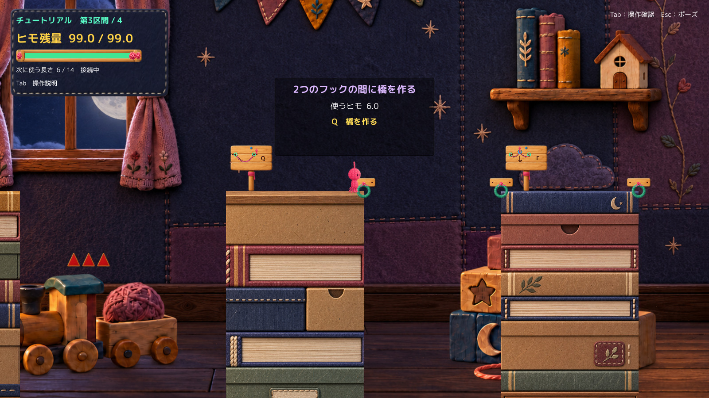

# Tutorial Q案内修正Proof

状態：技術確認済み候補／Human Review待ち。正式採用・Production統合なし。

対象は既存TutorialのQパネルだけ。Production参照HEADは `7a4f011b7ffc0343acd4727a75255495a3881fb3`、Unityは6000.3.21f1。現行と修正版は同じTutorial、背景、Camera、物理、解像度1600×900で比較した。主人公や腕の改修は含まない。

## まず実画面を比較

各比較シートは上が現行、下が修正版。JPEGは実Unityフレームバッファから作成した表示用プレビューで、文字の描き足し・画像生成は行っていない。タイトル帯だけを画像外へ追加した。元のRGBと可逆PNGはローカルに保持する。全身・地形を含む通常画角で、拡大しないと読めない局所比較だけにはしていない。

| 状態 | 通常画角の比較 | 修正版単体 |
|---|---|---|
| T3・生成可能 | [BEFORE／AFTER](Images/01_T3_Ready_Comparison.jpg) | [修正版](Images/01_T3_Ready_After.jpg) |
| 生成後の最低残量不足 | [BEFORE／AFTER](Images/02_T3_Reserve_Comparison.jpg) | [修正版](Images/02_T3_Reserve_After.jpg) |
| 接続長不足 | [BEFORE／AFTER](Images/03_T3_Short_Comparison.jpg) | [修正版](Images/03_T3_Short_After.jpg) |
| ペアのない接続先 | [BEFORE／AFTER](Images/04_T3_NoPair_Comparison.jpg) | [修正版](Images/04_T3_NoPair_After.jpg) |
| T4中央・青フック・生成可能 | [BEFORE／AFTER](Images/05_T4_BlueReady_Comparison.jpg) | [修正版](Images/05_T4_BlueReady_After.jpg) |

## 変えた表示と根拠

- 見出し：`2つのフックの間に橋を作る`。実際の生成先は照準方向やPlayer位置ではなく、`RopePlatformAnchor.TryGetPairedAnchor`で定まる2つの端点。`RopePlatformBuilder.CanBuild`がこれを使うことを確認した。
- 費用：`使うヒモ {n:0.0}`。従来と同じ`CurrentPlatformCost`を直接読む。選択長や推奨長を別途計算して代用していない。
- 可能：`Q　橋を作る`。`CanBuildCurrentPlatform`がtrueの場合だけ表示する。
- 残量不足：`ヒモが足りません／作った後に {minimum:0.0} 以上必要`。`CurrentLength - CurrentPlatformCost < MinimumRopeReserve`で判断。最低値はハードコードせず、既存プロパティを読む。旧UIだけにあった0.001の判定差も、表示側を実生成条件に合わせた。
- 接続先の問題：ペアの定義を取得できないときのみ`この接続先では橋を作れません`。
- 長さ不足：ペアが実在し、両端点距離が`CurrentPlatformCost + 0.05`を超えるときだけ`ヒモの長さが足りません／Eで外し、Wで長くして再接続`。0.05は既存生成判定の距離許容値と同じ。生成側には変更なし。
- その他：原因を裏付けられなければ`この状態では橋を作れません`。このフォールバックはSource確認のみで、ゲーム条件を改変して強制発生させていない。
- `CanBuild=false`だけで「右の緑フック」へ誘導する区間依存の分岐を撤去。青フックを一律Q不可とは説明しない。

予備画面を確認後、パネル高さのみ148→176pxにした。本文領域は134→162px。GUIStyleの高さと余白を足した保守的な見積もりでは、長い不可理由が約149.66pxを要したため、余白を確保した。この計測は実ピクセルの文字切れ検出とは別。最終5画面は実画像でも確認した。表示位置の追従・画面内クランプ・接続／解放条件・T1/T2でのロックは既存のまま。

## 5状態の結果

以下は**診断API／Reflectionによる状態設定・既存生成APIの実行結果**。OSキー操作でもHuman試遊でもない。各組でRoot位置、速度、Camera、Zoom、Hook、ペア座標、残量、長さ、生成可否、消費結果を照合し、すべて一致した。

| 状態 | 残量 | 費用 | 最低残量 | 結果（現行／修正共通） |
|---|---:|---:|---:|---|
| T3可能 | 99 | 6 | 1 | 生成成功、実消費6、残量93 |
| T3残量不足 | 6.5 | 6 | 1 | 生成拒否、実消費0。生成すれば0.5で最低値未満 |
| T3長さ不足 | 99 | 5 | 1 | 生成拒否、実消費0。ペア間6に対し接続長5 |
| ペアなしT2 Hookへ接続、区間状態はT3 | 99 | 6 | 1 | 生成拒否、実消費0。色ではなくペア定義なしが根拠 |
| T4中央の青フック | 99 | 6 | 1 | 生成成功、実消費6、残量93 |

根拠：[5状態の数値・文言・画角](QA/FiveStates.json)、[現行実行](QA/BeforeSummary.json)、[修正版実行](QA/AfterSummary.json)。

診断では区間・残量・位置を設定し、接地キャッシュも接続APIが読めるように設定した。長さ不足の例は空中の診断位置で接続し、撮影時は空中状態へ戻している。スナップショットは時刻停止で比較し、通常操作による到達性や振り子軌道の検証にはしていない。接続直後の提示演出も停止するため、撮影には伸び終わった接続ヒモの全体表示を保証していない。生成先はペア座標と既存生成処理・実際の生成可否／費用で照合した。

## 手動Build

[起動方法](Launch.md)。最終版は`Build_After_r3/TutorialQPrompt.exe`。非Development、Script Debugging・Profiler自動接続・Deep Profilingすべてfalse。[Build識別・オプション](QA/BuildIdentity.json)。

通常起動で診断コンポーネントは作成されない。明示的な`-qPromptCapture`指定時に限り、撮影用の位置設定・自動API・撮影・終了を行う。手動ランチャーにこの指定はない。撮影時計への変更もない。

通常引数での起動・40秒待機・応答・初期ログを確認し、自動終了していないことを記録した。[起動記録](QA/ManualIdle.json)。この確認はキー反応の確認ではない。検証起動だけ-noaudioを使用し、手動ランチャーの音は既存のまま。音は未確認。

対象はTutorialだけを収録した検証Build。本編を選ぶ場合の通常の未収録表示は、このProofでは変更しない。腕レビュー用の固定ランチャーとは別。

## 差分・保護

- [表示だけの差分](Diff/PrototypeHud.patch)。既存Runtimeファイルの変更は`PrototypeHud.cs`1件のみ。既存metaは不変。
- [診断コード資料](Diff/DiagnosticFixture.cs.txt)、[Editor Buildツール資料](Diff/BuildTool.cs.txt)。Proof専用で、今後のProduction採用パッチには含めない。
- [既存Source・Scene・meta・物理／入力設定のハッシュ](QA/CoreIdentity.json)。生成可否、消費、最低残量、操作、物理、橋統合、復帰、地形に変更なし。
- [保護確認](QA/Protection.json)：ProductionのAssets／Packages／ProjectSettings計514ファイル、別途dirty資料4ファイル、腕固定レビュー環境151ファイルを開始時と照合。Git状態・stageも開始時と同一。既存Proof・凍結A2・Build・outputを削除／差し替えしていない。
- GitHubに置いたのはこのレビュー資料・画像・JSON・差分だけ。Production・mainへのコード／Asset反映なし。Build・Library・BGM実体は追加しない。

## 確認方法と未確認

| 項目 | 判定 |
|---|---|
| Compile／非Development Windows Build | PASS（最終Build Error 0／Warning 0） |
| Standaloneの実Unity描画・5状態 | PASS（診断設定、実フレーム） |
| 費用／生成可否／ペア距離の整合 | PASS（上表の範囲） |
| 5画面の文字切れ・通常画角での読みやすさ | Codex画像確認、最終レイアウト予算内 |
| 通常起動で自動攻略・撮影を開始しない経路 | Source確認＋40秒起動継続 |
| OS画面取得→キー入力→反応 | 未確認（list_appsが1回タイムアウト。再承認要求・反復試行なし） |
| Humanの理解度・実キーで接続→Q | 未実施 |
| 音・全区間通し・面白さ・Visual正式採用 | 未確認／今回は評価しない |

操作の継続許可があることと、ツールが動作することは区別した。[操作環境記録](QA/OperationAvailability.json)。[重要ログ抜粋](QA/RuntimeLogExcerpt.txt)、[診断準備時の修正履歴](QA/ReviewChecks.json)。初期の撮影補助Compile問題と、距離外の診断位置による失敗はローカルに保持し、最終PASSへ混同していない。

残る最重要の確認は、Humanが「照準先へ作るのではなく、2つのフック間へ作り、表示量を消費する」と理解できるか。今回は文言・余白の修正版1案を提出して停止する。追加UI案、地形調整、正式採用、Production統合には進まない。
