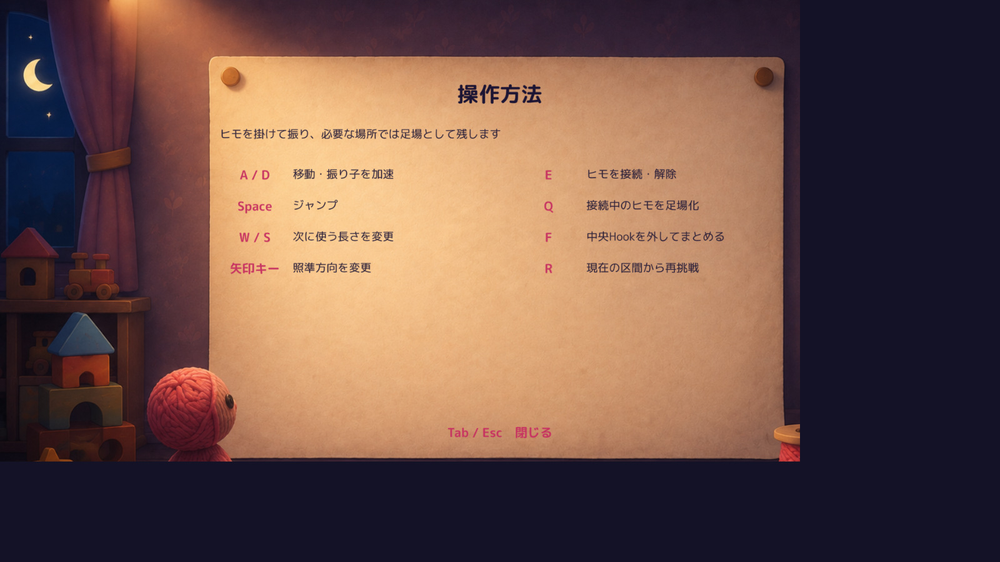

# 既存Tab操作説明の点検・修正文案

調査のみ。修正文案3件を提出し、採用判断を待つ。UI実装・ゲーム実装・Unity起動・再Buildは行っていない。

参照Production：`main` / `7a4f011b7ffc0343acd4727a75255495a3881fb3`。対象の入力・説明コードはHEADとの差分0。既存dirty Scene・資料、Q案内Proof、腕レビュー環境は変更しない。

## 確認した画面と範囲



これは`FullGameRegression_20260930/Evidence/StaticScreens/Help_1600x900.png`に保存されていた既存画面。**今回開いて撮影した画面ではない。** 8行・導入文・閉じる表示が、現行`StageOverlayControls.DrawHelpScreen`と一致することを目視・コードで確認した。元PNGを変更せず、同解像度のJPEGプレビューだけを新規作成した。[画像の出所・SHA](Evidence/ScreenEvidence.json)。

computer-useの`list_apps`は今回もタイムアウト。再承認要求・反復試行・別手段によるキー注入はしていない。今回のOS操作、最新実行時の表示、Humanの理解は未確認。[操作確認の範囲](Evidence/OperationAvailability.json)。

## 重要な修正文案：最大3件

### 1. Q：「接続中なら何でも、そのヒモの形で足場になる」と読める

- **現行文**：`Q　接続中のヒモを足場化`
- **修正文案**：

  ```text
  Q　橋用の2フック間に橋を作る
     （接続中・ヒモを消費）
  ```

- **問題**：接続だけでは生成できないこと、PlayerとHookの間ではなく設定済みの2端点へ生成されること、身体を消費することがこの行から分からない。「足場化」も動作対象が抽象的。
- **根拠**：`RopePlatformBuilder.CanBuild`は接続・解放済み区間・`RopePlatformAnchor`と有効なペア・接続長・生成後残量を判定する。端点間距離は接続長＋0.05以内が必要。`CurrentPlatformCost`は`ActiveRopeLength`、`CommitAttachedRopeAsPlatform`が実消費する。Q解放はTutorial第3区間／本編第4区間以降。「青フックは不可」「緑なら必ず可」とはしない。
- **失われる情報**：「接続中のヒモそのものを足場化」という表現は外すが、実際の操作条件「接続中」は残す。短文に全ての数値条件は列挙しない。元のTabにも具体値はなく、数値の情報を削る変更ではない。
- **位置づけ**：先のQパネルProofと意味を揃える文案。Q Proofが正式採用されたとは扱わず、今回は両方の実装を触らない。

### 2. F：何を「まとめる」のか、どこを狙うのか、未接続が必要なことが曖昧

- **現行文**：`F　中央Hookを外してまとめる`
- **修正文案**：

  ```text
  F　未接続で共有フックを狙う
     2本の橋を1本に統合
  ```

- **問題**：「中央」は画面中央とも読め、「まとめる」の対象も明記されない。Eで接続したままFを押しても成立しない。
- **根拠**：`TryRemoveAimedHook`は接続中なら即拒否。キーボード照準で有効範囲のHookを解決し、そのanchorに触れる生成済み橋が**ちょうど2本**のときに統合する。見た目の中央位置や色だけでは判定しない。F解放はTutorial第4区間／本編第9区間以降。F自体に追加のヒモ消費処理はない。
- **失われる情報**：現行の「Hookを外す」、すなわち統合後に中間フックがなくなる予告を短文から省く。この効果の予告は弱くなる。既存Tutorial第4区間の説明`Fで中央を外し…`は保持されるが、この省略を許容できるかはHuman判断。新語「共有フック」が伝わるかも未確認。

### 3. Space／W・S：接続中にはできない操作が区別されていない

- **現行文**：`Space　ジャンプ`／`W / S　次に使う長さを変更`
- **修正文案**：

  ```text
  Space　ジャンプ（未接続時）
  W / S　次の長さを変更（未接続時）
  ```

- **問題**：接続中にSpaceでジャンプできる、W/Sで今のヒモを伸縮できる、という読みを排除できない。同じ「未接続条件の欠落」として1件にまとめた。
- **根拠**：`PlayerMover.FixedUpdate`のジャンプ実行条件に`!isSwinging`があり、接地猶予と入力バッファも必要。未接続なら無制限に空中ジャンプできるという意味ではない。`RopeController.UpdateSelectedRopeLength`は接続中にreturnする。Wは次の選択長を＋1、Sは－1とし、既存の上下限で制限される。
- **失われる情報**：なし。「次の長さ」は次に接続するヒモの選択長を指し、現在接続中のヒモを巻き取る操作へ意味を変えない。猶予時間・選択上下限の数値は従来同様Tabに詰め込まない。

## その他の説明の照合：今回は変更を提案しない

| 現行表示 | 実装との照合 | 判断 |
|---|---|---|
| A / D：移動・振り子を加速 | A/D入力をPlayerMoverが移動・接続時の力へ使用 | 維持。入力と運動の全詳細までこの行に追加しない |
| 矢印キー：照準方向を変更 | 左右で角度回転、上／下で真上／真下へ合わせる | 概要として正しいので維持 |
| E：ヒモを接続・解除 | 未接続時は照準から有効なHookへ接続を試み、接続中は解除 | 維持。対象が無条件に接続できるという仕様ではない |
| R：現在の区間から再挑戦 | Tutorial／本編とも通常プレイ時は記録済みCP位置・残量・選択長・橋・除去Hookを復元 | 重大な誤りではないため今回は維持。凍結A2等の特殊Proof仕様は説明へ混ぜない |
| 導入文：ヒモを掛けて振り、必要な場所では足場として残します | 振り子と橋の用途を要約している | 短い導入役があるため、無理に削除しない |
| Tab / Esc：閉じる | 開いたヘルプはTab／Escで閉じる。クリックでも閉じる | 維持 |

**Eの注意**：通常の新規接続には接地判定が必要だが、指定された連続Hookからの解除直後は、受付時間内に同グループの次のHookへ空中再接続できる。`TryResolveAvailableAttachment`、`OpenAirChainReconnectWindow`、`CanReconnectAirChainTo`を確認した。したがって、説明を単純に「Eは地上でのみ有効」へ変更する案は出さない。通常のE解除は運動量を引き継ぐ。橋生成後はそのヒモをE解除で払い戻す状態には戻らない。

## 文案を置き換えた場合の一覧（未実装）

| キー | 修正文案／維持する文 |
|---|---|
| A / D | 移動・振り子を加速 |
| Space | ジャンプ（未接続時） |
| W / S | 次の長さを変更（未接続時） |
| 矢印キー | 照準方向を変更 |
| E | ヒモを接続・解除 |
| Q | 橋用の2フック間に橋を作る<br>（接続中・ヒモを消費） |
| F | 未接続で共有フックを狙う<br>2本の橋を1本に統合 |
| R | 現在の区間から再挑戦 |

新しいキーやルールを加える提案ではない。提案後の改行・文字量が現行枠へ収まるかは、UIを変更していないため**未確認**。本資料の表は実ゲーム画面の再現画像ではない。Humanが文案を選んだ後、別の許可された工程で実画面を確認する。

## 根拠・保護・停止

- [実装の該当行・SHA・原文抜粋](Evidence/SourceEvidence.json)
- [保護確認](Evidence/Protection.json)：対象Source、dirty Scene／資料、Q Proof・腕レビュー環境の指定ファイルとGit状態を前後比較。
- OSキー操作・新規実画面・Human理解度は未確認。コード照合を実プレイPASSや採用承認とは呼ばない。
- 今回は調査資料のみを`review/tab-controls-audit`へ共有。Production／main、Qパネル、腕候補、既存差分、Buildに変更なし。修正文案の採用・実装を待って停止する。
