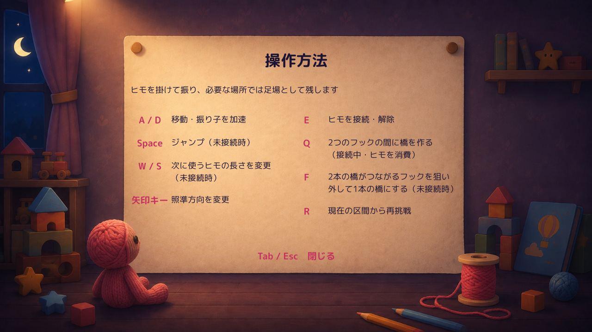

# Tab操作説明・指定文案の隔離Proof

指定されたSpace／W・S／Q／Fの4項目だけを修正した1案。**Production正式採用・統合なし／Human画面レビュー待ち。**

参照Production：`main` / `7a4f011b7ffc0343acd4727a75255495a3881fb3`。Unity 6000.3.21f1。最終Buildはr2、非Development。背景・画風・フォント・他の説明文・操作・物理・消費ルールは維持した。

## 実Unity画面の比較

| 解像度 | 現行／修正の比較 | 修正版単体 |
|---|---|---|
| 1600×900 | [比較シート](Images/Comparison_1600x900.jpg) | [修正版](Images/After_1600x900.jpg) |
| 1280×720 | [比較シート](Images/Comparison_1280x720.jpg) | [修正版](Images/After_1280x720.jpg) |



同じ最終EXE・Tutorial・解像度で撮影した。現行比較は保存した現行`DrawHelpScreen`／`DrawHelpRow`を使うProof専用Rendererで、現行の文字列・配置・スタイル・閉じる処理を保持する。ProductionのEXEを変更して撮影したものではない。

画像は今回のStandalone実Unityフレームバッファから採取。APIでヘルプを開いている。JPEGは同解像度の表示用プレビューで、縮小・文字の描き足し・画像生成はしていない。比較シートの見出しだけを画像外へ追加した。元RGB／可逆PNGをローカルに保持。前回調査の保存画像を再利用した比較ではない。

## 指定文言

```text
Space：ジャンプ（未接続時）

W / S：次に使うヒモの長さを変更
       （未接続時）

Q：2つのフックの間に橋を作る
   （接続中・ヒモを消費）

F：2本の橋がつながるフックを狙い
   外して1本の橋にする（未接続時）
```

実際に描画した文字列を両解像度で照合し、指定4項目と完全一致。他のA/D・矢印キー・E・Rの説明は現行と一致。「共有フック」「橋用の2フック」は修正版の表示へ使用していない。導入文・タイトル・閉じる表示も変更していない。

## 最小の配置調整

- 説明18px、キー20px、見出し34pxを維持。フォントも既存のM Plus Rounded 1cのまま。文字を小さくして押し込んでいない。
- キー欄112→84px。「矢印キー」に実測約80.01px必要なため、この幅を確保した。
- 左列48％→45％、右列48％→53％、列間4％→2％。両列から2pxずつ差し引き、IMGUIの外側余白も含めて既存領域内へ収めた。
- 親領域の幅56％・高さ65％、紙背景、行間12px、閉じるボタン位置の規則は維持。

初回r1の64pxキー欄では「矢印キー」が不足したため、提出前に修正した。初回Build／計測はローカル保持し、合格扱いしていない。文案を別案へ変更したものではなく、同じ指定文案の配置修正1回。

## 表示検証

| 項目 | 1600×900 修正 | 1280×720 修正 | 根拠 |
|---|---|---|---|
| 指定改行以外の折り返し | なし | なし | 実GUIStyleの必要高さ・幅と実レイアウトを照合 |
| キー／本文の文字切れ | なし | なし | 必要幅・高さの計測＋実画像確認 |
| 行の重なり | なし | なし | 全16ラベルのRect交差確認＋実画像 |
| 紙からのはみ出し | なし | なし | ヘルプ領域内の計測＋実画像の紙端確認 |
| 閉じるボタンの欠け | なし | なし | ボタンRectが領域内、実画像で全文確認 |
| フォント縮小 | なし | なし | キー20／本文18を全行で計測、スタイル関数不変 |

[計測総括](QA/Summary.json)と各解像度の[1600 Layout](QA/After_1600_Layout.json)／[1280 Layout](QA/After_1280_Layout.json)を参照。

現行比較には既存の右ラベル領域が親領域より約4px広いという保守的なRect判定が残るため、`layoutFit=false`・プロセス終了値2となる。実際の文字欠けと同一視していない。現行の描画は改変せず、両現行ケースともRuntime Error 0、開閉・復帰のAPI検証はPASS。最終修正版の両ケースは領域判定PASS・終了値0。この区別は[ScopeChecks](QA/ScopeChecks.json)に記録した。

## Tab開閉・ポーズ復帰

通常プレイ→`OpenHelp`→`CloseHelp`、ポーズ状態→ヘルプ→閉じる→ポーズ解除を**診断API／Reflection**で実行した。

- 通常プレイから開くと`timeScale=0`、閉じると1へ戻り、ゲーム時刻が再び進む。
- ポーズ中に開いたヘルプを閉じても`timeScale=0`とポーズ表示を維持する。
- ポーズ解除後はヘルプ／ポーズ表示がなくなり`timeScale=1`へ戻る。
- 現行／修正×2解像度の4ケースでPASS、Runtime Error 0。
- `Update`、開閉ハンドラ、`ApplyPauseState`、ポーズ描画・スタイル定義は原文と一致することも照合した。

[1600現行](QA/Before_1600_Lifecycle.json)／[1600修正](QA/After_1600_Lifecycle.json)／[1280現行](QA/Before_1280_Lifecycle.json)／[1280修正](QA/After_1280_Lifecycle.json)。

**Tab／Esc実キー・マウスによるボタン反応は未確認。** computer-useの`list_apps`が1回タイムアウトし、反復や再承認要求はしなかった。API検証をOS操作成功・Human試遊へ置き換えていない。[操作環境記録](QA/OperationAvailability.json)。

## 手動Build・差分・保護

- [手動起動方法](Launch.md)。修正／現行を別ランチャーから同じEXEで開ける。既存ランチャーは上書きしていない。
- [Build結果](QA/BuildSummary.json)：非Development、Error 0／Warning 0、Script Debugging・Profiler接続・Deep Profilingはfalse。[EXE／Assembly識別](QA/BuildIdentity.json)。
- [4項目と配置だけの差分](Diff/DisplayOnly.patch)。[比較・計測用差分](Diff/ProofInstrumentation.patch)は別資料へ分離。比較Renderer／診断コードはProof専用で、Production採用パッチには含めない。
- [保護確認](QA/Protection.json)：ProductionのAssets／Packages／ProjectSettings 514ファイル、dirty資料等19ファイル、Q・腕レビュー関連9ファイルを照合。Production Git状態・stageも同一。隔離コピーの既存ファイル変更は`StageOverlayControls.cs`1件のみ、既存meta不変。
- Q案内ProofをこのBuildへ合成していない。Q案内Proof・腕レビュー環境・main・未承認差分・既存Buildを保持した。

## 未確認・停止

Humanの理解度・使いやすさ・正式採用は未確認。OS実キー操作、音、MainStage実起動、全区間通しプレイも未確認。今回はTutorialから開いた共通Tab画面での限定検証であり、ゲーム全体の回帰PASSとは呼ばない。

指定文案の隔離Proof1案を提出して停止する。追加文案・追加改修・Production統合は行わない。
