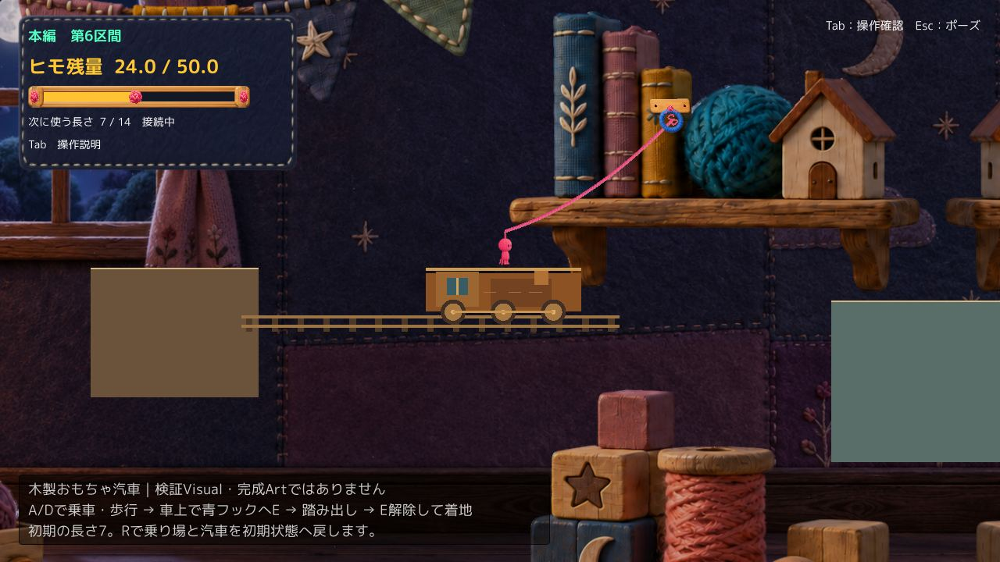
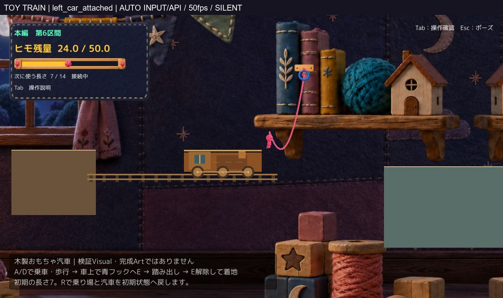

# 木製おもちゃの汽車 → 固定Hook → 振り子 → 着地

**隔離Proof1案を完成。Technical：確認した範囲でPASS／Human実キー・手応え・楽しさ・正式採用：未確認。** Production・mainへの統合なし。R修正のHuman実キー確認を制作開始条件にはしていない。

## まず一連の実Unity映像

[乗車から着地までの連続動画：9.96秒](Videos/Train_RideToLanding_Normal_50fps_silent.mp4)／[連続JPEG](Frames/)／[手動起動](Launch.md)。

実Unity 6000.3.21f1、1280×720、既存Camera。自動入力／内部APIと実Physics2Dによる撮影。ゲーム内時間に等速の50fps、無音。OSキー・Human試遊・実機FPSの計測ではない。動画は途中切替・カット・診断テレポートなし。JPEGは表示用圧縮と枠外ラベルのみで、実画面への描き足しや画像生成はしていない。[撮影条件](QA/Media.json)。

## 1. 構成と見た目

作業領域とSourceに既存の汽車Proofがなく、remoteのreview/toy-trainも未作成だったため、新規の独立領域を1つだけ作成した。既存A2／腕／BodyPump／斜面／Q／Tab／固定レビュー環境は変更しない。

実座標のXは下表に117.9を加えた値。Cameraのズーム・追従コード、Playerの大きさ・物理設定はそのまま。

| 要素 | ローカル寸法・位置 |
|---|---|
| 乗り場 | x=-7.5〜-2.3、上面y=0.4 |
| 汽車1台 | 中心x=0〜5.5、幅4.8、高さ1.4、上面y=0.4 |
| 水平線路 | 描画のみ。車輪の下、x約-2.85〜8.85 |
| 固定青Hook1個 | (10.5,5.0)、通常の接地中初回接続 |
| 広い着地先 | x=15.4〜24.4、上面y=-0.6 |
| 初期状態 | 残量24／選択長7／橋0。新Proofのcheckpoint設定で、ルール変更ではない |

車体・窓・煙突・3つの車輪・木の軸を簡易図形で構成。上の明るい乗車面はBoxCollider上面と一致し、装飾はその下に収めている。新規PNGや完成Artは作っていない。既存の高品質背景に比べ平面的な仮造形で、完成Visualとしての採用を求めるものではない。

主人公はProductionの素材・表示処理をコピー。腕・BodyPump・足裏補正候補などのPresentation Proofコードは持ち込まない。Production由来の見た目の課題は、今回同時改修していない。

## 2. 最小限の移動床対応

- 汽車はKinematic Rigidbody2D。最高1.8、加減速1.2。最初4秒停車、端では減速→2秒停車→折り返す。
- 未接続で汽車に足が載っている間だけ、通常の地上目標速度を「A/Dの相対歩行速度＋汽車速度」にする。入力0でも運ばれ、車上を歩ける。
- Rootの親子付け・毎フレームの位置加算・離脱時の追加速度加算は使わない。
- 接続中はこの地上速度処理を通さない。既存の接触・摩擦と接線方向の力で動き、汽車速度を二重加算しない。
- 足元の支持を毎物理更新で取り直し、空中・通常床では汽車参照を捨てる。離脱後に元から持っている世界速度は残る。それは運搬処理の残存とは別。
- Rでは汽車の位置・速度・方向・停車時間を初期化し、Playerには直近のR状態同期を隔離内だけで利用する。

変更理由：移動床上では「世界に対して停止」ではなく「汽車に対して停止」が必要。一方、接続後や空中へ同じ運搬を足すと二重移動になるため、表示の親子付けで解決せず支持状態で分けた。

通常の振り子・空中制御・接続解除・橋生成統合・消費ルールは保持。[差分（Runtime／Editor専用QA／包装設定を区別）](CodeDiff.json)／[保護と関数同一性](QA/Protection.json)／[実行設定](QA/Config.json)。Production側の同名Sourceは変更していない。

## 3. 検証したこと

最終Windows版23項目PASS、Gameplay Error0。Editorでも同じ23項目PASS。[短い集計](QA/Summary.json)／[Windows全記録](QA/Windows_Result.json)／[Editor記録](QA/Editor_Result.json)。

- 未接続の無入力乗車25秒：停車・折り返し3回、相対位置ずれ最大約0.0050、サンプル相対速度差最大0、支持を維持。
- 車上左右歩行：相対位置が約-0.639から+0.557へ変化。乗り場へ降りた後、汽車支持なし・静止を確認。
- 車上で接地中のE相当API接続に成功。接続後0.35秒の相対位置ずれ0。
- 汽車から踏み出し、上昇中の40°／45°／50°を解除条件とした3サンプルで着地成功。接続・解除前後の速度差0、残量24を維持。乗車済み時点から安定着地まで約8.98／9.06／9.24秒。
- 離脱後の記録は汽車支持なし。通常の空中・振り子関数本文はProductionと一致する。
- 距離約6.18（選択長7の範囲内）でも、ジャンプして未接地の初回接続は拒否。範囲外だから失敗した試験ではない。
- 乗車中・空中・着地後のRでPlayerと汽車の初期状態へ復元。

さらに**接続中のR**をEditor専用で焦点確認。車上で接続・速度約1.06の状態から、R共通メソッドで入口・汽車初期位置／速度0／停車時間4秒／未接続／残量24／選択長7／橋0へ戻り、0.6秒後も安定。[接続中R](QA/FocusedAttachedR.json)。これはWindows Build後に追加したEditor専用テストで、凍結Runtimeは変更していない。OSキーRとは区別する。

3つの解除サンプルは連続する成功窓やHuman成功率の証明ではない。診断上の初期化・E／Rメソッド呼出しと、本人が実際にキーで遊んだ結果は分けている。

## 4. Buildと手動経路

Compile／Play／非Development Windows Build成功。新Build1個、Buildエラー0・警告0。Profiler自動接続・script debuggingなし。[同定SHAと起動観測](QA/BuildAndManual.json)。

引数なしの通常起動では自動入力・撮影・自動終了を作らず、実時間で動く。汽車が4秒後に動くのは仕掛け自体の挙動で、自動攻略ではない。Ready後15秒の観測で、Playerは乗り場・未接続・24／7／橋0のまま。プロセスは40秒生存を確認して自身のPID／exeを照合後に外部終了した。OSキー／クリックでの終了確認ではない。

技術上の修正履歴：最初は既存SolidSwingSurfaceのAwakeが汽車もStaticに戻していた。既存クラスを書き換えず、この汽車だけ初期化後にKinematic設定する順番へ修正した。QAの型名重複と撮影用組込みモジュール不足もBuild前に解消。失敗ログはローカル保持し、最終PASSへ混ぜていない。[必要なログ抜粋](QA/LogExtract.txt)。

## 5. 未確認・残る弱点と停止

- computer-useスキルで初期化後、list_appsが1回タイムアウト。反復・同じ許可の再要求はせず、OS実キー、Humanの手応え・楽しさ、音は未確認。
- 汽車の木目・立体感、車輪回転や音は未制作。仮造形と背景の品質差は残る。
- Production基準の主人公表示を保持しているため、以前指摘された腕・姿勢の改善／採用とは別。足元の読みやすさを含むVisual採否はHuman待ち。
- Hookを狙う時間の分かりやすさ、長さ7以外・逆方向操作・不適切な解除を網羅したものではない。線路自体や背景棚は歩行面ではない。
- 接続したまま折り返し後も長時間乗り続ける条件は未検証。ヒモが張れば車から引かれる既存の物理が働くため、未接続乗車の結果をそのまま一般化しない。
- 全区間の通し回帰・他の移動床への展開は未実施。今回の単一汽車・短いルートだけの検証。

Production・main・dirty Working Tree・BGM・過去Proofを保護。Scene、Art、物理設定、入力設定の本番変更なし。GitHubへは資料・画像動画・差分のみ共有し、Build／Library／Unity Project本体は入れない。

**Technicalの成立と面白さ・正式採用は別。** この1案で停止し、Human判断を待つ。新ワールド採用、斜面HOLDの変更、腕の改修、本番統合、追加ギミックへ進まない。
